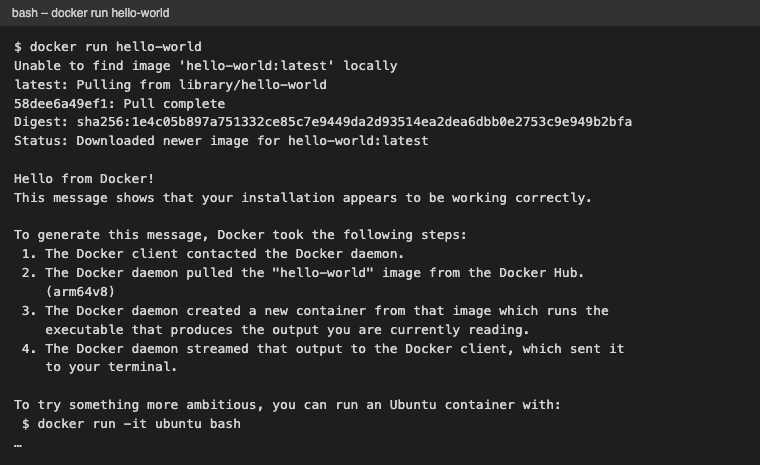
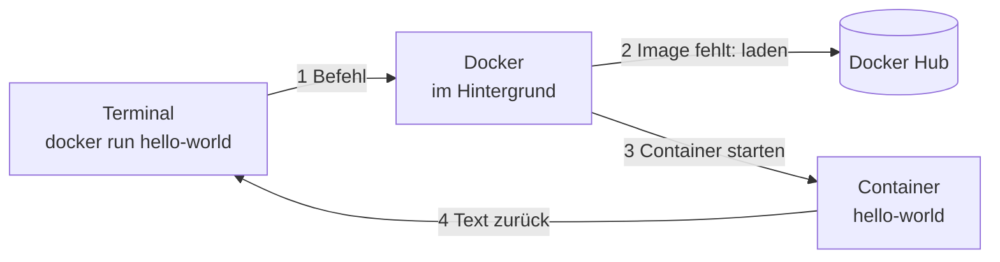

# Lab 1.1: Warum Container?

**Leitfragen:**

Warum läuft eine Anwendung auf dem Entwicklerrechner und auf dem Server manchmal unterschiedlich?

Weil die Umgebung abweicht: andere Python- oder Java-Version, fehlende Bibliothek, anderes Betriebssystem, andere Einstellungen. Der Code ist gleich, das Drumherum nicht.

Was müsste in einem Paket stecken, damit eine Anwendung überall gleich startet?

Der Code, die Laufzeit (z. B. Python), alle Bibliotheken, die nötigen Systemdateien und der Startbefehl. Genau das enthält ein Container-Image.

- Ein Container ist eine eigenständige, ausführbare Einheit: Anwendung plus alles, was sie zum Laufen braucht.
- Container teilen sich den Kern des Betriebssystems (Kernel) mit dem Rechner und sind deshalb leichter als virtuelle Maschinen.

## Begriffe

| Begriff | Bedeutung |
| --- | --- |
| Anwendung | ein Programm, z. B. ein Webserver, eine Datenbank oder eine Web-App |
| Abhängigkeit | etwas, das eine Anwendung zusätzlich braucht: Laufzeit (Python, Java, Node.js), Bibliotheken, Systemwerkzeuge, Konfiguration |
| Container | laufende, abgeschirmte Anwendung mit eigenem Dateisystem, eigenen Prozessen und eigener Netzwerkadresse; wie eine verschlossene Kiste, in der alles für ein Programm liegt |
| Image | unveränderliche Vorlage für Container: Dateien plus Startbefehl; wie eine Installations-DVD, aus der beliebig viele Container entstehen |
| Kernel | Kern des Betriebssystems, der Prozesse, Speicher und Hardware verwaltet |
| Host | der Rechner, auf dem Container laufen (Laptop, Server, Cloud-Maschine) |
| virtuelle Maschine (VM) | komplett nachgebildeter Rechner mit eigenem Betriebssystem (Vergleich in Lab 1.2) |
| Docker | das bekannteste Werkzeug, um Images zu bauen, zu verteilen und als Container zu starten |
| Docker Hub | öffentlicher Online-Speicher von Docker für fertige Images (Registry, Lab 1.3) |
| Produktion | die Umgebung, in der eine Anwendung für echte Nutzer läuft; davor liegen Entwicklung und Test |

## Docker auf einen Blick

_Quelle: Docker Inc., „What is a Container?" (https://www.docker.com/resources/what-container/), abgerufen am 23.11.2026._

Sechs Anwendungen laufen als Container nebeneinander auf einem Rechner. Docker sitzt zwischen Containern und Betriebssystem und startet, stoppt und trennt sie.

### Definition von Container und Docker

Ein Container ist ein Prozess, den das Betriebssystem vom Rest abschirmt: eigenes Dateisystem aus einem Image, eigene Netzwerkadresse, begrenzte Ressourcen. Docker ist die Software, die solche Images baut, verteilt und als Container startet.

### Schiffscontainer als Vergleich

Vor dem genormten Frachtcontainer wurde jede Ladung einzeln verstaut. Mit der Normkiste verladen Kran, Schiff und Lkw alles gleich, egal was darin steckt. Ein Software-Container ist diese Normkiste für Programme: Laptop, Testserver und Cloud starten ihn auf dieselbe Weise, egal ob Python, Java oder eine Datenbank darin steckt.

### Geschichte der Container-Technik

| Jahr | Schritt |
| --- | --- |
| 1979 | `chroot` in Version 7 Unix: Ein Prozess sieht nur einen Teil des Dateisystems ([Wikipedia: chroot](https://en.wikipedia.org/wiki/Chroot)) |
| 2000 | FreeBSD Jails (FreeBSD 4.0, 14.03.2000): abgeschottete Bereiche mit eigenem Dateisystem, eigenen Prozessen und eigener IP-Adresse ([Wikipedia: FreeBSD jail](https://en.wikipedia.org/wiki/FreeBSD_jail)) |
| 2008 | LXC (Linux Containers): Container mit Bordmitteln des Linux-Kernels, Namespaces und Cgroups ([Wikipedia: LXC](https://en.wikipedia.org/wiki/LXC)) |
| 2013 | Docker: im März 2013 von Solomon Hykes (Firma dotCloud, danach Docker Inc.) vorgestellt und als Open Source veröffentlicht; Images bauen, teilen und starten mit einem Befehl ([Wikipedia: Docker](https://en.wikipedia.org/wiki/Docker_%28software%29)) |
| 2015 | Open Container Initiative (OCI), gegründet am 22.06.2015 von Docker, CoreOS und weiteren Firmen: offener Standard für Image-Format, Laufzeit und Verteilung ([opencontainers.org](https://opencontainers.org/about/overview/)) |

Alle Quellen abgerufen am 23.11.2026. Die OCI-Standards sind der Grund, warum Images heute auch mit anderen Werkzeugen als Docker laufen (Lab 2.3).

### Verbreitung von Docker 2026

In der Stack Overflow Developer Survey 2026 geben 59,1 % aller Befragten (n = 10.889) an, im letzten Jahr intensiv mit Docker bzw. Docker Compose gearbeitet zu haben; Podman folgt mit 13,0 %. Docker ist damit das meistgenutzte Container-Werkzeug der Umfrage ([survey.stackoverflow.co/2026](https://survey.stackoverflow.co/2026/technology/data), Bereich „Cloud development", abgerufen am 23.11.2026).

### Bekannte Beispiele

_Quelle: Docker Inc., Docker-Dokumentation „Docker Build" (https://docs.docker.com/build/), abgerufen am 23.11.2026._

- **Docker Official Images** auf Docker Hub: `nginx`, `alpine`, `busybox`, `postgres`, `redis`, `python`; jedes wurde über eine Milliarde Mal heruntergeladen (Bild oben). Der Kurs nutzt `nginx`, `alpine`, `busybox` und `python`.
- **Dev Containers** in VS Code: die komplette Entwicklungsumgebung eines Projekts als Container ([containers.dev](https://containers.dev/), abgerufen am 23.11.2026).
- **CI-Pipelines** wie GitHub Actions: Build- und Testschritte laufen in Containern ([GitHub Docs: About service containers](https://docs.github.com/en/actions/use-cases-and-examples/using-containerized-services/about-service-containers), abgerufen am 23.11.2026).

### Einsatzfälle

| Einsatz | Beispiel |
| --- | --- |
| Entwicklung | Datenbank oder Webserver mit einem Befehl starten, ohne Installation auf dem Rechner |
| Test | jeder Testlauf startet in einer frischen, gleichen Umgebung |
| Auslieferung | dasselbe Image läuft in Entwicklung, Test und Produktion |
| Betrieb | viele kleine Dienste (Microservices) auf wenigen Servern, verwaltet von einem Orchestrator wie Docker Swarm (Modul 10) oder Kubernetes |

### Nutzen je Rolle

| Rolle | Nutzen | im Kurs |
| --- | --- | --- |
| Softwareentwicklung | gleiche Umgebung für das ganze Team; Datenbank oder Webserver ohne Installation | nginx mit einem Befehl (Lab 2.1) |
| DevOps | Bauanleitung als Datei; dasselbe Image von Test bis Produktion | Hello-App als Image `v1` und `v2` (Lab 3.2) |
| IT-Betrieb | mehr Anwendungen je Server, voneinander getrennt; Container in Sekunden ersetzen und vervielfachen | Swarm-Stack mit Rolling Update (Modul 10) |

## Herausforderungen traditioneller Anwendungen

Ohne Container wird eine Anwendung direkt auf jedem Rechner installiert. Das führt zu zwei typischen Problemen:

- **Unterschiedliche Umgebungen:** Auf dem Entwicklerrechner läuft Python 3.13, auf dem Server Python 3.9. Das Ergebnis ist das „Works on my machine"-Problem: Die Anwendung läuft nur auf dem Rechner, auf dem sie entstanden ist.
- **Komplexe Abhängigkeiten:** Zwei Anwendungen auf demselben Server brauchen verschiedene Versionen derselben Bibliothek. Eine Aktualisierung für die eine Anwendung bricht die andere.

### Lösungsansatz durch Container

- Ein Container enthält alles Notwendige: Code, Laufzeit, System-Tools und Bibliotheken. Er startet deshalb überall gleich, egal was auf dem Host installiert ist.
- Die Abschottung sorgt dafür, dass Anwendungen lokal und in der Produktion einheitlich laufen und sich gegenseitig nicht in die Quere kommen.

## Portabilität und Konsistenz

- Container brauchen auf dem Host nur eine Container-Laufzeit wie Docker, keine installierte Anwendung. Dasselbe Image läuft lokal, im eigenen Rechenzentrum (on-premises) und in der Cloud.
- Einschränkung: Linux-Container brauchen einen Linux-Kernel. Unter macOS und Windows startet Docker Desktop dafür im Hintergrund eine kleine Linux-VM (Lab 1.3).
- Die Portabilität sorgt für Konsistenz zwischen Entwicklung, Test und Produktion: Getestet wird genau das, was später läuft.

## Effizienz durch Ressourcennutzung

Container sind schlanker und brauchen weniger Arbeitsspeicher und CPU als virtuelle Maschinen, weil sie den Kernel des Hosts mitbenutzen, statt ein eigenes Betriebssystem zu starten. Auf einen Server passen dadurch mehr Anwendungen (Vergleich in Lab 1.2).

## Isolierung und Abstraktion

- **Isolierung:** Container trennen Prozesse, Dateisysteme und Netzwerk voneinander. Das senkt das Risiko von Konflikten (zwei Bibliotheksversionen) und begrenzt die Folgen eines Fehlers.
- **Abstraktion:** Die Anwendung sieht nur ihren Container. Ob darunter ein Laptop, ein Server oder eine Cloud-Maschine liegt, spielt für sie keine Rolle.

## Eigenschaften von Containern

| Eigenschaft | Bedeutung |
| --- | --- |
| Startzeit | Sekunden oder weniger, weil kein Betriebssystem hochfährt, sondern nur ein Prozess aus einem fertigen Image startet |
| Portabilität | ein Image wandert ohne Änderung von der lokalen Entwicklung bis in die Cloud |
| Skalierbarkeit | aus einem Image entstehen beliebig viele gleiche Container, die parallel Last abfangen |
| Isolierung | mehrere Container laufen auf demselben Host, ohne sich gegenseitig zu beeinträchtigen |
| Konsistenz | alle Beteiligten arbeiten mit derselben Umgebung, Unterschiede zwischen Entwicklung und Produktion fallen weg |
| Sicherheit | eingebaute Schutzmechanismen wie getrennte Dateisysteme und eingeschränkte Rechte; wegen des gemeinsamen Kernels schwächer getrennt als eine VM (vertieft in Modul 6) |

> **Merksatz:** Ein Image ist die Vorlage, ein Container die laufende Kopie davon. Aus einem Image entstehen beliebig viele Container.

## Der erste Container mit hello-world

Der Befehl `docker run hello-world` ist der klassische Test einer Docker-Installation. Er startet einen Container aus dem winzigen Image `hello-world` von Docker Hub; der Container gibt einen Begrüßungstext aus und endet sofort.

_Quelle: eigener Screenshot, Docker Desktop 4.99 mit Engine 29.9.3, 23.11.2026._

Die Ausgabe beschreibt selbst, was passiert ist:

Ohne Angabe einer Version (Tag) nimmt Docker die Version `latest`. Ab Lab 1.2 stehen Versionen immer dabei, z. B. `alpine:3.24`.

## Typische Fehler

| Symptom | Ursache | Lösung |
| --- | --- | --- |
| `Cannot connect to the Docker daemon` oder `failed to connect to the docker API` | Docker Desktop läuft nicht | Docker Desktop starten, warten, bis die Statusleiste `Engine running` zeigt |
| `docker: command not found` | Docker nicht installiert oder Terminal vor der Installation geöffnet | Terminal neu öffnen, sonst [Setup](../../00-setup-and-installation.md#kurs-shell-bash) prüfen |
| `toomanyrequests: You have reached your pull rate limit` | Download-Grenze von Docker Hub für die gemeinsame IP erreicht | `docker login` ([Setup](../../00-setup-and-installation.md#docker-hub-limit-und-docker-login)) |

## Fazit

- Container bündeln eine Anwendung mit ihren Abhängigkeiten und laufen dadurch auf jedem Rechner mit Container-Laufzeit gleich.
- Sie teilen sich den Kernel des Hosts: schneller Start, wenig Verbrauch, gute, aber nicht vollständige Trennung.
- Docker hat Container 2013 einfach nutzbar gemacht; die OCI-Standards von 2015 machen Images werkzeugunabhängig.

In der Übung startet der erste Container und bestätigt, dass Docker auf dem eigenen Rechner bereit ist.
