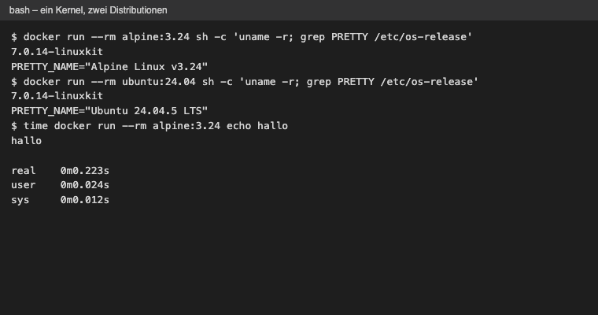

# Lab 1.2 – Lösung: Vergleich zur Virtualisierung



_Quelle: eigener Screenshot, Docker Desktop 4.99 auf macOS, 23.11.2026._

## Aufgabe 1: Kernel im Alpine-Container

```bash
docker run --rm alpine:3.24 uname -r
```

```text
Unable to find image 'alpine:3.24' locally
3.24: Pulling from library/alpine
…
Status: Downloaded newer image for alpine:3.24
7.0.14-linuxkit
```

Die Version ist die des Linux-Kernels in der VM von Docker Desktop (macOS: `…-linuxkit`, Windows: `…-microsoft-standard-WSL2`). Sie weicht je nach Rechner ab.

## Aufgabe 2: Kernel im Ubuntu-Container

```bash
docker run --rm ubuntu:24.04 uname -r
```

```text
7.0.14-linuxkit
```

Dieselbe Version wie bei Alpine: Beide Container haben keinen eigenen Kernel, sondern nutzen den gemeinsamen Kernel des Hosts. Eine VM würde ihren eigenen Kernel booten.

## Aufgabe 3: Distribution anzeigen

```bash
docker run --rm alpine:3.24 cat /etc/os-release
docker run --rm ubuntu:24.04 cat /etc/os-release
```

```text
NAME="Alpine Linux"
ID=alpine
VERSION_ID=3.24.…
PRETTY_NAME="Alpine Linux v3.24"
…
PRETTY_NAME="Ubuntu 24.04.5 LTS"
NAME="Ubuntu"
VERSION_ID="24.04"
…
```

Das Dateisystem kommt aus dem Image: Jedes Image bringt die Programme und Bibliotheken seiner Distribution mit. Nur der Kernel darunter ist gemeinsam.

## Aufgabe 4: Startzeit messen

```bash
time docker run --rm alpine:3.24 echo hallo
```

```text
hallo

real	0m0.223s
user	0m0.024s
sys	0m0.012s
```

`real` ist die gesamte Dauer: Container anlegen, Befehl ausführen, Container entfernen. Werte zwischen 0,2 und 1 Sekunde sind normal; unter Windows sind sie oft etwas höher. Liegt das Image noch nicht lokal vor, kommt die Downloadzeit hinzu, deshalb ist der zweite Lauf aussagekräftiger. Eine VM braucht für denselben Befehl erst einen Bootvorgang von Sekunden bis Minuten.
