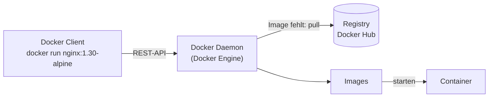
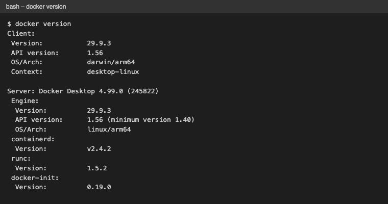
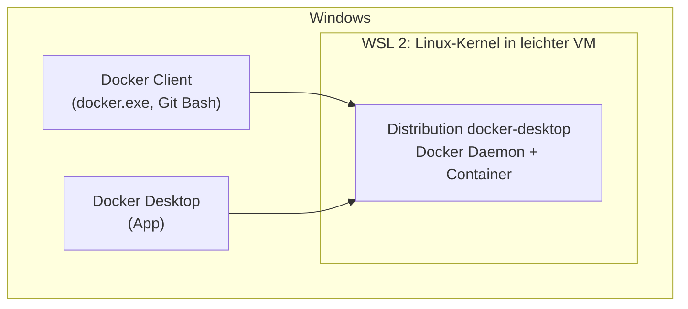

# Lab 1.3: Container-Ökosystem kennenlernen

**Leitfragen:**

Ein Befehl im Terminal soll ein Programm im Hintergrund starten: wer nimmt den Befehl entgegen?

Ein dauerhaft laufender Hintergrunddienst. Bei Docker heißt er Docker Daemon (`dockerd`); das Kommando `docker` im Terminal ist nur der Client, der ihm den Auftrag schickt.

Woher kommt ein Programm, das auf dem Rechner noch nie installiert wurde?

Aus einem zentralen Speicher im Netz, ähnlich einem App Store. Für Container heißt er Registry; die bekannteste ist Docker Hub.

- Docker besteht aus mehreren Teilen: Client, Daemon (Docker Engine), Images, Container und Registry.
- Unter Windows und macOS bringt Docker Desktop alle Teile mit, dazu eine kleine Linux-VM; unter Windows läuft sie auf WSL 2.

## Begriffe

| Begriff | Bedeutung |
| --- | --- |
| Docker Engine | die Software, die Container erstellt und ausführt; Kern ist der Docker Daemon |
| Docker Daemon (`dockerd`) | Hintergrunddienst auf dem Host, der Images lädt, Container startet und überwacht |
| Docker Client | das Kommando `docker` im Terminal; nimmt Befehle an und schickt sie an den Daemon |
| API | Schnittstelle, über die Programme miteinander reden; der Client spricht über die Docker-API mit dem Daemon |
| Registry | Server, der Images speichert und zum Herunterladen bereitstellt |
| Docker Hub | die offizielle, öffentliche Registry von Docker unter `hub.docker.com` |
| Docker Desktop | Desktop-App für Windows, macOS und Linux: Engine, Client, Compose, grafische Oberfläche und Linux-VM in einem Paket |
| WSL 2 | Windows-Subsystem für Linux, Version 2: ein echter Linux-Kernel, den Windows in einer leichten VM betreibt |
| Kubernetes | Open-Source-System, das Container auf vielen Servern (Cluster) verteilt und verwaltet |
| Cluster | Verbund mehrerer Server, die gemeinsam Container ausführen |

## Container-Ökosystem: Docker und Kubernetes

| Werkzeug | Was es ist | Vorteile |
| --- | --- | --- |
| Docker | marktführendes Werkzeug zum Erstellen, Verwalten und Ausführen von Containern (Verbreitung: [Lab 1.1](../l01-why-containers/l01-why-containers-thx.md#verbreitung-von-docker-2026)) | Portabilität, Isolation, einfache Verwaltung, Skalierbarkeit |
| Kubernetes | Open-Source-System für das Management von Container-Anwendungen in einem Cluster | automatische Bereitstellung, Skalierung und Verwaltung von Anwendungen über viele Server |

Docker startet Container auf einem Rechner; Kubernetes verteilt sie auf viele. Kubernetes nutzt seit Version 1.24 (Mai 2022) nicht mehr Docker selbst, sondern Laufzeiten wie containerd; mit Docker gebaute Images laufen dort trotzdem, weil beide dem OCI-Standard folgen ([Kubernetes-Blog, 07.01.2022](https://kubernetes.io/blog/2022/01/07/kubernetes-is-moving-on-from-dockershim/), abgerufen am 23.11.2026). Den Vergleich mit Docker Swarm zeigt Lab 10.2.

## Docker-Komponenten

| Komponente | Rolle |
| --- | --- |
| Docker Engine | Software, die Container erstellt und ausführt |
| Docker Images | unveränderliche, ausführbare Pakete mit Code, Laufzeit und Abhängigkeiten |
| Docker Container | laufende Instanz eines Images mit der Anwendung und ihren Abhängigkeiten |
| Docker Hub | Registry zum Speichern und Teilen von Images |

## Docker Client, Daemon und Registry

_Quelle: Wikimedia Commons, „Docker-architecture.png" (https://commons.wikimedia.org/wiki/File:Docker-architecture.png), nach der Docker-Dokumentation, CC BY-SA 4.0, abgerufen am 23.11.2026._

- **Docker Client:** nimmt Befehle wie `docker run` entgegen und sendet sie an den Docker Daemon, auf demselben oder auf einem entfernten Host.
- **Docker Daemon:** Hintergrundprozess auf dem Host, verantwortlich für das Erstellen, Ausführen und Überwachen von Containern. Er verwaltet Images, Container, Netzwerke und Datenspeicher (Volumes, Lab 4.3).
- **Docker Registry:** Speicherort für Images, um sie zentral zu verwalten und zu teilen. Eine Firma kann eine eigene betreiben (Lab 3.3).
- **Docker Hub:** die offizielle, öffentliche Registry von Docker mit einer großen Sammlung fertiger Images, z. B. `nginx`, `python`, `alpine`.

Ein Image-Name ohne Registry meint Docker Hub: `nginx:1.30-alpine` heißt vollständig `docker.io/library/nginx:1.30-alpine`.

`docker version` zeigt beide Seiten getrennt: **Client** ist das Kommando im Terminal, **Server** die Docker Engine.

_Quelle: eigener Screenshot, Docker Desktop 4.99 auf macOS, 23.11.2026._

Der Client läuft unter macOS (`darwin`) bzw. Windows, der Server unter `linux`: in der Linux-VM von Docker Desktop. `containerd` und `runc` sind Bausteine unter der Engine, die den Container tatsächlich starten (Lab 2.3).

## Docker Desktop

_Quelle: Docker Inc., „Docker Desktop" (https://www.docker.com/products/docker-desktop/), abgerufen am 23.11.2026._

| Ansicht | Zeigt | Gegenstück im Terminal |
| --- | --- | --- |
| **Containers** | alle Container mit Status, Ports, CPU; Start, Stopp, Löschen per Klick | `docker ps -a` (Lab 2.1) |
| **Images** | lokale Images mit Tag und Größe | `docker images` (Lab 2.1) |
| **Volumes** | Datenspeicher der Container | `docker volume ls` (Lab 4.3) |
| Statusleiste | `Engine running`, Speicher- und CPU-Verbrauch | `docker info` |

Docker Desktop gibt es für Windows, macOS und Linux; aktuell ist Version 4.100 (Stand: 23.11.2026, [Release Notes](https://docs.docker.com/desktop/release-notes/)). Unter Linux genügt auch die Docker Engine allein ohne Desktop-App.

## Installation unter Windows mit WSL 2

Docker Desktop für Windows enthält den Docker Client, den Docker Daemon und eine Linux-VM, in der die Container laufen. Diese VM läuft heute standardmäßig auf **WSL 2**; das frühere Hyper-V-Backend ist nur noch eine Option für Installationen für alle Benutzer.

_Quelle: Docker Inc., „Troubleshoot topics for Docker Desktop" (https://docs.docker.com/desktop/troubleshoot-and-support/troubleshoot/topics/), abgerufen am 23.11.2026._

Die Windows-Features **Virtual Machine Platform** und **Windows Subsystem for Linux** müssen eingeschaltet sein; `wsl --install` in einer PowerShell als Administrator erledigt das ([Setup](../../00-setup-and-installation.md)). In Docker Desktop steht die Einstellung unter **Settings > General > Use WSL 2 based engine**.

### Systemanforderungen unter Windows

| Anforderung | Wert (Stand: 23.11.2026) |
| --- | --- |
| Windows | Windows 10 64 Bit, Version 22H2 (Build 19045) oder Windows 11 64 Bit, Version 23H2 (Build 22631) und neuer |
| WSL | Version 2.1.5 oder neuer (`wsl --version`) |
| Prozessor | 64 Bit mit Second Level Address Translation (SLAT) |
| Arbeitsspeicher | 8 GB |
| Virtualisierung | im BIOS/UEFI eingeschaltet |

Quelle: [Install Docker Desktop on Windows](https://docs.docker.com/desktop/setup/install/windows-install/), abgerufen am 23.11.2026.

_Quelle: Docker Inc., „Troubleshoot topics for Docker Desktop" (https://docs.docker.com/desktop/troubleshoot-and-support/troubleshoot/topics/), abgerufen am 23.11.2026._

Ob die Virtualisierung eingeschaltet ist, zeigt der Task-Manager unter **Leistung > CPU** in der Zeile **Virtualisierung**. Steht dort „Deaktiviert", muss sie im BIOS/UEFI eingeschaltet werden; auf Firmenrechnern kann eine Richtlinie das verhindern.

Unter macOS läuft die Linux-VM über das Virtualisierungs-Framework von Apple, unter Linux laufen Container direkt auf dem Kernel des Rechners.

### Lizenz von Docker Desktop

| Nutzung | Docker Desktop |
| --- | --- |
| privat, Ausbildung, nicht-kommerzielle Open-Source-Projekte | kostenlos |
| Unternehmen mit weniger als 250 Beschäftigten **und** weniger als 10 Mio. USD Jahresumsatz | kostenlos |
| größere Unternehmen, Behörden | kostenpflichtiges Abo (Docker Pro, Team oder Business) |

Quelle: [Docker Desktop license agreement](https://docs.docker.com/subscription/desktop-license/), Stand: 23.11.2026, vor Kursbeginn prüfen. Die Docker Engine selbst (Linux, ohne Desktop-App) ist Open Source und frei nutzbar; Alternativen zu Docker Desktop zeigt Lab 2.3.

## Typische Fehler

| Symptom | Ursache | Lösung |
| --- | --- | --- |
| `docker version` zeigt nur den Client, danach `Cannot connect to the Docker daemon` | Daemon läuft nicht, Docker Desktop nicht gestartet | Docker Desktop starten, `Engine running` abwarten |
| „WSL 2 installation is incomplete" | WSL fehlt oder ist veraltet | PowerShell als Administrator: `wsl --install` bzw. `wsl --update`, neu starten |
| „Virtualization support not detected" | Virtualisierung im BIOS/UEFI aus | im BIOS/UEFI einschalten (Intel VT-x, AMD-V/SVM), Task-Manager prüfen |
| `docker info` gibt sehr viele Zeilen aus | normal | gezielt filtern, z. B. `docker info --format '{{.OperatingSystem}}'` |

## Fazit

- Der Client (`docker`) schickt Befehle an den Daemon; der Daemon holt Images aus der Registry und startet Container.
- Docker Hub ist die öffentliche Standard-Registry; Kubernetes verwaltet Container auf vielen Servern.
- Docker Desktop bündelt alles samt Linux-VM, unter Windows auf WSL 2; größere Unternehmen brauchen dafür eine Lizenz.

In der Übung zeigen `docker version` und `docker info` Client und Server auf dem eigenen Rechner, Docker Desktop dieselben Daten grafisch.
