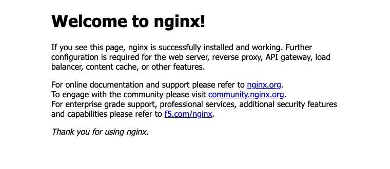
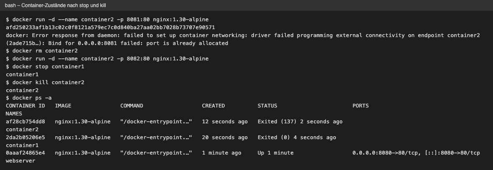

# Lab 2.1 – Lösung: Container über die CLI steuern

## Aufgabe 1: Image laden

```bash
docker pull nginx:1.30-alpine
docker images
```

```text
1.30-alpine: Pulling from library/nginx
…
Status: Downloaded newer image for nginx:1.30-alpine
docker.io/library/nginx:1.30-alpine
```

```text
IMAGE                ID             DISK USAGE   CONTENT SIZE   EXTRA
alpine:3.24          …
busybox:1.37         a7dbc319b143       6.14MB          1.9MB
hello-world:latest   1e4c05b897a7       22.6kB         10.3kB    U
nginx:1.30-alpine    …
ubuntu:24.04         …
```

Die Liste enthält auch die Images aus Modul 1; Größen und IDs weichen je nach Rechner ab.

## Aufgabe 2: Webserver starten

```bash
docker run -d --name webserver -p 8080:80 nginx:1.30-alpine
docker ps
```

```text
0aaaf24865e4d324705bb52b9537634b13caf5d289471ed0ee19cd49a7225a0a
```

```text
CONTAINER ID   IMAGE               COMMAND                  CREATED         STATUS         PORTS                                     NAMES
0aaaf24865e4   nginx:1.30-alpine   "/docker-entrypoint.…"   5 seconds ago   Up 4 seconds   0.0.0.0:8080->80/tcp, [::]:8080->80/tcp   webserver
```



_Quelle: eigener Screenshot, nginx:1.30-alpine unter http://localhost:8080, 23.11.2026._

`-d` gibt nur die lange Container-ID aus; der Webserver läuft im Hintergrund weiter. `[::]:8080` ist dieselbe Weiterleitung für IPv6.

## Aufgabe 3: Zwei weitere Container und ein Port-Konflikt

```bash
docker run -d --name container1 -p 8081:80 nginx:1.30-alpine
docker run -d --name container2 -p 8081:80 nginx:1.30-alpine
```

```text
2da2b05206e5…
afd250233af1…
docker: Error response from daemon: failed to set up container networking: driver failed programming external connectivity on endpoint container2 (…): Bind for 0.0.0.0:8081 failed: port is already allocated
```

Port 8081 des Rechners gehört schon `container1`. Docker hat `container2` trotzdem angelegt (Status `Created`), deshalb ist der Name belegt und der Container muss vor dem neuen Versuch weg:

```bash
docker rm container2
docker run -d --name container2 -p 8082:80 nginx:1.30-alpine
docker ps
```

```text
CONTAINER ID   IMAGE               COMMAND                  CREATED          STATUS          PORTS                                     NAMES
af28cb754dd8   nginx:1.30-alpine   "/docker-entrypoint.…"   1 second ago     Up 1 second     0.0.0.0:8082->80/tcp, [::]:8082->80/tcp   container2
2da2b05206e5   nginx:1.30-alpine   "/docker-entrypoint.…"   5 seconds ago    Up 4 seconds    0.0.0.0:8081->80/tcp, [::]:8081->80/tcp   container1
0aaaf24865e4   nginx:1.30-alpine   "/docker-entrypoint.…"   1 minute ago     Up 1 minute     0.0.0.0:8080->80/tcp, [::]:8080->80/tcp   webserver
```

Alle drei nutzen im Container Port 80; nur die Ports des Rechners müssen verschieden sein.

## Aufgabe 4: stop und kill

```bash
docker stop container1
docker kill container2
docker ps
docker ps -a
```

```text
container1
container2
```

```text
CONTAINER ID   IMAGE               COMMAND                  CREATED        STATUS        PORTS                                     NAMES
0aaaf24865e4   nginx:1.30-alpine   "/docker-entrypoint.…"   1 minute ago   Up 1 minute   0.0.0.0:8080->80/tcp, [::]:8080->80/tcp   webserver
```



_Quelle: eigener Screenshot, Docker Engine 29.9.3, 23.11.2026._

- `container1` endet mit `Exited (0)`: `docker stop` schickt `SIGTERM`, nginx fährt sauber herunter.
- `container2` endet mit `Exited (137)`: `docker kill` bricht mit `SIGKILL` sofort ab (128 + 9).
- Beendete Container fehlen in `docker ps`, aber `docker ps -a` zeigt sie samt Exit-Code; Ports sind bei beendeten Containern frei.

## Aufgabe 5: Aufräumen

```bash
docker rm container1 container2
docker ps -a
```

```text
container1
container2
```

```text
CONTAINER ID   IMAGE               COMMAND                  CREATED        STATUS        PORTS                                     NAMES
0aaaf24865e4   nginx:1.30-alpine   "/docker-entrypoint.…"   2 minutes ago  Up 2 minutes  0.0.0.0:8080->80/tcp, [::]:8080->80/tcp   webserver
…
```

Weitere beendete Container aus Modul 1 (`hello-world`) dürfen in der Liste stehen. `docker rm` braucht hier kein `-f`, weil beide Container bereits beendet sind. `webserver` bleibt für Lab 2.2 stehen.
