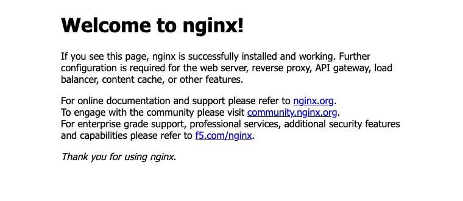
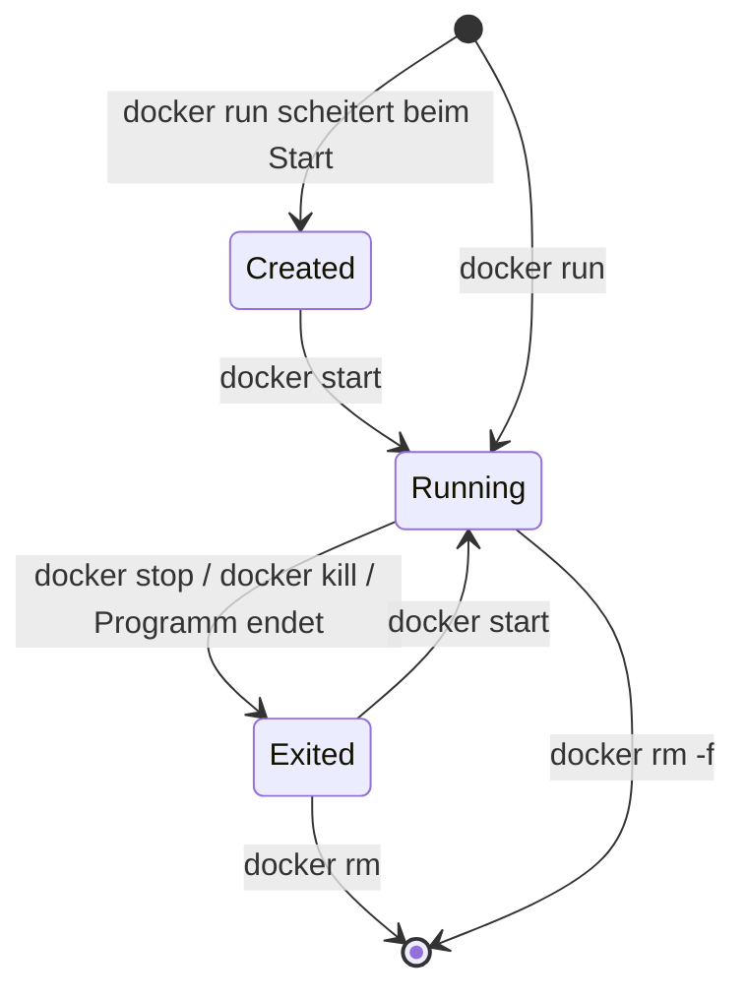
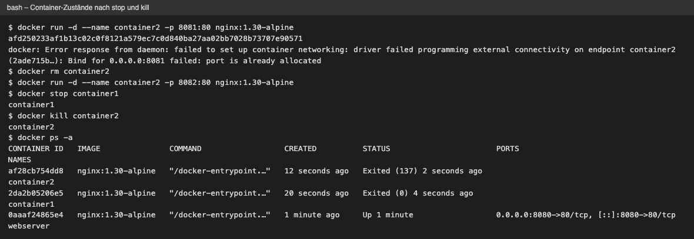

# Lab 2.1: Container über die CLI steuern

**Leitfragen:**

<details>
<summary>Wie lässt sich ein Programm steuern, das im Hintergrund läuft?</summary>

Über Befehle an den Dienst, der es verwaltet: starten, anzeigen, anhalten, löschen. Bei Docker schickt die CLI diese Befehle an den Docker Daemon (`docker ps`, `docker stop`, `docker rm`).

</details>

<details>
<summary>Zwei Webserver wollen auf demselben Rechner Port 80: was passiert?</summary>

Der zweite bekommt einen Fehler, denn ein Port des Rechners kann nur einem Programm gehören. Container lösen das, indem jeder intern Port 80 nutzt und nach außen auf einen anderen Port weitergeleitet wird (`-p 8081:80`, `-p 8082:80`).

</details>

- Die Docker-CLI ist das wichtigste Werkzeug, um Container zu steuern; alles, was Docker Desktop per Klick kann, geht auch im Terminal.
- Ein Container durchläuft einen Lebenszyklus: erstellt, läuft, beendet, gelöscht.

## Begriffe

| Begriff | Bedeutung |
| --- | --- |
| CLI | Command Line Interface: ein Programm, das im Terminal mit Text-Befehlen bedient wird, hier `docker` |
| Pull | ein Image aus der Registry auf den eigenen Rechner herunterladen |
| Containername | eindeutiger Name eines Containers; ohne `--name` vergibt Docker einen Zufallsnamen wie `brave_swirles` |
| Container-ID | eindeutige Kennung eines Containers (64 Zeichen, meist gekürzt auf 12) |
| Port | Nummer, unter der ein Programm im Netzwerk erreichbar ist; Webserver nutzen Port 80 |
| Port-Weiterleitung | ein Port des Rechners wird an einen Port im Container durchgereicht, z. B. `-p 8080:80` |
| detached | Container läuft im Hintergrund, das Terminal bleibt frei (`-d`) |
| Hauptprozess | das Programm, das der Container beim Start ausführt; endet es, endet der Container |
| Signal | Nachricht des Betriebssystems an ein Programm: `SIGTERM` = „bitte beenden", `SIGKILL` = sofort abbrechen |
| Exit-Code | Zahl, mit der ein Programm endet: `0` = normal, `137` = von `SIGKILL` abgebrochen |
| nginx | verbreiteter Webserver; das Image `nginx` liefert eine Willkommensseite auf Port 80 |

## Die Docker-CLI

- Die CLI ermöglicht direkte Interaktion mit der Docker Engine: Images, Container, Netzwerke und Volumes verwalten.
- Sie kommuniziert mit dem Docker Daemon, der die Container startet und verwaltet (Bild in [Lab 1.3](../../m01-container-intro/l03-ecosystem/l03-ecosystem-thx.md#docker-client-daemon-und-registry)).
- Jeder Befehl hat die Form `docker <befehl> [optionen] [argumente]`; `docker --help` und `docker <befehl> --help` listen alle Optionen.

Der Installationstest `docker run hello-world` aus Lab 1.1 war bereits der erste CLI-Befehl.

## Erster Container mit Busybox

`busybox` ist ein sehr kleines Image (wenige MB) mit den wichtigsten Linux-Befehlen.

```bash
docker pull busybox:1.37
```

```text
1.37: Pulling from library/busybox
…
Status: Downloaded newer image for busybox:1.37
docker.io/library/busybox:1.37
```

Der Befehl `pull` holt das Image aus der Registry (Docker Hub) und speichert es lokal. `docker run` erledigt das bei Bedarf automatisch.

```bash
docker run busybox:1.37 echo "hello from busybox"
```

```text
hello from busybox
```

`docker run` erstellt aus dem Image einen Container und führt darin den Befehl `echo` aus. Danach ist der Hauptprozess fertig und der Container beendet sich.

## Container und Images auflisten

```bash
docker ps        # nur laufende Container
docker ps -a     # alle Container, auch beendete
docker images    # lokal gespeicherte Images
```

```text
CONTAINER ID   IMAGE          COMMAND                  CREATED         STATUS                     PORTS     NAMES
85e30a9f2d56   busybox:1.37   "echo 'hello from bu…"   5 seconds ago   Exited (0) 4 seconds ago             brave_swirles
```

```text
IMAGE                ID             DISK USAGE   CONTENT SIZE   EXTRA
busybox:1.37         a7dbc319b143       6.14MB          1.9MB    U
hello-world:latest   1e4c05b897a7       22.6kB         10.3kB
```

| Spalte (`docker ps`) | Bedeutung |
| --- | --- |
| `CONTAINER ID` | gekürzte ID; reicht statt des Namens in allen Befehlen |
| `IMAGE` | Image, aus dem der Container entstand |
| `COMMAND` | Hauptprozess |
| `STATUS` | `Up …` = läuft, `Exited (0)` = beendet mit Exit-Code 0, `Created` = angelegt, nie gestartet |
| `PORTS` | Port-Weiterleitungen, z. B. `0.0.0.0:8080->80/tcp` |
| `NAMES` | Containername |

`docker ps` ohne `-a` zeigt den Busybox-Container nicht mehr, weil er schon beendet ist. In `docker images` markiert `U` (in use) Images, aus denen Container existieren.

## Container im Hintergrund starten

```bash
docker run -d --name webserver -p 8080:80 nginx:1.30-alpine
#          │  │                │           └─ Image:Tag
#          │  │                └─ Port 8080 des Rechners -> Port 80 im Container
#          │  └─ Name des Containers
#          └─ detached: im Hintergrund, das Terminal bleibt frei
```

| Option | Wirkung |
| --- | --- |
| `-d` | startet den Container im Hintergrund (detached mode) und gibt nur die Container-ID aus |
| `--name` | gibt dem Container einen Namen, mit dem alle weiteren Befehle arbeiten |
| `-p <Rechner>:<Container>` | leitet einen Port vom Host in den Container weiter |



_Quelle: eigener Screenshot, nginx:1.30-alpine unter http://localhost:8080, 23.11.2026._

nginx lauscht im Container auf Port 80. Erst `-p 8080:80` macht ihn unter `http://localhost:8080` erreichbar. Ein zweiter Container kann denselben Container-Port 80 nutzen, braucht aber einen anderen Port auf dem Rechner (z. B. `-p 8081:80`).

## Starten und Stoppen von Containern



| Befehl | Wirkung |
| --- | --- |
| `docker stop webserver` | stoppt den Container ordnungsgemäß: `SIGTERM`, das Programm schließt Dateien und Verbindungen; nach 10 Sekunden ohne Reaktion folgt `SIGKILL` |
| `docker kill webserver` | erzwingt das sofortige Stoppen mit `SIGKILL`; nur, wenn der Container auf `docker stop` nicht reagiert |
| `docker start webserver` | startet einen beendeten Container erneut, mit allen Änderungen darin |
| `docker restart webserver` | stoppt und startet in einem Schritt |

Nach `stop` zeigt `docker ps -a` meist `Exited (0)`, nach `kill` `Exited (137)` (128 + Signal 9 = `SIGKILL`).

## Löschen eines Containers

| Befehl | Wirkung |
| --- | --- |
| `docker rm webserver` | löscht einen gestoppten Container dauerhaft |
| `docker rm -f webserver` | erzwingt das Löschen eines laufenden Containers (stoppt und löscht) |
| `docker run --rm …` | löscht den Container automatisch, sobald er endet (aus Lab 1.2) |

Gelöscht wird nur der Container, das Image bleibt erhalten. Ein neuer `docker run` startet wieder beim unveränderten Image.



_Quelle: eigener Screenshot, Docker Engine 29.9.3, 23.11.2026._

## Typische Fehler

| Symptom | Ursache | Lösung |
| --- | --- | --- |
| `Bind for 0.0.0.0:8080 failed: port is already allocated` | ein anderer Container oder Dienst nutzt den Port | anderen Port wählen (`-p 8081:80`); der fehlgeschlagene Container bleibt als `Created` liegen und muss mit `docker rm` weg |
| `Conflict. The container name "/webserver" is already in use` | Container mit diesem Namen existiert noch (auch beendet) | `docker rm -f webserver` oder anderen Namen wählen |
| `docker ps` zeigt einen Container nicht | Container ist beendet | `docker ps -a` |
| Browser zeigt unter `localhost:8080` nichts | `-p` vergessen oder falscher Port | Spalte `PORTS` in `docker ps` prüfen |
| `toomanyrequests` beim Pull | Docker-Hub-Limit der gemeinsamen IP | `docker login` ([Setup](../../00-setup-and-installation.md#docker-hub-limit-und-docker-login)) |

## Fazit

- `pull` lädt Images, `run` erstellt und startet Container; `-d`, `--name` und `-p` sind die wichtigsten Optionen.
- `ps` zeigt laufende, `ps -a` alle Container, `images` die lokalen Images.
- `stop` beendet sauber, `kill` sofort; `rm` löscht den Container, nicht das Image.

In der Übung läuft ein nginx-Webserver im Browser, und zwei weitere Container zeigen Port-Konflikt, `stop` und `kill`.
