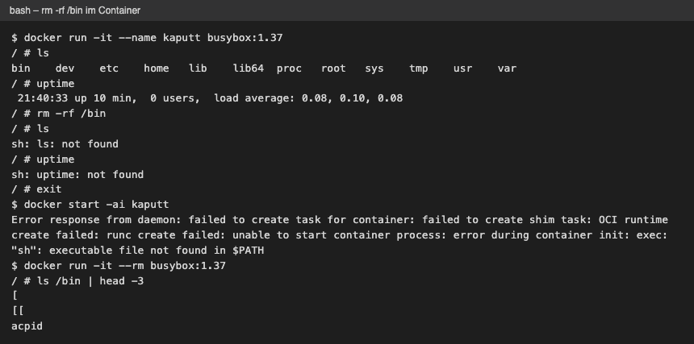
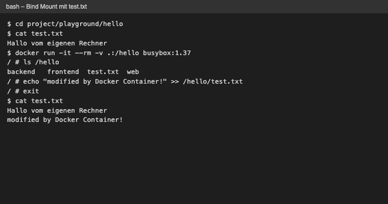
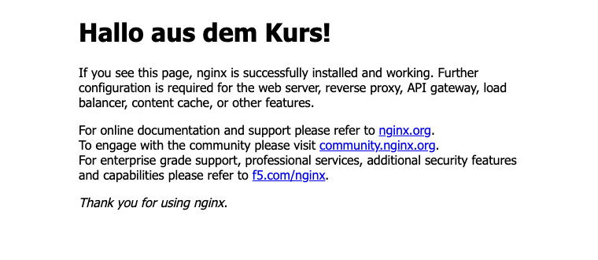

# Lab 2.2 – Lösung: Verwaltung und Inspektion von Containern

## Aufgabe 1: Container beschädigen

```bash
docker run -it --name kaputt busybox:1.37
```

```text
/ # ls
bin    dev    etc    home   lib    lib64  proc   root   sys    tmp    usr    var
/ # cat /etc/hostname
5c1e0d9b7a42
/ # uptime
 21:40:33 up 10 min,  0 users,  load average: 0.08, 0.10, 0.08
/ # rm -rf /bin
/ # ls
sh: ls: not found
/ # cat /etc/hostname
sh: cat: not found
/ # uptime
sh: uptime: not found
/ # exit
```

- `/etc/hostname` enthält die gekürzte Container-ID: Jeder Container hat seinen eigenen Rechnernamen.
- `uptime` zeigt die Laufzeit des gemeinsamen Kernels (Linux-VM von Docker Desktop), nicht die des Containers (Lab 1.2).
- In Busybox liegen alle Befehle unter `/bin`. Die laufende Shell ist schon im Speicher und reagiert noch, findet aber keine Programme mehr.

## Aufgabe 2: Neustart und neuer Container

```bash
docker start -ai kaputt
```

```text
Error response from daemon: failed to create task for container: failed to create shim task: OCI runtime create failed: runc create failed: unable to start container process: error during container init: exec: "sh": executable file not found in $PATH
```

```bash
docker run -it --rm busybox:1.37
```

```text
/ # ls
bin    dev    etc    home   lib    lib64  proc   root   sys    tmp    usr    var
/ # exit
```



_Quelle: eigener Screenshot, busybox:1.37, 23.11.2026._

`rm -rf /bin` hat nur die beschreibbare Schicht des Containers `kaputt` verändert. Beim Neustart fehlt ihm sein Hauptprozess `sh`, deshalb startet er nicht mehr. Das Image `busybox:1.37` ist unverändert, und jeder neue Container daraus ist wieder vollständig. Container sind Wegwerfware: kaputt → löschen → neu starten.

## Aufgabe 3: Bind Mount mit test.txt

```bash
cd project/playground/hello
cat test.txt
docker run -it --rm -v .:/hello busybox:1.37
```

```text
Hallo vom eigenen Rechner
/ # ls /hello
backend   frontend  test.txt  web
/ # echo "modified by Docker Container!" >> /hello/test.txt
/ # exit
```

```bash
cat test.txt
```

```text
Hallo vom eigenen Rechner
modified by Docker Container!
```



_Quelle: eigener Screenshot, Hello-App-Ordner `project/playground/hello`, 23.11.2026._

Der Container hat direkt in die Datei auf dem Rechner geschrieben. Obwohl `--rm` den Container gelöscht hat, bleibt die Änderung, weil die Datei nie im Container lag. `ls /hello` zeigt die Ordner der Hello-App, die ab Lab 3.2 zu Images werden.

## Aufgabe 4: exec, cp und logs

```bash
docker exec webserver ls /usr/share/nginx/html
docker cp webserver:/usr/share/nginx/html/index.html .
```

```text
50x.html
index.html
```

`docker cp` legt `index.html` im aktuellen Ordner ab; in einem echten Terminal meldet es zusätzlich `Successfully copied …`.

In `index.html` steht die Überschrift zweimal: im `<title>` und im `<h1>`. Beide Stellen in „Hallo aus dem Kurs!" ändern, speichern, dann:

```bash
docker cp index.html webserver:/usr/share/nginx/html/index.html
docker logs --tail 3 webserver
```

```text
192.168.65.1 - - [23/Nov/2026:21:40:46 +0000] "GET / HTTP/1.1" 200 900 "-" "Mozilla/5.0 …" "-"
…
```



_Quelle: eigener Screenshot, nginx:1.30-alpine mit geänderter `index.html`, 23.11.2026._

nginx liefert die neue Datei sofort aus; ein `docker restart` ist für Inhalte nicht nötig, nur für Konfigurationsdateien. Die geänderte `index.html` liegt in der Container-Schicht von `webserver` und verschwindet mit `docker rm`. Die IP-Adresse am Zeilenanfang ist die der Docker-Desktop-VM und kann abweichen.

## Aufgabe 5: Aufräumen

```bash
docker rm -f webserver kaputt
rm index.html
docker ps -a
```

```text
webserver
kaputt
CONTAINER ID   IMAGE         COMMAND    CREATED          STATUS                      PORTS     NAMES
…
```

`webserver` und `kaputt` fehlen in der Liste; beendete `hello-world`-Container aus Modul 1 dürfen noch da sein. `test.txt` behält die angehängte Zeile.
