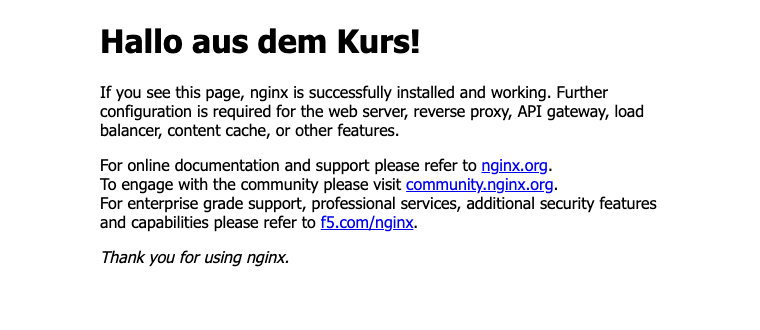
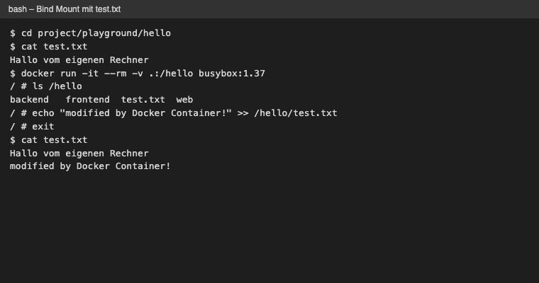

# Lab 2.2: Verwaltung und Inspektion von Containern

**Leitfragen:**

<details>
<summary>Wie schaut man in ein laufendes Programm hinein, ohne es anzuhalten?</summary>

Über seine Ausgaben (Logs) und indem man einen zusätzlichen Befehl daneben startet. Bei Docker: `docker logs` liest die Ausgaben, `docker exec` führt einen Befehl im laufenden Container aus.

</details>

<details>
<summary>Wie kommt eine Datei vom Laptop in ein Programm, das abgeschottet läuft?</summary>

Entweder einmalig hineinkopieren (`docker cp`) oder einen Ordner des Laptops im Container sichtbar machen (Bind Mount mit `-v`). Beim Bind Mount sehen beide Seiten dieselbe Datei.

</details>

- `exec`, `logs`, `history` und `cp` machen einen Container von außen beobachtbar und veränderbar.
- Änderungen im Container landen in seiner beschreibbaren Schicht; das Image bleibt unverändert. Ein Bind Mount legt Dateien außerhalb des Containers ab.

## Begriffe

| Begriff | Bedeutung |
| --- | --- |
| Shell | Kommandozeile, z. B. `sh` in Busybox- und Alpine-Images; nimmt Befehle wie `ls` entgegen |
| interaktiv (`-it`) | Tastatur und Terminal sind mit dem Container verbunden; `-i` hält die Eingabe offen, `-t` gibt ein Terminal |
| Log | alles, was der Hauptprozess auf die Standardausgabe schreibt; Docker speichert es je Container |
| History | Liste der Bauschritte (Schichten) eines Images |
| Konfigurationsdatei | Textdatei mit Einstellungen eines Programms, z. B. `/etc/nginx/conf.d/default.conf` bei nginx |
| Bind Mount | ein Ordner des Rechners wird an einem Pfad im Container eingebunden; beide Seiten sehen dieselben Dateien |
| Mount-Pfad | Ordner im Container, an dem der eingebundene Ordner erscheint, z. B. `/hello` |

## Befehle in Containern ausführen

Der Befehl `docker exec` führt einen Befehl in einem laufenden Container aus. Der Hauptprozess (bei `webserver`: nginx) läuft dabei ungestört weiter.

```bash
docker exec webserver ls /usr/share/nginx/html     # ein Befehl, Ausgabe kommt zurück
```

```text
50x.html
index.html
```

```bash
docker exec -it webserver sh                       # Shell im Container; exit beendet nur die Shell
```

| Befehl | Wirkung |
| --- | --- |
| `docker exec <name> <befehl>` | Befehl im laufenden Container ausführen |
| `docker exec -it <name> sh` | interaktive Shell im laufenden Container |
| `docker run -it --name <name> busybox:1.37` | neuer Container, dessen Hauptprozess eine Shell ist; `exit` beendet den Container |
| `docker start -ai <name>` | beendeten Container wieder starten und sich mit seiner Shell verbinden (`-a` = Ausgabe anzeigen, `-i` = Eingabe) |

Git Bash unter Windows: `-it` im Terminal von VS Code nutzen oder `winpty` voranstellen ([Setup](../../00-setup-and-installation.md#kurs-shell-bash)).

## Container-Logs und Image-History

```bash
docker logs webserver              # bisherige Ausgaben (bei nginx: jede Anfrage)
docker logs --tail 2 webserver     # nur die letzten 2 Zeilen
docker logs -f webserver           # live mitlesen, Strg+C beendet nur das Mitlesen
```

```text
192.168.65.1 - - [23/Nov/2026:21:40:06 +0000] "GET / HTTP/1.1" 200 896 "-" "Mozilla/5.0 …" "-"
2026/11/23 21:40:18 [error] 32#32: *3 open() "/usr/share/nginx/html/nix" failed (2: No such file or directory) …
192.168.65.1 - - [23/Nov/2026:21:40:18 +0000] "GET /nix HTTP/1.1" 404 153 "-" "Mozilla/5.0 …" "-"
```

Die erste Zeile ist ein erfolgreicher Aufruf (`200`), die letzten beiden ein Aufruf einer fehlenden Seite (`404`). Logs sind die erste Anlaufstelle, wenn ein Container nicht tut, was er soll (vertieft in Lab 7.1).

Der Befehl `docker history` zeigt die Schritte, mit denen ein Image gebaut wurde, eine Zeile je Schicht (Schichten aus Lab 1.2):

```bash
docker history hello-world
```

```text
IMAGE          CREATED        CREATED BY                SIZE      COMMENT
1e4c05b897a7   8 months ago   CMD ["/hello"]            0B        buildkit.dockerfile.v0
<missing>      8 months ago   COPY hello / # buildkit   12.3kB    buildkit.dockerfile.v0
```

`hello-world` besteht aus nur einer Datei `/hello` (12,3 kB) und dem Startbefehl. `<missing>` bedeutet nur, dass diese Zwischenschicht keine eigene ID hat.

## Dateien zwischen Host und Container kopieren

`docker cp` kopiert Dateien zwischen Hostsystem und Container, in beide Richtungen, auch bei gestoppten Containern:

```bash
# Datei vom Host zum Container kopieren
docker cp /pfad/zur/datei.txt mein_container:/zielverzeichnis/
# Datei vom Container zum Host kopieren
docker cp mein_container:/pfad/zur/datei.txt /zielverzeichnis/
```

### Konfigurationsdatei aktualisieren und neu starten

Eine Anwendung im Container soll eine geänderte Konfiguration bekommen. Ablauf am Beispiel nginx:

```bash
docker cp webserver:/etc/nginx/conf.d/default.conf .              # 1. Datei herauskopieren
# 2. default.conf im Editor ändern
docker cp default.conf webserver:/etc/nginx/conf.d/default.conf   # 3. zurückkopieren
docker restart webserver                                          # 4. nginx liest die Konfiguration beim Start
```

Für Webseiten wie `index.html` ist kein Neustart nötig; nginx liefert bei jedem Aufruf die aktuelle Datei aus.



_Quelle: eigener Screenshot, nginx:1.30-alpine mit per `docker cp` geänderter `index.html`, 23.11.2026._

## Änderungen im Container und im Image


_Quelle: Docker Inc., „Storage drivers" (https://docs.docker.com/engine/storage/drivers/), abgerufen am 23.11.2026._

- Alles, was im Container geändert wird (Datei per `cp`, gelöschte Ordner), landet in der beschreibbaren Container-Schicht.
- `docker stop` und `docker start` behalten diese Schicht; `docker rm` löscht sie mit dem Container.
- Das Image bleibt unverändert: Ein neuer Container aus demselben Image beginnt wieder beim Originalzustand.
- Folge: Wer in einem Container Systemdateien löscht (z. B. `rm -rf /bin`), macht genau diesen Container unbrauchbar, nicht das Image.

## Verzeichnis vom Host einbinden

Ein Bind Mount macht einen Ordner des Rechners im Container sichtbar. Änderungen auf einer Seite sind sofort auf der anderen zu sehen und überstehen das Löschen des Containers.

```bash
docker run -d --name my_app -v /host/path:/container/path nginx:1.30-alpine
#                           │  │          └─ Mount-Pfad im Container
#                           │  └─ Ordner auf dem Rechner (absolut oder relativ wie .)
#                           └─ volume: Ordner einbinden
```

```bash
cd project/playground/hello
docker run -it --rm -v .:/hello busybox:1.37   # aktueller Ordner erscheint im Container als /hello
```



_Quelle: eigener Screenshot, Hello-App-Ordner `project/playground/hello`, 23.11.2026._

- `.` steht für den aktuellen Ordner; Docker wandelt ihn in den vollständigen Pfad um. Ebenso möglich: `-v "$(pwd)":/hello`.
- Liegt am Mount-Pfad im Image schon etwas, überdeckt der eingebundene Ordner es.
- Typisch für Quellcode in der Entwicklung und für Konfigurationsdateien. Von Docker verwaltete Volumes für Daten folgen in Lab 4.3.

## Typische Fehler

| Symptom | Ursache | Lösung |
| --- | --- | --- |
| `the input device is not a TTY` | Git-Bash-Fenster ohne echtes Terminal | `winpty docker run -it …` oder Terminal in VS Code |
| `ls: C:/Program Files/Git/usr/share/nginx/html: No such file or directory` | Git Bash wandelt Linux-Pfade um | `export MSYS_NO_PATHCONV=1` ([Setup](../../00-setup-and-installation.md#kurs-shell-bash)) |
| `exec: "bash": executable file not found` | Alpine- und Busybox-Images haben keine bash | `sh` statt `bash` |
| `sh: ls: not found` | `/bin` im Container gelöscht | Container verlassen, mit `docker rm` löschen, neuen aus dem Image starten |
| `/hello` im Container ist leer | Befehl nicht im Ordner `project/playground/hello` gestartet | `pwd` prüfen, in den Ordner wechseln |
| Linux: Datei aus dem Container gehört `root` | Container schreibt als root in den Bind Mount | mit `sudo` bearbeiten; Benutzer im Container ab Lab 6.3 |

## Fazit

- `exec` führt Befehle im laufenden Container aus, `logs` zeigt seine Ausgaben, `history` die Schichten eines Images.
- `cp` kopiert Dateien hinein und heraus; Konfiguration wird erst nach `restart` wirksam.
- Änderungen im Container sind an diesen Container gebunden; ein Bind Mount (`-v`) legt Dateien direkt auf dem Rechner ab.

In der Übung wird ein Container absichtlich beschädigt, eine Datei des Rechners im Container geändert und eine Webseite per `docker cp` ausgetauscht.
