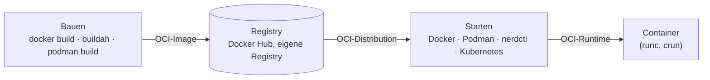

# Lab 2.3: Einführung in Docker-Alternativen

**Leitfragen:**

<details>
<summary>Was müsste gleich bleiben, damit ein Image mit einem anderen Werkzeug startet?</summary>

Das Format des Images, die Art, wie ein Container gestartet wird, und der Weg, Images aus einer Registry zu laden. Genau diese drei Punkte legt der offene OCI-Standard fest.

</details>

<details>
<summary>Aus welchen Gründen könnte eine Firma ein anderes Werkzeug als Docker wählen?</summary>

Lizenzkosten von Docker Desktop in größeren Firmen, Sicherheitsvorgaben (kein dauerhaft laufender Dienst mit root-Rechten), die Plattform (z. B. Red-Hat-Server) oder Leistung auf dem Mac.

</details>

- Docker ist nicht das einzige Container-Werkzeug: Dank OCI-Standard laufen dieselben Images auch mit Podman, containerd und in Kubernetes.
- Die Alternativen teilen sich in Kommandozeilen-Werkzeuge (Podman, nerdctl, Buildah) und Desktop-Apps (Rancher Desktop, Podman Desktop, OrbStack, Colima).

## Begriffe

| Begriff | Bedeutung |
| --- | --- |
| OCI | Open Container Initiative: Gremium der Linux Foundation, das offene Standards für Container festlegt (Geschichte in Lab 1.1) |
| Container-Laufzeit (Runtime) | Software, die einen Container tatsächlich startet; unter Docker sind das `containerd` und `runc` (aus Lab 1.3 `docker version`) |
| Daemon | dauerhaft laufender Hintergrunddienst; bei Docker `dockerd` |
| daemonless | ohne Hintergrunddienst: jeder Befehl startet seine Container selbst |
| rootless | Container laufen mit den Rechten eines normalen Benutzers statt als root (Administrator unter Linux) |
| Pod | Gruppe von Containern, die sich Netzwerk und Speicher teilen; Begriff aus Kubernetes, auch in Podman |
| CNCF | Cloud Native Computing Foundation: Stiftung, unter deren Dach Kubernetes und containerd entwickelt werden |

## OCI-Standard für Images und Laufzeit

Die Open Container Initiative pflegt drei Spezifikationen. Jedes Werkzeug, das sie einhält, kann Images der anderen nutzen.

| Spezifikation | Legt fest | aktuelle Version (Datum) |
| --- | --- | --- |
| Image Spec | Aufbau eines Images: Schichten, Konfiguration, Manifest | v1.1.1 (03.03.2025) |
| Runtime Spec | wie eine Laufzeit einen Container aus einem entpackten Image startet | v1.3.0 (04.11.2025) |
| Distribution Spec | wie Images über eine Registry hoch- und heruntergeladen werden | v1.1.1 (29.01.2025) |

Quellen: [opencontainers.org](https://opencontainers.org/about/overview/), GitHub-Releases von [image-spec](https://github.com/opencontainers/image-spec/releases), [runtime-spec](https://github.com/opencontainers/runtime-spec/releases), [distribution-spec](https://github.com/opencontainers/distribution-spec/releases), abgerufen am 23.11.2026.



## Kommandozeilen-Alternativen: Podman, containerd mit nerdctl, Buildah

| Werkzeug | Was es ist | Besonderheit | Stand |
| --- | --- | --- | --- |
| **Podman** | Container-Engine, ursprünglich von Red Hat, Open Source (Apache-2.0) | ohne Daemon, rootless möglich, kennt Pods; Befehle wie Docker, „die meisten Nutzer können einfach `alias docker=podman` setzen" | v6.2.0 (10.11.2026) |
| **containerd** | Container-Laufzeit der CNCF; arbeitet unter der Docker Engine und auf den meisten Kubernetes-Servern | ohne eigene Benutzeroberfläche für Menschen gedacht | v2.4.2 (13.10.2026) |
| **nerdctl** | Docker-kompatible Kommandozeile für containerd (Teil des containerd-Projekts) | `nerdctl run`, `nerdctl compose` ohne Docker Engine | v2.4.2 (30.10.2026) |
| **Buildah** | Werkzeug nur zum Bauen von OCI-Images, aus derselben Familie wie Podman | baut Images ohne Daemon, auch aus einem Dockerfile | v1.46.1 (11.11.2026) |

Quellen: [Podman-Dokumentation](https://docs.podman.io/en/latest/), GitHub-Releases von [Podman](https://github.com/podman-container-tools/podman/releases), [containerd](https://github.com/containerd/containerd/releases), [nerdctl](https://github.com/containerd/nerdctl/releases), [Buildah](https://github.com/podman-container-tools/buildah/releases), abgerufen am 23.11.2026.

Podman braucht wie Docker einen Linux-Kernel. Unter macOS und Windows startet `podman machine init` und `podman machine start` dafür eine Linux-VM, ähnlich Docker Desktop.

### Dieselben Befehle mit Docker und Podman

| Aufgabe | Docker | Podman |
| --- | --- | --- |
| Image laden | `docker pull nginx:1.30-alpine` | `podman pull docker.io/library/nginx:1.30-alpine` |
| Container starten | `docker run -d --name webserver -p 8080:80 nginx:1.30-alpine` | `podman run -d --name webserver -p 8080:80 docker.io/library/nginx:1.30-alpine` |
| laufende Container | `docker ps` | `podman ps` |
| Logs | `docker logs webserver` | `podman logs webserver` |
| stoppen und löschen | `docker rm -f webserver` | `podman rm -f webserver` |
| Engine-Infos | `docker info` | `podman info` |

Unterschied im Image-Namen: Docker ergänzt fehlende Angaben immer zu `docker.io/library/…`. Podman fragt bei kurzen Namen nach der Registry oder nutzt eine Liste bekannter Kurznamen; der volle Name ist deshalb der sichere Weg.

Beispielausgabe derselben Schritte, zuerst mit Docker (Docker Engine 29.9.3), danach mit Podman (Ausgabeformat von Podman 6, IDs und Zeiten weichen ab, gekürzt):

```text
$ docker run -d --name webserver -p 8080:80 nginx:1.30-alpine
0aaaf24865e4d324705bb52b9537634b13caf5d289471ed0ee19cd49a7225a0a
$ docker ps
CONTAINER ID   IMAGE               COMMAND                  CREATED         STATUS         PORTS                                     NAMES
0aaaf24865e4   nginx:1.30-alpine   "/docker-entrypoint.…"   5 seconds ago   Up 4 seconds   0.0.0.0:8080->80/tcp, [::]:8080->80/tcp   webserver
```

```text
$ podman run -d --name webserver -p 8080:80 docker.io/library/nginx:1.30-alpine
Trying to pull docker.io/library/nginx:1.30-alpine...
Getting image source signatures
Copying blob …
Writing manifest to image destination
4b7d2c1e9f03a6…
$ podman ps
CONTAINER ID  IMAGE                                 COMMAND               CREATED        STATUS        PORTS                 NAMES
4b7d2c1e9f03  docker.io/library/nginx:1.30-alpine   nginx -g daemon o...  5 seconds ago  Up 5 seconds  0.0.0.0:8080->80/tcp  webserver
```

Gleiche Befehle, gleiche Spalten, dasselbe Image von Docker Hub. Unterschiede: Podman zeigt den vollen Image-Namen und meldet den Download ausführlicher. Im Browser zeigt `http://localhost:8080` in beiden Fällen „Welcome to nginx!".


_Quelle: Wikimedia Commons, „Podman commands screenshot.webp" (https://commons.wikimedia.org/wiki/File:Podman_commands_screenshot.webp), Software: Red Hat, Inc. und Podman-Community, Apache-2.0, abgerufen am 23.11.2026._

Echte Podman-Sitzung: `podman image history` liefert dieselben Spalten wie `docker history` aus Lab 2.2; `podman info` meldet `Rootless: true`.

## Desktop-Alternativen

| App | Plattform | Engine darin | Lizenz und Kosten | Stand |
| --- | --- | --- | --- | --- |
| **Rancher Desktop** (SUSE) | Windows, macOS, Linux | wählbar: dockerd (moby) mit Docker-CLI oder containerd mit nerdctl; Kubernetes (k3s) eingebaut | Open Source, kostenlos | v1.25.0 (05.11.2026) |
| **Podman Desktop** | Windows, macOS, Linux | Podman; Docker-Kompatibilitätsmodus | Open Source (Apache-2.0), kostenlos | v1.30.7 (13.11.2026) |
| **OrbStack** | macOS | eigene schnelle Linux-VM mit Docker-Engine, Kubernetes und Linux-Maschinen | privat kostenlos, kommerziell 8 USD je Nutzer und Monat | 11/2026 |
| **Colima** | macOS, Linux | Docker oder containerd in einer Lima-VM, optional Kubernetes; nur Kommandozeile (`colima start`) | Open Source (MIT), kostenlos | v0.10.3 (04.06.2026) |

Quellen: [Rancher Desktop Docs](https://docs.rancherdesktop.io/), [Podman Desktop](https://podman-desktop.io/), [OrbStack Pricing](https://orbstack.dev/pricing), [Colima auf GitHub](https://github.com/abiosoft/colima), Versionen aus den GitHub-Releases, abgerufen am 23.11.2026. Preise und Versionen ändern sich, vor Kursbeginn prüfen.


_Quelle: SUSE, Rancher Desktop Docs „Container Engine" (https://docs.rancherdesktop.io/ui/preferences/container-engine/general), abgerufen am 23.11.2026._

Mit **dockerd (moby)** funktionieren alle Kursbefehle unverändert mit `docker`; mit **containerd** heißt das Kommando `nerdctl`. Images wechseln beim Umschalten nicht mit.


_Quelle: Wikimedia Commons, „Podman Desktop Containers screenshot.webp" (https://commons.wikimedia.org/wiki/File:Podman_Desktop_Containers_screenshot.webp), Software: Red Hat, Inc. und Podman-Community, Apache-2.0, abgerufen am 23.11.2026._

Podman Desktop ist ähnlich aufgebaut wie Docker Desktop (Lab 1.3): Containers, Images, Volumes, dazu Pods.


_Quelle: Orbital Labs, OrbStack (https://orbstack.dev/), abgerufen am 23.11.2026._

## Wann eine Alternative sinnvoll ist

| Situation | sinnvolle Wahl | Grund |
| --- | --- | --- |
| Firma ab 250 Beschäftigten oder 10 Mio. USD Umsatz ohne Docker-Abo | Rancher Desktop oder Podman Desktop | Docker Desktop ist dort lizenzpflichtig (Lab 1.3) |
| Sicherheitsvorgabe: kein Dienst mit root-Rechten | Podman rootless | kein Daemon, Container laufen mit Benutzerrechten |
| Red-Hat-Server (RHEL, Fedora) | Podman, Buildah | dort vorinstalliert bzw. Standard |
| Mac, Wunsch nach wenig Verbrauch und schnellem Start | OrbStack oder Colima | leichtere VM; OrbStack kommerziell kostenpflichtig |
| Images in einer CI-Pipeline ohne Docker-Dienst bauen | Buildah | baut ohne Daemon und ohne root |
| Server, die nur Container ausführen (Kubernetes-Knoten) | containerd | schlanke Laufzeit ohne Docker Engine |
| Kurs, Lernen, Docker Compose und Swarm | Docker Desktop bzw. Docker Engine | vollständiger Funktionsumfang, auf den sich dieser Kurs bezieht |

Grenzen der Alternativen für diesen Kurs: Docker Swarm (Modul 10) und Docker Scout (Lab 6.3) gibt es nur mit Docker. Compose-Dateien laufen mit `podman compose` und `nerdctl compose` meist, aber nicht in allen Details gleich.

## Fazit

- Der OCI-Standard (Image, Runtime, Distribution) macht Images zwischen Docker, Podman, containerd und Kubernetes austauschbar.
- Podman und nerdctl verstehen fast dieselben Befehle wie Docker; Podman arbeitet ohne Daemon und rootless.
- Rancher Desktop, Podman Desktop, OrbStack und Colima ersetzen Docker Desktop, etwa aus Lizenz-, Sicherheits- oder Plattformgründen.

Die Gegenüberstellung oben zeigt im Plenum denselben `run`-Befehl mit Docker und Podman; eine eigene Übung gibt es in diesem Lab nicht.
