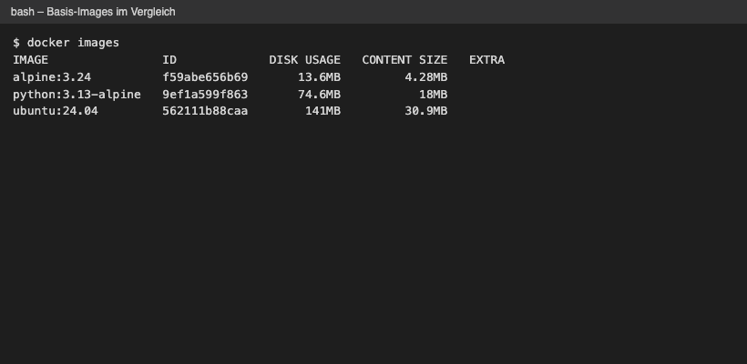

# Lab 3.1 – Lösung: Aufbau und Speichern von Images

## Aufgabe 1: Basis-Images laden und Größen vergleichen

```bash
docker pull ubuntu:24.04
docker pull alpine:3.24
docker pull python:3.13-alpine
docker images
```

```text
IMAGE                ID             DISK USAGE   CONTENT SIZE   EXTRA
alpine:3.24          f59abe656b69       13.6MB         4.28MB
python:3.13-alpine   9ef1a599f863       74.6MB           18MB
ubuntu:24.04         562111b88caa        141MB         30.9MB
```



_Quelle: eigener Screenshot, Lab 3.1, 23.11.2026._

| Image | `CONTENT SIZE` (Download) | Grund |
| --- | --- | --- |
| `alpine:3.24` | ca. 4 MB | nur Kernprogramme, Shell `sh`, Paketmanager `apk` |
| `python:3.13-alpine` | ca. 18 MB | Alpine plus Python; baut auf denselben Alpine-Dateien auf |
| `ubuntu:24.04` | ca. 31 MB | vollständiges Ubuntu mit `bash` und `apt` |

Die Liste enthält auch Images aus früheren Labs. Werte gelten für einen Mac mit Apple-Chip (`linux/arm64`); auf Intel- und AMD-Rechnern (`linux/amd64`) und mit neueren Versionen weichen sie leicht ab. `DISK USAGE` ist größer als `CONTENT SIZE`, weil die Schichten entpackt auf der Festplatte liegen.

## Aufgabe 2: Bauschritte von python:3.13-alpine lesen

```bash
docker history python:3.13-alpine
```

```text
IMAGE          CREATED       CREATED BY                                      SIZE      COMMENT
9ef1a599f863   2 weeks ago   CMD ["python3"]                                 0B        buildkit.dockerfile.v0
<missing>      2 weeks ago   RUN /bin/sh -c set -eux;  for src in idle3 p…   16.4kB    buildkit.dockerfile.v0
<missing>      2 weeks ago   RUN /bin/sh -c set -eux;   apk add --no-cach…   44.3MB    buildkit.dockerfile.v0
<missing>      2 weeks ago   ENV PYTHON_SHA256=abb0102e6d4ae027509bcb8232…   0B        buildkit.dockerfile.v0
<missing>      2 weeks ago   ENV PYTHON_VERSION=3.13.18                      0B        buildkit.dockerfile.v0
<missing>      2 weeks ago   ENV GPG_KEY=7169605F62C751356D054A26A821E680…   0B        buildkit.dockerfile.v0
<missing>      2 weeks ago   RUN /bin/sh -c set -eux;  apk add --no-cache…   2.91MB    buildkit.dockerfile.v0
<missing>      2 weeks ago   ENV LANG=C.UTF-8                                0B        buildkit.dockerfile.v0
<missing>      2 weeks ago   ENV PATH=/usr/local/bin:/usr/local/sbin:/usr…   0B        buildkit.dockerfile.v0
<missing>      2 weeks ago   CMD ["/bin/sh"]                                 0B        buildkit.dockerfile.v0
<missing>      2 weeks ago   ADD alpine-minirootfs-3.24.4-aarch64.tar.gz …   9.31MB    buildkit.dockerfile.v0
```

| Gesucht | Zeile | Bedeutung |
| --- | --- | --- |
| unterste Schicht (Basis) | `ADD alpine-minirootfs-3.24.4-aarch64.tar.gz …` (9.31MB) | das komplette Alpine-Dateisystem; dieselbe Schicht wie in `alpine:3.24` |
| größte Schicht | `RUN … apk add --no-cache …` (44.3MB) | Python wird aus dem Quellcode gebaut und installiert |
| Schritt mit `0B` | z. B. `ENV PYTHON_VERSION=3.13.18` oder `CMD ["python3"]` | setzt nur eine Einstellung, keine Dateien |

Die untersten zwei Zeilen stammen aus dem Dockerfile von `alpine:3.24`, alles darüber aus dem Dockerfile des Python-Images. `<missing>` bedeutet nur, dass diese Schritte anderswo gebaut wurden.

## Aufgabe 3: layers-demo bauen und starten

`playground/layers/Dockerfile`:

```dockerfile
# Beispiel eines Dockerfiles mit Schichten (Lab 3.1)
# Basis-Image: Ubuntu 24.04, fester Tag statt latest
FROM ubuntu:24.04

# Neue Schicht: Paketliste laden und Python installieren
RUN apt-get update && apt-get install -y python3

# Weitere Schicht: Anwendungscode hinzufügen
COPY app.py /app/app.py
```

```bash
cd playground/layers
docker build -t layers-demo:1.0 .
docker run --rm layers-demo:1.0 python3 /app/app.py
```

```text
[+] Building 34.9s (8/8) FINISHED
 => [internal] load build definition from Dockerfile
 => [internal] load metadata for docker.io/library/ubuntu:24.04
 => [internal] load .dockerignore
 => [1/3] FROM docker.io/library/ubuntu:24.04@sha256:…
 => [internal] load build context
 => [2/3] RUN apt-get update && apt-get install -y python3
 => [3/3] COPY app.py /app/app.py
 => exporting to image
 => => naming to docker.io/library/layers-demo:1.0
```

```text
Hallo aus der Schicht COPY app.py
```

Das Image enthält keinen eigenen Startbefehl (`CMD`); Ubuntu startet sonst `bash`. Deshalb steht der Befehl `python3 /app/app.py` hinter dem Image-Namen.

## Aufgabe 4: Schichten von layers-demo zuordnen

```bash
docker history layers-demo:1.0
docker images
```

```text
IMAGE          CREATED          CREATED BY                                      SIZE      COMMENT
6f294b4a2c61   6 seconds ago    COPY app.py /app/app.py # buildkit              12.3kB    buildkit.dockerfile.v0
<missing>      6 seconds ago    RUN /bin/sh -c apt-get update && apt-get ins…   107MB     buildkit.dockerfile.v0
<missing>      13 days ago      /bin/sh -c #(nop)  CMD ["/bin/bash"]            0B
<missing>      13 days ago      /bin/sh -c #(nop) ADD file:2a6d7d3511af5b48d…   110MB
<missing>      13 days ago      /bin/sh -c #(nop)  LABEL org.opencontainers.…   0B
<missing>      13 days ago      /bin/sh -c #(nop)  ARG LAUNCHPAD_BUILD_ARCH     0B
<missing>      13 days ago      /bin/sh -c #(nop)  ARG RELEASE                  0B
```

| Zeile in der History | Anweisung im Dockerfile |
| --- | --- |
| `COPY app.py /app/app.py` | `COPY app.py /app/app.py` |
| `RUN … apt-get update && apt-get install …` | `RUN apt-get update && apt-get install -y python3` |
| `CMD ["/bin/bash"]` und alle Zeilen darunter | `FROM ubuntu:24.04`: Schritte aus dem Dockerfile von Ubuntu |

```text
IMAGE                ID             DISK USAGE   CONTENT SIZE   EXTRA
layers-demo:1.0      6f294b4a2c61        302MB         84.2MB
ubuntu:24.04         562111b88caa        141MB         30.9MB
```

In `docker images` ist `layers-demo:1.0` deutlich größer als `ubuntu:24.04` (84,2 MB statt 30,9 MB Download). Der Unterschied ist die `RUN`-Schicht (107 MB): Python mit seinen Bibliotheken und die Paketlisten von `apt-get update`. Die `COPY`-Schicht ist nur wenige Kilobyte groß; die Ubuntu-Schicht teilt sich `layers-demo` mit `ubuntu:24.04` und belegt sie nicht doppelt. Genaue Größen weichen je nach Rechner und Paketstand ab.

## Aufgabe 5: Neu bauen und den Cache beobachten

`app.py` nach der Änderung, z. B.:

```python
# Kleines Programm für das Schichten-Beispiel aus Lab 3.1
print("Hallo aus der geänderten Schicht COPY app.py")
```

```bash
docker build -t layers-demo:1.1 .
docker run --rm layers-demo:1.1 python3 /app/app.py
```

```text
[+] Building 0.2s (8/8) FINISHED
 => [internal] load build definition from Dockerfile
 => [internal] load metadata for docker.io/library/ubuntu:24.04
 => [internal] load .dockerignore
 => [1/3] FROM docker.io/library/ubuntu:24.04@sha256:…
 => [internal] load build context
 => CACHED [2/3] RUN apt-get update && apt-get install -y python3
 => [3/3] COPY app.py /app/app.py
 => exporting to image
 => => naming to docker.io/library/layers-demo:1.1
```

```text
Hallo aus der geänderten Schicht COPY app.py
```

`FROM` und `RUN` haben sich nicht geändert und kommen aus dem Cache (`CACHED`; `FROM` lädt nichts neu). Nur `COPY` läuft neu, weil sich der Inhalt von `app.py` geändert hat. Der Build dauert deshalb 0,2 Sekunden statt rund 35 Sekunden. `layers-demo:1.0` und `layers-demo:1.1` teilen sich alle Schichten bis auf die oberste.
