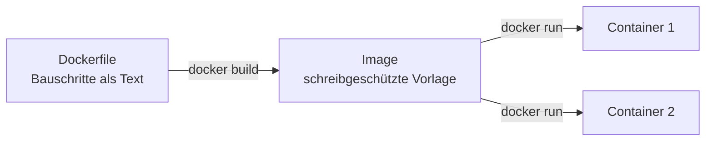
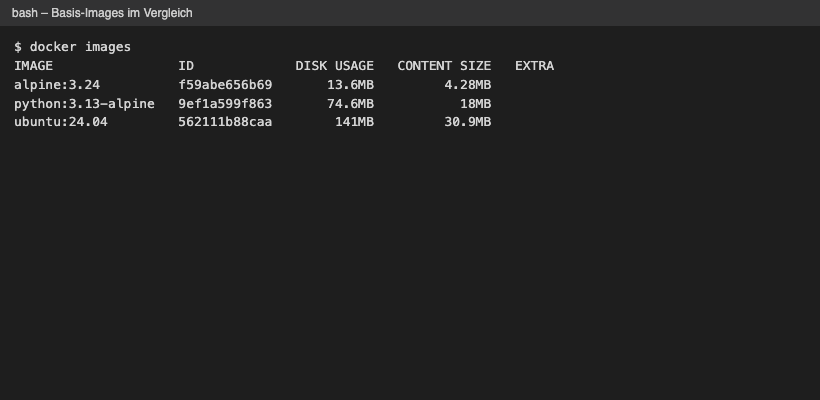
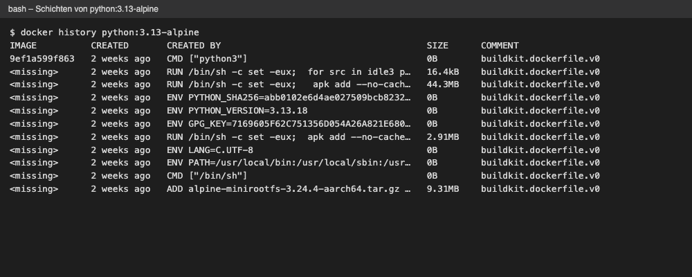

# Lab 3.1: Aufbau und Speichern von Images

**Leitfragen:**

<details>
<summary>Zehn Anwendungen nutzen dasselbe Betriebssystem: muss es zehnmal auf der Festplatte liegen?</summary>

Nein. Images bestehen aus Schichten; eine Schicht, die mehrere Images gemeinsam haben (z. B. das Basis-Image `ubuntu:24.04`), liegt nur einmal auf der Festplatte und wird von allen Images und Containern mitbenutzt.

</details>

<details>
<summary>Was kostet ein möglichst kleines Paket?</summary>

Es spart Speicher, Download-Zeit und Angriffsfläche. Dafür fehlen Werkzeuge wie Shell und Paketmanager; die Fehlersuche wird mühsamer, und manche Programme brauchen genau die Bibliotheken, die weggelassen wurden.

</details>

- Ein Image entsteht aus einem Dockerfile: Jede Anweisung baut auf dem Ergebnis der vorherigen auf, Dateiänderungen werden als schreibgeschützte Schicht gespeichert.
- Ein Container legt nur eine dünne beschreibbare Schicht über die Schichten seines Images. Gleiche Schichten teilen sich alle Images und Container.
- Kleine Basis-Images (Alpine, Scratch, distroless, Docker Hardened Images) sparen Platz und reduzieren Sicherheitslücken.

## Begriffe

| Begriff | Bedeutung |
| --- | --- |
| Image | schreibgeschützte Vorlage für Container: Dateisystem plus Startkonfiguration; wie eine Installations-DVD, von der beliebig viele Rechner starten |
| Dockerfile | Textdatei mit den Bauschritten für ein Image, wie ein Rezept |
| `docker build` | führt ein Dockerfile aus und speichert das Ergebnis als Image |
| Schicht (Layer) | Paket mit den Dateiänderungen eines Bauschritts; schreibgeschützt und über ihren Inhalt eindeutig benannt |
| Basis-Image | Image, auf dem ein neues Image aufbaut (Anweisung `FROM`), z. B. `ubuntu:24.04` |
| Tag | Versionsname hinter dem Doppelpunkt, z. B. `24.04` in `ubuntu:24.04`; ohne Angabe nimmt Docker `latest` |
| Container-Schicht | dünne beschreibbare Schicht, die jeder Container über das Image legt; verschwindet mit `docker rm` |
| Union Filesystem | Dateisystem, das mehrere Schichten übereinanderlegt und als ein einziges Verzeichnis zeigt; bei Docker heute OverlayFS |
| Copy-on-Write | eine Datei aus einer Image-Schicht wird erst beim Ändern in die Container-Schicht kopiert; bis dahin wird sie nur gelesen |
| Build-Kontext | Ordner, dessen Dateien `docker build` an Docker übergibt; `COPY` kann nur Dateien daraus ins Image holen |
| Build-Cache | gespeicherte Schichten früherer Builds; unveränderte Schritte werden nicht neu ausgeführt |
| Minimal-Base-Image | stark reduziertes Basis-Image mit nur dem Nötigsten, z. B. Alpine |

## Dockerfile als Bauplan eines Images

Ein Dockerfile ist eine Textdatei, die die Schritte zum Erstellen eines Docker-Images festlegt. Es enthält Anweisungen zum Hinzufügen von Dateien, zum Ausführen von Befehlen und zum Festlegen von Konfigurationen. Aus einem Dockerfile entsteht mit `docker build` ein Image, aus dem Image mit `docker run` beliebig viele Container:



Das Dockerfile heißt standardmäßig `Dockerfile` (ohne Endung) und liegt im Ordner der Anwendung. Die einzelnen Anweisungen mit ihrer Syntax behandelt Lab 3.2; hier reichen `FROM` (Basis-Image), `RUN` (Befehl beim Bauen ausführen) und `COPY` (Datei vom Rechner ins Image kopieren).

## Image bauen mit docker build

Mit `docker build` erstellen Nutzer eigene Images aus einem Dockerfile:

```bash
docker build -t ImageName:TagName Verzeichnis
```

| Teil | Bedeutung | Beispiel |
| --- | --- | --- |
| `-t` | gibt Name und Tag für das Image an (*tag*) | `-t layers-demo:1.0` |
| `ImageName` | Name des Images | `layers-demo` |
| `TagName` | Tag, meist eine Version; fehlt er, setzt Docker `latest` | `1.0` |
| `Verzeichnis` | Build-Kontext: Ordner mit dem Dockerfile und den Dateien, die ins Image sollen; `.` ist der aktuelle Ordner | `.` |
| `-f` (optional) | Dockerfile mit anderem Namen oder an anderem Ort | `-f docker/Dockerfile.dev` |

```bash
cd project/playground/layers
docker build -t layers-demo:1.0 .      # Dockerfile im aktuellen Ordner, Image layers-demo:1.0
docker images layers-demo              # das neue Image anzeigen
```

## Container-Layering

Container-Images bestehen aus mehreren schreibgeschützten Schichten (Layers), die aufeinander aufbauen und sich dasselbe Basis-Image teilen. Das spart Platz und vermeidet doppelte Daten: Änderungen führen nur zu neuen Schichten. Über den Image-Schichten liegt bei jedem laufenden Container eine eigene beschreibbare Container-Schicht.


_Quelle: Docker Inc., „Storage drivers" (https://docs.docker.com/engine/storage/drivers/), abgerufen am 23.11.2026._

### Beispiel eines Dockerfiles mit Schichten

```dockerfile
# Basis-Image: Ubuntu 24.04 (fester Tag statt latest)
FROM ubuntu:24.04

# Neue Schicht: Installation von Paketen
RUN apt-get update && apt-get install -y python3

# Weitere Schicht: Anwendungscode hinzufügen
COPY app.py /app/app.py
```

Datei: `project/examples/m03-images-registries/l01-image-layers/layers/Dockerfile`.

| Anweisung | Ergebnis im Image |
| --- | --- |
| `FROM ubuntu:24.04` | alle Schichten des Basis-Images (bei Ubuntu 24.04 eine Schicht mit dem kompletten Ubuntu-Dateisystem) |
| `RUN apt-get update && apt-get install -y python3` | neue Schicht mit allen Dateien, die die Installation angelegt oder geändert hat |
| `COPY app.py /app/app.py` | neue Schicht, die nur `/app/app.py` enthält |

`FROM ubuntu:latest` aus älteren Beispielen ist hier durch `ubuntu:24.04` ersetzt. `latest` ist nur ein Name, der sich mit jeder neuen Ubuntu-Version auf ein anderes Image verschiebt; derselbe Build liefert dann nach Monaten ein anderes Ergebnis. Ein fester Tag macht Builds wiederholbar (vertieft in Lab 3.3).

## Union Filesystem und Copy-on-Write

Container-Images basieren auf einem Union Filesystem, das mehrere Dateisystem-Schichten übereinanderlegt und als ein einziges Verzeichnisbaum zeigt. Docker nutzt dafür heute OverlayFS aus dem Linux-Kernel:


_Quelle: Docker Inc., „OverlayFS storage driver" (https://docs.docker.com/engine/storage/drivers/overlayfs-driver/), abgerufen am 23.11.2026._

- **Image-Schichten (`lowerdir`)** werden nur gelesen. **Container-Schicht (`upperdir`)** nimmt alle Änderungen des Containers auf. **Container-Sicht (`merged`)** zeigt beides zusammen; liegt eine Datei in beiden, gewinnt die obere.
- **Copy-on-Write:** Ändert ein Container eine Datei aus dem Image (im Bild `file 2`), kopiert Docker sie zuerst in die Container-Schicht und ändert dort die Kopie. Das Image selbst bleibt unverändert.
- **Gelöschte Dateien** werden in der Container-Schicht nur als gelöscht markiert; im Image sind sie weiter vorhanden.

### Layer-Konzept beim Bauen

- Jede Anweisung im Dockerfile ist ein Bauschritt. Schritte, die Dateien ändern (`RUN`, `COPY`, `ADD`), speichern ihre Änderungen als neue Schicht. Schritte, die nur Einstellungen setzen (z. B. `WORKDIR`, `ENV`, `CMD`), erscheinen in der History mit `0B`.
- Hinzugefügte Dateien oder installierte Pakete liegen in getrennten Schichten. Das spart Speicher und beschleunigt Builds.
- Nur bei Änderungen entsteht eine neue Schicht: Ist ein Schritt samt seinen Eingaben unverändert, nimmt `docker build` die vorhandene Schicht aus dem Build-Cache (Ausgabe `CACHED`). Basis-Images werden so wiederverwendet, statt neu geladen und neu gebaut.
- Eine Datei, die ein späterer Schritt löscht, bleibt in der früheren Schicht enthalten und vergrößert das Image trotzdem. Aufräumen gehört deshalb in denselben `RUN`-Befehl (Lab 3.2).

## Speicherstruktur und Schichten eines Images

Ein Image besteht aus schreibgeschützten Schichten, die von unten nach oben aufeinander aufbauen. Jede Schicht ist über einen Prüfwert ihres Inhalts (Digest, `sha256:…`) eindeutig benannt und dient als Baustein für die Schichten darüber. Gespeichert werden nur die Änderungen gegenüber der Schicht darunter. Beispiel: `FROM ubuntu:24.04` liefert die Basisschicht, alle weiteren Schritte (`RUN`, `COPY` …) bauen darauf auf.


_Quelle: Docker Inc., „Storage drivers" (https://docs.docker.com/engine/storage/drivers/), abgerufen am 23.11.2026._

Vier Container aus demselben Image brauchen die 188 MB der Image-Schichten nur einmal; jeder Container belegt zusätzlich nur, was er selbst schreibt. Dasselbe gilt für Images: Alle Images auf Basis von `python:3.13-alpine` teilen sich dessen Schichten.

### Images und Schichten anzeigen

```bash
docker images                          # alle Images (Kurzform von docker image ls)
docker history python:3.13-alpine      # Bauschritte und Schichten eines Images
docker system df                       # Speicherverbrauch von Images, Containern, Volumes, Build-Cache
```



_Quelle: eigener Screenshot, Lab 3.1, 23.11.2026._

| Spalte von `docker images` (Docker 29) | Bedeutung |
| --- | --- |
| `IMAGE` | Name und Tag |
| `ID` | Kurzform der Image-ID |
| `DISK USAGE` | Platz, den die entpackten Schichten belegen; gemeinsame Schichten zählen bei jedem Image mit |
| `CONTENT SIZE` | komprimierte Größe, ungefähr die Download-Menge |
| `EXTRA` | `U` = von mindestens einem Container genutzt |

Ältere Docker-Versionen zeigen stattdessen die Spalten `REPOSITORY`, `TAG`, `IMAGE ID`, `CREATED` und `SIZE`. Seit Docker Engine 29 speichert Docker Images bei Neuinstallationen über den containerd-Image-Store; Docker Desktop nutzt ihn ebenfalls standardmäßig (Quelle: [containerd image store](https://docs.docker.com/engine/storage/containerd/), abgerufen am 23.11.2026). Die Schichten liegen bei Docker Desktop in dessen Linux-VM, nicht direkt im Dateisystem von Windows oder macOS.

`docker history` zeigt die Bauschritte von oben (zuletzt) nach unten (Basis):



_Quelle: eigener Screenshot, Lab 3.1, 23.11.2026._

| Spalte | Bedeutung |
| --- | --- |
| `CREATED BY` | Anweisung des Bauschritts (gekürzt; vollständig mit `--no-trunc`) |
| `SIZE` | Größe der Schicht; `0B` = Schritt ohne Dateiänderung |
| `COMMENT` | `buildkit.dockerfile.v0` = mit einem Dockerfile gebaut |
| `IMAGE` | `<missing>` bei Schritten, die anderswo gebaut wurden; kein Fehler |

## Minimal-Base-Images

Ein Minimal-Base-Image ist eine stark reduzierte Version eines Standard-Images. Es enthält nur die Komponenten, die eine Anwendung zum Laufen braucht. Im Gegensatz zu umfangreichen Images sind minimale Images schlank: Sie laden schneller, starten schneller, verbrauchen weniger Ressourcen und enthalten weniger Programme mit möglichen Sicherheitslücken.

| Basis-Image | Inhalt | Größe (komprimiert, ca.) | Typischer Einsatz |
| --- | --- | --- | --- |
| `ubuntu:24.04` | vollständiges Ubuntu mit `apt`, `bash` | 30 MB | wenn Programme Ubuntu-Pakete brauchen; zum Lernen |
| `python:3.13` | vollständiges Debian mit Python und Compilern | 410 MB | wenn beim Bauen Bibliotheken kompiliert werden |
| `python:3.13-slim` | Debian, verkleinert, mit Python | 43 MB | Python-Apps mit Bibliotheken, die Debian-Pakete voraussetzen |
| `alpine:3.24` | Alpine Linux mit Paketmanager `apk` und Shell `sh` | 4 MB | beliebtes Minimal-Image wegen geringer Größe und kleiner Angriffsfläche |
| `python:3.13-alpine` | Alpine mit Python | 18 MB | Kurs-Images `frontend` und `backend` |
| `scratch` | leer, keinerlei Betriebssystem-Komponenten | 0 MB | einzelne, vollständig gebündelte Programme (z. B. in Go kompiliert) |
| distroless (`gcr.io/distroless/…`) | nur Anwendung und Laufzeit, ohne Shell und Paketmanager | ab ca. 2 MB | Produktion, wenn keine Shell im Container gewünscht ist |
| Docker Hardened Images (`dhi.io/…`) | gehärtete, minimale Images von Docker, laufen ohne Root-Rechte | je nach Image | Produktion mit geringer Zahl bekannter Sicherheitslücken |

Größen: komprimierte Größe für `linux/amd64` laut [Docker Hub](https://hub.docker.com/) bzw. Projektangabe, abgerufen am 23.11.2026; sie ändern sich mit jeder neuen Version.

- **Alpine Linux** nutzt die C-Bibliothek `musl` statt `glibc`. Die meisten Programme laufen damit; vorkompilierte Pakete für `glibc` können fehlen oder anders funktionieren.
- **Scratch** ist ein spezielles, leeres Image ohne Betriebssystem-Komponenten. Es eignet sich nur für Programme, die alles Nötige selbst mitbringen.
- **distroless** von Google enthält nur die Anwendung und ihre Laufzeit, keine Paketmanager und keine Shell; die kleinste Variante `gcr.io/distroless/static-debian13` hat rund 2 MiB. Für die Fehlersuche gibt es `:debug`-Varianten mit einer Shell. Quelle: [GoogleContainerTools/distroless](https://github.com/GoogleContainerTools/distroless), abgerufen am 23.11.2026.
- **Docker Hardened Images (DHI)** sind minimale, laufend gepatchte Images von Docker, standardmäßig ohne Root-Rechte und mit distroless-Varianten. Docker startete sie im Mai 2025 und stellt sie seit dem 17.12.2025 kostenlos unter der Lizenz Apache 2.0 bereit; geladen werden sie nach `docker login dhi.io` z. B. als `dhi.io/python:3.13`. Quellen: [Docker Hardened Images](https://docs.docker.com/dhi/), [Docker-Blog vom 17.12.2025](https://www.docker.com/blog/docker-hardened-images-for-every-developer/), abgerufen am 23.11.2026. Angebot und Bezugsweg ändern sich noch; vor dem Einsatz den Stand prüfen.
- **Bitnami-Images** von Docker Hub (`bitnami/…`) eignen sich nicht mehr als Basis: Seit dem 28.08.2025 veröffentlicht Bitnami dort keine neuen Images; die vorhandenen wurden ins Archiv `bitnamilegacy` verschoben und erhalten keine Updates. Quelle: [bitnami/containers, Issue 83267](https://github.com/bitnami/containers/issues/83267), abgerufen am 23.11.2026.

### Einsatzszenarien für Minimal-Base-Images

| Szenario | Nutzen |
| --- | --- |
| Microservices-Architekturen | Für einzelne kleine Dienste sind minimale Images besonders effektiv: kurze Startzeit, leichtes Skalieren durch zusätzliche Kopien. |
| Container-Orchestrierung | In Umgebungen wie Kubernetes, die Tausende Container verwalten, sparen kleine Images Download-Zeit und Speicher auf jedem Server (Orchestrierung: Modul 10). |
| Sicherheit | Jedes Programm, das fehlt, kann keine Sicherheitslücke haben; Scanner melden weniger Funde (Lab 6.3). |
| Wann nicht | beim Lernen und bei der Fehlersuche (fehlende Werkzeuge), bei Programmen, die `glibc` oder bestimmte Systempakete brauchen |

## Typische Fehler

| Symptom | Ursache | Lösung |
| --- | --- | --- |
| `failed to read dockerfile: open Dockerfile: no such file or directory` | `docker build` im falschen Ordner gestartet oder Datei heißt `Dockerfile.txt` | mit `ls` prüfen; Datei exakt `Dockerfile` nennen oder `-f` angeben |
| `COPY failed: … "/app.py": not found` | Datei liegt nicht im Build-Kontext (Ordner hinter `docker build`) | Datei in den Ordner legen oder richtigen Ordner als Kontext angeben |
| `docker build` ohne `-t` liefert ein Image ohne Namen (`<none>`) | Name und Tag fehlen | mit `-t name:tag` erneut bauen |
| `toomanyrequests` beim Laden eines Basis-Images | Pull-Limit von Docker Hub erreicht | `docker login` ([Setup](../../00-setup-and-installation.md#docker-hub-limit-und-docker-login)) |
| `bash: not found` in einem Alpine-Container | Alpine enthält nur `sh` | `sh` statt `bash` nutzen |
| Image wird trotz gelöschter Dateien nicht kleiner | Dateien stecken in einer früheren Schicht | im selben `RUN` installieren und aufräumen |

## Fazit

- Ein Dockerfile beschreibt die Bauschritte; `docker build -t name:tag .` erzeugt daraus ein Image.
- Jeder Bauschritt mit Dateiänderungen wird zu einer schreibgeschützten Schicht; Container legen nur eine beschreibbare Schicht darüber (Copy-on-Write).
- Gleiche Schichten liegen nur einmal auf der Festplatte; unveränderte Schritte kommen beim nächsten Build aus dem Cache.
- Minimal-Base-Images sparen Platz und Angriffsfläche; feste Tags statt `latest` machen Builds wiederholbar.

In der Übung werden drei Basis-Images verglichen, ihre Schichten gelesen und ein eigenes Image mit drei Schichten gebaut.
