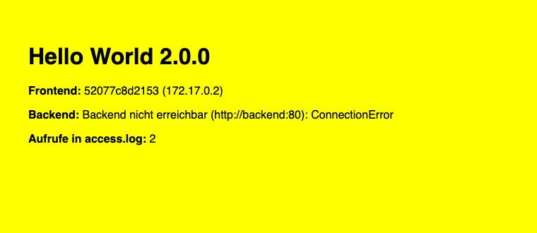

# Lab 3.2 – Lösung: Eigene Images erstellen und verwalten

Alle fertigen Dateien liegen in `project/examples/m03-images-registries/l02-own-images/` (Pfade relativ zu `playground/`).

## Aufgabe 1: Wetter-App

`playground/weather/Dockerfile`:

```dockerfile
# Wetter-App (Lab 3.2)
# Basisimage: Python 3.13 auf Alpine Linux (klein, offiziell gepflegt)
FROM python:3.13-alpine

# Arbeitsordner im Image; COPY und CMD beziehen sich darauf
WORKDIR /app

# Skript vom Rechner ins Image kopieren
COPY weather.py .

# Startbefehl (Listenform): läuft bei jedem docker run
CMD ["python", "weather.py"]
```

```bash
cd playground/weather
docker build -t weather:1.0 .
docker run --rm weather:1.0
```

```text
Heute scheint die Sonne!
```

Der Container endet direkt nach der Ausgabe, weil das Programm fertig ist. `--rm` entfernt ihn danach automatisch; `docker ps -a` zeigt ihn nicht mehr.

## Aufgabe 2: Pizza-App mit Eingabe

`playground/pizza/Dockerfile`:

```dockerfile
# Pizza-App (Lab 3.2)
FROM python:3.13-alpine

WORKDIR /app

COPY order_pizza.py .

# Das Programm liest eine Eingabe: Container mit docker run -it starten
CMD ["python", "order_pizza.py"]
```

```bash
cd ../pizza
docker build -t pizza:1.0 .
docker run --rm pizza:1.0
```

```text
Welche Pizza soll es sein? Traceback (most recent call last):
  File "/app/order_pizza.py", line 2, in <module>
    pizza_type = input("Welche Pizza soll es sein? ")
EOFError: EOF when reading a line
```

Ohne `-i` bekommt der Container keine Tastatureingabe; `input()` liest sofort das Ende der Eingabe (EOF) und bricht ab.

```bash
docker run -it --rm pizza:1.0
```

```text
Welche Pizza soll es sein? Margherita
Margherita wurde bestellt!
```

## Aufgabe 3: Dockerfiles der Hello-App

`playground/hello/backend/Dockerfile`:

```dockerfile
# Basisimage: Python 3.13 auf Alpine Linux (klein, offiziell gepflegt)
FROM python:3.13-alpine

# curl wird für den Healthcheck gebraucht (ab Lab 4.2)
RUN apk add --no-cache curl

# Arbeitsordner im Image; alle folgenden Pfade beziehen sich darauf
WORKDIR /app

# Erst die Abhängigkeiten: diese Schicht bleibt im Cache, solange requirements.txt gleich bleibt
COPY requirements.txt .
RUN pip install --no-cache-dir -r requirements.txt

# Danach den Code (ändert sich oft)
COPY . .

# Dokumentiert den Port, auf dem die App lauscht
EXPOSE 80

# Startbefehl des Containers
CMD ["python", "backend.py"]
```

`playground/hello/frontend/Dockerfile`:

```dockerfile
# Basisimage: Python 3.13 auf Alpine Linux (klein, offiziell gepflegt)
FROM python:3.13-alpine

# curl für Tests aus dem Container heraus (wie im Backend)
RUN apk add --no-cache curl

# Arbeitsordner im Image; alle folgenden Pfade beziehen sich darauf
WORKDIR /app

# Erst die Abhängigkeiten: diese Schicht bleibt im Cache, solange requirements.txt gleich bleibt
COPY requirements.txt .
RUN pip install --no-cache-dir -r requirements.txt

# Build-Argument: nur beim Bauen vorhanden, z. B. docker build --build-arg APP_VERSION=2.0.0
ARG APP_VERSION=0.0.0
# Umgebungsvariable: bleibt im Image und ist zur Laufzeit lesbar (frontend.py zeigt sie an)
ENV APP_DISPLAY_VERSION=$APP_VERSION

# Schreibt die Version beim Bauen in eine Datei im Image
RUN echo "Last version updated: $APP_VERSION" > version.info

# Danach den Code (ändert sich oft)
COPY . .

# Dokumentiert den Port, auf dem die App lauscht
EXPOSE 80

# Startbefehl des Containers
CMD ["python", "frontend.py"]
```

```bash
cd ../hello/backend
docker build -t backend:v1 .
cd ../frontend
docker build -t frontend:v1 --build-arg APP_VERSION=1.0.0 .
```

```text
[+] Building 8.7s (11/11) FINISHED
 => [1/6] FROM docker.io/library/python:3.13-alpine@sha256:9ef1a599f86323…
 => [2/6] RUN apk add --no-cache curl
 => [3/6] WORKDIR /app
 => [4/6] COPY requirements.txt .
 => [5/6] RUN pip install --no-cache-dir -r requirements.txt
 => [6/6] COPY . .
 => => naming to docker.io/library/backend:v1
```

Der Build von `frontend:v1` sieht gleich aus, mit sieben Schritten (`[1/7]` bis `[7/7]`, darunter `RUN echo "Last version updated: 1.0.0" > version.info`) und dauert rund 12 Sekunden. Die Zeiten hängen von Rechner und Internetverbindung ab.

Die Reihenfolge folgt der Änderungshäufigkeit: Abhängigkeiten zuerst, Code zuletzt. Eine Änderung an `frontend.py` baut nur `COPY . .` neu.

## Aufgabe 4: frontend:v2 bauen und starten

```bash
docker build -t frontend:v2 --build-arg APP_VERSION=2.0.0 .
docker run -d --name hello-frontend -p 8080:80 frontend:v2
docker images
```

```text
[+] Building 0.7s (12/12) FINISHED
 => CACHED [2/7] RUN apk add --no-cache curl
 => CACHED [3/7] WORKDIR /app
 => CACHED [4/7] COPY requirements.txt .
 => CACHED [5/7] RUN pip install --no-cache-dir -r requirements.txt
 => [6/7] RUN echo "Last version updated: 2.0.0" > version.info
 => [7/7] COPY . .
 => => naming to docker.io/library/frontend:v2
```

Bis zur Installation kommt alles aus dem Cache; ab dem Schritt, der `APP_VERSION` nutzt, baut Docker neu, weil sich der Wert geändert hat.

```text
IMAGE                ID             DISK USAGE   CONTENT SIZE   EXTRA
backend:v1           2dc96e62ab74        103MB           25MB
frontend:v1          6aca9a34f4c4        108MB         26.1MB
frontend:v2          c2edf827da28        108MB         26.1MB   U
pizza:1.0            45d805771e7d       73.9MB         17.4MB
python:3.13-alpine   9ef1a599f863       74.6MB           18MB
weather:1.0          5e6da34a25a7       73.9MB         17.4MB
```

Die Liste enthält weitere Images aus früheren Labs. `weather:1.0` und `pizza:1.0` sind praktisch so groß wie `python:3.13-alpine`: Sie fügen nur ein kleines Skript als Schicht hinzu. `U` bei `frontend:v2` zeigt, dass der Container `hello-frontend` dieses Image nutzt. `frontend` und `backend` enthalten zusätzlich `curl`, Flask und `requests`.



_Quelle: eigener Screenshot, Hello-App `frontend:v2`, 23.11.2026._

`Backend nicht erreichbar (http://backend:80): ConnectionError` ist erwartet: Unter dem Namen `backend` gibt es noch keinen Container, mit dem das Frontend sprechen kann.

## Aufgabe 5: Standardbefehl ersetzen

```bash
docker run --rm frontend:v1 cat version.info
docker run --rm frontend:v2 cat version.info
docker run --rm frontend:v2 env
```

```text
Last version updated: 1.0.0
Last version updated: 2.0.0
```

```text
PATH=/usr/local/bin:/usr/local/sbin:/usr/local/bin:/usr/sbin:/usr/bin:/sbin:/bin
HOSTNAME=f74b7b373961
LANG=C.UTF-8
GPG_KEY=7169605F62C751356D054A26A821E680E5FA6305
PYTHON_VERSION=3.13.18
PYTHON_SHA256=abb0102e6d4ae027509bcb82327d9dd85515b44a3ba8ad538cfc5e9847029f68
APP_DISPLAY_VERSION=2.0.0
HOME=/root
```

- `cat version.info` ersetzt das `CMD` `python frontend.py`; der Befehl läuft im Arbeitsverzeichnis `/app`, in dem `version.info` liegt.
- `APP_DISPLAY_VERSION=2.0.0` steht in der Liste, weil `ENV` im Image gespeichert wird.
- `APP_VERSION` fehlt, weil `ARG` nur während `docker build` existiert.
- `LANG`, `GPG_KEY` und `PYTHON_*` stammen aus dem Basis-Image `python:3.13-alpine`, `HOSTNAME` (Container-ID) und `HOME` setzt Docker beim Start.

## Erweiterung: Backend allein starten

```bash
docker run -d --name hello-backend -p 8081:80 backend:v1
```

Antwort unter `http://localhost:8081` (hier lesbar formatiert):

```json
{
  "hostname": "e986cfdf8a65",
  "ip": ["172.17.0.3"],
  "now": "22:20:01"
}
```

- `hostname`: Container-ID (kurz) des Backends.
- `ip`: IP-Adressen des Containers im Docker-Netzwerk (Modul 5).
- `now`: Uhrzeit im Container (UTC, solange keine Zeitzone gesetzt ist).

Je nach Browser erscheint das JSON in einer Zeile. Danach aufräumen:

```bash
docker rm -f hello-backend
```
