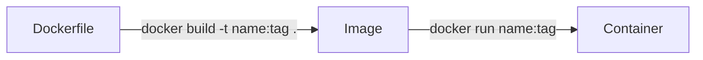
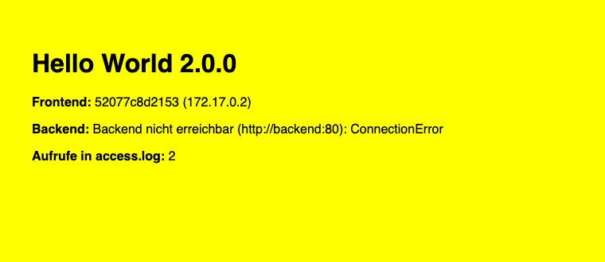

# Lab 3.2: Eigene Images erstellen und verwalten

**Leitfragen:**

<details>
<summary>Welche Schritte sind nötig, um ein Python-Skript auf einem frischen Server zu starten?</summary>

Betriebssystem und Python installieren, benötigte Bibliotheken installieren, Code auf den Server kopieren, in den richtigen Ordner wechseln und das Skript starten. Genau diese Schritte schreibt ein Dockerfile auf.

</details>

<details>
<summary>Wie kann ein Kollege diese Schritte in einem Jahr genauso wiederholen?</summary>

Nur wenn sie aufgeschrieben und ausführbar sind, mit festen Versionen. Ein Dockerfile mit festen Tags lässt sich jederzeit erneut mit `docker build` ausführen; das gebaute Image enthält das Ergebnis dauerhaft.

</details>

<details>
<summary>Woran soll später erkennbar sein, welche Version gerade läuft?</summary>

Am Namen des Images (Tag, z. B. `frontend:v2`) und an einer Versionsangabe im Programm selbst. Die Hello-App bekommt ihre Version beim Bauen als Build-Argument und zeigt sie auf der Seite an.

</details>

- Ein Dockerfile ist eine Folge von Anweisungen: Basis-Image wählen, Dateien kopieren, Befehle beim Bauen ausführen, Einstellungen und Startbefehl festlegen.
- Build-Argumente (`ARG`, `--build-arg`) machen ein Dockerfile für mehrere Versionen nutzbar; `CMD` und `ENTRYPOINT` bestimmen, was beim Start läuft.
- Gute Dockerfiles sind klein, nutzen den Build-Cache und packen nichts Unnötiges oder Geheimes ins Image.

## Begriffe

| Begriff | Bedeutung |
| --- | --- |
| Anweisung | eine Zeile im Dockerfile, beginnt mit einem Schlüsselwort in Großbuchstaben (`FROM`, `COPY` …) |
| Build-Zeit / Laufzeit | Build-Zeit: während `docker build`; Laufzeit: während der Container läuft (`docker run`) |
| `.dockerignore` | Liste von Dateien und Ordnern, die `docker build` nicht an Docker übergibt; wie eine Ausschlussliste beim Kopieren |
| Listenform (Exec-Form) | Befehl als JSON-Liste, z. B. `["python", "app.py"]`; Docker startet das Programm direkt |
| Shell-Form | Befehl als normaler Text, z. B. `python app.py`; Docker startet ihn über `/bin/sh -c` |
| Build-Argument | Variable, die nur beim Bauen existiert (`ARG`), Wert per `--build-arg` |
| Umgebungsvariable | Variable, die im Image gespeichert ist und im laufenden Container gelesen werden kann (`ENV`) |
| Standardbefehl (`CMD`) | Befehl beim Start des Containers; wird durch einen Befehl bei `docker run` ersetzt |
| Einstiegspunkt (`ENTRYPOINT`) | fester Programmaufruf beim Start; Argumente bei `docker run` werden angehängt |
| interaktiver Container | Container, der Eingaben von der Tastatur liest; Start mit `docker run -it` |

## Vom Dockerfile zum Container



Beispiel eines vollständigen Dockerfiles für eine Python-Anwendung mit Abhängigkeiten (`requirements.txt`) und Startskript `app.py`:

```dockerfile
# Ausgangsimage
FROM python:3.13-alpine

# Arbeitsverzeichnis festlegen
WORKDIR /app

# Abhängigkeiten kopieren und installieren
COPY requirements.txt .
RUN pip install --no-cache-dir -r requirements.txt

# Anwendungscode kopieren
COPY . .

# Startbefehl
CMD ["python", "app.py"]
```

```bash
docker build -t my-app:1.0 .     # im Ordner mit Dockerfile, requirements.txt und app.py
docker run --rm my-app:1.0       # Container starten; --rm entfernt ihn nach dem Ende
```

Ältere Vorlagen nutzen `python:3.8-slim`; Python 3.8 erhält seit Oktober 2024 keine Sicherheitsupdates mehr ([Status of Python versions](https://devguide.python.org/versions/), abgerufen am 23.11.2026). Der Kurs nutzt `python:3.13-alpine`.

## Best Practices für Dockerfiles

Optimierte Dockerfiles erzeugen kleinere, schnellere und sicherere Images.

| Regel | Umsetzung | Grund |
| --- | --- | --- |
| wenige Schichten, kein Ballast | zusammengehörige Befehle in einem `RUN` mit `&&` verbinden; Paket-Caches gar nicht anlegen (`apk add --no-cache`, `pip install --no-cache-dir`) oder im selben Schritt löschen | was ein späterer Schritt löscht, bleibt in der früheren Schicht |
| Selten Geändertes zuerst | erst `requirements.txt` kopieren und installieren, dann den Code | eine Codeänderung baut nur die letzten Schritte neu, die Installation kommt aus dem Cache |
| `.dockerignore` nutzen | Caches, lokale Umgebungen, Geheimnisse und das `Dockerfile` selbst ausschließen | kleinerer Build-Kontext, keine Geheimnisse im Image, weniger unnötige Neubauten |
| Sicherheit | kleines offizielles Basis-Image mit festem Tag, keine Passwörter oder Schlüssel in `ENV`, `ARG` oder Dateien, eigener Benutzer mit `USER` | alles im Image ist für jeden lesbar, der das Image hat; weniger Programme, weniger Lücken (vertieft in Modul 6) |
| ein Prozess je Container | Frontend und Backend als eigene Images | getrennt skalieren, aktualisieren und neu starten (Modul 4) |

Wie der Build-Cache arbeitet: Ändert sich ein Schritt oder eine Datei, die er kopiert, baut Docker diesen und alle folgenden Schritte neu.


_Quelle: Docker Inc., „Docker build cache" (https://docs.docker.com/build/cache/), abgerufen am 23.11.2026. Das Beispiel der Quelle nutzt noch `ubuntu:latest`._

`.dockerignore` der Hello-Dienste (z. B. `project/examples/m03-images-registries/l02-own-images/hello/frontend/.dockerignore`):

```text
__pycache__/
*.pyc
Dockerfile
.dockerignore
```

Mehrere Befehle in einer Schicht:

```dockerfile
# eine Schicht statt drei; die Paketlisten landen gar nicht erst im Image
RUN apt-get update \
 && apt-get install -y --no-install-recommends python3 \
 && rm -rf /var/lib/apt/lists/*
```

## Dockerfile-Anweisungen

Anweisungen stehen in Großbuchstaben am Zeilenanfang; `#` leitet einen Kommentar ein. Reihenfolge in einem typischen Dockerfile: `FROM`, `RUN`, `WORKDIR`, `COPY`/`ADD`, `ARG`/`ENV`, `EXPOSE`, `VOLUME`, `USER`, `CMD`/`ENTRYPOINT`. Alle Anweisungen mit Syntax auch im [Dockerfile-Cheatsheet](../dockerfile-cheatsheet.md).

| Anweisung | Wirkung | wirkt bei |
| --- | --- | --- |
| `FROM` | legt das Basis-Image fest | Build |
| `RUN` | führt einen Befehl beim Bauen aus, Ergebnis wird Schicht | Build |
| `WORKDIR` | legt das Arbeitsverzeichnis fest | Build und Laufzeit |
| `COPY` | kopiert Dateien und Ordner vom Rechner (Build-Kontext) ins Image | Build |
| `ADD` | wie `COPY`, zusätzlich Download von URLs und Entpacken lokaler Tar-Archive | Build |
| `ENV` | setzt Umgebungsvariablen im Image | Build und Laufzeit |
| `ARG` | Build-Argument, nur beim Bauen | Build |
| `EXPOSE` | dokumentiert, auf welchem Port die Anwendung lauscht | Doku für die Laufzeit |
| `VOLUME` | markiert ein Verzeichnis als Volume für Daten | Laufzeit |
| `USER` | wechselt den Benutzer für folgende Befehle und den Container | Build und Laufzeit |
| `CMD` | Standardbefehl beim Start des Containers | Laufzeit |
| `ENTRYPOINT` | fester Programmaufruf beim Start, mit `CMD` kombinierbar und dadurch flexibler | Laufzeit |

### FROM

- **Syntax:** `FROM Basisimage[:Tag]`
- **Optionen:** `Basisimage` = Image, auf dem das neue Image aufbaut; `Tag` (optional) = bestimmte Version des Basis-Images, ohne Angabe `latest`.
- **Beispiel:** `FROM python:3.13-alpine`
- Steht als erste Anweisung (davor nur Kommentare und `ARG`). Mit `FROM … AS name` entstehen benannte Bauabschnitte (Multistage, Lab 9.3).

### RUN

- **Syntax:** `RUN Befehl Parameter` (Shell-Form) oder `RUN ["Befehl", "Parameter"]` (Listenform)
- **Optionen:** `Befehl` = Programm, das beim Bauen des Images ausgeführt wird; `Parameter` = Argumente für den Befehl.
- **Beispiel:** `RUN apk add --no-cache curl`
- Läuft nur beim Bauen, nie beim Start des Containers. Das Ergebnis (installierte Dateien) wird eine Schicht.

### WORKDIR

- **Syntax:** `WORKDIR Verzeichnis`
- **Optionen:** `Verzeichnis` = neues Arbeitsverzeichnis; existiert es nicht, wird es angelegt.
- **Beispiel:** `WORKDIR /app`
- Gilt für alle folgenden `RUN`, `COPY`, `ADD`, `CMD`, `ENTRYPOINT` und für Befehle im laufenden Container. Ersetzt `RUN cd /app`, das nur innerhalb seines eigenen `RUN` wirkt.

### COPY

- **Syntax:** `COPY Quelle Ziel`
- **Optionen:** `Quelle` = Pfad zur Datei oder zum Verzeichnis auf dem Rechner, relativ zum Build-Kontext; `Ziel` = Pfad im Image, relativ zu `WORKDIR`, wenn er nicht mit `/` beginnt. Zusätzlich `--chown=Benutzer:Gruppe` und `--chmod=Rechte`.
- **Beispiel:** `COPY requirements.txt .` und `COPY . .` (alles aus dem Build-Kontext außer den `.dockerignore`-Einträgen ins Arbeitsverzeichnis)
- Kopiert nur Dateien aus dem Build-Kontext, nicht `../andere-datei`.

### ADD

- **Syntax:** `ADD Quelle Ziel`
- **Optionen:** `Quelle` = Pfad auf dem Rechner, URL oder Git-Repository; `Ziel` = Zielverzeichnis im Image.
- **Beispiel:** `ADD app.tar.gz /opt/app/` (lokales Archiv wird entpackt)
- Zusatzfunktionen gegenüber `COPY`: lokale Tar-Archive automatisch entpacken, Dateien von URLs herunterladen. Für einfaches Kopieren empfiehlt Docker `COPY`, weil sein Verhalten eindeutig ist ([Building best practices](https://docs.docker.com/build/building/best-practices/), abgerufen am 23.11.2026).

### ENV

- **Syntax:** `ENV Schlüssel=Wert` (ältere Schreibweise `ENV Schlüssel Wert` funktioniert noch)
- **Optionen:** `Schlüssel` = Name der Umgebungsvariable; `Wert` = ihr Wert.
- **Beispiel:** `ENV APP_COLOR=yellow`
- Der Wert ist zur Laufzeit im Container lesbar und lässt sich beim Start mit `docker run -e APP_COLOR=green …` überschreiben. Keine Geheimnisse in `ENV`: `docker history` zeigt sie.

### EXPOSE

- **Syntax:** `EXPOSE Port[/Protokoll]`
- **Optionen:** `Port` = Port, auf dem die Anwendung im Container lauscht; Protokoll `tcp` (Standard) oder `udp`.
- **Beispiel:** `EXPOSE 80`
- `EXPOSE` öffnet nichts. Es dokumentiert den Port für Menschen und Werkzeuge. Erreichbar vom Rechner wird der Port erst mit `docker run -p 8080:80`.

### VOLUME

- **Syntax:** `VOLUME ["Pfad"]` oder `VOLUME Pfad`
- **Optionen:** `Pfad` = Verzeichnis im Container, das als Volume markiert wird.
- **Beispiel:** `VOLUME ["/data"]`
- Bei jedem Start legt Docker für diesen Pfad ein neues, unbenanntes Volume an, wenn beim Start keins angegeben ist. Daten darin liegen außerhalb der Container-Schicht (Volumes: Lab 4.3).

### USER

- **Syntax:** `USER Benutzer[:Gruppe]`
- **Optionen:** `Benutzer` = Benutzername oder Benutzer-ID; `Gruppe` = Gruppenname oder Gruppen-ID.
- **Beispiel:**

  ```dockerfile
  RUN adduser -D appuser     # Benutzer anlegen (Alpine; Debian/Ubuntu: useradd -m appuser)
  USER appuser               # alle folgenden Schritte und der Container laufen als appuser
  ```

- Ohne `USER` laufen Container als `root`. Der Benutzer muss im Image existieren (vertieft in Modul 6).

### CMD

- **Syntax:** `CMD ["Befehl", "Parameter"]` (Listenform, empfohlen) oder `CMD Befehl Parameter` (Shell-Form)
- **Optionen:** `Befehl` = Programm, das beim Starten des Containers ausgeführt wird; `Parameter` = Argumente dafür.
- **Beispiel:** `CMD ["python", "frontend.py"]`
- Nur das letzte `CMD` im Dockerfile zählt. Ein Befehl hinter dem Image-Namen bei `docker run` ersetzt es: `docker run --rm frontend:v2 cat version.info`.

### ENTRYPOINT

- **Syntax:** `ENTRYPOINT ["Befehl", "Parameter"]` (Listenform, empfohlen) oder `ENTRYPOINT Befehl Parameter`
- **Optionen:** `Befehl` = Programm, das beim Starten des Containers ausgeführt wird; `Parameter` = feste Argumente.
- **Beispiel:** `ENTRYPOINT ["python"]`
- Argumente bei `docker run` werden angehängt statt ersetzt. Ersetzen lässt sich der Einstiegspunkt nur ausdrücklich mit `docker run --entrypoint …`.

Listenform oder Shell-Form: In der Listenform startet Docker das Programm direkt als Hauptprozess; es erhält das Signal `SIGTERM` von `docker stop` und kann sauber beenden. Die Shell-Form startet `/bin/sh -c "…"`; Variablen wie `$HOME` werden dann ersetzt, aber die Shell reicht `SIGTERM` nicht weiter, und `docker stop` wartet 10 Sekunden bis zum harten Abbruch. Für `CMD` und `ENTRYPOINT` deshalb die Listenform nutzen.

## Build-Argumente mit ARG und --build-arg

Build-Argumente werden im Dockerfile mit `ARG` definiert und stehen während des Builds wie Umgebungsvariablen zur Verfügung. Übergeben werden sie beim Aufruf von `docker build` mit der Option `--build-arg`. Das Hello-Frontend nutzt das für seine Version:

```dockerfile
# Build-Argument mit Standardwert, falls kein --build-arg kommt
ARG APP_VERSION=0.0.0
# Umgebungsvariable: übernimmt den Wert ins Image; frontend.py zeigt sie an
ENV APP_DISPLAY_VERSION=$APP_VERSION
# beim Bauen eine Datei mit der Version ins Image schreiben
RUN echo "Last version updated: $APP_VERSION" > version.info
```

```bash
docker build -t frontend:v1 --build-arg APP_VERSION=1.0.0 .   # Seite zeigt "Hello World 1.0.0"
docker build -t frontend:v2 --build-arg APP_VERSION=2.0.0 .   # gleiches Dockerfile, Version 2.0.0
```

Ohne `--build-arg` gilt der Standardwert `0.0.0`.

| | `ARG` | `ENV` |
| --- | --- | --- |
| verfügbar | nur beim Bauen | beim Bauen und im laufenden Container |
| Wert setzen | `docker build --build-arg NAME=Wert` | im Dockerfile; beim Start mit `docker run -e NAME=Wert` überschreibbar |
| im Image gespeichert | nein, nur in den Bauschritten sichtbar | ja |
| Beispiel Hello-Frontend | `APP_VERSION` | `APP_DISPLAY_VERSION` |

Ein `ARG` vor `FROM` gilt nur für die `FROM`-Zeile selbst. Werte von `ARG` können in `docker history` erscheinen; Passwörter gehören deshalb nicht in Build-Argumente.

## CMD und ENTRYPOINT kombiniert

Docker setzt den Startbefehl eines Containers aus `ENTRYPOINT` und `CMD` zusammen: Ist beides gesetzt, hängt Docker `CMD` als Argumente an `ENTRYPOINT` an. Vier Varianten aus der Hands-on-Vorlage des Hello-Frontends:

| Variante | Dockerfile | `docker run IMAGE` startet | `docker run IMAGE backend.py` startet |
| --- | --- | --- | --- |
| 1: nur `CMD` | `CMD ["python", "frontend.py"]` | `python frontend.py` | `backend.py` (ersetzt `CMD`; schlägt fehl, weil `backend.py` kein Programm ist) |
| 2: nur `ENTRYPOINT` | `ENTRYPOINT ["python", "frontend.py"]` | `python frontend.py` | `python frontend.py backend.py` (angehängt) |
| 3: `ENTRYPOINT` plus `CMD` | `ENTRYPOINT ["python"]`<br>`CMD ["frontend.py"]` | `python frontend.py` | `python backend.py` (nur `CMD` ersetzt) |
| 4: beides als vollständiger Befehl | `CMD ["python", "frontend.py"]`<br>`ENTRYPOINT ["python", "frontend.py"]` | `python frontend.py python frontend.py` | `python frontend.py backend.py` |

- **Variante 1** ist der Normalfall und steckt in den Hello-Dockerfiles: Ein Befehl hinter dem Image-Namen ersetzt den Start, z. B. `docker run --rm frontend:v2 cat version.info`.
- **Variante 3** trennt festes Programm (`ENTRYPOINT`) und änderbaren Standard (`CMD`). Häufig ist `ENTRYPOINT` ein Startskript, das vorbereitet und danach das Programm aus `CMD` startet (z. B. `/docker-entrypoint.sh` im nginx-Image).
- **Variante 4** ist ein Fehler: `CMD` wird zum Argument von `ENTRYPOINT`, der Container startet `python frontend.py python frontend.py`. `frontend.py` ignoriert die zusätzlichen Argumente und startet trotzdem; Programme, die ihre Argumente prüfen, brechen ab.
- Bringt das Basis-Image ein `CMD` mit, setzt ein eigenes `ENTRYPOINT` dieses `CMD` zurück (Quelle: [Dockerfile reference, ENTRYPOINT](https://docs.docker.com/reference/dockerfile/#entrypoint), abgerufen am 23.11.2026).

## Interaktive Programme mit -it starten

Ein Programm, das Eingaben liest (in Python `input()`), braucht eine Verbindung zur Tastatur. `docker run` verbindet diese standardmäßig nicht.

| Option | Wirkung |
| --- | --- |
| `-i` (`--interactive`) | hält die Standardeingabe offen; der Container bekommt die Tastatureingaben |
| `-t` (`--tty`) | gibt dem Container ein Terminal; Eingabeaufforderung und Zeilen erscheinen wie gewohnt |
| `-it` | beides zusammen, die übliche Form |

```bash
docker run -it --rm pizza:1.0     # fragt nach der Pizza und wartet auf die Eingabe
docker run --rm pizza:1.0         # ohne -it: EOFError: EOF when reading a line
```

Unter Windows in Git Bash bei Bedarf `winpty` voranstellen oder das Terminal in VS Code nutzen ([Setup](../../00-setup-and-installation.md#kurs-shell-bash)).

## Hello-App als eigene Images

Die Hello-App in `project/playground/hello/` besteht aus zwei Diensten mit je eigenem Dockerfile:

```text
playground/hello/
├── backend/
│   ├── backend.py          JSON mit hostname, ip, now auf Port 80
│   ├── requirements.txt    flask
│   ├── .dockerignore
│   └── Dockerfile          entsteht in der Übung
└── frontend/
    ├── frontend.py         HTML-Seite: Version, Container-ID und IPs, Antwort des Backends
    ├── requirements.txt    flask, requests
    ├── .dockerignore
    └── Dockerfile          entsteht in der Übung, mit ARG APP_VERSION
```

| Image | Build | Ergebnis |
| --- | --- | --- |
| `backend:v1` | `docker build -t backend:v1 .` im Ordner `backend/` | antwortet mit JSON auf Port 80 |
| `frontend:v1` | `docker build -t frontend:v1 --build-arg APP_VERSION=1.0.0 .` im Ordner `frontend/` | Seite „Hello World 1.0.0" |
| `frontend:v2` | `docker build -t frontend:v2 --build-arg APP_VERSION=2.0.0 .` im Ordner `frontend/` | Seite „Hello World 2.0.0" |

Das Frontend fragt bei jedem Aufruf `http://backend:80`. Läuft es allein, zeigt es „Backend nicht erreichbar (http://backend:80): ConnectionError". Das ist erwartet: Zwei Container gemeinsam starten und verbinden ist Thema von Modul 4. Die Zeile „Aufrufe in access.log" zählt die Seitenaufrufe in einer Datei im Container (dauerhaft gespeichert ab Lab 4.3).



_Quelle: eigener Screenshot, Hello-App `frontend:v2`, 23.11.2026._

## Typische Fehler

| Symptom | Ursache | Lösung |
| --- | --- | --- |
| `failed to resolve source metadata for docker.io/library/python:3.13-alpin` | Tippfehler im Image-Namen oder Tag | Namen und Tag auf Docker Hub prüfen |
| Container endet sofort, `docker ps` zeigt ihn nicht | Programm ist fertig (Wetter-App) oder abgestürzt | `docker ps -a` und `docker logs <name>`; bei einmaligen Programmen normal |
| `EOFError: EOF when reading a line` | interaktives Programm ohne `-it` gestartet | `docker run -it --rm pizza:1.0` |
| `the input device is not a TTY` | Git Bash ohne echtes Terminal | `winpty docker run -it …` oder Terminal in VS Code |
| `python: can't open file '/app/weather.py'` | `COPY` fehlt oder `WORKDIR` passt nicht zum Pfad | `COPY weather.py .` nach `WORKDIR /app` |
| `/bin/sh: [python,: not found` | `CMD` in Listenform mit einfachen statt doppelten Anführungszeichen | `CMD ["python", "weather.py"]` |
| Seite zeigt „Hello World 0.0.0" | Build ohne `--build-arg APP_VERSION=…` | mit `--build-arg` neu bauen |
| `Bind for 0.0.0.0:8080 failed: port is already allocated` | anderer Container nutzt Port 8080 | `docker ps`, alten Container mit `docker rm -f <name>` entfernen |
| jeder Build installiert alle Pakete neu | `COPY . .` steht vor `pip install` | erst `requirements.txt` kopieren und installieren, dann den Code |

## Fazit

- `FROM`, `WORKDIR`, `COPY`, `RUN` und `CMD` reichen für die meisten Anwendungen; `docker build -t name:tag .` baut, `docker run` startet.
- `ARG` gilt beim Bauen, `ENV` auch zur Laufzeit; mit `--build-arg` entstehen aus einem Dockerfile mehrere Versionen.
- `CMD` wird durch einen Befehl bei `docker run` ersetzt, an `ENTRYPOINT` werden Argumente angehängt; beides als vollständigen Befehl zu setzen ist ein Fehler.
- Reihenfolge nach Änderungshäufigkeit, `.dockerignore` und feste Tags halten Images klein, schnell und wiederholbar.

In der Übung entstehen die Images der Wetter-App, der Pizza-App und der Hello-App in den Versionen `v1` und `v2`.
