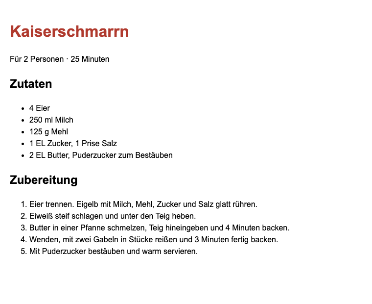
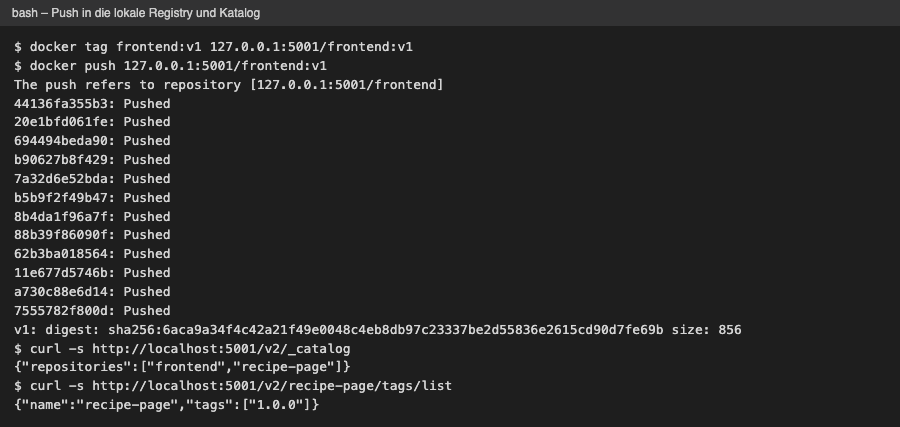

# Lab 3.3 – Lösung: Lokale Registry und Image-Verwaltung

Fertige Dateien: `project/examples/m03-images-registries/l03-local-registry/` mit `recipe-page/` (Dockerfile, `index.html` mit Beispielrezept) und `registry/registry.sh` (Aufgabe 2 bis 4 als Skript).

## Aufgabe 1: Rezeptseite als Image

`playground/recipe-page/Dockerfile`:

```dockerfile
# Rezeptseite (Lab 3.3): statische HTML-Seite mit nginx ausliefern
# Basisimage: nginx 1.30 auf Alpine Linux, fester Tag
FROM nginx:1.30-alpine

# Eigene Startseite über die Standardseite von nginx kopieren
COPY index.html /usr/share/nginx/html/index.html

# nginx lauscht im Container auf Port 80; den Startbefehl bringt das Basisimage mit
EXPOSE 80
```

```bash
cd playground/recipe-page
docker build -t recipe-page:1.0.0 .
docker run -d --name recipe-page -p 8081:80 recipe-page:1.0.0
```



_Quelle: eigener Screenshot, `index.html` der Rezeptseite mit Beispielrezept, 23.11.2026._

Ein `CMD` fehlt bewusst: `nginx:1.30-alpine` startet nginx bereits über sein eigenes `ENTRYPOINT` und `CMD`. Der Ordner `/usr/share/nginx/html` ist der Standardordner, aus dem nginx Dateien ausliefert (bekannt aus Lab 2.2).

## Aufgabe 2: Registry starten, taggen und pushen

```bash
docker run -d -p 5001:5000 --name registry registry:3

docker tag frontend:v1 127.0.0.1:5001/frontend:v1
docker push 127.0.0.1:5001/frontend:v1

docker tag recipe-page:1.0.0 127.0.0.1:5001/recipe-page:1.0.0
docker push 127.0.0.1:5001/recipe-page:1.0.0
```

```text
The push refers to repository [127.0.0.1:5001/frontend]
44136fa355b3: Pushed
20e1bfd061fe: Pushed
694494beda90: Pushed
b90627b8f429: Pushed
…
7555782f800d: Pushed
v1: digest: sha256:6aca9a34f4c42a21f49e0048c4eb8db97c23337be2d55836e2615cd90d7fe69b size: 856

The push refers to repository [127.0.0.1:5001/recipe-page]
e491b2ef6097: Pushed
dd10fcbc32f9: Pushed
80b3ede6a0ae: Pushed
8b2f459e106c: Pushed
44136fa355b3: Mounted from frontend
2392231ead1c: Pushed
b90627b8f429: Mounted from frontend
…
1.0.0: digest: sha256:412021e906dc1503f5d3ea17620717efb2e680a446e5058f692d85ca66a5c8d1 size: 856
```

`Mounted from frontend`: Diese Teile liegen schon im Repository `frontend` der Registry und werden nur verknüpft, nicht erneut hochgeladen. IDs und Digests sind auf jedem Rechner anders.

```bash
docker images
```

```text
IMAGE                              ID             DISK USAGE   CONTENT SIZE   EXTRA
127.0.0.1:5001/frontend:v1         6aca9a34f4c4        108MB         26.1MB
127.0.0.1:5001/recipe-page:1.0.0   412021e906dc       92.2MB           26MB   U
frontend:v1                        6aca9a34f4c4        108MB         26.1MB
nginx:1.30-alpine                  caf4e1e032a2       93.1MB         26.9MB
recipe-page:1.0.0                  412021e906dc       92.2MB           26MB   U
registry:3                         82f6ff4a7f98       82.4MB         19.4MB   U
```

`frontend:v1` und `127.0.0.1:5001/frontend:v1` haben dieselbe ID: `docker tag` legt nur einen zweiten Namen an. Die Registry-Adresse im Namen bestimmt, wohin `docker push` hochlädt.

## Aufgabe 3: Katalog und Tag-Listen im Browser

| Adresse | Antwort |
| --- | --- |
| `http://localhost:5001/v2/_catalog` | `{"repositories":["frontend","recipe-page"]}` |
| `http://localhost:5001/v2/frontend/tags/list` | `{"name":"frontend","tags":["v1"]}` |
| `http://localhost:5001/v2/recipe-page/tags/list` | `{"name":"recipe-page","tags":["1.0.0"]}` |



_Quelle: eigener Screenshot, Registry `registry:3` auf Port 5001, 23.11.2026._

- `repositories`: alle Image-Namen in der Registry; der Name enthält die Registry-Adresse nicht.
- `tags`: alle Versionen eines Repositories.

## Aufgabe 4: Lokal löschen, aus der Registry ziehen

```bash
docker rm -f recipe-page
docker rmi recipe-page:1.0.0 127.0.0.1:5001/recipe-page:1.0.0
docker images
docker pull 127.0.0.1:5001/recipe-page:1.0.0
docker run -d --name recipe-page -p 8081:80 127.0.0.1:5001/recipe-page:1.0.0
```

```text
recipe-page
Untagged: recipe-page:1.0.0
Untagged: 127.0.0.1:5001/recipe-page:1.0.0
Deleted: sha256:412021e906dc1503f5d3ea17620717efb2e680a446e5058f692d85ca66a5c8d1
```

```text
1.0.0: Pulling from recipe-page
8b2f459e106c: Already exists
1cdf0801949d: Already exists
…
2392231ead1c: Download complete
Digest: sha256:412021e906dc1503f5d3ea17620717efb2e680a446e5058f692d85ca66a5c8d1
Status: Downloaded newer image for 127.0.0.1:5001/recipe-page:1.0.0
127.0.0.1:5001/recipe-page:1.0.0
```

- Zwischen `rmi` und `pull` fehlt `recipe-page` in `docker images`; `nginx:1.30-alpine` bleibt, weil es ein eigenes Image ist.
- `Already exists`: Die Schichten von `nginx:1.30-alpine` liegen noch auf dem Rechner und werden nicht erneut geladen; nur die Schicht mit `index.html` kommt aus der Registry. Auf einem frischen Rechner lädt `docker pull` alle Schichten.
- Der Container muss zuerst weg: Solange ein Container ein Image nutzt, verweigert `docker rmi` das Löschen.
- `http://localhost:8081` zeigt danach wieder das eigene Rezept, jetzt aus dem Image der Registry. Genauso würde ein zweiter Rechner im selben Netz das Image ziehen (dort mit der IP-Adresse der Registry statt `127.0.0.1` und eingerichtetem TLS).

## Aufgabe 5: Image als Datei sichern und laden

```bash
docker save -o recipe-page.tar 127.0.0.1:5001/recipe-page:1.0.0
ls -lh recipe-page.tar
docker rm -f recipe-page
docker rmi 127.0.0.1:5001/recipe-page:1.0.0
docker load -i recipe-page.tar
docker images
```

```text
-rw-------  1 kurs  staff    25M 23 Nov 14:41 recipe-page.tar
```

```text
Loaded image: 127.0.0.1:5001/recipe-page:1.0.0
```

- Die `.tar`-Datei enthält alle Schichten samt `nginx:1.30-alpine` (rund 25 MB, etwa die `CONTENT SIZE`) und lässt sich auf einen Rechner ohne Netz kopieren. `-rw-------`: Nur der eigene Benutzer darf die Datei lesen.
- `docker load` stellt Name und Tag wieder her; der Name aus `docker save` bleibt erhalten.
- Die Datei `recipe-page.tar` liegt im Build-Kontext. Für spätere Builds der Rezeptseite gehört sie in eine `.dockerignore` oder wird gelöscht (`rm recipe-page.tar`).

## Erweiterung: Push nach Docker Hub

```bash
docker login
docker tag 127.0.0.1:5001/recipe-page:1.0.0 <docker-hub-name>/recipe-page:1.0.0
docker push <docker-hub-name>/recipe-page:1.0.0
```

```text
The push refers to repository [docker.io/<docker-hub-name>/recipe-page]
…
1.0.0: digest: sha256:… size: 2196
```

Nach Aufgabe 4 existiert die Rezeptseite nur noch unter dem Namen `127.0.0.1:5001/recipe-page:1.0.0`; er dient als Quelle für den neuen Namen. Ohne Registry-Adresse im Namen geht der Push nach `docker.io`. Der erste Push legt ein öffentliches Repository an; es erscheint auf `https://hub.docker.com` unter dem eigenen Konto mit dem Tag `1.0.0`.
