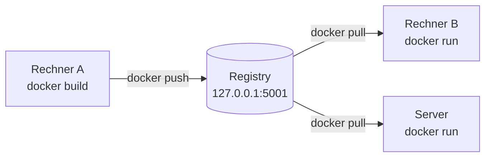
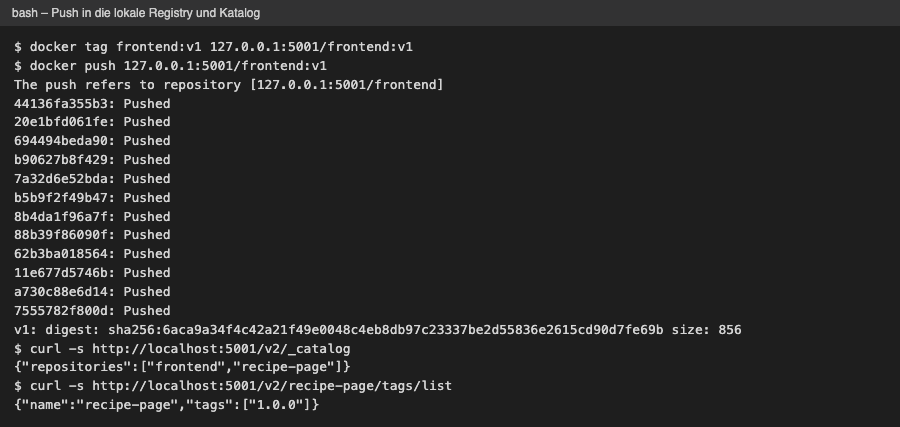

# Lab 3.3: Lokale Registry und Image-Verwaltung

**Leitfragen:**

<details>
<summary>Ein Team von zehn Personen braucht dieselben Images: wo sollen sie liegen?</summary>

An einem gemeinsamen Ort, den alle erreichen: in einer Registry. Ein Image wird einmal hochgeladen (`push`) und von allen heruntergeladen (`pull`); jede Person bekommt exakt dasselbe Image.

</details>

<details>
<summary>Wie kommt ein Programm auf einen Rechner ohne Internetzugang?</summary>

Über eine Registry im eigenen Netz oder als Datei: `docker save` schreibt ein Image in ein `.tar`-Archiv, das per USB-Stick oder Netzlaufwerk transportiert und mit `docker load` wieder eingelesen wird.

</details>

- Eine Registry ist ein zentraler Speicherort für Images. Docker Hub ist die größte öffentliche Registry; Firmen betreiben zusätzlich private Registries.
- Der Name eines Images enthält die Registry-Adresse. `docker tag` gibt einem Image einen weiteren Namen, `docker push` lädt es hoch, `docker pull` lädt es herunter.
- Tags sind Versionsnamen: semantische Versionierung macht Änderungen nachvollziehbar; `latest` gehört nicht in die Produktion.

## Begriffe

| Begriff | Bedeutung |
| --- | --- |
| Registry | Server, der Images speichert und über HTTP(S) ausliefert; wie ein App-Store für Images |
| Repository | alle Versionen eines Images unter einem Namen in einer Registry, z. B. `recipe-page` mit den Tags `1.0.0` und `1.1.0` |
| `push` | Image von der eigenen Maschine in eine Registry hochladen |
| `pull` | Image aus einer Registry herunterladen |
| öffentliche Registry | Registry, aus der jede Person Images laden kann, z. B. Docker Hub |
| private Registry | Registry mit Zugriffsschutz, z. B. im Firmennetz oder als Cloud-Dienst |
| Digest | Prüfwert eines Images (`sha256:…`); ändert sich bei jeder Änderung am Inhalt, im Gegensatz zum Tag |
| semantische Versionierung | Versionsnummer `MAJOR.MINOR.PATCH`, deren Teile die Art der Änderung anzeigen |
| Zugangstoken | geheime Zeichenfolge, die bei `docker login` statt des Passworts genutzt wird und sich einzeln widerrufen lässt |

## Registries: Einrichtung und Zweck

Eine Docker-Registry ist ein zentraler Speicherort für Images. Sie ermöglicht es, Images zu speichern, zu organisieren und zu teilen. Registries können öffentlich sein (Docker Hub) oder privat betrieben werden, um firmeninterne Images zu verwalten.



Der vollständige Name eines Images sagt Docker, aus welcher Registry es kommt:

```text
127.0.0.1:5001/recipe-page:1.0.0
└─ Registry ─┘ └Repository┘ └Tag┘
```

| Name wie eingegeben | vollständiger Name | Registry |
| --- | --- | --- |
| `nginx:1.30-alpine` | `docker.io/library/nginx:1.30-alpine` | Docker Hub, offizielles Image (`library`) |
| `prom/prometheus` | `docker.io/prom/prometheus:latest` | Docker Hub, Konto `prom` |
| `ghcr.io/google/cadvisor:0.61.1` | unverändert | GitHub Container Registry |
| `127.0.0.1:5001/recipe-page:1.0.0` | unverändert | eigene Registry auf Port 5001 |

Ohne Registry-Adresse ergänzt Docker `docker.io`, ohne Konto `library`, ohne Tag `latest`.

## Docker Hub als öffentliche Registry

Docker Hub ist die größte öffentliche Registry. Sie bietet eine Vielzahl vorkonfigurierter Images für Anwendungen und Betriebssysteme: offizielle Images (z. B. `nginx`, `python`, `ubuntu`), Images geprüfter Hersteller und Images von Nutzerinnen und Nutzern. Jede Person mit Konto kann eigene Images hochladen und fremde Images für eigene Anwendungen verwenden.

| Konto (Stand 23.11.2026) | Pulls je 6 Stunden | öffentliche Repositories | private Repositories |
| --- | --- | --- | --- |
| ohne Anmeldung | 100 je IPv4-Adresse bzw. IPv6-/64-Netz | – | – |
| Personal (kostenlos, angemeldet) | 200 | unbegrenzt | bis zu 1 |
| Pro, Team, Business (bezahlt) | unbegrenzt | unbegrenzt | unbegrenzt |

Quelle: [Docker Hub usage and limits](https://docs.docker.com/docker-hub/usage/), abgerufen am 23.11.2026. Für `docker login` empfiehlt Docker ein persönliches Zugangstoken (Personal Access Token) statt des Passworts; es lässt sich auf Lesen beschränken und einzeln widerrufen ([Access tokens](https://docs.docker.com/security/access-tokens/), abgerufen am 23.11.2026). Anmeldung: [Setup](../../00-setup-and-installation.md#docker-hub-limit-und-docker-login).

## Private Registries erstellen

Organisationen erstellen private Registries, um die interne Verwaltung von Images zu kontrollieren: Images mit Firmencode bleiben im eigenen Netz, Server ohne Internetzugang laden aus der eigenen Registry, und das Pull-Limit von Docker Hub spielt keine Rolle.

| Registry | Art | Einsatz |
| --- | --- | --- |
| `registry:3` (CNCF Distribution) | Open Source, ein Container, ohne Oberfläche | Lernen, Tests, kleine Teams; Basis vieler anderer Registries |
| Harbor | Open Source, CNCF-Projekt mit Weboberfläche, Benutzern, Rollen und Sicherheits-Scans | firmeninterne Registry |
| GitHub Container Registry (`ghcr.io`) | Cloud-Dienst von GitHub | Images neben dem Quellcode auf GitHub |
| Cloud-Registries | Amazon ECR, Azure Container Registry, Google Artifact Registry | Images für Server in derselben Cloud |
| Mirantis Secure Registry | kommerziell | Nachfolger der früheren Docker Trusted Registry (DTR) |

- **Docker Trusted Registry (DTR)** aus älteren Unterlagen gibt es unter diesem Namen nicht mehr: Mirantis übernahm 2019 das Enterprise-Geschäft von Docker, das Produkt heißt seitdem Mirantis Secure Registry ([Mirantis: DTR is now MSR](https://docs.mirantis.com/mke/3.4/common/dtr-msr.html), abgerufen am 23.11.2026).
- **Harbor** ist seit dem 15.06.2020 ein „Graduated"-Projekt der Cloud Native Computing Foundation ([CNCF: Harbor](https://www.cncf.io/projects/harbor/), abgerufen am 23.11.2026).


_Quelle: Harbor-Projekt, „Repositories" (https://goharbor.io/docs/main/working-with-projects/working-with-images/repositories/), abgerufen am 23.11.2026._

### Lokale Registry mit registry:3

Die einfachste private Registry ist das offizielle Image `registry:3`. Im Container lauscht sie auf Port 5000; im Kurs wird sie auf Port 5001 des Rechners veröffentlicht, weil macOS Port 5000 für den AirPlay-Empfänger belegt.

```bash
docker run -d -p 5001:5000 --name registry registry:3           # Registry starten
docker tag frontend:v1 127.0.0.1:5001/frontend:v1               # zweiter Name mit Registry-Adresse
docker push 127.0.0.1:5001/frontend:v1                          # hochladen
docker pull 127.0.0.1:5001/frontend:v1                          # herunterladen, z. B. auf einem anderen Rechner
```

| Adresse im Browser | Inhalt |
| --- | --- |
| `http://localhost:5001/v2/_catalog` | Liste aller Repositories, z. B. `{"repositories":["frontend","recipe-page"]}` |
| `http://localhost:5001/v2/<image-name>/tags/list` | Tags eines Repositories, z. B. `{"name":"frontend","tags":["v1"]}` |

- `docker tag` kopiert nichts: Beide Namen zeigen auf dasselbe Image (gleiche ID in `docker images`).
- `docker push` überträgt nur Schichten, die in der Registry noch fehlen; gemeinsame Schichten (z. B. `python:3.13-alpine`) werden nur einmal gespeichert.
- Die Kurs-Registry nutzt HTTP ohne Verschlüsselung und ohne Anmeldung. Docker erlaubt das ohne weitere Einstellung nur für Adressen im Bereich `127.0.0.0/8`; im Firmennetz gehören TLS und Benutzerverwaltung dazu ([dockerd: insecure registries](https://docs.docker.com/reference/cli/dockerd/#insecure-registries), abgerufen am 23.11.2026).
- Daten der Registry liegen in der Container-Schicht und sind mit `docker rm` weg. Dauerhaft speichern lassen sie sich mit einem Volume (Lab 4.3).



_Quelle: eigener Screenshot, Registry `registry:3` auf Port 5001, 23.11.2026._

## Images versionieren und taggen

Tags dienen der Versionskontrolle (z. B. `v1.0`, `1.0.0`, `latest`). Über eigene Tags lassen sich auch Umgebungen unterscheiden, etwa Staging (Testsystem) und Produktion. Ein Image kann beliebig viele Tags tragen:


_Quelle: Docker Inc., „Trusted content" (https://docs.docker.com/docker-hub/image-library/trusted-content/), abgerufen am 23.11.2026. Stand des Bildes: Februar 2024; heute zeigt `latest` bei Ubuntu auf 24.04._

Das Bild zeigt, warum `latest` unzuverlässig ist: Der Tag wandert mit jeder neuen Version weiter. `ubuntu:latest` war 2024 Ubuntu 22.04 und ist heute 24.04.

```bash
docker tag recipe-page:1.0.0 recipe-page:1.0      # Kurzform für die Minor-Version
docker tag recipe-page:1.0.0 recipe-page:staging  # Umgebung
```

### Best Practices beim Tagging

- **Semantische Versionierung** (`MAJOR.MINOR.PATCH`) macht Änderungen nachvollziehbar: `PATCH` für Fehlerbehebungen (`1.0.1`), `MINOR` für neue Funktionen ohne Bruch (`1.1.0`), `MAJOR` für inkompatible Änderungen (`2.0.0`) ([semver.org](https://semver.org/lang/de/), abgerufen am 23.11.2026).
- **Kein `latest` in der Produktion:** Der Tag kann sich jederzeit ändern; zwei Server mit `latest` laufen unbemerkt mit unterschiedlichen Versionen.
- **Einmal vergebene Versionen nicht überschreiben:** `1.0.0` bleibt `1.0.0`; jede Änderung bekommt eine neue Nummer.
- **Digest für absolute Sicherheit:** `nginx:1.30-alpine@sha256:…` lädt genau dieses Image, selbst wenn der Tag später verschoben wird.

## Images sichern mit save und load

| Befehl | Wirkung |
| --- | --- |
| `docker save -o recipe-page.tar recipe-page:1.0.0` | Image exportieren: alle Schichten und Metadaten in eine `.tar`-Datei schreiben |
| `docker load -i recipe-page.tar` | Image importieren: ein gespeichertes Image wiederherstellen, mit Name und Tag |

`save` und `load` eignen sich für Rechner ohne Netzverbindung zur Registry und für einzelne Sicherungen. Mehrere Images passen in eine Datei: `docker save -o images.tar frontend:v1 backend:v1`. Für viele Images und Teams ist eine Registry übersichtlicher, weil gemeinsame Schichten dort nur einmal liegen.

Nicht verwechseln: `docker export` und `docker import` sichern das Dateisystem eines Containers ohne Schichten, Startbefehl und Einstellungen; für Images gelten `save` und `load`.

## Sicherung über eine private Registry

Eine private Registry dient als zentraler Speicher und Sicherung aller Images: Jedes gebaute Image wird mit Versions-Tag gepusht und ist danach von jedem Rechner im Netz wiederherstellbar.

```bash
docker push 127.0.0.1:5001/recipe-page:1.0.0
```

Das Skript `project/examples/m03-images-registries/l03-local-registry/registry/registry.sh` führt alle Schritte der Übung in einem Durchlauf aus: Registry starten, taggen, pushen, Katalog abfragen, lokal löschen, ziehen und starten.

## Typische Fehler

| Symptom | Ursache | Lösung |
| --- | --- | --- |
| `Bind for 0.0.0.0:5001 failed: port is already allocated` | Registry läuft schon oder ein anderes Programm nutzt den Port | `docker ps`; alte Registry mit `docker rm -f registry` entfernen |
| `Ports are not available: … 5000` beim Start auf Port 5000 | macOS belegt Port 5000 (AirPlay-Empfänger) | Port 5001 nutzen wie im Kurs |
| `An image does not exist locally with the tag: 127.0.0.1:5001/…` beim Push | Image nicht mit Registry-Adresse getaggt | erst `docker tag`, dann `docker push` |
| `push access denied … insufficient_scope` | Push nach Docker Hub ohne Anmeldung oder fremdes Konto im Namen | `docker login`; Name mit eigenem Konto (`<konto>/recipe-page:1.0.0`) |
| `http: server gave HTTP response to HTTPS client` | Registry ohne TLS unter einer anderen Adresse als `127.0.0.1`/`localhost` | Kurs-Registry über `127.0.0.1:5001` ansprechen |
| `conflict: unable to remove repository reference … container … is using its referenced image` | Container nutzt das Image noch | Container zuerst mit `docker rm -f <name>` entfernen |
| Katalog leer nach Neustart der Registry | Container wurde gelöscht, Daten lagen in der Container-Schicht | Images erneut pushen; dauerhaft mit Volume (Lab 4.3) |

## Fazit

- Eine Registry speichert und verteilt Images: `docker tag` mit Registry-Adresse, dann `docker push`; andere Rechner nutzen `docker pull`.
- Docker Hub ist öffentlich und hat Pull-Limits; private Registries (`registry:3`, Harbor, `ghcr.io`, Cloud) halten Firmen-Images im eigenen Zugriff.
- Feste Versions-Tags nach `MAJOR.MINOR.PATCH` statt `latest` machen nachvollziehbar, was läuft.
- `docker save` und `docker load` bringen Images als Datei auf Rechner ohne Registry-Zugang.

In der Übung entsteht eine Rezeptseite als Image; sie landet zusammen mit `frontend:v1` in der eigenen Registry und als `.tar`-Datei auf der Festplatte.
