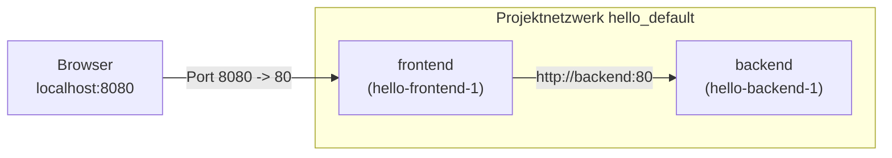

# Lab 4.1: Einführung in Docker Compose

**Leitfragen:**

<details>
<summary>Welche Angaben aus den <code>docker run</code>-Befehlen von Tag 1 müssten in einer Datei stehen?</summary>

Image oder Build-Ordner, Containername, Ports (`-p`), eingebundene Ordner (`-v`), Umgebungsvariablen und Build-Argumente. Docker Compose schreibt genau diese Angaben je Dienst in eine YAML-Datei.

</details>

<details>
<summary>Wie startet ein neues Teammitglied am ersten Tag die ganze Anwendung?</summary>

Mit einem einzigen Befehl im Projektordner: `docker compose up -d`. Alle Container, ihr gemeinsames Netzwerk und ihre Einstellungen kommen aus der Compose-Datei, die im Projekt liegt.

</details>

- Docker Compose beschreibt eine Anwendung aus mehreren Containern in einer YAML-Datei und startet sie mit einem Befehl.
- Die Hello-App aus Lab 3.2 läuft ab jetzt über Compose: Frontend und Backend finden sich, ohne dass ein `docker run` von Hand nötig ist.

## Begriffe

| Begriff | Bedeutung |
| --- | --- |
| Docker Compose | Werkzeug, das mehrere Container nach einer Beschreibungsdatei gemeinsam startet, stoppt und anzeigt; Teil von Docker Desktop, Aufruf `docker compose` |
| Compose-Datei | YAML-Datei mit der Beschreibung der Anwendung, Standardname `compose.yaml` oder `compose.yml`; wie ein Bauplan für alle Container auf einmal |
| YAML | Textformat für Konfigurationen: `schlüssel: wert`, Einrückung mit Leerzeichen zeigt, was wozu gehört, `-` beginnt einen Listeneintrag |
| Service (Dienst) | ein Baustein der Anwendung in der Compose-Datei, z. B. `frontend`; Compose startet daraus einen oder mehrere gleiche Container |
| Replika | eine von mehreren gleichen Kopien eines Dienstes (`deploy.replicas`) |
| Projekt | alle Container, Netzwerke und Volumes einer Compose-Datei; der Projektname ist standardmäßig der Ordnername, hier `hello` |
| Build-Kontext | Ordner, den Docker beim Bauen eines Images liest (wie der Punkt in `docker build .`) |
| Umgebungsvariable | benannter Wert, den ein Programm beim Start aus seiner Umgebung liest, z. B. `APP_COLOR=lightblue` |
| `.env` | Datei im Projektordner, aus der Compose Werte für Platzhalter wie `${FE_PORT}` in der Compose-Datei liest |
| Projektnetzwerk | Netzwerk, das Compose für jedes Projekt anlegt (`hello_default`); alle Dienste darin erreichen sich über ihren Dienstnamen |

## Docker Compose: mehrere Container aus einer Datei

Die Hello-App besteht aus zwei Containern. Bisher brauchte jeder einen eigenen `docker build`- und `docker run`-Befehl mit allen Optionen. Compose fasst diese Angaben in einer Datei zusammen:

- **Definition:** Docker Compose ist ein Werkzeug, mit dem eine Anwendung aus mehreren Containern (Multi-Container-Anwendung) in einer YAML-Datei definiert und verwaltet wird.
- **Ein Befehl:** `docker compose up` baut fehlende Images, legt ein Netzwerk an und startet alle Dienste; `docker compose down` stoppt und entfernt Container und Netzwerk wieder.


_Quelle: Docker Inc., „How Compose works" (https://docs.docker.com/compose/intro/compose-application-model/), abgerufen am 23.11.2026._

Das Bild zeigt, was eine Compose-Datei beschreibt: Dienste (Frontend, Backend), den veröffentlichten Port (443), das Netzwerk zwischen den Diensten und ein Volume für dauerhafte Daten.

| Befehl | Wirkung |
| --- | --- |
| `docker compose up` | Dienste aus der Compose-Datei starten; Ausgaben aller Container laufen im Terminal mit (`Strg+C` stoppt) |
| `docker compose up -d` | dasselbe im Hintergrund (`-d` = detached), das Terminal bleibt frei |
| `docker compose ps` | Status der Container dieses Projekts anzeigen |
| `docker compose logs` | Ausgaben aller Dienste anzeigen; `docker compose logs -f frontend` liest einen Dienst live mit |
| `docker compose down` | Container und Netzwerk des Projekts stoppen und entfernen; Images bleiben |

Alle Befehle wirken auf die Compose-Datei im aktuellen Ordner. Eine Datei mit anderem Namen wählt `-f`, das **vor** dem Unterbefehl steht: `docker compose -f compose-minimal.yml up -d`. Derselbe `-f`-Wert gehört dann auch zu `ps`, `logs` und `down`.

## Anwendungsszenarien für Compose

| Szenario | Einsatz |
| --- | --- |
| Entwicklungsumgebungen | Datenbank, Webserver und weitere Abhängigkeiten laufen mit einem Befehl auf dem eigenen Rechner, für alle im Team gleich |
| Testumgebungen | Tests laufen gegen eine Umgebung mit festgelegter Konfiguration und festen Abhängigkeiten, die jedes Mal gleich startet |
| Produktionsbereitstellung | Betrieb auf einem einzelnen Server, wenn die Anforderungen nicht sehr komplex sind; für mehrere Server folgt Swarm in Modul 10 |

## Aufbau einer Compose-Datei

Compose-Dateien sind YAML-Dateien (`.yaml` oder `.yml`). Sie definieren Dienste, Netzwerke und Volumes. Die kleinste Compose-Datei der Hello-App:

```yaml
# playground/hello/compose-minimal.yml
services:                 # oberste Ebene: alle Dienste der Anwendung
  frontend:               # Dienstname, frei wählbar; zugleich Hostname im Projektnetzwerk
    build: frontend       # Image aus dem Ordner frontend/ bauen (dort liegt das Dockerfile)
    ports:
      - 8080:80           # Rechner-Port 8080 -> Container-Port 80

  backend:
    build: backend        # kein Port nach außen: nur das Frontend fragt das Backend
```

YAML-Regeln, die in jeder Compose-Datei gelten:

- Einrückung nur mit Leerzeichen (keine Tabs); zwei Leerzeichen je Ebene sind üblich. Was gleich weit eingerückt ist, steht auf derselben Ebene.
- `schlüssel: wert` mit Leerzeichen nach dem Doppelpunkt; `- ` beginnt einen Listeneintrag; `#` beginnt einen Kommentar.
- Neben `services:` kann die oberste Ebene `volumes:` und `networks:` enthalten (Lab 4.3, Modul 5).

Compose sucht im aktuellen Ordner nach `compose.yaml` (empfohlen), `compose.yml` und aus Kompatibilitätsgründen nach `docker-compose.yaml` und `docker-compose.yml`. Die Hello-App hat mehrere Varianten nebeneinander, deshalb wählt `-f` die Datei.

### Compose v1, v2 und v5 und das Feld `version:`


_Quelle: Docker Inc., „History and development of Docker Compose" (https://docs.docker.com/compose/intro/history/), abgerufen am 23.11.2026._

| | Compose v1 | Compose v2 und v5 (heute) |
| --- | --- | --- |
| Befehl | `docker-compose` (mit Bindestrich, eigenes Programm) | `docker compose` (Unterbefehl von `docker`) |
| Sprache | Python, erschienen 2014 | Go; v2 seit 2020, v5 seit 2025 mit zusätzlichem Go-SDK |
| Dateiformat | Versionen 1, 2.x, 3.x, angegeben mit `version: "3.7"` | Compose Specification ohne Versionsnummer |
| Status | nicht mehr unterstützt | aktuell; Docker Desktop bringt Compose mit (`docker compose version`) |

Ältere Compose-Dateien beginnen mit `version: "3.7"` oder ähnlich; früher war diese Angabe Pflicht. Aktuelle Versionen von Compose ignorieren das Feld und melden es als veraltet (``the attribute `version` is obsolete, it will be ignored``). Neue Dateien lassen es weg. Anleitungen mit `docker-compose` funktionieren, wenn der Bindestrich durch ein Leerzeichen ersetzt wird.

## Service-Optionen image, build, ports, volumes, environment und env_file

Ein Dienst wird durch seine Optionen konfiguriert. Jede Option entspricht einer Angabe von Tag 1:

| Option | entspricht | Zweck |
| --- | --- | --- |
| `image` | Image-Name bei `docker run` | welches Image der Dienst nutzt, z. B. `nginx:1.30-alpine`; praktisch, wenn das Image auf Docker Hub oder in einer Registry liegt |
| `build` | `docker build` | Image aus einem eigenen Dockerfile bauen; Pfad zum Build-Kontext und weitere Optionen wie Build-Argumente |
| `ports` | `-p` | Rechner-Port mit Container-Port verbinden, Syntax `Rechner-Port:Container-Port`; macht den Dienst von außen erreichbar |
| `volumes` | `-v` | Ordner des Rechners (Bind Mount, Lab 2.2) oder Named Volume (Lab 4.3) einbinden; Daten bleiben über Neustarts erhalten |
| `environment` | `-e` | Umgebungsvariablen für den Container, z. B. Benutzername und Passwort einer Datenbank |
| `env_file` | `--env-file` | Umgebungsvariablen aus einer externen Datei laden |
| `deploy.replicas` | mehrere `docker run` | Anzahl gleicher Container eines Dienstes |

### image, ports, volumes und replicas: compose-simple.yml

Zwei Dienste aus einem fertigen Image, ohne eigenes Dockerfile:

```yaml
# playground/hello/compose-simple.yml
services:
  web:
    image: nginx:1.30-alpine
    ports:
      - 9000:80                             # Rechner-Port 9000 -> Container-Port 80
    volumes:
      - ./web:/usr/share/nginx/html         # Bind Mount: Ordner web/ als Webseite

  extra:
    image: nginx:1.30-alpine
    deploy:
      replicas: 2                           # zwei Container aus demselben Dienst
```

`./web` ist relativ zum Ordner der Compose-Datei. Compose übersetzt den relativen Pfad selbst, deshalb funktioniert die Datei auf jedem Rechner. `extra` hat keinen Port: Zwei Container könnten nicht beide den Rechner-Port 9000 belegen.

### build mit Build-Argumenten und environment: compose-with-custom-image.yml

```yaml
# playground/hello/compose-with-custom-image.yml
services:
  frontend:
    image: frontend:v1                      # Name des gebauten Images
    build:
      context: ./frontend                   # Build-Kontext mit Dockerfile
      args:
        - APP_VERSION=1.0.0                 # Build-Zeit: landet über ARG/ENV im Image (Lab 3.2)
    ports:
      - 8080:80
    environment:
      - APP_COLOR=lightblue                 # Laufzeit: überschreibt den Standardwert yellow

  backend:
    image: backend:v1
    build: backend
    deploy:
      replicas: 2
```

- `build` und `image` zusammen: Compose baut das Image und gibt ihm den Namen aus `image`. Ohne `image` heißt es `<projekt>-<dienst>`, z. B. `hello-frontend`.
- **Existiert das Image schon, baut `up` nicht neu.** `docker compose up -d --build` erzwingt den Build, z. B. nach einer Code-Änderung oder mit neuen Build-Argumenten.
- `environment` gibt es in zwei Schreibweisen: als Liste (`- APP_COLOR=lightblue`) oder als Zuordnung (`APP_COLOR: lightblue`).

### Werte aus .env und env_file: compose-with-config.yml

Konfiguration gehört nicht fest in die Compose-Datei, wenn sie sich je Rechner oder Umgebung ändert. Dafür gibt es zwei verschiedene Dateien:

```bash
# playground/hello/.env: wird von docker compose automatisch gelesen und in ${...} eingesetzt
FE_PORT=8080
FE_VERSION=1.1.0
BE_REPLICAS=3
```

```bash
# playground/hello/app-config.env: Umgebungsvariablen für die Container (env_file)
APP_COLOR=lightgreen
```

```yaml
# Ausschnitt aus compose-with-config.yml
    build:
      context: ./frontend
      args:
        - APP_VERSION=${FE_VERSION}         # aus .env, nur beim Bauen
    ports:
      - ${FE_PORT}:80                       # aus .env
    env_file:
      - app-config.env                      # Laufzeit-Variablen für den Container
```

| Mechanismus | Wer liest die Werte? | Wann wirksam? |
| --- | --- | --- |
| `.env` mit `${VAR}` in der Compose-Datei | Compose selbst, beim Einlesen der Datei | bei jedem `docker compose`-Befehl; im Container nicht sichtbar |
| `environment:` | der Container | beim Start des Containers |
| `env_file:` | der Container | beim Start des Containers |
| `build.args` | das Dockerfile (`ARG`) | nur beim Bauen des Images |

`docker compose -f compose-with-config.yml config` zeigt die Datei so, wie Compose sie nach dem Einsetzen aller Werte versteht. Fehlt eine Variable in `.env`, warnt Compose (`The "FE_PORT" variable is not set. Defaulting to a blank string.`) und setzt einen leeren Text ein; bei `deploy.replicas` bricht es dann ab. `${FE_PORT:-8080}` gibt einen Standardwert vor.

## Projektnetzwerk und Dienstnamen

Compose legt für jedes Projekt ein eigenes Netzwerk an (`hello_default`) und hängt alle Dienste hinein. Darin erreicht jeder Dienst den anderen über seinen **Dienstnamen**: Das Frontend fragt `http://backend:80`, ohne eine IP-Adresse zu kennen. Deshalb zeigt die Hello-Seite jetzt die Antwort des Backends statt „Backend nicht erreichbar" wie in Lab 3.2. Details zu Netzwerken folgen in Modul 5.



Container heißen `<projekt>-<dienst>-<nummer>`, z. B. `hello-frontend-1`. Bei mehreren Replikas zählt die Nummer hoch.


_Quelle: eigener Screenshot, Hello-App mit compose-minimal.yml, 23.11.2026._

## Die Compose-Varianten der Hello-App

| Datei | Neu darin | Ergebnis |
| --- | --- | --- |
| `compose-simple.yml` | `image`, `ports`, `volumes` (Bind Mount), `deploy.replicas` | nginx zeigt `web/index.html` auf Port 9000, dazu zwei `extra`-Container |
| `compose-minimal.yml` | `build` | Hello-App auf Port 8080, Frontend erreicht `backend:80` |
| `compose-with-custom-image.yml` | `image` + `build`, Build-Argument, `environment` | Image-Namen `frontend:v1`/`backend:v1`, hellblaue Seite, zwei Backends |
| `compose-with-config.yml` | `${...}` aus `.env`, `env_file` | Port, Version und Anzahl der Backends aus `.env`, hellgrüne Seite |

Alle Dateien liegen im selben Ordner und gehören damit zum selben Projekt `hello`. Vor dem Wechsel auf eine andere Datei stoppt `docker compose -f <alte Datei> down` die Container der vorigen.

## Typische Fehler

| Symptom | Ursache | Lösung |
| --- | --- | --- |
| `no configuration file provided: not found` | im falschen Ordner oder Datei heißt nicht `compose.yaml`/`compose.yml` | `cd playground/hello`, Datei mit `-f` angeben |
| `unknown shorthand flag: 'f' in -f` | `-f` hinter dem Unterbefehl (`docker compose up -f …`) | `-f` vor den Unterbefehl: `docker compose -f datei.yml up -d` |
| `go-yaml load error … mapping values are not allowed in this context` | Einrückung falsch | gleich weit einrücken; Zeile und Spalte stehen in der Meldung (`L4.C10`) |
| `found character that cannot start any token` | Tab statt Leerzeichen | Tabs durch Leerzeichen ersetzen; VS Code zeigt unten rechts „Spaces: 2“ |
| `Bind for 0.0.0.0:8080 failed: port is already allocated` | ein anderer Container nutzt den Port schon (z. B. aus Tag 1) | `docker ps` prüfen, alten Container mit `docker rm -f` entfernen oder Port ändern |
| Änderung an Build-Argument oder Code nicht sichtbar | Image existierte schon, `up` baut dann nicht neu | `docker compose up -d --build` |
| `Found orphan containers` | Container einer anderen Compose-Datei desselben Projekts laufen noch | vorige Datei mit `-f … down` stoppen oder `up -d --remove-orphans` |
| ``the attribute `version` is obsolete, it will be ignored`` | alte Datei mit `version:` | Zeile `version:` löschen |

## Fazit

- Eine Compose-Datei beschreibt Dienste mit `image` oder `build`, `ports`, `volumes`, `environment` und `env_file`; `docker compose up -d` und `down` starten und entfernen alles auf einmal.
- `docker compose` (v2/v5) ersetzt `docker-compose`; das Feld `version:` ist veraltet und entfällt.
- Compose legt ein Projektnetzwerk an, in dem sich Dienste über ihren Namen erreichen.
- `.env` liefert Werte für die Compose-Datei, `environment`/`env_file` Werte für den Container, `build.args` Werte für das Bauen.

In der Übung läuft die Hello-App nacheinander mit allen vier Compose-Varianten.
