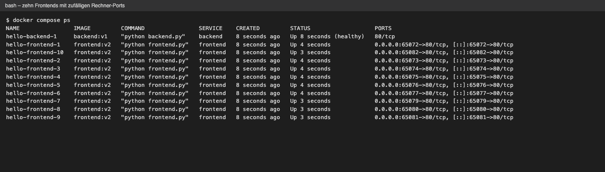
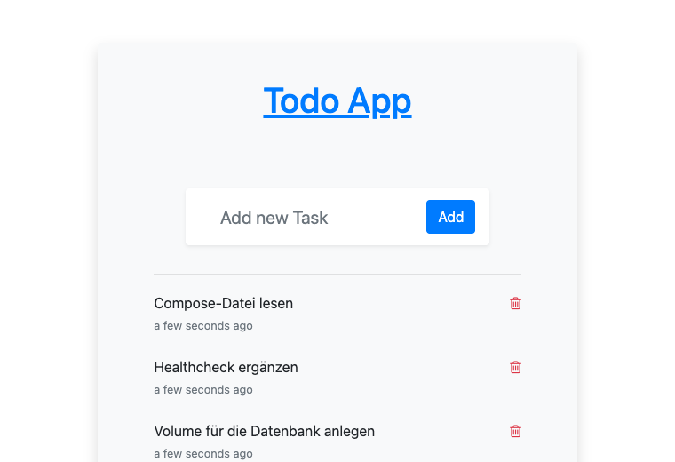
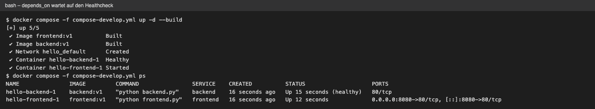

# Lab 4.2: Multi-Container-Anwendungen erstellen

**Leitfragen:**

<details>
<summary>Ein Programm läuft, antwortet aber nicht mehr: woran merkt man das von außen?</summary>

Nur durch regelmäßiges Nachfragen, z. B. eine Testanfrage alle paar Sekunden. Docker macht das mit einem Healthcheck und markiert den Container als `healthy` oder `unhealthy`.

</details>

<details>
<summary>Wie oft am Tag baut ein Entwickler die App neu, und wie lange wartet er jedes Mal?</summary>

Oft dutzende Male, jedes Mal mit Build- und Startbefehl. Compose Watch beobachtet die Dateien und baut oder synchronisiert bei jeder Änderung selbst.

</details>

<details>
<summary>Zehn Kopien desselben Dienstes: wie bekommen sie unterschiedliche Ports?</summary>

Gar nicht von Hand: Wird nur der Container-Port angegeben (`":80"`), wählt Docker für jede Kopie einen freien Rechner-Port.

</details>

- Eine Multi-Container-Anwendung besteht aus mehreren Diensten, die getrennt laufen und miteinander sprechen; Compose startet, skaliert und überwacht sie gemeinsam.
- Drei Compose-Werkzeuge machen daraus eine Entwicklungsumgebung: `depends_on` mit Healthcheck (Startreihenfolge), `develop.watch` (automatischer Neubau) und `deploy.replicas` (mehrere Kopien).

## Begriffe

| Begriff | Bedeutung |
| --- | --- |
| Multi-Container-Anwendung | Anwendung aus mehreren Containern, je einer pro Aufgabe (Webserver, Backend, Datenbank), die über das Netzwerk zusammenarbeiten |
| Microservice | kleiner, eigenständiger Dienst mit genau einer Aufgabe, der über eine Schnittstelle (API) mit anderen spricht; vertieft in Lab 4.4 |
| Skalieren | mehr oder weniger Kopien (Replikas) eines Dienstes starten, um mehr Last zu tragen |
| `depends_on` | legt fest, welcher Dienst vor einem anderen starten muss |
| Healthcheck | Befehl, den Docker regelmäßig im Container ausführt, um zu prüfen, ob das Programm antwortet |
| `healthy` / `unhealthy` | Ergebnis des Healthchecks: Prüfung erfolgreich / mehrfach fehlgeschlagen; vorher `starting` |
| Compose Watch | Modus, in dem Compose Dateien beobachtet und den Container bei Änderungen aktualisiert (`docker compose watch`) |
| Live-Reload | Browser lädt die Seite selbst neu, sobald sich der Code ändert |

## Multi-Container-Anwendungen

In einer Multi-Container-Anwendung laufen mehrere Container als einzelne Dienste, die miteinander interagieren. Das macht die Anwendung modular und flexibel.

| Vorteil | Bedeutung |
| --- | --- |
| Skalierbarkeit | ein stark genutzter Dienst bekommt mehr Kopien, die anderen nicht |
| Unabhängigkeit der Komponenten | jeder Dienst hat eigenes Image, eigene Version, eigene Abhängigkeiten |
| leichtere Wartbarkeit | ein Dienst wird ausgetauscht oder aktualisiert, ohne die anderen anzufassen |

Beispiel: eine Webanwendung mit einem Backend (z. B. Node.js) und einer Datenbank (z. B. MongoDB) in getrennten Containern. Genau so ist das Live-Beispiel unten aufgebaut; die Hello-App folgt demselben Muster mit Frontend und Backend.

### Microservices-Architektur

Bei einer Microservices-Architektur besteht eine Anwendung aus kleinen, unabhängigen Diensten, die über APIs miteinander kommunizieren. Docker Compose definiert und verwaltet mehrere containerisierte Microservices in einer Datei. Wie eine große Anwendung in Microservices zerlegt wird, behandelt Lab 4.4.

## Dienste mit Compose skalieren

Skalieren fängt Lastspitzen ab und hält die Anwendung verfügbar, auch wenn eine Kopie ausfällt.

| Weg | Beispiel | Wirkung |
| --- | --- | --- |
| in der Compose-Datei | `deploy:` → `replicas: 10` | jeder `up` startet zehn Container des Dienstes |
| beim Start | `docker compose up -d --scale frontend=3` | überschreibt den Wert aus der Datei für diesen Aufruf |

Mehrere Kopien können nicht denselben Rechner-Port belegen. Deshalb steht bei skalierten Diensten nur der Container-Port:

```yaml
    ports:
      - ":80"          # nur Container-Port: Docker wählt je Kopie einen freien Rechner-Port
```

`docker compose ps` zeigt dann für jeden Container einen anderen Port, z. B. `0.0.0.0:55003->80/tcp`. `docker compose port --index 3 frontend 80` gibt den Port der dritten Kopie aus.

Docker Compose ist ideal für lokale und Entwicklungsumgebungen auf einem Rechner. Für Produktionsumgebungen mit mehreren Servern sind Orchestrierer wie Docker Swarm (Modul 10) oder Kubernetes besser geeignet.



_Quelle: eigener Screenshot, Hello-App mit compose.yml, 23.11.2026._

## Live-Beispiel: docker/multi-container-app

Docker stellt eine kleine Todo-App als Beispiel bereit: [github.com/docker/multi-container-app](https://github.com/docker/multi-container-app). Sie besteht aus einer Node.js-App (`app/`) und einer MongoDB-Datenbank. Projekt holen und starten:

```bash
git clone https://github.com/docker/multi-container-app   # oder auf GitHub: Code > Download ZIP
cd multi-container-app
docker compose up -d                                       # danach http://localhost:3000
```

Die `compose.yaml` des Repos (Stand: letzter Commit vom 04.06.2026, abgerufen am 23.11.2026; Kommentare gekürzt):

```yaml
services:
  todo-app:
    build:
      context: ./app            # Image aus app/Dockerfile bauen
    depends_on:
      - todo-database           # Datenbank-Container zuerst starten
    environment:
      NODE_ENV: production      # Node.js im Produktionsmodus
    ports:
      - 3000:3000               # Webserver der App
      - 35729:35729             # Live-Reload
    develop:
      watch:
        - path: ./app/package.json
          action: rebuild       # neue Abhängigkeiten: Image neu bauen
        - path: ./app
          target: /usr/src/app
          action: sync          # geänderter Code: Datei in den Container kopieren

  todo-database:
    image: mongo:6              # veraltet, siehe unten
    #volumes:
    #  - database:/data/db
    ports:
      - 27017:27017             # MongoDB-Standardport

#volumes:
  #database:
```

_Quelle: docker/multi-container-app, `compose.yaml` (https://github.com/docker/multi-container-app/blob/main/compose.yaml), abgerufen am 23.11.2026._

| Teil | Bedeutung |
| --- | --- |
| `todo-app` → `build` | definiert den Bauprozess des Containers auf Basis des Dockerfiles im Ordner `./app` |
| `environment` → `NODE_ENV: production` | legt die Umgebung der Node.js-App auf „production" fest |
| `ports` `3000` und `35729` | Webserver-Port der Anwendung und Port für den Live-Reload im Browser |
| `depends_on` → `todo-database` | Compose startet `todo-database` vor `todo-app` |
| `develop` → `watch` | Entwicklungsmodus: überwacht Dateien und führt Aktionen wie `rebuild` und `sync` aus |
| `todo-database` → `image: mongo:6` | offizielles MongoDB-Image von Docker Hub; startet die Datenbank |
| `todo-database` → `ports` `27017` | MongoDB-Standardport, damit lokale Werkzeuge oder andere Container zugreifen können |
| auskommentiertes `volumes` | Volume für die Datenbank; Thema von Lab 4.3 |

### MongoDB-Version im Live-Beispiel

MongoDB 6.0 hat seit dem 31.07.2025 keinen Support mehr. Aktuell sind MongoDB 8.0 und 8.3 (Support bis 31.10.2029) sowie seit 09/2026 MongoDB 9.0. Für das Beispiel `image: mongo:8` eintragen (Quelle: MongoDB Lifecycle Schedules, https://www.mongodb.com/legal/support-policy/lifecycles, abgerufen am 23.11.2026).



_Quelle: eigener Screenshot, docker/multi-container-app mit mongo:8, 23.11.2026._

`depends_on` in der kurzen Form wartet nur, bis der Datenbank-**Container** gestartet ist, nicht bis MongoDB Anfragen annimmt. Dafür gibt es den Healthcheck.

## Healthcheck und depends_on mit Bedingung

Ein Healthcheck ist ein Befehl, den Docker in festen Abständen im Container ausführt. Endet er mit Exit-Code 0, gilt die Prüfung als erfolgreich. Das Hello-Backend prüft sich mit `curl` selbst; `curl` ist dafür im Image installiert (Lab 3.2):

```yaml
  backend:
    image: backend:v1
    build: backend
    healthcheck:
      test: ["CMD", "curl", "-f", "http://localhost:80"]   # -f: HTTP-Fehler zählen als Fehlschlag
      interval: 10s          # alle 10 Sekunden prüfen
      timeout: 2s            # Antwort muss nach 2 Sekunden da sein
      retries: 2             # nach 2 Fehlschlägen in Folge: unhealthy
      start_period: 3s       # Startzeit, in der Fehlschläge nicht zählen
```

| Feld | Bedeutung |
| --- | --- |
| `test` | Prüfbefehl; `["CMD", …]` führt das Programm direkt aus, `["CMD-SHELL", "…"]` über eine Shell |
| `interval` | Abstand zwischen zwei Prüfungen |
| `timeout` | maximale Dauer einer Prüfung; länger zählt als Fehlschlag |
| `retries` | Anzahl Fehlschläge in Folge bis `unhealthy` |
| `start_period` | Anlaufzeit nach dem Start, in der Fehlschläge nicht mitzählen |

Der Status steht in `docker compose ps` und `docker ps` in der Spalte `STATUS`: `Up 5 seconds (health: starting)`, danach `(healthy)` oder `(unhealthy)`.

Die lange Form von `depends_on` wartet auf diesen Status:

```yaml
  frontend:
    depends_on:
      backend:
        condition: service_healthy   # erst starten, wenn das Backend "healthy" ist
```

| `condition` | Frontend startet, wenn … |
| --- | --- |
| `service_started` | der Backend-Container läuft (entspricht der kurzen Form) |
| `service_healthy` | der Healthcheck des Backends erfolgreich war |
| `service_completed_successfully` | der Backend-Container fertig ist und mit Exit-Code 0 endete (z. B. ein Einrichtungsschritt) |



_Quelle: eigener Screenshot, Hello-App mit compose-develop.yml, 23.11.2026._

Docker startet einen `unhealthy` Container nicht von selbst neu; das übernimmt ein Orchestrierer wie Swarm (Modul 10).

## Entwicklungsmodus mit Compose Watch

Ohne Watch heißt jede Code-Änderung: `docker compose up -d --build`, warten, Browser neu laden. Mit `develop.watch` beobachtet Compose die angegebenen Pfade und reagiert selbst:

```yaml
  frontend:
    build: …                         # Watch braucht einen build-Abschnitt
    develop:
      watch:
        - path: ./frontend/frontend.py
          action: rebuild            # Datei geändert -> Image neu bauen, Container ersetzen
```

| `action` | Wirkung | geeignet für |
| --- | --- | --- |
| `sync` | kopiert geänderte Dateien nach `target` in den laufenden Container | Programme, die ihren Code selbst neu laden (Node.js mit nodemon, Live-Reload) |
| `rebuild` | baut das Image neu und ersetzt den Container, wie `docker compose up -d --build <dienst>` | neue Abhängigkeiten, Programme ohne eigenes Neuladen (Hello-Frontend) |
| `sync+restart` | kopiert die Dateien und startet den Container neu | Konfigurationsdateien, die nur beim Start gelesen werden |


_Quelle: Docker Inc., „Announcing Docker Compose Watch GA Release" (https://www.docker.com/blog/announcing-docker-compose-watch-ga-release/), abgerufen am 23.11.2026._

Das Bild zeigt eine Node.js-App mit beiden Aktionen: `package.json` geändert → `rebuild`, Code in `web/` geändert → `sync`, `node_modules/` per `ignore:` ausgenommen. Dasselbe Muster nutzt das Live-Beispiel oben.

| Befehl | Wirkung |
| --- | --- |
| `docker compose watch` | startet die Dienste und beobachtet die Dateien; zeigt nur Build- und Sync-Meldungen (`Strg+C` beendet das Beobachten) |
| `docker compose up --watch` | startet die Dienste mit Logs der Anwendung und beobachtet zusätzlich |

Quelle: Docker Docs, „Use Compose Watch" (https://docs.docker.com/compose/how-tos/file-watch/), abgerufen am 23.11.2026.

## Typische Fehler

| Symptom | Ursache | Lösung |
| --- | --- | --- |
| `dependency failed to start: container hello-backend-1 is unhealthy` | Healthcheck schlägt fehl (falscher Port, `curl` fehlt im Image) | `docker inspect --format '{{json .State.Health}}' hello-backend-1` lesen, `test` korrigieren |
| `docker compose ps` zeigt beim Start nur das Backend | das Frontend ist erst erstellt (`Created`) und wartet; `ps` listet nur laufende Container | `docker compose ps -a` zeigt auch das wartende Frontend |
| `Bind for 0.0.0.0:8080 failed: port is already allocated` bei `replicas` | fester Rechner-Port bei mehreren Kopien | nur Container-Port angeben: `":80"` |
| Watch reagiert bei einem Dienst nicht | `develop.watch` ohne `build`-Abschnitt | `build:` im Dienst ergänzen |
| Watch meldet nichts bei Änderung | Pfad unter `path` stimmt nicht oder Datei an anderem Ort gespeichert | Pfad relativ zur Compose-Datei prüfen (`./frontend/frontend.py`) |
| Änderung am Code bleibt nach dem Lab im Image | Watch hat das Image mit dem geänderten Code gebaut | Änderung rückgängig machen; Watch baut erneut |

## Fazit

- Multi-Container-Anwendungen trennen Aufgaben in Dienste; Compose skaliert sie mit `deploy.replicas` oder `--scale`, mit `":80"` bekommt jede Kopie einen eigenen Port.
- Ein Healthcheck macht „läuft, antwortet aber nicht" sichtbar; `depends_on` mit `condition: service_healthy` startet abhängige Dienste erst danach.
- `develop.watch` mit `sync` oder `rebuild` erspart das manuelle Neubauen; `docker compose watch` startet den Modus.
- Das Live-Beispiel `docker/multi-container-app` zeigt alle Bausteine in einer Datei; `mongo:6` wird durch `mongo:8` ersetzt.

In der Übung bekommt die Hello-App einen Healthcheck, Compose Watch und zehn Frontends.
