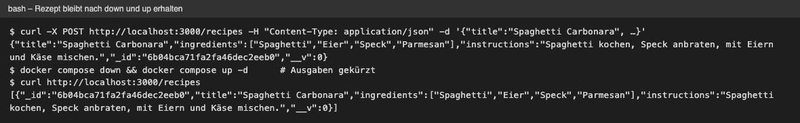

# Lab 4.3: Datenvolumes und Persistenz

**Leitfragen:**

<details>
<summary>Ein Container wird durch eine neue Version ersetzt: was passiert mit Dateien, die er geschrieben hat?</summary>

Sie sind weg: Der neue Container startet wieder vom unveränderten Image. Bleiben nur, wenn sie außerhalb des Containers liegen, in einem Volume oder einem eingebundenen Ordner des Rechners.

</details>

<details>
<summary>Welche Daten einer Web-App dürfen verloren gehen, welche nicht?</summary>

Zwischenspeicher, temporäre Dateien und der Programmcode selbst (steckt im Image) dürfen verloren gehen. Datenbankinhalte, hochgeladene Dateien und Protokolle nicht; sie gehören in ein Volume.

</details>

- Was ein Programm im Container schreibt, liegt in der beschreibbaren Schicht des Containers und verschwindet mit ihm.
- Volumes speichern Daten außerhalb des Containers; Compose legt sie an, bindet sie ein und lässt sie bei `docker compose down` stehen.

## Begriffe

| Begriff | Bedeutung |
| --- | --- |
| Persistenz | Daten bleiben erhalten, auch wenn das Programm oder der Container beendet und ersetzt wird |
| Volume | von Docker verwalteter Speicherbereich außerhalb des Containers, der in einen Container-Ordner eingebunden wird; wie ein USB-Stick, der von Container zu Container wandert |
| Named Volume | Volume mit festem Namen (z. B. `mein_db_data`), über den es wiederverwendet wird |
| Bind Mount | ein Ordner des eigenen Rechners, der im Container sichtbar ist (aus Lab 2.2) |
| Mountpoint | Ordner im Container, an dem ein Volume erscheint, z. B. `/data/db`; bei `docker volume inspect` auch der Speicherort des Volumes |
| Volume-Treiber | Programm, das ein Volume speichert: `local` (Standard, Festplatte des Docker-Hosts) oder z. B. NFS für Netzwerkspeicher |

## Warum Daten im Container verloren gehen


_Quelle: Docker Inc., „Storage drivers" (https://docs.docker.com/engine/storage/drivers/), abgerufen am 23.11.2026._

Die Image-Schichten sind nur lesbar (Lab 3.1). Jeder Container bekommt darüber eine dünne beschreibbare Schicht. Alles, was das Programm schreibt, landet dort und wird mit `docker rm` oder `docker compose down` gelöscht.

## Volumes in Docker

Volumes sind der Mechanismus von Docker für die persistente Datenspeicherung außerhalb des Containers. Sie halten Daten über den Lebenszyklus eines Containers hinaus. Docker bietet zwei Arten:

| | Named Volume | Bind Mount |
| --- | --- | --- |
| Angabe bei `-v` | Name vorn: `-v mein_db_data:/var/lib/mysql` | Pfad vorn: `-v /host/verzeichnis:/app` |
| liegt | im Speicher von Docker (bei Docker Desktop in dessen Linux-VM) | im gewählten Ordner des Rechners |
| verwaltet mit | `docker volume …`, Docker Desktop **Volumes** | Dateimanager, Editor |
| erstes Einbinden | ein leeres Volume übernimmt die Dateien des Images an diesem Pfad | der Ordner überdeckt die Dateien des Images |
| typisch für | Datenbanken, Daten der Anwendung | Quellcode in der Entwicklung, Konfigurationsdateien, `web/` in Lab 4.1 |

### Volume erstellen mit docker volume create

Ein Volume kann vorab mit `docker volume create` erstellt werden. Ohne diesen Schritt legt `docker run -v <name>:…` es beim ersten Start automatisch an.

```bash
docker volume create mein_db_data          # Volume mit dem Treiber local anlegen
```

| Option | Bedeutung |
| --- | --- |
| Name (letztes Argument) | Name des zu erstellenden Volumes; ohne Namen vergibt Docker eine zufällige ID |
| `--driver` (`-d`) | Volume-Treiber, Standard `local` |
| `--opt type=…` | Typ des Speichers, z. B. `nfs` oder `tmpfs` |
| `--opt device=…` | Pfad oder Quelle, die das Volume verwenden soll |
| `--opt o=…` | weitere Optionen je nach Typ, z. B. Adresse des NFS-Servers oder `size` bei `tmpfs` |

Beispiel für ein Volume auf einem NFS-Server (setzt einen erreichbaren NFS-Server voraus):

```bash
docker volume create --driver local \
  --opt type=nfs --opt o=addr=192.168.1.1,rw --opt device=:/pfad/zum/ordner \
  nfs-daten
```

### Volumes auflisten, untersuchen und löschen

| Befehl | Wirkung |
| --- | --- |
| `docker volume ls` | alle Volumes auf dem Docker-Host auflisten (keine Optionen nötig) |
| `docker volume inspect mein_db_data` | Details als JSON: Treiber, `Mountpoint`, Erstellungszeit, Compose-Labels |
| `docker volume rm mein_db_data` | Volume samt Daten löschen; nur, wenn kein Container es nutzt |
| `docker volume prune` | alle Volumes löschen, die kein Container nutzt; nur mit Vorsicht verwenden |

```bash
docker volume inspect mein_db_data
```

```text
[
    {
        "CreatedAt": "2026-11-23T09:12:03Z",
        "Driver": "local",                                          ← Treiber
        "Labels": null,
        "Mountpoint": "/var/lib/docker/volumes/mein_db_data/_data", ← Speicherort in der Docker-VM
        "Name": "mein_db_data",
        "Options": null,
        "Scope": "local"
    }
]
```

Bei Docker Desktop liegt der `Mountpoint` in der Linux-VM, nicht auf der Festplatte von macOS oder Windows.

### Named Volumes und Bind Mounts beim Start eines Containers

Named Volumes werden beim Start mit `--volume` (kurz `-v`) eingebunden. Bind Mounts verbinden ein Verzeichnis des Rechners mit einem Verzeichnis im Container:

```bash
docker run -d --name app1 -v mein_volume:/app nginx:1.30-alpine            # Named Volume unter /app
docker run -d --name app2 -v /host/verzeichnis:/app nginx:1.30-alpine      # Bind Mount: /host/verzeichnis -> /app
docker run -d --name app3 -v "$(pwd)/web":/usr/share/nginx/html nginx:1.30-alpine   # Bind Mount mit aktuellem Ordner
```

Steht vor dem Doppelpunkt ein Pfad (`/…`, `./…`, `$(pwd)/…`), ist es ein Bind Mount, sonst ein Named Volume. Die ausführlichere Schreibweise `--mount type=volume,source=mein_volume,target=/app` bewirkt dasselbe.

### Datenbank mit Named Volume: MySQL

Named Volumes eignen sich für die persistente Speicherung von Datenbankdateien. Der folgende Befehl startet MySQL mit dem Volume `mein_db_data` für das Datenverzeichnis `/var/lib/mysql`:

```bash
docker run -d --name mysql-db \
  -e MYSQL_ROOT_PASSWORD=geheim \
  -v mein_db_data:/var/lib/mysql \
  mysql:9.7
```

- `mysql:9.7` ist die aktuelle LTS-Version (Tag `lts` auf Docker Hub, geprüft am 23.11.2026); `mysql:8.4` ist die vorige LTS-Version.
- Wird `mysql-db` gelöscht und mit demselben `-v mein_db_data:/var/lib/mysql` neu gestartet, sind alle Datenbanken noch da.
- `MYSQL_ROOT_PASSWORD` ist Pflicht beim ersten Start; ein echtes Passwort gehört nicht in Skripte, die geteilt werden.

### Daten in Docker Desktop durchsuchen

Named Volumes lassen sich in Docker Desktop durchsuchen und bearbeiten: Ansicht **Volumes**, Volume anklicken. Der Reiter **Stored data** listet Dateien und Ordner mit Größe; Textdateien lassen sich im eingebauten Editor öffnen. **Container in-use** zeigt, welcher Container das Volume nutzt und unter welchem Pfad (Quelle: Docker Docs, „Volumes view", https://docs.docker.com/desktop/use-desktop/volumes/, abgerufen am 23.11.2026).

## Volumes mit Docker Compose

Compose definiert Volumes in der YAML-Datei an zwei Stellen: beim Dienst (wo wird eingebunden?) und auf oberster Ebene (welche Named Volumes gibt es?).

```yaml
# Rezeptbuch: playground/recipe-book/compose.yml (Ergebnis der Übung)
services:
  recipe-app:
    build: ./app
    ports:
      - 3000:3000
    depends_on:
      - recipe-database

  recipe-database:
    image: mongo:8
    volumes:
      - recipe-data:/data/db        # Named Volume recipe-data unter /data/db im Container

volumes:
  recipe-data:                      # oberste Ebene: Compose legt das Volume an (Name: recipe-book_recipe-data)
```

| Befehl | Container | Netzwerk | Named Volumes |
| --- | --- | --- | --- |
| `docker compose down` | gelöscht | gelöscht | bleiben |
| `docker compose down -v` | gelöscht | gelöscht | gelöscht |

Compose stellt dem Volume-Namen den Projektnamen voran: aus `recipe-data` im Ordner `recipe-book` wird `recipe-book_recipe-data`, aus `hello-data` im Ordner `hello` wird `hello_hello-data`.

### Live-Beispiel: Volume für die Todo-Datenbank

Im Live-Beispiel `docker/multi-container-app` aus Lab 4.2 fehlt das Volume noch; die Zeilen stehen auskommentiert in `compose.yaml`. Kommentarzeichen entfernen ergibt:

```yaml
  todo-database:
    image: mongo:8
    volumes:
      - database:/data/db
    ports:
      - 27017:27017

volumes:
  database:
```

Das `volumes`-Element in `todo-database` weist Compose an, das Volume `database` unter `/data/db` im Container des Dienstes einzubinden. MongoDB legt dort alle Datenbankdateien ab. Dadurch bleiben die Todo-Einträge auch nach einem Neustart oder nach `down` und `up` erhalten.

### Hello-App: access.log im Volume

Das Hello-Frontend schreibt jeden Seitenaufruf in `/data/access.log` und zeigt die Anzahl als „Aufrufe in access.log". Ohne Volume beginnt die Zählung nach jedem `down`/`up` wieder bei 1. Mit Volume zählt sie weiter:

```yaml
  frontend:
    volumes:
      - hello-data:/data            # Named Volume: access.log überlebt Container

volumes:
  hello-data:
```



_Quelle: eigener Screenshot, Rezeptbuch mit Named Volume, 23.11.2026._

## Typische Fehler

| Symptom | Ursache | Lösung |
| --- | --- | --- |
| Daten nach `docker compose down -v` weg | `-v` löscht auch die Named Volumes | `down` ohne `-v` verwenden, wenn Daten bleiben sollen |
| Daten nach Neustart weg, obwohl ein Volume angegeben ist | falscher Pfad im Container, z. B. `/data` statt `/data/db` bei MongoDB | Pfad aus der Image-Beschreibung auf Docker Hub nehmen |
| `service "…" refers to undefined volume recipe-data` | Volume beim Dienst genutzt, aber nicht unter `volumes:` auf oberster Ebene angelegt | `volumes:` mit `recipe-data:` auf oberster Ebene ergänzen |
| `volume is in use` bei `docker volume rm` | ein Container (auch gestoppt) nutzt das Volume | Container zuerst entfernen (`docker compose down`) |
| `curl: (7) Failed to connect` oder `Empty reply from server` beim ersten `curl` | App oder Datenbank startet noch | einige Sekunden warten, `docker compose logs recipe-app` lesen |
| `MongoDB nicht erreichbar` in den Logs | Dienstname in `index.js` und Compose-Datei verschieden | Dienst muss `recipe-database` heißen |
| „Aufrufe in access.log: nicht beschreibbar" | Container-Benutzer darf nicht in `/data` schreiben | Volume-Pfad und Rechte prüfen; tritt ab Lab 6.3 mit eigenem `USER` auf |

## Fazit

- Daten in der beschreibbaren Schicht verschwinden mit dem Container; Named Volumes und Bind Mounts halten sie außerhalb.
- `docker volume create`, `ls`, `inspect` und `rm` verwalten Volumes; Docker Desktop zeigt ihren Inhalt unter **Volumes**.
- In Compose steht ein Volume beim Dienst (`name:/pfad`) und auf oberster Ebene (`volumes:`); `down` behält es, `down -v` löscht es.

In der Übung speichert das Rezeptbuch Rezepte in MongoDB mit Named Volume, und die Hello-App zählt ihre Aufrufe über Neustarts hinweg.
