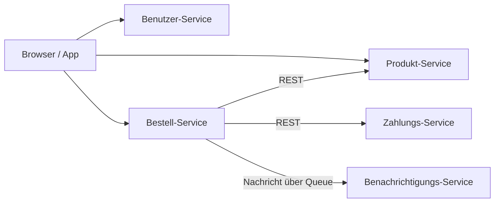

# Lab 4.4: Migration in eine Microservice-basierte Anwendung

**Leitfragen:**

<details>
<summary>Ein Online-Shop ist eine einzige große Anwendung: was passiert, wenn nur der Bezahlteil geändert werden soll?</summary>

Die ganze Anwendung wird neu gebaut, getestet und ausgeliefert, auch Katalog, Warenkorb und Benutzerverwaltung. Als Microservice wäre nur der Zahlungs-Service betroffen.

</details>

<details>
<summary>Was ist riskanter: alles auf einmal umstellen oder Stück für Stück?</summary>

Alles auf einmal: Fehler zeigen sich erst am Stichtag und betreffen alles. Stück für Stück liefert früh Rückmeldung, kostet aber eine Übergangszeit mit zwei Systemen.

</details>

- Eine Microservice-Architektur teilt eine Anwendung in kleine Dienste mit je einer Aufgabe; jeder läuft in eigenen Containern und wird einzeln aktualisiert und skaliert.
- Der Weg dorthin ist meist schrittweise: Teile des bisherigen Systems (Monolith) werden nacheinander durch Dienste ersetzt.

## Begriffe

| Begriff | Bedeutung |
| --- | --- |
| Monolith | Anwendung, deren Funktionen alle in einem Programm und einem Prozess laufen und nur gemeinsam ausgeliefert werden |
| Microservice | kleiner, eigenständiger Dienst mit genau einer fachlichen Aufgabe und eigener Schnittstelle |
| API | festgelegte Schnittstelle, über die Programme Anfragen stellen, z. B. `GET /recipes` aus Lab 4.3 |
| REST | API-Stil über HTTP mit Adressen und Methoden (`GET`, `POST`); Daten meist als JSON |
| gRPC | schnelles API-Verfahren für Programm-zu-Programm-Aufrufe mit fest beschriebenen Nachrichten |
| Message Queue | Warteschlange, in die ein Dienst Nachrichten legt und aus der ein anderer sie später abholt, z. B. Kafka, RabbitMQ; wie ein Briefkasten statt eines Telefonats |
| Bounded Context | abgegrenzter fachlicher Bereich mit eigenen Begriffen und Daten, z. B. „Bestellung" oder „Zahlung"; Grundlage für Service-Grenzen |
| Strangler Fig | Migrationsmuster: neue Dienste übernehmen Funktion für Funktion, bis der Monolith leer ist; benannt nach der Würgefeige, die einen Baum langsam umwächst |

## Microservice-Architektur


_Quelle: James Lewis, Martin Fowler, „Microservices" (https://martinfowler.com/articles/microservices.html), abgerufen am 23.11.2026._

- Jeder Microservice ist für eine bestimmte Funktion verantwortlich (z. B. Benutzerauthentifizierung, Zahlungssystem, Produktverwaltung).
- Services hängen nicht direkt voneinander ab, sondern kommunizieren über APIs (REST, gRPC oder Message Queues wie Kafka).
- Jeder Microservice kann je nach Last unabhängig skaliert werden.
- Jeder Service kann eine andere Programmiersprache oder Datenbanktechnologie nutzen.
- Teams entwickeln Microservices unabhängig voneinander und bringen sie getrennt in Produktion.

### Beispiel: Online-Shop aus Microservices

| Service | Aufgabe |
| --- | --- |
| Benutzer-Service | Verwaltung von Nutzern und Authentifizierung |
| Produkt-Service | Verwaltung von Produkten und Beständen |
| Bestell-Service | Abwicklung von Bestellungen |
| Zahlungs-Service | Abwicklung von Zahlungen |
| Benachrichtigungs-Service | Versand von E-Mails oder Push-Benachrichtigungen |



In Compose wäre jeder dieser Services ein Eintrag unter `services:` mit eigenem Image. Die Hello-App ist die kleinste Form davon: Frontend und Backend sind getrennte Dienste mit eigenen Images (`frontend:v2`, `backend:v1`), die über HTTP sprechen.

## Strategische Ansätze für die Migration

| Ansatz | Vorgehen | Vorteile | Nachteile |
| --- | --- | --- | --- |
| Big-Bang-Migration | die gesamte Anwendung wird auf einmal umgestellt | Microservice-Vorteile sofort nutzbar; keine lange parallele Wartung zweier Systeme | hohes Risiko, große Umstellungen sind fehleranfällig; lange Entwicklungszeit ohne frühes Feedback |
| Strangler-Fig-Muster (empfohlen) | schrittweise: neue Microservices ersetzen nach und nach Komponenten des Monolithen | geringes Risiko durch iterative Entwicklung; Alt- und Neusystem parallel nutzbar | erfordert fortlaufende Integration neuer Services |
| Parallelbetrieb | Monolith und Microservices laufen gleichzeitig, der Monolith wird nach und nach ersetzt | reibungsloser Übergang mit Vergleichsmöglichkeit zwischen alt und neu | höherer Wartungsaufwand in der Übergangsphase |


_Quelle: Microsoft Learn, „Strangler Fig pattern" (https://learn.microsoft.com/en-us/azure/architecture/patterns/strangler-fig), CC BY 4.0, abgerufen am 23.11.2026._

Beim Strangler-Fig-Muster nimmt eine Fassade (z. B. ein Reverse Proxy, Modul 9) alle Anfragen an und leitet jede Funktion entweder an den Monolithen oder an den neuen Dienst weiter. Funktion für Funktion wandert zum neuen System, bis der Monolith abgeschaltet werden kann.

## Phasen der Migration

| Phase | Inhalt |
| --- | --- |
| 1. Analyse der bestehenden Anwendung | Abhängigkeiten und Engpässe erkennen; Geschäftslogik und Funktionseinheiten festlegen; technische Schulden und Modernisierungsbedarf bewerten |
| 2. Auswahl einer Migrationsstrategie | Strangler Fig (schrittweiser Ersatz einzelner Komponenten), Parallelbetrieb (Monolith und Microservices gleichzeitig) oder Big Bang (komplette Umstellung, hohes Risiko) |
| 3. Definition der Microservices | Service-Grenzen bestimmen (Bounded Contexts); API-Schnittstellen für die Kommunikation entwerfen; synchrone (REST, gRPC) oder asynchrone Kommunikation (Message Queues) festlegen |

## Zerlegung der monolithischen Anwendung

| Zerlegung | Aufteilung nach | Beispiel |
| --- | --- | --- |
| funktional | Business-Funktionalität | Bestellung, Zahlung und Versand werden je ein Dienst |
| datenbasiert | Datenbesitz und -verantwortung | wer Kundendaten ändert, besitzt sie: ein Kunden-Service |
| technologisch | technischen Anforderungen einzelner Module | eine rechenintensive Bildverarbeitung wird mit eigener Sprache und eigener Skalierung ausgelagert |

## Migration der Datenhaltung


_Quelle: James Lewis, Martin Fowler, „Microservices" (https://martinfowler.com/articles/microservices.html), abgerufen am 23.11.2026._

| Ansatz | Bedeutung | Einsatz |
| --- | --- | --- |
| Shared Database Pattern | Monolith und Microservices nutzen dieselbe Datenbank | Übergangslösung |
| Database per Service | jeder Microservice erhält eine eigene Datenbank und gibt Daten nur über seine API heraus | finale Lösung |
| Event Sourcing und CQRS | statt des aktuellen Zustands werden alle Ereignisse gespeichert („Bestellung angelegt", „bezahlt"); Schreiben und Lesen nutzen getrennte Modelle (CQRS = Command Query Responsibility Segregation) | wenn Historie und hohe Leselast wichtig sind |

Im Rezeptbuch aus Lab 4.3 gehört die MongoDB nur dem Dienst `recipe-app`: das ist „Database per Service" im Kleinen.

## Kommunikation zwischen Microservices

| Art | Technik | Eigenschaft |
| --- | --- | --- |
| synchron | REST, gRPC | direkte Anfrage, der Aufrufer wartet auf die Antwort (wie das Hello-Frontend auf das Backend) |
| asynchron | Message Queues (Kafka, RabbitMQ) | Nachricht wird abgelegt und später verarbeitet; lose gekoppelt, Empfänger darf kurz ausfallen |

## Testen der Microservices

| Teststrategie | Prüft |
| --- | --- |
| Unit-Tests | jeden Microservice isoliert |
| Integrationstests | die Schnittstellen zwischen Services, z. B. mit Compose gestartet |
| Contract Testing | dass APIs kompatibel bleiben: Anbieter und Nutzer prüfen gegen einen gemeinsamen Vertrag (z. B. Felder und Typen der JSON-Antwort) |

## Monitoring-Werkzeuge

| Werkzeug | Zweck |
| --- | --- |
| Prometheus und Grafana | Echtzeit-Überwachung von Service-Metriken (CPU, Speicher, Anfragen); hands-on in Lab 7.2 |
| ELK-Stack (Elasticsearch, Logstash, Kibana) | Logs aller Dienste sammeln und durchsuchen; Lab 7.2 |
| Jaeger und OpenTelemetry | Tracing: verfolgt eine Anfrage über alle beteiligten Dienste und zeigt, wo Zeit verloren geht |

## Einen Dienst unabhängig aktualisieren

Mit Compose wird ein einzelner Dienst neu gebaut und ersetzt, während die anderen weiterlaufen:

```bash
docker compose up -d --build --no-deps frontend   # nur frontend neu bauen und ersetzen
```

```text
[+] up 2/2
 ✔ Image frontend:v2          Built
 ✔ Container hello-frontend-1 Started
```

- Der Dienstname am Ende (`frontend`) beschränkt Bauen und Ersetzen auf diesen Dienst.
- `--no-deps` lässt die Dienste aus `depends_on` ganz in Ruhe. Ohne `--no-deps` baut Compose auch das Image des Backends neu und prüft dessen Healthcheck; der laufende Backend-Container bleibt dabei meist bestehen, kann aber mit ersetzt werden.

Der Backend-Container behält ID und Laufzeit (`docker compose ps`, Spalte `CREATED`); nur das Frontend ist neu. Das ist der Kern jeder Microservice-Migration: kleine Teile einzeln ausliefern.

## Typische Fehler

| Symptom | Ursache | Lösung |
| --- | --- | --- |
| Backend wird ebenfalls neu erstellt | `--build` ohne Dienstnamen, ohne `--no-deps` oder Backend-Abschnitt geändert | `docker compose up -d --build --no-deps frontend` |
| Neue Version nicht sichtbar | `--build` vergessen; das vorhandene Image wird weiterverwendet | `docker compose up -d --build --no-deps frontend` |
| „Backend nicht erreichbar" für einige Sekunden | Frontend startet, bevor das Backend antwortet | `depends_on` mit `condition: service_healthy` (Lab 4.2) |

## Fazit

- Microservices trennen eine Anwendung in Dienste mit je einer Aufgabe, eigener API und oft eigener Datenbank; sie werden einzeln skaliert und ausgeliefert.
- Migration gelingt meist schrittweise mit dem Strangler-Fig-Muster; Big Bang ist riskant, Parallelbetrieb aufwendig.
- Zerlegung, Datenhaltung, Kommunikation, Tests und Monitoring sind die Entscheidungen jeder Migration.
- Compose aktualisiert mit `docker compose up -d --build --no-deps <dienst>` einen Dienst, ohne die anderen anzuhalten.

In der Übung bekommt nur das Hello-Frontend eine neue Version, während das Backend weiterläuft.
