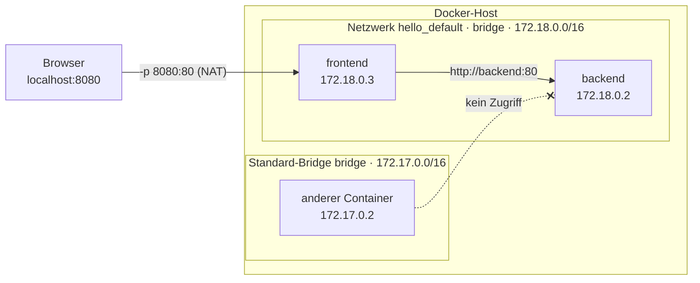
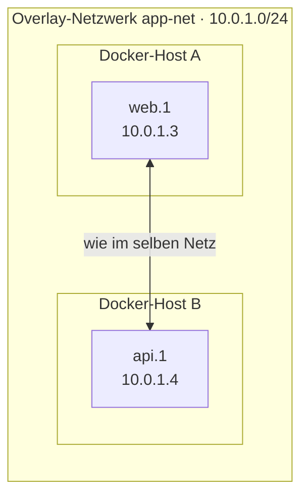
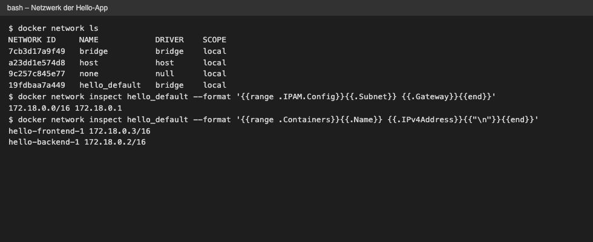

# Lab 5.1: Netzwerkverwaltung in Containern

**Leitfragen:**

<details>
<summary>Zwei abgeschottete Programme sollen miteinander reden: was müssen sie voneinander wissen?</summary>

Eine Adresse, unter der das andere erreichbar ist, und einen gemeinsamen Weg dorthin. Bei Containern ist das ein gemeinsames Docker-Netzwerk; die Adresse ist eine IP oder besser ein Name.

</details>

<details>
<summary>Warum ist eine feste IP-Adresse als Ziel schlecht, wenn Programme oft neu gestartet werden?</summary>

Ein neu gestarteter Container bekommt oft eine andere IP. Ein Name, den Docker bei jedem Start neu auf die aktuelle IP abbildet (DNS), bleibt gleich.

</details>

- Jeder Container hängt in einem Docker-Netzwerk, bekommt dort eine eigene IP-Adresse und ist von anderen Netzwerken abgeschottet.
- Compose legt für jedes Projekt ein eigenes Netzwerk an; darin finden sich die Dienste über ihren Namen. Deshalb erreicht das Hello-Frontend seit Lab 4.1 das Backend unter `http://backend:80`.

## Begriffe

| Begriff | Bedeutung |
| --- | --- |
| Docker-Netzwerk | virtuelles Netz auf dem Docker-Host, in dem Container IP-Adressen bekommen und sich erreichen; wie ein eigener Switch nur für Container |
| Netzwerktreiber | Bauart eines Netzwerks: `bridge`, `host`, `none`, `overlay`, `macvlan`, `ipvlan` |
| Bridge | virtueller Switch auf einem Docker-Host; verbindet die Container eines Netzwerks untereinander und über den Host mit der Außenwelt |
| Host | der Rechner, auf dem die Docker Engine läuft; bei Docker Desktop eine kleine Linux-VM |
| Subnetz | Adressbereich eines Netzwerks, z. B. `172.18.0.0/16` = alle Adressen `172.18.x.x` |
| Gateway | Adresse im Netzwerk, über die Container das Netzwerk verlassen, z. B. ins Internet |
| DNS, Namensauflösung | übersetzt einen Namen wie `backend` in eine IP-Adresse; wie ein Telefonbuch |
| NAT | Network Address Translation: der Host übersetzt Adressen und Ports zwischen außen und Container; Grundlage von `-p 8080:80` |
| Projektnetzwerk | Netzwerk, das Compose je Projekt anlegt, Name `<projekt>_default`, bei der Hello-App `hello_default` |

## Aufgaben von Docker-Netzwerken

- **Verbinden:** Container einer Anwendung (Frontend, Backend, Datenbank) und andere Dienste erreichen einander.
- **Abschotten:** Container in verschiedenen Netzwerken sehen sich nicht. Eine Datenbank, die nur im Netzwerk des Backends hängt, ist für andere Container unsichtbar.

Beides gleichzeitig ist der Kern: so viel Verbindung wie nötig, so viel Isolation wie möglich.

## Standardnetzwerke und benutzerdefinierte Netzwerke

Docker legt bei der Installation drei Netzwerke an. Jedes weitere Netzwerk ist benutzerdefiniert, egal ob es mit `docker network create` (Lab 5.2) oder von Compose angelegt wurde.

```bash
docker network ls
```

```text
NETWORK ID     NAME            DRIVER    SCOPE
7cb3d17a9f49   bridge          bridge    local     # Standard-Bridge: hier landet jeder Container ohne --network
a23dd1e574d8   host            host      local     # Container nutzen direkt das Netzwerk des Hosts
9c257c845e77   none            null      local     # Container ohne Netzwerk
19fdbaa7a449   hello_default   bridge    local     # Projektnetzwerk der Hello-App (von Compose)
```

| | Standard-Bridge `bridge` | benutzerdefiniertes Netzwerk |
| --- | --- | --- |
| entsteht | bei der Installation, je Host genau eins | mit `docker network create` oder durch Compose |
| Container landen dort | automatisch, wenn kein `--network` angegeben ist | nur mit `--network <name>` oder über Compose |
| Erreichbarkeit untereinander | nur über IP-Adressen | über Container- bzw. Dienstnamen und IP-Adressen |
| Isolation | alle Container ohne Netzwerkangabe teilen sich ein Netz | nur die Container, die bewusst hinzugefügt werden |

Die alte Aussage „Container können über ihre Namen kommunizieren" gilt nur für benutzerdefinierte Netzwerke. In der Standard-Bridge funktionieren Namen nicht (Details in Lab 5.3).

## Bridge-Netzwerke als Standardmodus

Ohne weitere Angabe arbeitet jedes Netzwerk mit dem Treiber `bridge`. Docker weist jedem Container eine IP-Adresse aus dem Subnetz des Netzwerks zu. Container im selben Bridge-Netzwerk erreichen sich, Container in verschiedenen Bridge-Netzwerken standardmäßig nicht.



Nach außen ist ein Container nur über einen veröffentlichten Port erreichbar (`-p` bzw. `ports:` in Compose, aus Tag 1 und Lab 4.1). Der Host übersetzt dabei Adresse und Port (NAT):


_Quelle: Wikimedia Commons, „NAT Concept-en.svg" (https://commons.wikimedia.org/wiki/File:NAT_Concept-en.svg), CC BY-SA 4.0, abgerufen am 23.11.2026._

Bei Docker spielt der Host die Rolle des Routers: Anfragen an `localhost:8080` gehen an Port 80 des Containers, die private Container-IP bleibt außen unsichtbar.

## Host-Netzwerkmodus

- Mit dem Treiber `host` nutzt ein Container das Netzwerk des Hosts direkt: keine eigene IP, keine Abschottung, kein NAT.
- Vorteil: etwas weniger Aufwand pro Paket, daher teils bessere Leistung.
- Nachteil: Ports teilen sich alle. Wollen zwei Container (oder ein Container und ein Programm des Hosts) denselben Port, startet der zweite nicht. `-p` wird ignoriert.
- Docker Desktop: Der Host ist die Linux-VM, nicht der eigene Rechner. Ein Host-Netzwerk-Container ist deshalb ohne Zusatzeinstellung nicht über `localhost` erreichbar. Ab Docker Desktop 4.34 lässt sich das unter **Settings → Resources → Network → Enable host networking** einschalten (Anmeldung mit Docker-Konto nötig, nur TCP/UDP). Quelle: Docker Docs, „Host network driver" (https://docs.docker.com/engine/network/drivers/host/), abgerufen am 23.11.2026. Ausprobiert in Lab 5.2.

## Overlay-Netzwerke über mehrere Hosts

- Ein Overlay-Netzwerk spannt ein gemeinsames Netz über mehrere Docker-Hosts. Ein Container auf Server A erreicht einen Container auf Server B, als hingen beide am selben Switch.
- Eingesetzt in verteilten Anwendungen und bei der Orchestrierung mit Docker Swarm (Modul 10). Kubernetes nutzt statt Docker-Overlay-Netzwerken eigene Netzwerk-Plugins (CNI) nach demselben Prinzip.



## Benutzerdefinierte Bridge-, Overlay- und MacVLAN-Netzwerke

Eigene Netzwerke werden mit dem passenden Treiber und eigener Konfiguration angelegt, je nach Anforderung der Anwendung.

| Treiber | Wofür | Beispiel |
| --- | --- | --- |
| `bridge` | Container auf einem Host verbinden und abschotten (Standard) | Frontend, Backend und Datenbank einer App |
| `host` | Container ohne eigene Netzwerkschicht, direkt am Host | Netzwerk-Messwerkzeug, sehr viele Ports |
| `none` | Container ganz ohne Netzwerk | Stapelverarbeitung geheimer Daten (Lab 5.2) |
| `overlay` | Container auf mehreren Hosts verbinden | Swarm-Dienste (Modul 10) |
| `macvlan` | Container erscheint als eigenes Gerät mit eigener MAC- und IP-Adresse im Firmennetz | Altanwendung, die eine Adresse im LAN erwartet |
| `ipvlan` | wie `macvlan`, aber alle Container teilen die MAC-Adresse des Hosts | Netze, die nur eine MAC-Adresse je Port erlauben |


_Quelle: Docker Docs, „Macvlan network driver" (https://docs.docker.com/engine/network/drivers/macvlan/), abgerufen am 23.11.2026._

Bei `macvlan` hängen die Container direkt am physischen Netz, als wären es eigene Rechner. Unter Docker Desktop hat das keinen sichtbaren Nutzen, weil die Container in der VM laufen.

## Das Projektnetzwerk der Hello-App

`docker compose up` legt das Netzwerk `hello_default` an (Projektname = Ordnername `hello`), hängt beide Dienste hinein und trägt die Dienstnamen in den eingebauten DNS-Server von Docker ein. `docker compose down` entfernt das Netzwerk wieder.

```bash
docker network inspect hello_default     # ganze Beschreibung als JSON
```

```text
[
    {
        "Name": "hello_default",
        "Driver": "bridge",                      # Treiber
        "IPAM": {
            "Config": [
                {
                    "Subnet": "172.18.0.0/16",   # Adressbereich des Netzwerks
                    "Gateway": "172.18.0.1"      # Ausgang zum Host und ins Internet
                }
            ]
        },
        "Labels": {
            "com.docker.compose.project": "hello",   # von Compose angelegt
            …
        },
        "Containers": {
            "43a7af3e8d8c…": {
                "Name": "hello-frontend-1",
                "IPv4Address": "172.18.0.3/16"      # IP des Frontends
            },
            "c0f0edd9ccaa…": {
                "Name": "hello-backend-1",
                "IPv4Address": "172.18.0.2/16"      # IP des Backends
            }
        },
        …                                         # weitere Felder: für dieses Lab ignorierbar
    }
]
```



_Quelle: eigener Screenshot, Hello-App, 23.11.2026._

Jeder Container in einem benutzerdefinierten Netzwerk fragt den DNS-Server `127.0.0.11` (steht in `/etc/resolv.conf` des Containers). Der antwortet auf `backend` mit der aktuellen IP des Backend-Containers. Startet das Backend neu und bekommt eine andere IP, liefert der Name automatisch die neue.

## Typische Fehler

| Symptom | Ursache | Lösung |
| --- | --- | --- |
| `Error: No such network: hello_default` | Hello-App läuft nicht oder Ordner hat einen anderen Namen | `docker compose up -d` im Ordner `hello`; Name mit `docker network ls` prüfen |
| `wget: bad address 'backend'` aus einem Einzelcontainer | Container hängt in der Standard-Bridge, nicht im Projektnetzwerk | Container mit `--network hello_default` starten |
| `curl: (6) Could not resolve host: backend` auf dem eigenen Rechner | Dienstnamen gibt es nur innerhalb des Docker-Netzwerks | von außen `localhost` mit veröffentlichtem Port nutzen |
| IP aus dem Handout stimmt nicht | IPs werden beim Start vergeben und unterscheiden sich je Rechner | Werte aus dem eigenen `inspect` lesen |

## Fazit

- Docker-Netzwerke verbinden Container und schotten sie zugleich ab; der Treiber bestimmt die Bauart (`bridge`, `host`, `none`, `overlay`, `macvlan`).
- Standard ist die Bridge: eigene IP je Container, Zugriff von außen nur über veröffentlichte Ports (NAT).
- In benutzerdefinierten Netzwerken, auch im Compose-Projektnetzwerk, lösen Namen wie `backend` per DNS auf die aktuelle IP auf.

In der Übung wird das Netzwerk der laufenden Hello-App gelesen und das Backend per Namen aus dem Frontend-Container erreicht.
