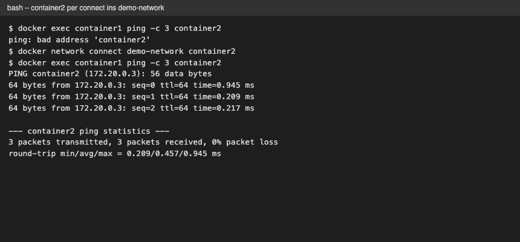

# Lab 5.2 – Lösung: Erstellen und Verwalten von Docker-Netzwerken

IDs, IP-Adressen und Zeiten unterscheiden sich je Rechner.

## Aufgabe 1: Netzwerk erstellen

```bash
docker network create demo-network
```

```text
8a0e1b7942ebd4a48cf015bc05bac7dd35fdbda53f5c466dea3714a5c5b9a4a1
```

```bash
docker network inspect demo-network --format '{{json .Containers}}'
```

```text
{}
```

Die Ausgabe ist die ID des neuen Netzwerks. Ohne `--driver` ist es ein Bridge-Netzwerk; noch hängt kein Container darin.

## Aufgabe 2: Container in getrennten Netzwerken

```bash
docker run -d --name container1 --network demo-network busybox:1.37 sleep 3600
docker run -d --name container2 busybox:1.37 sleep 3600
docker exec container1 ping -c 3 container2
```

```text
ping: bad address 'container2'
```

`container1` hängt in `demo-network`, `container2` in der Standard-Bridge. Im Netzwerk von `container1` gibt es den Namen `container2` nicht, und selbst ein Ping auf die IP von `container2` bliebe ohne Antwort (`100% packet loss`), weil die beiden Netzwerke getrennt sind.

## Aufgabe 3: Container verbinden

```bash
docker network connect demo-network container2
docker exec container1 ping -c 3 container2
```

```text
PING container2 (172.20.0.3): 56 data bytes
64 bytes from 172.20.0.3: seq=0 ttl=64 time=0.945 ms
64 bytes from 172.20.0.3: seq=1 ttl=64 time=0.209 ms
64 bytes from 172.20.0.3: seq=2 ttl=64 time=0.217 ms

--- container2 ping statistics ---
3 packets transmitted, 3 packets received, 0% packet loss
round-trip min/avg/max = 0.209/0.457/0.945 ms
```

```bash
docker network inspect demo-network --format '{{range .Containers}}{{.Name}} {{.IPv4Address}}{{"\n"}}{{end}}'
docker inspect container2 --format '{{range $name, $net := .NetworkSettings.Networks}}{{$name}} {{$net.IPAddress}}{{"\n"}}{{end}}'
```

```text
container2 172.20.0.3/16
container1 172.20.0.2/16

bridge 172.17.0.3
demo-network 172.20.0.3
```

`connect` wirkt sofort, ohne Neustart. `container2` hängt jetzt in zwei Netzwerken und hat in jedem eine eigene IP.



_Quelle: eigener Screenshot, Docker Desktop, 23.11.2026._

## Aufgabe 4: Host-Netzwerk und kein Netzwerk

```bash
docker run -d --name web-host --network host nginx:1.30-alpine
docker ps --filter name=web-host --format '{{.Names}} {{.Status}} Ports: [{{.Ports}}]'
curl http://localhost:80
```

Unter Linux mit Docker Engine:

```text
web-host Up 3 seconds Ports: []
<!DOCTYPE html>
<html>
<head>
<title>Welcome to nginx!</title>
…
```

Unter Docker Desktop (Standardeinstellung):

```text
web-host Up 3 seconds Ports: []
curl: (7) Failed to connect to localhost port 80 after 0 ms: Couldn't connect to server
```

```bash
docker run --rm --network host busybox:1.37 wget -qO- http://localhost:80
```

```text
<!DOCTYPE html>
<html>
<head>
<title>Welcome to nginx!</title>
…
```

- Die Spalte `Ports` bleibt leer: Im Host-Netzwerk gibt es keine Portweiterleitung, nginx lauscht direkt auf Port 80 des Hosts.
- Unter Docker Desktop ist der Host die Linux-VM. Der zweite Container im Host-Netzwerk sieht dasselbe `localhost` wie nginx und bekommt die Seite; der eigene Rechner nicht. Mit **Settings → Resources → Network → Enable host networking** (ab Docker Desktop 4.34, Anmeldung nötig) liefert auch `curl` die Seite.

```bash
docker rm -f web-host
docker run --rm --network none busybox:1.37 ping -c 2 8.8.8.8
```

```text
web-host
PING 8.8.8.8 (8.8.8.8): 56 data bytes
ping: sendto: Network is unreachable
```

Ohne Netzwerk hat der Container nur die Loopback-Schnittstelle `lo`; es gibt keine Route nach außen.

## Aufgabe 5: Container entfernen und Subnetz festlegen

```bash
docker network disconnect demo-network container2
docker exec container1 ping -c 3 container2
```

```text
ping: bad address 'container2'
```

```bash
docker network create --subnet 172.30.0.0/24 lab-net
docker run -d --name fix --network lab-net --ip 172.30.0.10 busybox:1.37 sleep 3600
docker network inspect lab-net --format '{{range .IPAM.Config}}{{.Subnet}} {{.Gateway}}{{end}}'
docker network inspect lab-net --format '{{range .Containers}}{{.Name}} {{.IPv4Address}}{{"\n"}}{{end}}'
```

```text
5c1e9a7d0b3f…
3f7d2b9e8a41…
172.30.0.0/24 172.30.0.1
fix 172.30.0.10/24
```

Das Gateway bekommt automatisch die erste Adresse des Bereichs. `--ip` funktioniert nur in Netzwerken mit selbst festgelegtem `--subnet`.

Aufräumen:

```bash
docker rm -f container1 container2 fix
docker network rm demo-network lab-net
```

```text
container1
container2
fix
demo-network
lab-net
```
