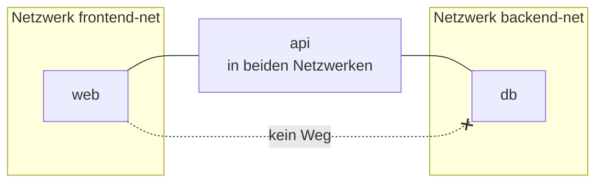
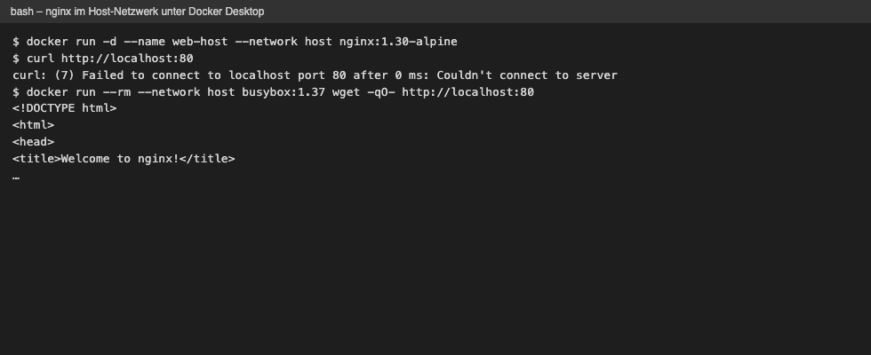

# Lab 5.2: Erstellen und Verwalten von Docker-Netzwerken

**Leitfragen:**

<details>
<summary>Wofür kann ein Programm ganz ohne Netzwerkverbindung sinnvoll sein?</summary>

Für Arbeit, die nur lokale Dateien braucht, etwa das Umwandeln oder Auswerten vertraulicher Daten. Ohne Netzwerk kann es nichts nach außen senden und nichts nachladen; Docker erreicht das mit `--network none`.

</details>

<details>
<summary>Ein Programm soll mit zwei getrennten Gruppen von Programmen reden: wie geht das, ohne die Gruppen zu verbinden?</summary>

Das Programm hängt in beiden Netzwerken, die Gruppen bleiben getrennt. Ein Container kann mit `docker network connect` Mitglied mehrerer Netzwerke sein.

</details>

- Netzwerke werden mit `docker network create` angelegt; Container kommen beim Start mit `--network` oder später mit `docker network connect` hinein und mit `disconnect` wieder heraus.
- `--network host` und `--network none` sind die beiden Sonderfälle: kein eigenes Netz bzw. gar kein Netz.

## Begriffe

| Begriff | Bedeutung |
| --- | --- |
| `docker network create` | legt ein benutzerdefiniertes Netzwerk an, Standardtreiber `bridge` |
| `connect` / `disconnect` | hängt einen laufenden Container in ein Netzwerk ein bzw. aus, ohne Neustart |
| CIDR-Schreibweise | Subnetzangabe wie `172.30.0.0/24`: die ersten 24 Bit sind fest, frei sind die letzten 8 Bit, also `172.30.0.1` bis `172.30.0.254` |
| `ping` | schickt kleine Testpakete an eine Adresse und zeigt, ob und wie schnell Antworten kommen |

## Benutzerdefiniertes Netzwerk erstellen

```bash
docker network create demo-network                 # neues Bridge-Netzwerk; Ausgabe: die Netzwerk-ID
docker run -d --name web --network demo-network nginx:1.30-alpine   # Container beim Start zuordnen
docker network inspect demo-network                # Konfiguration: Treiber, Subnetz, Gateway, Container
docker network ls --filter driver=bridge           # nur Bridge-Netzwerke anzeigen
docker network rm demo-network                     # löschen; nur ohne verbundene Container möglich
```

Ein frisch angelegtes Netzwerk ist leer: `inspect` zeigt `"Containers": {}`, bis der erste Container hineinkommt.

## Container in mehreren Netzwerken

Ein Container kann Mitglied mehrerer Netzwerke sein. Er bekommt dann je Netzwerk eine eigene IP und erreicht die Container in jedem davon; die Netzwerke selbst bleiben getrennt.



```bash
docker network connect backend-net api       # laufenden Container zusätzlich in ein Netzwerk hängen
docker network disconnect backend-net api    # wieder entfernen; die anderen Netzwerke bleiben
```

Nach außen gilt unverändert: Erreichbar ist nur, was mit `-p <Host-Port>:<Container-Port>` veröffentlicht ist (aus Tag 1).

## Netzwerkoptionen beim Start

Docker bietet verschiedene Netzwerkoptionen, um Verbindung und Isolation zu steuern. Sie werden beim Erstellen eines Netzwerks (`docker network create …`) oder beim Starten eines Containers (`docker run --network …`) festgelegt.

| Option bei `docker run` | Wirkung |
| --- | --- |
| ohne Angabe | Standard-Bridge `bridge`: eigene IP, keine Namensauflösung zwischen Containern |
| `--network mein_netzwerk` | benutzerdefiniertes Netzwerk: eigene IP, Namen der anderen Container auflösbar |
| `--network host` | Netzwerk des Hosts direkt, keine eigene IP, `-p` wirkungslos |
| `--network none` | nur `lo` (die eigene Loopback-Adresse `127.0.0.1`), kein Zugang zu anderen Containern oder ins Internet |

| Option bei `docker network create` | Wirkung |
| --- | --- |
| `--driver bridge` (Standard), `overlay`, `macvlan` | Treiber des Netzwerks (Lab 5.1) |
| `--subnet 172.30.0.0/24` | Adressbereich festlegen |
| `--gateway 172.30.0.1` | Gateway-Adresse festlegen (sonst die erste Adresse) |
| `--internal` | Netzwerk ohne Weg nach außen: Container erreichen sich, aber nicht das Internet |

## Host-Netzwerk mit `--network host`

Der Container teilt sich das Netzwerk mit dem Host und nutzt dessen Netzwerkschnittstellen direkt, was die Leistung verbessern kann. nginx lauscht dann auf Port 80 des Hosts selbst:

```bash
docker run -d --name web-host --network host nginx:1.30-alpine
curl http://localhost:80
```

| Umgebung | Ergebnis von `curl http://localhost:80` auf dem eigenen Rechner |
| --- | --- |
| Linux mit Docker Engine | „Welcome to nginx!" – nginx lauscht direkt auf dem Rechner |
| Docker Desktop (macOS, Windows), Standardeinstellung | `Connection refused` bzw. keine Antwort: Host ist die Linux-VM, nginx lauscht dort |
| Docker Desktop ab 4.34 mit **Settings → Resources → Network → Enable host networking** | „Welcome to nginx!" (Anmeldung mit Docker-Konto nötig, nur TCP/UDP) |

Quelle Docker Desktop: Docker Docs, „Host network driver" (https://docs.docker.com/engine/network/drivers/host/), abgerufen am 23.11.2026; Standardverhalten am 23.11.2026 mit Docker Desktop (Engine 29.9.3) geprüft.

Dass nginx in der VM tatsächlich auf Port 80 lauscht, zeigt ein zweiter Container im Host-Netzwerk, denn er sieht dasselbe `localhost`:

```bash
docker run --rm --network host busybox:1.37 wget -qO- http://localhost:80   # liefert die nginx-Startseite
```



_Quelle: eigener Screenshot, Docker Desktop, 23.11.2026._

## Kein Netzwerk mit `--network none`

Mit `--network none` ist das Netzwerk für den Container abgeschaltet. Er hat nur seine eigene Loopback-Schnittstelle, erreicht weder andere Container noch das Internet und ist von außen nicht erreichbar.

```bash
docker run --rm --network none busybox:1.37 ping -c 2 8.8.8.8
```

```text
PING 8.8.8.8 (8.8.8.8): 56 data bytes
ping: sendto: Network is unreachable
```

## Subnetze mit `--subnet`

Docker vergibt Subnetze automatisch (meist `172.17.0.0/16`, `172.18.0.0/16`, …). Mit `--subnet` wird der Bereich beim Anlegen festgelegt, mit `--ip` bekommt ein Container eine feste Adresse daraus:

```bash
docker network create --subnet 172.30.0.0/24 lab-net
docker run -d --name fix --network lab-net --ip 172.30.0.10 busybox:1.37 sleep 3600
```

- Subnetze teilen den Datenverkehr in Abschnitte und ordnen ihn: z. B. ein Bereich für Web-Container, einer für Datenbanken.
- Firewalls und Sicherheitsrichtlinien im Firmennetz arbeiten mit Adressbereichen; ein festes Subnetz lässt sich dort eintragen.
- Das Subnetz darf sich nicht mit dem eigenen Netz überschneiden. Das alte Folienbeispiel `192.168.0.0/24` ist in vielen Heim- und Büronetzen schon belegt; Container erreichen dann Geräte im eigenen Netz nicht mehr. Bereiche wie `172.30.0.0/24` sind sicherer.

## Typische Fehler

| Symptom | Ursache | Lösung |
| --- | --- | --- |
| `ping: bad address 'container2'` | die Container sind in verschiedenen Netzwerken oder einer davon in der Standard-Bridge | beide in dasselbe benutzerdefinierte Netzwerk bringen (`docker network connect`) |
| `network demo-network already exists` | Netzwerk aus einem früheren Versuch | weiterverwenden oder mit `docker network rm demo-network` löschen |
| `error while removing network: … has active endpoints` | noch Container im Netzwerk | Container zuerst entfernen (`docker rm -f …`) oder `disconnect` |
| `Pool overlaps with other one on this address space` | `--subnet` überschneidet sich mit einem vorhandenen Docker-Netzwerk | anderen Bereich wählen, belegte mit `docker network inspect` prüfen |
| nginx im Host-Netzwerk unter Linux startet nicht, Log: `Address in use` | auf dem Rechner belegt schon ein Programm Port 80 | anderes Programm stoppen oder die Übung mit Docker Desktop beobachten |
| `curl localhost:80` scheitert unter Docker Desktop | Host-Netzwerk liegt in der VM (Standard) | wie oben mit einem zweiten Host-Netzwerk-Container prüfen oder Host-Networking in den Settings einschalten |

## Fazit

- `docker network create`, `--network`, `connect` und `disconnect` steuern, welcher Container mit welchem reden kann, auch im laufenden Betrieb.
- Ein Container kann in mehreren Netzwerken hängen und so getrennte Gruppen erreichen, ohne sie zu verbinden.
- `--network host` verzichtet auf Isolation (unter Docker Desktop zählt die VM als Host), `--network none` schaltet das Netzwerk ganz ab.

In der Übung werden alle Schritte der Live-Demo im eigenen Terminal nachvollzogen: Netzwerk anlegen, Ping scheitert und klappt, Host-Netzwerk, kein Netzwerk, Container entfernen.
