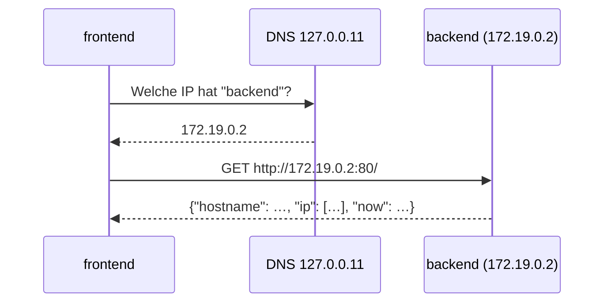
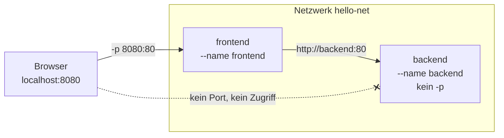

# Lab 5.3: Kommunikation zwischen Containern

**Leitfragen:**

<details>
<summary>Welche Teile einer Web-Anwendung müssen von außen erreichbar sein, welche nicht?</summary>

Nur der Teil, den Browser oder Kunden aufrufen, also das Frontend. Backend und Datenbank sprechen nur mit dem Frontend und bleiben von außen unerreichbar.

</details>

<details>
<summary>Was erledigt Compose automatisch, das hier von Hand nötig ist?</summary>

Compose legt das Netzwerk an, hängt alle Dienste hinein, vergibt die Namen und räumt mit `down` wieder auf. Ohne Compose sind das `docker network create`, `docker run --network … --name …` je Container und `docker rm`/`docker network rm`.

</details>

- In einem benutzerdefinierten Netzwerk erreichen sich Container über ihren Namen; der eingebaute DNS-Server von Docker kennt jeden Container im Netzwerk.
- Nur der Container, der von außen erreichbar sein muss, veröffentlicht einen Port; alle anderen reden nur im Netzwerk.

## Namensauflösung im benutzerdefinierten Netzwerk

Jeder Container in einem benutzerdefinierten Netzwerk nutzt den DNS-Server `127.0.0.11` (Lab 5.1). Er beantwortet:

| Name | Antwort |
| --- | --- |
| Containername (`--name backend`) | IP des Containers in diesem Netzwerk |
| Dienstname in Compose (`backend`) | IP des Dienst-Containers bzw. eine der Replikas |
| zusätzlicher Alias (`--network-alias api`) | IP des Containers, der den Alias trägt |
| alles andere (`kodschul.com`) | weitergereicht an den DNS-Server des Hosts |



Neustart oder Austausch eines Containers ändert oft seine IP, der Name bleibt. Programme sprechen deshalb Namen an, nie feste IPs.

## Standard-Bridge ohne Namen

In der Standard-Bridge `bridge` (Container ohne `--network`) gibt es keinen eingebauten DNS-Server für Containernamen. Container erreichen sich dort nur über IP-Adressen, die sich bei jedem Neustart ändern können.

| | Standard-Bridge | benutzerdefiniertes Netzwerk |
| --- | --- | --- |
| `ping backend` | `bad address 'backend'` | Antwort von der aktuellen IP |
| `ping 172.17.0.3` | funktioniert, solange die IP stimmt | funktioniert ebenfalls |
| empfohlen für | kurze Einzeltests | jede Anwendung aus mehreren Containern |

Die alte Option `--link` verknüpfte Container in der Standard-Bridge per Name. Sie gilt als veraltet; benutzerdefinierte Netzwerke ersetzen sie.

## Muster: Nur das Frontend veröffentlicht einen Port



Die Hello-App ohne Compose, mit denselben Images wie seit Lab 4.3:

```bash
docker network create hello-net
docker run -d --name backend  --network hello-net backend:v1                  # kein -p: nur im Netzwerk erreichbar
docker run -d --name frontend --network hello-net -p 8080:80 frontend:v2      # einziger veröffentlichter Port
```

- Das Frontend fragt standardmäßig `http://backend:80` (Standardwert der Umgebungsvariable `BACKEND_URL` in `frontend.py`). Deshalb muss der Backend-Container genau `backend` heißen.
- `docker port backend` gibt nichts aus: Das Backend hat keinen veröffentlichten Port.
- Weniger offene Ports bedeuten weniger Angriffsfläche (vertieft in Lab 6.1).


_Quelle: eigener Screenshot, Hello-App, 23.11.2026._

## Was Compose automatisch erledigt

| Schritt | von Hand | Compose (`compose.yml` aus Lab 4.3) |
| --- | --- | --- |
| Netzwerk anlegen | `docker network create hello-net` | `hello_default` beim ersten `up` |
| Container ins Netzwerk | `--network hello-net` je Container | alle Dienste automatisch |
| Namen | `--name backend` | Dienstname `backend` |
| Port veröffentlichen | `-p 8080:80` | `ports: - 8080:80` |
| Startreihenfolge | Befehle in der richtigen Reihenfolge tippen | `depends_on` mit Healthcheck |
| Aufräumen | `docker rm -f …`, `docker network rm …` | `docker compose down` |

## Typische Fehler

| Symptom | Ursache | Lösung |
| --- | --- | --- |
| `Bind for 0.0.0.0:8080 failed: port is already allocated` | die Hello-App läuft noch mit Compose | vorher `docker compose down` im Ordner `hello` |
| `Conflict. The container name "/backend" is already in use` | Container aus einem früheren Versuch | `docker rm -f backend` |
| Hello-Seite: „Backend nicht erreichbar (http://backend:80): ConnectionError" | Backend fehlt, heißt anders oder hängt in einem anderen Netzwerk | `docker ps`, Name `backend` und `--network hello-net` prüfen |
| `Invalid container name (küche)` | Containernamen erlauben nur Buchstaben a–z, Ziffern, `_`, `.`, `-` | `kueche` statt `küche` |
| `ping: bad address 'lieferung'` | einer der Container ist ohne `--network pizza-network` gestartet | `docker network connect pizza-network lieferung` |

## Fazit

- Container in einem benutzerdefinierten Netzwerk finden sich über ihren Namen; in der Standard-Bridge nur über IPs.
- Nur das Frontend veröffentlicht einen Port, Backend und Datenbank bleiben im Netzwerk.
- Compose übernimmt Netzwerk, Namen, Ports und Aufräumen; von Hand ist jeder Schritt ein eigener Befehl.

In der Übung reden zuerst „Küche" und „Lieferung" im `pizza-network` miteinander, danach läuft die Hello-App ohne Compose im Netzwerk `hello-net`.
