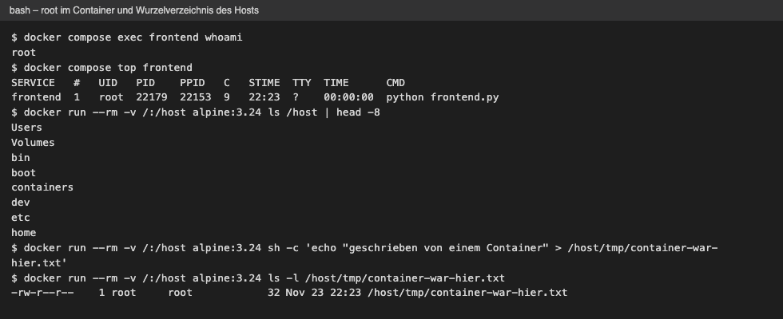

# Lab 6.1: Grundlagen der Docker-Sicherheit

**Leitfragen:**

<details>
<summary>Wer Container starten darf: was darf diese Person auf dem Rechner sonst noch?</summary>

Praktisch alles. Wer den Docker-Daemon steuert, kann einen Container mit dem ganzen Dateisystem des Hosts starten und darin als root lesen und schreiben.

</details>

<details>
<summary>Ein Angreifer übernimmt eine Web-Anwendung: wie weit kommt er?</summary>

So weit, wie Rechte, Mounts und Netzwerke des Containers reichen. Läuft der Container als root mit eingebundenen Host-Ordnern und in einem Netz mit der Datenbank, kommt er weit; ohne root, ohne Mounts und im eigenen Netz kaum.

</details>

- Docker-Sicherheit hat vier Bereiche: Host, Images, Netzwerk und Container. Eine Lücke in einem Bereich reicht für einen Angriff.
- Standardmäßig laufen Prozesse im Container als `root`. Die Isolation des Containers (Lab 6.2) begrenzt das, ersetzt aber keine knappen Rechte.

## Begriffe

| Begriff | Bedeutung |
| --- | --- |
| Docker-Daemon (`dockerd`) | Hintergrunddienst, der Container startet, Images baut und Netzwerke anlegt; läuft standardmäßig als root |
| Docker-Socket | Datei `/var/run/docker.sock`, über die CLI und Daemon reden; wer sie benutzen darf, steuert Docker |
| `root` | Administrator unter Linux mit der Benutzer-ID 0; darf alles |
| Gruppe `docker` | Linux-Gruppe, deren Mitglieder `docker`-Befehle ohne `sudo` ausführen; entspricht root-Rechten |
| Angriffsfläche | alles, was ein Angreifer erreichen kann: offene Ports, Programme im Image, Rechte, Mounts |
| Schwachstelle (CVE) | bekannte Sicherheitslücke in einem Programm; CVE-Nummern machen sie eindeutig (vertieft in Lab 6.3) |
| Least Privilege | Prinzip der geringsten Rechte: jedes Programm bekommt nur die Rechte, die es wirklich braucht |

## Schlüsselaspekte der Docker-Sicherheit

| Bereich | Ziel | Maßnahmen |
| --- | --- | --- |
| Host-Sicherheit | Rechner, auf dem Docker läuft, gegen Angriffe von außen schützen | Zugriff auf den Daemon begrenzen, Host und Docker regelmäßig aktualisieren, auf Sicherheitslücken überwachen |
| Image-Sicherheit | Integrität der Images prüfen, Angriffsfläche klein halten | offizielle und vertrauenswürdige Images, feste Tags, Images auf Schwachstellen prüfen (Lab 6.3) |
| Netzwerksicherheit | Netzwerkzugriff zwischen Containern und externen Systemen steuern | Firewall-Regeln, isolierte Netzwerke (Modul 5), nur nötige Ports veröffentlichen |
| Container-Sicherheit | Schaden aus einem übernommenen Container begrenzen | Privilegien begrenzen (kein root, keine unnötigen Mounts), Ressourcen begrenzen (Lab 6.2), Aktivität überwachen |


_Quelle: Wikimedia Commons, „Docker-architecture.png" (https://commons.wikimedia.org/wiki/File:Docker-architecture.png), nach der Docker-Dokumentation, CC BY-SA 4.0, abgerufen am 23.11.2026._

Jeder Befehl der CLI landet beim Daemon. Wer den Daemon erreicht, entscheidet über alle Container, Images, Volumes und Netzwerke des Hosts.

## Host-Sicherheit: Zugriff auf den Daemon begrenzen

- Der Daemon läuft als root. Über den Socket `/var/run/docker.sock` nimmt er Befehle entgegen.
- Unter Linux darf jedes Mitglied der Gruppe `docker` den Socket benutzen. Docker warnt selbst: „The docker group grants root-level privileges to the user." Quelle: Docker Docs, „Linux post-installation steps" (https://docs.docker.com/engine/install/linux-postinstall/), abgerufen am 23.11.2026.
- Der Grund: Docker kann einen Host-Ordner ohne Einschränkung in einen Container einbinden, auch das Wurzelverzeichnis `/`. Ein Container mit `-v /:/host` liest und ändert dann als root das ganze Dateisystem des Hosts. Quelle: Docker Docs, „Docker Engine security" (https://docs.docker.com/engine/security/), abgerufen am 23.11.2026.

```bash
docker run --rm -v /:/host alpine:3.24 ls /host        # zeigt das Wurzelverzeichnis des Hosts
```

| Umgebung | Was `-v /:/host` einbindet |
| --- | --- |
| Linux mit Docker Engine | das echte Dateisystem des Rechners, inklusive `/etc/shadow` (Passwort-Hashes) |
| Docker Desktop (macOS, Windows) | das Dateisystem der Linux-VM; darin liegen auch die für Docker freigegebenen Ordner des Rechners (macOS: `/host/Users`, `/host/host_mnt`), direkt erreichbar mit `-v "$HOME":/home-host` |

Maßnahmen für den Host:

- Nur vertrauenswürdige Personen in die Gruppe `docker` aufnehmen; den Socket nie ungeschützt ins Netz stellen (TCP ohne TLS).
- Den Socket nicht in Container einbinden (`-v /var/run/docker.sock:…`), außer bei Werkzeugen, die Docker steuern müssen; diese bekommen damit volle Kontrolle.
- Host, Docker Engine und Docker Desktop aktuell halten.
- Rootless-Modus: Daemon und Container laufen ohne root-Rechte; Einschränkungen z. B. bei Ports unter 1024 und einigen Netzwerkfunktionen. Quelle: Docker Docs, „Rootless mode" (https://docs.docker.com/engine/security/rootless/), abgerufen am 23.11.2026.

## Container-Sicherheit: Prozesse laufen als root

Ohne Anweisung `USER` im Dockerfile läuft der Hauptprozess eines Containers als root (Benutzer-ID 0). Das gilt auch für die Hello-App:

```bash
docker compose exec frontend whoami      # im Ordner hello: root
docker compose exec frontend id -u       # 0 = root
docker compose top frontend              # Prozesse des Dienstes mit Benutzer (Spalte UID)
```

- Root im Container ist durch Namespaces vom Host getrennt (Lab 6.2), aber nicht machtlos: Mit eingebundenen Host-Ordnern schreibt er dort als root, und bei einer Lücke im Kernel oder in Docker steht der Angreifer mit vollen Rechten da.
- Schutz: Images mit eigenem Benutzer bauen (`USER`, Lab 6.3), nur nötige Ordner einbinden, Ordner wenn möglich schreibgeschützt (`-v ./web:/usr/share/nginx/html:ro`).
- Die Option `--privileged` hebt fast alle Schutzmechanismen auf; sie gehört nicht in normale Anwendungen.



_Quelle: eigener Screenshot, Hello-App, 23.11.2026._

## Netzwerksicherheit mit isolierten Netzwerken

- Container nur in die Netzwerke hängen, die sie brauchen (Modul 5); eine Datenbank gehört ins Netz des Backends, nicht ins Netz des Frontends.
- Nur Ports veröffentlichen, die von außen erreichbar sein müssen (Muster aus Lab 5.3). `-p 127.0.0.1:8080:80` veröffentlicht nur für den eigenen Rechner, nicht für das ganze Netz.
- Achtung Firewall unter Linux: Mit `-p` veröffentlichte Ports umgehen einfache Regeln von `ufw`/`firewalld`, weil Docker eigene Paketfilter-Regeln (iptables/nftables) setzt. Quelle: Docker Docs, „Packet filtering and firewalls" (https://docs.docker.com/engine/network/packet-filtering-firewalls/), abgerufen am 23.11.2026.

## Image-Sicherheit

- Offizielle Images (Docker Official Images) oder Images verifizierter Herausgeber verwenden, feste Tags statt `latest` (Modul 3).
- Kleine Basisimages enthalten weniger Programme und damit weniger Schwachstellen: Alpine, oder distroless-Images, die nur die Laufzeit der Anwendung enthalten, ohne Shell und Paketmanager.
- Images regelmäßig scannen und neu bauen, wenn das Basisimage Sicherheitsupdates bekommt (Lab 6.3).
- Keine Passwörter oder Schlüssel ins Image kopieren; `.dockerignore` (Lab 3.1) hält `.env` und Schlüsseldateien draußen.

## Typische Fehler

| Symptom | Ursache | Lösung |
| --- | --- | --- |
| `permission denied while trying to connect to the Docker daemon socket` (Linux) | Benutzer nicht in der Gruppe `docker` | mit `sudo` arbeiten oder bewusst in die Gruppe aufnehmen (= root-Rechte) |
| `service "frontend" is not running` bei `docker compose exec` | Hello-App gestoppt oder falscher Ordner | im Ordner `hello` `docker compose up -d` |
| `ls /host` zeigt nicht die eigenen Dateien unter macOS/Windows | Docker Desktop bindet das Dateisystem der Linux-VM ein | erwartet; die freigegebenen Ordner liegen unter `/host/Users` (macOS) oder direkt mit `-v "$HOME":/home-host` |
| unter Windows `ls: /host;C: No such file or directory` o. Ä. | Git Bash wandelt `/` in einen Windows-Pfad um | `MSYS_NO_PATHCONV=1` setzen ([Setup](../../00-setup-and-installation.md#kurs-shell-bash)) |

## Fazit

- Sicherheit betrifft Host, Images, Netzwerk und Container; jeder Bereich hat eigene Maßnahmen.
- Zugriff auf den Docker-Daemon (Gruppe `docker`, Socket) bedeutet root-Rechte auf dem Host.
- Container laufen ohne `USER` als root; zusammen mit Host-Mounts wird daraus ein echtes Risiko.

In der Übung zeigt `whoami` im Hello-Container `root`, und ein Container mit eingebundenem Wurzelverzeichnis macht sichtbar, was Mount-Rechte bedeuten.
