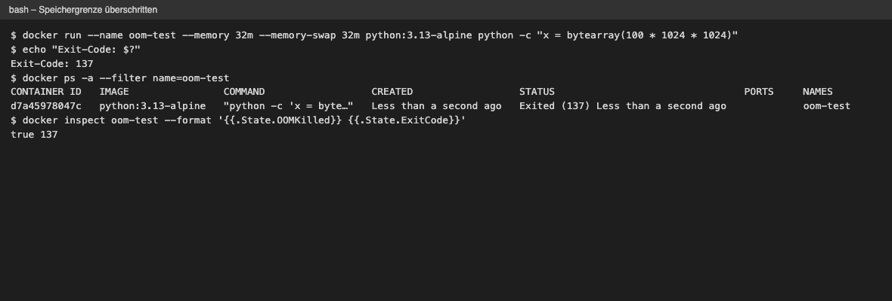

# Lab 6.2: Containerisolierung und Ressourcenbeschränkungen

**Leitfragen:**

<details>
<summary>Zehn Programme teilen sich einen Server: was passiert, wenn eines plötzlich allen Speicher will?</summary>

Ohne Grenzen nimmt es den anderen den Speicher weg; der Server wird langsam, und das Betriebssystem beendet irgendein Programm, nicht unbedingt das schuldige. Mit Grenzen trifft es nur das Programm, das seine Grenze überschreitet.

</details>

<details>
<summary>Was ist schlimmer: ein Programm, das langsamer wird, oder eines, das beendet wird?</summary>

Kommt auf den Zweck an: Ein beendetes Programm fällt sofort auf und wird neu gestartet, ein langsames ärgert unbemerkt. Docker bremst bei zu viel CPU und beendet bei zu viel Speicher.

</details>

- Containerisolierung trennt Container voneinander und vom Host. Linux erledigt das mit zwei Kernel-Funktionen: Namespaces (was ein Container sieht) und Cgroups (wie viel er verbraucht).
- Ohne Grenzen darf jeder Container alle CPUs und den ganzen Speicher des Hosts nutzen. `--memory` und `--cpus` setzen Grenzen, `docker stats` zeigt den Verbrauch.

## Begriffe

| Begriff | Bedeutung |
| --- | --- |
| Containerisolierung | Trennung und Absicherung von Containern untereinander und gegenüber dem Host |
| Namespace | Kernel-Funktion, die einem Prozess eine eigene Sicht gibt (eigene Prozessliste, eigenes Netz, eigenes Dateisystem); wie Trennwände in einem Großraumbüro |
| Cgroup (Control Group) | Kernel-Funktion, die Ressourcen wie CPU, Speicher und Festplattenzugriff einer Gruppe von Prozessen begrenzt und misst; wie ein Stromzähler mit Sicherung |
| Ressourcenbeschränkung | Obergrenze für CPU, Arbeitsspeicher oder Festplattenzugriff eines Containers |
| OOM-Killer | Teil des Linux-Kernels, der bei Speichermangel („Out Of Memory") einen Prozess beendet |
| Exit-Code 137 | Container wurde mit dem Signal `KILL` beendet (128 + 9), bei Speicherüberschreitung durch den OOM-Killer |

## Containerisolierung mit Namespaces und Cgroups

Docker nutzt mehrere Mechanismen, um Container zu isolieren, vor allem Namespaces und Cgroups. Beide sind Teil des Linux-Kernels; Docker richtet sie bei jedem `docker run` ein.


_Quelle: Wikimedia Commons, „Linux kernel unified hierarchy cgroups and systemd.svg" (https://commons.wikimedia.org/wiki/File:Linux_kernel_unified_hierarchy_cgroups_and_systemd.svg), ScotXW, CC BY-SA 3.0, abgerufen am 23.11.2026._

Alle Container teilen sich denselben Kernel. Die Cgroups sitzen im Kernel neben Prozess- und Speicherverwaltung und teilen beiden mit, wie viel jede Gruppe bekommt.

### Namespaces in Docker

Namespaces isolieren Ressourcen auf Systemebene: Ein Container sieht nur seine eigenen Prozesse, Netzwerkschnittstellen und Dateien, nicht die anderer Container.

| Namespace | Trennt | Sichtbar im Kurs |
| --- | --- | --- |
| `pid` | Prozesse | im Container hat der Hauptprozess die Nummer 1 (`docker compose top` zeigt ihn mit Host-Nummer) |
| `net` | Netzwerk | eigene IP-Adresse je Container (Modul 5) |
| `mnt` | Dateisystem | eigenes Wurzelverzeichnis aus dem Image (Lab 2.2) |
| `uts` | Hostname | Hostname = Container-ID, angezeigt von der Hello-App |
| `ipc` | Kommunikation zwischen Prozessen | gemeinsamer Speicher nur innerhalb des Containers |
| `user` | Benutzer-IDs | optional: root im Container wird auf dem Host ein normaler Benutzer (User-Namespace-Remapping, Rootless-Modus) |

```bash
docker run --rm alpine:3.24 ps      # zeigt nur die Prozesse dieses Containers, PID 1 = ps selbst
```

### Control Groups (Cgroups)

- Cgroups begrenzen und überwachen Ressourcen wie CPU, Arbeitsspeicher und Festplattenzugriff je Container.
- Docker legt für jeden Container eine Cgroup an, setzt dort die Grenzen aus `--memory`, `--cpus` usw. und liest daraus die Werte für `docker stats`.
- Aktuelle Linux-Systeme und Docker Desktop nutzen Cgroups Version 2 (`docker info` zeigt `Cgroup Version: 2`).

## Sicherheitsaspekte der Isolierung

- Isolierung ist eine zusätzliche Sicherheitsebene: Eine Anwendung im Container sieht weder den Host noch andere Container.
- Getrennte Ressourcen verringern Konflikte (zwei Programme wollen dieselbe Bibliothek in verschiedenen Versionen) und Angriffe (ein Container legt mit Last alle anderen lahm).
- Grenze: Alle Container teilen den Kernel des Hosts. Eine Lücke im Kernel betrifft alle; root im Container (Lab 6.1) erhöht das Risiko. Virtuelle Maschinen trennen stärker, weil jede ihren eigenen Kernel hat.

## Ressourcenbeschränkungen setzen

Ohne Beschränkungen kann ein einzelner Container alle verfügbaren Ressourcen belegen. Grenzen sorgen für eine faire Verteilung und verhindern Überlastung. Docker setzt sie per Flag beim Start (`docker run`) oder nachträglich (`docker update`).

| Flag | Wirkung | Beispiel |
| --- | --- | --- |
| `--memory`, `-m` | harte Obergrenze für Arbeitsspeicher; Einheiten `b`, `k`, `m`, `g` | `--memory 128m` |
| `--memory-swap` | Speicher plus Auslagerung; gleich `--memory` = keine Auslagerung | `--memory-swap 128m` |
| `--memory-reservation` | weiche Untergrenze, die bei Speicherknappheit greift | `--memory-reservation 64m` |
| `--cpus` | Anteil an CPU-Kernen, auch Bruchteile | `--cpus 0.5` = halber Kern |
| `--cpu-shares` | Gewichtung bei CPU-Konkurrenz (Standard 1024), keine harte Grenze | `--cpu-shares 512` |
| `--cpuset-cpus` | nur bestimmte Kerne | `--cpuset-cpus 0,1` |
| `--blkio-weight` | Gewichtung beim Festplattenzugriff, 10–1000 (Standard 500); nur wenn der Kernel es unterstützt, unter Docker Desktop startet der Container damit nicht | `--blkio-weight 300` |
| `--pids-limit` | höchstens so viele Prozesse | `--pids-limit 100` |

Quelle: Docker Docs, „Resource constraints" (https://docs.docker.com/engine/containers/resource_constraints/), abgerufen am 23.11.2026.

```bash
docker run -d --name backend-limits --memory 64m --cpus 0.5 backend:v1    # Hello-Backend mit Grenzen
docker stats --no-stream backend-limits                                   # einmal messen statt live
docker update --memory 128m --memory-swap 128m backend-limits             # Grenze im Betrieb ändern
```

### Verbrauch mit `docker stats` messen

```text
CONTAINER ID   NAME             CPU %     MEM USAGE / LIMIT   MEM %     NET I/O         BLOCK I/O    PIDS
6d9e211f047e   backend-limits   0.04%     21.23MiB / 64MiB    33.18%    1.26kB / 126B   0B / 172kB   1
```

| Spalte | Bedeutung |
| --- | --- |
| `CPU %` | CPU-Nutzung; 100 % = ein ganzer Kern, mit `--cpus 0.5` höchstens etwa 50 % |
| `MEM USAGE / LIMIT` | belegter Speicher und Grenze; ohne `--memory` steht dort der ganze Speicher des Hosts bzw. der VM |
| `NET I/O`, `BLOCK I/O`, `PIDS` | Netzwerk, Festplatte, Anzahl Prozesse; für dieses Lab ignorierbar |

`docker stats` ohne `--no-stream` aktualisiert sich jede Sekunde und endet mit Strg+C. Docker Desktop zeigt dieselben Werte im Tab **Containers** → Container → **Stats**.

### Speicherüberschreitung und Exit-Code 137

- CPU-Grenze: Der Container wird gebremst, läuft aber weiter.
- Speichergrenze: Will der Container mehr Speicher, beendet der OOM-Killer den Prozess. Der Container steht auf `Exited (137)`, und `docker inspect` zeigt `"OOMKilled": true`.

```bash
docker run --name oom-test --memory 32m --memory-swap 32m python:3.13-alpine \
  python -c "x = bytearray(100 * 1024 * 1024)"            # will 100 MB in 32 MB Grenze
docker inspect oom-test --format '{{.State.OOMKilled}} {{.State.ExitCode}}'   # true 137
```



_Quelle: eigener Screenshot, Docker Desktop, 23.11.2026._

## Ressourcengrenzen in Compose

In Compose stehen die Grenzen je Dienst unter `deploy.resources`. `docker compose up` wendet `limits` auch ohne Swarm an.

```yaml
services:
  backend:
    image: backend:v1
    deploy:
      resources:
        limits:
          cpus: "0.5"         # höchstens ein halber Kern
          memory: 128M        # harte Speichergrenze
        reservations:
          memory: 64M         # weiche Untergrenze (wie --memory-reservation)
```

Quelle: Docker Docs, „Compose Deploy Specification" (https://docs.docker.com/reference/compose-file/deploy/), abgerufen am 23.11.2026. Werte für `cpus` in Anführungszeichen, Speicher mit Einheit (`128M`, `1G`).

## Typische Fehler

| Symptom | Ursache | Lösung |
| --- | --- | --- |
| Container steht auf `Exited (137)`, Logs enden ohne Fehlermeldung | Speichergrenze überschritten | `docker inspect <name> --format '{{.State.OOMKilled}}'`; Grenze erhöhen oder Speicherbedarf senken |
| `Minimum memory limit allowed is 6MB` | Grenze zu klein | mindestens `6m`, für Python-Dienste realistisch ab etwa `64m` |
| `Minimum memoryswap limit should be larger than memory limit` | `--memory-swap` kleiner als `--memory` | `--memory-swap` gleich oder größer als `--memory` setzen |
| `error setting cgroup config … io.weight: no such file or directory` | `--blkio-weight` wird vom Kernel nicht unterstützt (z. B. Docker Desktop, 23.11.2026) | Flag weglassen; unter Linux nur mit passendem I/O-Scheduler (BFQ) wirksam |
| `MEM USAGE / LIMIT` zeigt nach `docker compose up` keine Grenze | `deploy` falsch eingerückt oder Container nicht neu erstellt | Einrückung prüfen, `docker compose up -d` erneut ausführen |

## Fazit

- Namespaces bestimmen, was ein Container sieht; Cgroups, wie viel er verbraucht. Alle Container teilen sich den Kernel des Hosts.
- `--memory` und `--cpus` (in Compose `deploy.resources.limits`) setzen harte Grenzen; `docker stats` zeigt Verbrauch und Grenze.
- Zu viel CPU bremst, zu viel Speicher beendet den Container mit Exit-Code 137 (`OOMKilled`).

In der Übung läuft das Hello-Backend mit Grenzen, ein Container überschreitet sein Speicherlimit, und die Hello-Compose-Datei bekommt Grenzen für beide Dienste.
