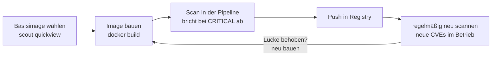
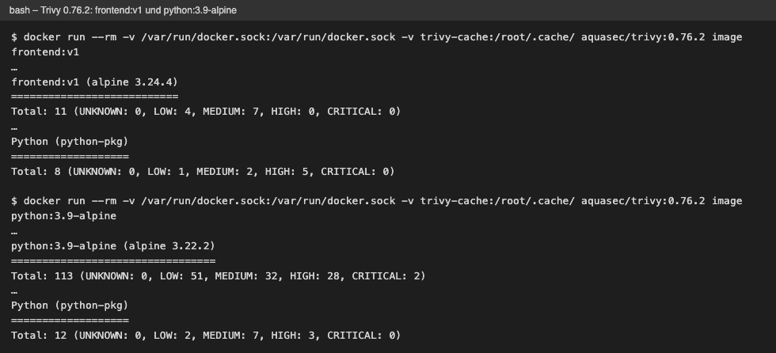

# Lab 6.3: Docker Security Scanning und andere Tools

**Leitfragen:**

<details>
<summary>Woher weiß man, ob in einem fertigen Paket eine bekannte Sicherheitslücke steckt?</summary>

Man vergleicht die enthaltenen Programme und Versionen mit öffentlichen Listen bekannter Lücken. Ein Scanner erledigt das automatisch für alle Pakete eines Images.

</details>

<details>
<summary>Wann sollte eine solche Prüfung laufen: vor dem Bauen, nach dem Bauen oder im Betrieb?</summary>

Zu allen drei Zeitpunkten: beim Auswählen des Basisimages, nach jedem Build in der Pipeline und regelmäßig für laufende Images, weil täglich neue Lücken bekannt werden.

</details>

- Ein Image-Scan listet die Pakete eines Images und vergleicht ihre Versionen mit Schwachstellen-Datenbanken. Ergebnis: bekannte Lücken (CVEs) mit Schweregrad und der Version, die sie behebt.
- Das frühere `docker scan` gibt es nicht mehr; heute scannt **Docker Scout** (in Docker Desktop und CLI enthalten). Trivy und Grype sind quelloffene Alternativen ohne Docker-Konto.
- Weitere Werkzeuge sichern die Lieferkette und den Betrieb: Image Signing (cosign, Notation) und Runtime Protection (z. B. Falco).

## Begriffe

| Begriff | Bedeutung |
| --- | --- |
| CVE | Common Vulnerabilities and Exposures: weltweit eindeutige Nummer einer bekannten Lücke, z. B. `CVE-2025-47273` |
| Schweregrad | Einstufung einer Lücke: `CRITICAL`, `HIGH`, `MEDIUM`, `LOW` (C, H, M, L in Docker Scout); beruht meist auf dem CVSS-Wert 0–10 |
| Image-Scan (Vulnerability Scanning) | automatische Prüfung aller Pakete eines Images gegen Schwachstellen-Datenbanken |
| SBOM | Software Bill of Materials: Stückliste aller Pakete und Versionen eines Images; Grundlage des Scans |
| Fixed Version | erste Paketversion, in der die Lücke behoben ist; leer = noch keine Korrektur verfügbar |
| Image Signing | digitale Signatur eines Images, mit der sich Herkunft und Unverändertheit prüfen lassen |
| Runtime Protection | Überwachung laufender Container auf verdächtiges Verhalten |

## Docker Security Scanning mit Docker Scout

Ein Scan prüft Images automatisch auf bekannte Schwachstellen. So erkennen Entwicklung und Betrieb Risiken, bevor ein Image läuft. Docker Scout ist der Nachfolger von „Docker Security Scanning" und `docker scan`.

- Voraussetzung: Docker Desktop oder das CLI-Plugin `docker scout` und eine Anmeldung mit kostenlosem Docker-Konto (`docker login`, [Setup](../../00-setup-and-installation.md#docker-hub-limit-und-docker-login)).
- Lokale Images werden direkt auf dem Rechner analysiert; nur die Stückliste (SBOM), nicht das Image, geht zum Abgleich an Docker. Quelle: Docker Docs, „Docker Scout" (https://docs.docker.com/scout/), abgerufen am 23.11.2026.

| Befehl | Wirkung |
| --- | --- |
| `docker scout quickview frontend:v1` | Kurzfassung: Anzahl Lücken je Schweregrad für Image und Basisimage, dazu ein aktuelleres Basisimage |
| `docker scout cves frontend:v1` | alle Lücken, gruppiert nach Paket, mit CVE-Nummer, Schweregrad und Fixed Version |
| `docker scout cves --only-severity critical,high frontend:v1` | nur kritische und hohe Lücken |
| `docker scout recommendations frontend:v1` | Vorschläge für ein Basisimage mit weniger Lücken |
| `docker scout compare frontend:v2 --to frontend:v1` | Unterschiede zweier Images (Pakete, Lücken) |

Quelle: Docker Docs, „docker scout quickview" (https://docs.docker.com/reference/cli/docker/scout/quickview/), abgerufen am 23.11.2026.

Aufbau der Ausgabe von `quickview`, schematisch (die Zahlen ändern sich täglich, weil neue Lücken bekannt und behoben werden):

```text
  Target               │  frontend:v1          │    0C     0H     7M     4L    # Lücken im Image: Critical, High, Medium, Low
    digest             │  4f2a9c81d0e3         │
  Base image           │  python:3.13-alpine   │    0C     0H     7M     4L    # davon stammen aus dem Basisimage
  Refreshed base image │  python:3.13-alpine   │    0C     0H     0M     0L    # dasselbe Tag, neu geladen
```

Docker Desktop zeigt dieselbe Analyse im Bereich **Images** → Image auswählen → Tab **Vulnerabilities**.

## Funktionsweise eines Image-Scans


_Quelle: Trivy Docs, „Container Image" (https://trivy.dev/docs/latest/guide/target/container_image/), Aqua Security, Apache-2.0, abgerufen am 23.11.2026._

1. Der Scanner lädt eine Schwachstellen-Datenbank (aus Quellen wie NVD, GitHub Advisories und den Sicherheitsmeldungen von Alpine, Debian, Ubuntu).
2. Er liest die Schichten des Images (Lab 3.1) und erkennt Betriebssystem-Pakete (`apk`, `apt`) und Sprachpakete (`pip`, `npm`).
3. Er vergleicht jede Paketversion mit der Datenbank und meldet Treffer mit Schweregrad und Fixed Version.

Der Scan findet nur **bekannte** Lücken in **erkannten** Paketen. Eigener Code, Fehlkonfigurationen und unbekannte Lücken bleiben unsichtbar.

## Integration in CI/CD und den Entwicklungsprozess

Scans lassen sich in die CI/CD-Pipeline einbauen, damit jedes neue Image geprüft wird (vertieft in Lab 8.2):



- Früh erkannt heißt billig behoben: Ein neueres Basisimage oder ein Paket-Update im Dockerfile reicht oft.
- Für GitHub Actions gibt es fertige Schritte, z. B. `docker/scout-action` und `aquasecurity/trivy-action`.

## Trivy und Grype als Alternativen zu Docker Scout

Beide Scanner sind quelloffen, laufen als Container und brauchen kein Docker-Konto. Sie lesen lokale Images über den Docker-Socket (Lab 6.1).

```bash
# Trivy: Schwachstellen eines lokalen Images, Datenbank im Volume trivy-cache zwischenspeichern
docker run --rm -v /var/run/docker.sock:/var/run/docker.sock -v trivy-cache:/root/.cache/ \
  aquasec/trivy:0.76.2 image frontend:v1

# Grype: gleiche Aufgabe, anderer Hersteller (Anchore)
docker run --rm -v /var/run/docker.sock:/var/run/docker.sock anchore/grype:v0.122.1 frontend:v1
```


_Quelle: Trivy Docs, „Overview" (https://trivy.dev/docs/latest/guide/), Aqua Security, Apache-2.0, abgerufen am 23.11.2026._

Vergleich der Hello-Images mit einem veralteten Basisimage (Trivy 0.76.2, 23.11.2026):



_Quelle: eigener Screenshot, Hello-App, 23.11.2026._

| Image | Betriebssystem-Pakete | Python-Pakete |
| --- | --- | --- |
| `frontend:v1` (`python:3.13-alpine`, Alpine 3.24) | 11 (0 C, 0 H, 7 M, 4 L) | 8 (0 C, 5 H, 2 M, 1 L) |
| `python:3.9-alpine` (Alpine 3.22, Python 3.9 ohne Support seit 10/2025) | 113 (2 C, 28 H, 32 M, 51 L) | 12 (0 C, 3 H, 7 M, 2 L) |

Ein aktuelles Basisimage ist die wirksamste Einzelmaßnahme.

## Weitere Sicherheitswerkzeuge

Neben Scannern verbessern weitere Werkzeuge und Praktiken die Sicherheit: Image Signing, Vulnerability Scanning und Runtime Protection.

| Bereich | Wirkung | Werkzeuge 2026 |
| --- | --- | --- |
| Image Signing | Signatur belegt Herkunft und Unverändertheit; nur signierte, vertrauenswürdige Images laufen | cosign (Sigstore), Notation (Notary Project); früher Docker Content Trust |
| Vulnerability Scanning | Berichte über bekannte Lücken mit Empfehlungen zur Behebung | Docker Scout, Trivy, Grype |
| Runtime Protection | überwacht laufende Container, setzt Regeln durch, erkennt Anomalien (z. B. Shell im Container, Schreiben in `/etc`) | Falco, Sysdig, Aqua, Docker Desktop Enhanced Container Isolation |

- **Docker Content Trust (DCT)** wird abgelöst: Der Notary-v1-Dienst `notary.docker.io` wird am 08.12.2026 abgeschaltet. Quelle: Docker Docs, „Content trust in Docker" (https://docs.docker.com/engine/security/trust/), abgerufen am 23.11.2026. Nachfolger sind cosign (`cosign sign`, `cosign verify`) und Notation; beide legen die Signatur als eigenes Objekt neben das Image in die Registry (vertieft in Lab 8.1).


_Quelle: Falco, „falco.org" (https://falco.org/), The Falco Authors, CC BY 4.0, abgerufen am 23.11.2026._

Falco beobachtet die Systemaufrufe aller Container im Kernel und meldet Regelverstöße, z. B. „Terminal shell in container".

## Container ohne root mit `USER`

Lab 6.1 zeigte: Ohne `USER` läuft das Hello-Frontend als root. Ein eigener Benutzer im Dockerfile senkt die Rechte für alle folgenden Anweisungen und für den Container:

```dockerfile
# … wie bisher bis vor CMD …

# Benutzer app ohne Passwort anlegen (-D), Ordner /data für access.log ihm übergeben
RUN adduser -D app && mkdir -p /data && chown app /data
# Ab hier laufen RUN, CMD und der Container als app statt root
USER app

CMD ["python", "frontend.py"]
```

- `adduser -D` ist der Alpine-Befehl; auf Debian/Ubuntu-Images heißt er `useradd -m app`.
- Port 80 bleibt nutzbar: Docker erlaubt Prozessen in Containern standardmäßig auch ohne root Ports unter 1024.
- Ein bestehendes Volume behält die Rechte seiner Dateien. `access.log` im Volume `hello-data` gehört noch root; das Frontend zeigt dann „nicht beschreibbar", bis die Datei dem neuen Benutzer gehört (`chown`, siehe Übung). Ein neues, leeres Volume übernimmt den Besitzer von `/data` aus dem Image.

## Typische Fehler

| Symptom | Ursache | Lösung |
| --- | --- | --- |
| `docker scout` meldet `log in to Docker Hub` bzw. `not authorized` | nicht angemeldet | `docker login` mit dem kostenlosen Docker-Konto; ohne Konto Trivy nutzen |
| `docker: 'scout' is not a docker command` | Docker Engine unter Linux ohne Scout-Plugin | Plugin nachinstallieren (Docker Docs „Install Docker Scout") oder Trivy nutzen |
| Zahlen weichen vom Handout ab | Datenbanken ändern sich täglich | erwartet; die Größenordnung und der Vergleich zählen |
| „Aufrufe in access.log: nicht beschreibbar" nach `USER` | `access.log` im Volume gehört root | `docker compose exec --user root frontend chown -R app /data` |
| `adduser: not found` | Basisimage ist kein Alpine | `useradd -m app` verwenden |
| Trivy unter Windows: `invalid mount config` | Git Bash wandelt `/var/run/docker.sock` um | `MSYS_NO_PATHCONV=1` setzen |

## Fazit

- Image-Scans gleichen die Pakete eines Images mit Schwachstellen-Datenbanken ab; Docker Scout (`quickview`, `cves`, `recommendations`) ist der heutige Docker-Weg, Trivy und Grype laufen ohne Konto.
- Ein aktuelles Basisimage beseitigt die meisten Lücken; Scans gehören in jede Pipeline und regelmäßig in den Betrieb.
- Signaturen (cosign, Notation) sichern die Herkunft, Runtime Protection (Falco) den Betrieb, `USER` nimmt dem Container root-Rechte.

In der Übung werden `frontend:v1` und `python:3.9-alpine` gescannt und verglichen, danach läuft das Hello-Frontend ohne root.
