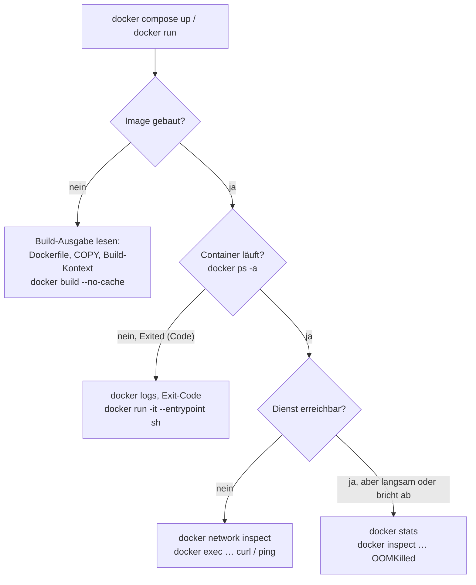
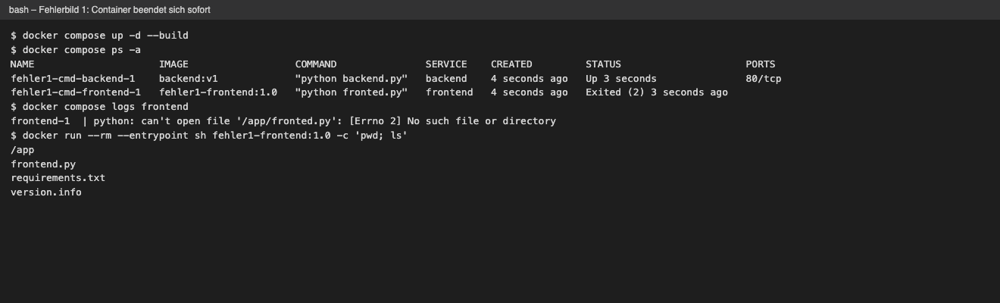
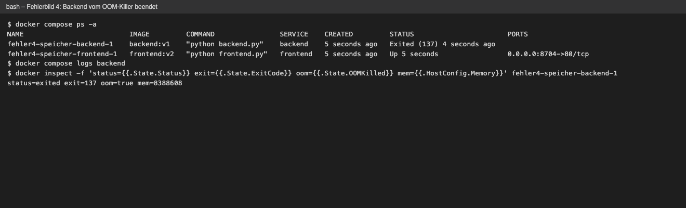

# Lab 7.1: Docker Debugging

**Leitfragen:**

<details>
<summary>Ein Programm startet und beendet sich sofort wieder: wo sucht man zuerst?</summary>

In seinen letzten Ausgaben und im Exit-Code. Bei Containern zeigen `docker logs` die Ausgaben und `docker ps -a` den Exit-Code, auch wenn der Container schon beendet ist.

</details>

<details>
<summary>Woran ist erkennbar, ob ein Fehler im Programm oder in der Umgebung liegt?</summary>

Läuft dasselbe Image mit anderer Umgebung (anderes Netzwerk, mehr Speicher, andere Variablen) fehlerfrei, liegt es an der Umgebung. Eine Fehlermeldung mit Dateiname und Zeile des Programms deutet auf Code oder Image.

</details>

- Fast jeder Container-Fehler fällt in eine von vier Gruppen: Build, Start, Netzwerk, Ressourcen. Jede Gruppe hat ihr eigenes Werkzeug.
- Die Werkzeuge sind aus Tag 1 und 2 bekannt (`logs`, `exec`, `inspect`, `stats`); neu ist die Reihenfolge, in der sie eingesetzt werden.

## Begriffe

| Begriff | Bedeutung |
| --- | --- |
| Exit-Code | Zahl, mit der sich ein Programm beendet: `0` = alles in Ordnung, alles andere = Fehler; Docker merkt sie sich je Container |
| Entrypoint | das Programm, das beim Containerstart ausgeführt wird; `CMD` liefert ihm die Argumente (Lab 3.2) |
| Build-Kontext | der Ordner, den `docker build` an Docker schickt; nur Dateien darin (und nicht in `.dockerignore`) kann `COPY` ins Image kopieren |
| Namensauflösung (DNS) | Übersetzung eines Namens wie `backend` in eine IP-Adresse; klappt nur innerhalb desselben Docker-Netzwerks (Lab 5.3) |
| OOM-Killer | Teil des Linux-Kernels, der einen Prozess beendet, wenn sein Speicher („out of memory") nicht reicht; Exit-Code `137` (Lab 6.2) |
| Cache | gespeicherte Ergebnisse früherer Build-Schritte; `docker build` überspringt Schritte, deren Eingaben gleich geblieben sind (Lab 3.1) |

## Fehlersuche in vier Schritten

Die Fehlersuche beginnt immer mit derselben Frage: Wie weit ist der Container gekommen?



| Gruppe | typisches Symptom | erstes Werkzeug |
| --- | --- | --- |
| Build | `docker build` bricht ab, kein Image | Build-Ausgabe, Zeile mit `ERROR` bzw. `failed to solve` |
| Start | Container sofort `Exited`, Seite lädt nicht | `docker ps -a`, `docker logs` |
| Netzwerk | Container läuft, Verbindung zu anderem Dienst scheitert | `docker network inspect`, `curl` im Container |
| Ressourcen | Container langsam oder plötzlich `Exited (137)` | `docker stats`, `docker inspect` |

## Logs und Diagnose mit docker logs

`docker logs <container>` zeigt alles, was das Programm im Container auf die Standardausgabe und die Fehlerausgabe geschrieben hat. Logs zeigen besonders gut, was beim Start des Containers passiert ist, und sie bleiben auch nach dem Absturz lesbar, bis der Container gelöscht wird.

```bash
docker logs my-web-container                  # alle bisherigen Ausgaben
docker logs --follow my-web-container         # live mitlesen (kurz: -f), Strg+C beendet nur das Mitlesen
docker logs --tail 20 my-web-container        # nur die letzten 20 Zeilen
docker logs --since 10m my-web-container      # nur die letzten 10 Minuten (auch 30s, 2h oder ein Datum)
docker logs -t --tail 5 my-web-container      # mit Zeitstempel je Zeile
```

| Option | Wirkung |
| --- | --- |
| `--follow`, `-f` | zeigt neue Zeilen in Echtzeit |
| `--tail <n>` | gibt nur die letzten `n` Zeilen aus |
| `--since <zeit>` | nur Zeilen ab diesem Zeitpunkt, z. B. `10m`, `2026-11-23T09:00` |
| `--timestamps`, `-t` | Zeitstempel vor jede Zeile |

In einem Compose-Projekt gibt es dieselben Befehle je Dienst: `docker compose logs frontend`, `docker compose logs -f --tail 20`. Wichtig: `docker ps` und `docker compose ps` zeigen nur laufende Container; beendete Container und ihren Exit-Code zeigen erst `docker ps -a` und `docker compose ps -a`.



_Quelle: eigener Screenshot, Hello-App (Fehlerbild 1), 23.11.2026._

### Exit-Codes lesen

| Exit-Code | Bedeutung | typischer Anlass |
| --- | --- | --- |
| `0` | Programm hat sich regulär beendet | Befehl wie `echo` ist fertig; bei Webservern unerwartet |
| `1` | allgemeiner Fehler des Programms | Ausnahme im Code, fehlende Konfiguration |
| `2` | falscher Aufruf | Python findet die Startdatei nicht |
| `126` / `127` | Befehl nicht ausführbar / nicht gefunden | Tippfehler im Programmnamen in `CMD` oder `ENTRYPOINT` |
| `137` | hart beendet (`SIGKILL`) | Speichergrenze überschritten (OOM) oder `docker kill` |
| `143` | sauber beendet (`SIGTERM`) | `docker stop` |

## Interaktive Fehlerbehebung mit docker exec

`docker exec` startet einen zusätzlichen Prozess in einem **laufenden** Container, zum Beispiel eine Shell. So lassen sich Konfigurationen prüfen, Dateien ansehen oder Prozesse beobachten, ohne den Container anzuhalten (Lab 2.2).

```bash
docker exec -it my-web-container /bin/bash   # Shell in Images mit bash (z. B. ubuntu, debian)
docker exec -it my-web-container sh          # Alpine-Images (python:3.13-alpine, nginx:1.30-alpine) haben nur sh
docker compose exec backend sh               # dasselbe für einen Compose-Dienst
```

In der Shell helfen `ls`, `cat <datei>`, `env` (Umgebungsvariablen) und `ps` (laufende Prozesse); `exit` verlässt sie.

## Abgestürzten Container untersuchen mit --entrypoint

Ein Container, der sofort abstürzt, lässt sich nicht mit `exec` betreten: Es gibt keinen laufenden Prozess. Stattdessen startet ein **neuer** Container aus demselben Image mit einer Shell als Entrypoint; das eigentliche Programm läuft dann nicht.

```bash
docker run -it --rm --entrypoint /bin/bash <image>    # Images mit bash
docker run -it --rm --entrypoint sh fehler1-frontend:1.0
```

```text
/app # ls
frontend.py       requirements.txt  version.info
/app # exit
```

Im Container lässt sich prüfen, ob die Dateien am erwarteten Ort liegen und ob der Startbefehl von Hand funktioniert (`python frontend.py`). `--rm` löscht den Untersuchungscontainer danach wieder.

## Netzwerkfehler beheben mit docker network inspect

`docker network inspect <netzwerk>` zeigt, welche Container in einem Netzwerk hängen und welche IP-Adressen sie haben. Zwei Container können sich nur über ihren Namen erreichen, wenn sie im selben benutzerdefinierten Netzwerk sind (Lab 5.3).

```bash
docker network ls                                    # alle Netzwerke; Compose-Netzwerke heißen <projekt>_<name>
docker network inspect my-network                    # vollständiges JSON
docker network inspect my-network \
  --format '{{range .Containers}}{{.Name}} {{.IPv4Address}}{{"\n"}}{{end}}'   # nur Container und IPs
docker inspect -f '{{range $k, $v := .NetworkSettings.Networks}}{{$k}} {{end}}' my-web-container   # Netzwerke eines Containers
```

In Compose legt der Schlüssel `networks:` eigene Netzwerke an; ein Dienst hängt nur in den Netzwerken, die unter ihm aufgeführt sind. Ohne `networks:` hängen alle Dienste eines Projekts im Netzwerk `<projekt>_default`.

```yaml
services:
  frontend:
    networks: [front]          # nur im Netzwerk front
  backend:
    networks: [back, front]    # in beiden Netzwerken: für das Frontend erreichbar
networks:
  front:
  back:
```

Zum schnellen Test lässt sich ein laufender Container zusätzlich verbinden: `docker network connect --alias backend <netzwerk> <container>`. Ohne `--alias` ist er im neuen Netzwerk nur unter seinem Containernamen erreichbar, nicht unter dem Dienstnamen. Dauerhaft gehört die Änderung in die Compose-Datei.

## Netzwerkverbindungen testen mit curl und ping

Mit `curl` oder `ping` **aus einem Container heraus** lässt sich prüfen, ob ein anderer Container oder Dienst erreichbar ist, und zwar genau so, wie die Anwendung ihn sieht.

```bash
docker exec -it my-web-container curl http://my-database:3306   # Beispiel: Ist der Datenbankdienst unter diesem Namen erreichbar?
docker compose exec frontend curl -sS http://backend:80          # Hello-App: Antwort des Backends aus Sicht des Frontends
docker compose exec frontend ping -c 1 backend                   # nur Namensauflösung und Erreichbarkeit
```

| Ausgabe | Bedeutung |
| --- | --- |
| JSON oder HTML des Zieldienstes | Verbindung funktioniert; Fehler liegt woanders (z. B. falsche URL in der Konfiguration) |
| `Could not resolve host: backend` / `ping: bad address 'backend'` | Name unbekannt: anderes Netzwerk oder Tippfehler im Namen |
| `Connection refused` | Name bekannt, aber auf dem Port lauscht nichts: falscher Port oder Dienst nicht gestartet |
| keine Antwort bis zum Timeout | Ziel nicht erreichbar, z. B. Firewall oder falsche IP |

`curl -sS` unterdrückt den Fortschrittsbalken, zeigt Fehler aber an. Ein Datenbankport wie `3306` spricht kein HTTP; `curl` meldet dann einen Protokollfehler, was trotzdem beweist, dass die Verbindung zustande kommt. Fehlen `curl` und `ping` im Image, hilft ein Werkzeug-Container im selben Netzwerk: `docker run --rm -it --network <netzwerk> nicolaka/netshoot`.

Auch die Konfiguration der Anwendung gehört zur Netzwerkprüfung: Das Hello-Frontend liest die Adresse des Backends aus `BACKEND_URL` (Standard `http://backend:80`). Ein Tippfehler dort erzeugt dasselbe Symptom wie ein falsches Netzwerk; `docker compose exec frontend env` zeigt den tatsächlichen Wert.

## Debugging von Dockerfiles und Images

Typische Probleme in Dockerfiles:

| Problem | Beispiel | Erkennbar an |
| --- | --- | --- |
| falsches Basis-Image | nicht unterstütztes oder falsches Image, Tippfehler im Tag | `pull access denied`, `manifest unknown`, Befehle wie `apt-get` fehlen in Alpine |
| Fehler in `COPY` | Datei oder Ordner liegt nicht im Build-Kontext oder ist durch `.dockerignore` ausgeschlossen | `failed to compute cache key: "/requirements.txt": not found` |
| nicht angegebene Abhängigkeiten | Bibliothek fehlt in `requirements.txt` bzw. Programm fehlt im Image | Build klappt, Start scheitert: `ModuleNotFoundError`, `curl: not found` |
| falscher Startbefehl | Tippfehler im Dateinamen von `CMD` | Container sofort `Exited (2)`, Log `can't open file` |

Ein Build-Fehler nennt die Anweisung, an der er scheitert, mit Zeilennummer:

```text
 > [4/7] COPY requirements.txt .:
------
Dockerfile:8
--------------------
   7 |
   8 | >>> COPY requirements.txt .
   9 |     RUN pip install --no-cache-dir -r requirements.txt
--------------------
failed to solve: failed to compute cache key: failed to calculate checksum of ref …: "/requirements.txt": not found
```

`not found` bezieht sich auf den Build-Kontext, nicht auf den Ordner im Explorer: Liegt die Datei sichtbar im Ordner, steht sie vermutlich in `.dockerignore` oder `docker build` wurde mit einem anderen Ordner als Kontext aufgerufen (bei Compose: `build.context`).

### Neu bauen ohne Cache

Der Build-Cache spart Zeit, kann aber veraltete Schritte wiederverwenden, z. B. ein `RUN apk add` von vor Wochen. `--no-cache` führt alle Schritte neu aus:

```bash
docker build --no-cache -t my-python-app .     # alle Schritte neu ausführen
docker compose build --no-cache frontend       # dasselbe für einen Compose-Dienst
```

## Ressourcenprobleme erkennen und beheben

`docker stats` zeigt die Ressourcennutzung von Containern live: CPU, Speicher mit Grenze, Netzwerk und Datenträger (Lab 6.2).

```bash
docker stats my-web-container            # live, Strg+C beendet
docker stats --no-stream                 # alle laufenden Container, einmal
```

Ressourcengrenzen lassen sich direkt beim Start setzen, in Compose unter `deploy.resources.limits`:

```bash
docker run --memory="256m" --cpus="1" my-app     # höchstens 256 MB Speicher und ein CPU-Kern
```

```yaml
services:
  backend:
    deploy:
      resources:
        limits:
          memory: 64M
          cpus: "0.5"
```

Eine zu knappe CPU-Grenze macht den Container langsam; eine zu knappe Speichergrenze beendet ihn: Der OOM-Killer beendet den Prozess, `docker ps -a` zeigt `Exited (137)`, die Logs bleiben oft leer. Gewissheit bringt `docker inspect`:

```bash
docker inspect -f 'status={{.State.Status}} exit={{.State.ExitCode}} oom={{.State.OOMKilled}}' fehler4-speicher-backend-1
```

```text
status=exited exit=137 oom=true
```



_Quelle: eigener Screenshot, Hello-App (Fehlerbild 4), 23.11.2026._

Dieselbe Meldung erscheint ohne Docker in der Kernel-Ausgabe eines Linux-Systems, wenn der Speicher ausgeht:


_Quelle: Wikimedia Commons, Neo139, CC BY-SA 3.0 (https://commons.wikimedia.org/wiki/File:Out_of_Memory_in_Linux.jpg), abgerufen am 23.11.2026._

## Typische Fehler

| Symptom | Ursache | Lösung |
| --- | --- | --- |
| `docker ps` zeigt den Container nicht | Container ist beendet | `docker ps -a` bzw. `docker compose ps -a`, danach `docker logs` |
| `docker exec` meldet `container … is not running` | `exec` braucht einen laufenden Container | `docker run -it --rm --entrypoint sh <image>` |
| `exec: "/bin/bash": no such file or directory` | Alpine-Image ohne bash | `sh` statt `/bin/bash` |
| Korrektur im Dockerfile wirkt nicht | Container läuft noch mit dem alten Image | `docker compose up -d --build` bzw. neu bauen und Container neu erstellen |
| `docker logs` leer, Exit-Code `137` | Prozess vom OOM-Killer beendet, bevor er etwas schreiben konnte | `docker inspect … OOMKilled`, Speichergrenze erhöhen |
| `Could not resolve host` nur unter dem Dienstnamen | Container per `docker network connect` ohne `--alias` verbunden | `--alias <dienstname>` oder Netzwerk in `compose.yml` eintragen |
| `curl: not found` im Container | Image enthält kein `curl` | Werkzeug-Container `nicolaka/netshoot` im selben Netzwerk |

## Fazit

- Erst klären, wie weit der Container kommt: Build, Start, Netzwerk oder Ressourcen; danach das passende Werkzeug wählen.
- `docker ps -a` und `docker logs` zeigen Exit-Code und letzte Ausgaben auch nach einem Absturz; `--entrypoint sh` öffnet ein Image, dessen Programm nicht startet.
- Netzwerkfehler werden aus dem Container heraus geprüft (`curl`, `ping`, `network inspect`); `Exited (137)` mit `OOMKilled=true` heißt: Speichergrenze zu knapp.

In der Übung sind vier vorbereitete Fehlerbilder der Hello-App zu finden und zu beheben, je eines aus jeder Gruppe.
