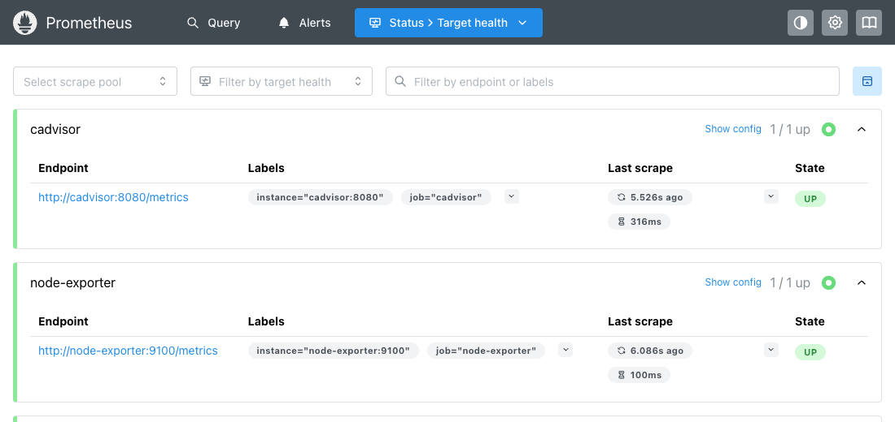
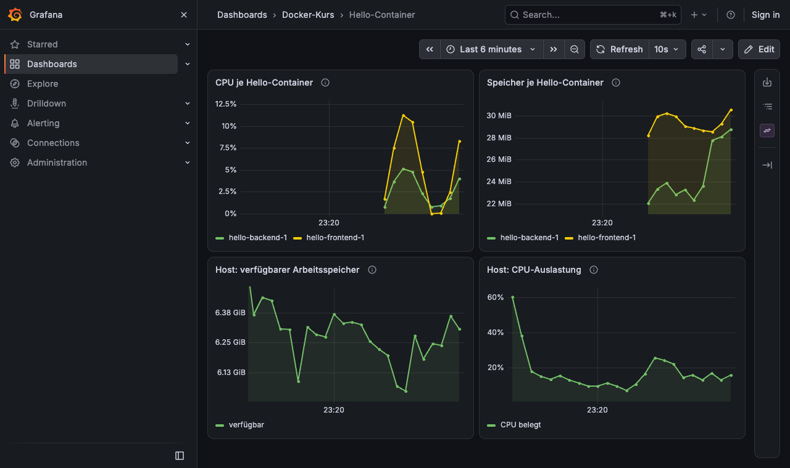

# Lab 7.2 – Lösung: Logging und Monitoring in Docker

Fertiger Stand: `project/examples/m07-debugging/l02-logging-monitoring/monitoring/`. Wiederherstellen im Ordner `project/`:

```bash
cp -r examples/m07-debugging/l02-logging-monitoring/monitoring/. playground/monitoring/
```

## Aufgabe 1: Hello-App starten

```bash
cd project/playground/hello
docker compose up -d
docker compose ps
```

```text
NAME               IMAGE         COMMAND                SERVICE    CREATED          STATUS                    PORTS
hello-backend-1    backend:v1    "python backend.py"    backend    20 seconds ago   Up 19 seconds (healthy)   80/tcp
hello-frontend-1   frontend:v2   "python frontend.py"   frontend   20 seconds ago   Up 8 seconds              0.0.0.0:8080->80/tcp, [::]:8080->80/tcp
```

Die Containernamen beginnen mit `hello-`, weil der Ordner `hello` den Compose-Projektnamen liefert. Das Dashboard filtert genau danach.

## Aufgabe 2: prometheus.yml ergänzen

```yaml
global:
  scrape_interval: 15s

scrape_configs:
  - job_name: prometheus
    static_configs:
      - targets: ['localhost:9090']

  - job_name: cadvisor                  # Werte je Container
    static_configs:
      - targets: ['cadvisor:8080']      # Dienstname und Port im Container

  - job_name: node-exporter             # Werte des Hosts
    static_configs:
      - targets: ['node-exporter:9100']
```

`cadvisor:8080`, nicht `localhost:8081`: Prometheus fragt aus seinem eigenen Container über das Compose-Netzwerk `monitoring_default` ab. Dort heißt der Dienst `cadvisor` und lauscht auf 8080; `8081` gibt es nur auf dem Rechner. `localhost` wäre der Prometheus-Container selbst, daher passt `localhost:9090` nur für den Job `prometheus`.

## Aufgabe 3: Stack starten und Ziele prüfen

```bash
cd ../monitoring
docker compose up -d
docker compose ps
```

```text
NAME                          IMAGE                            COMMAND                  SERVICE         CREATED          STATUS          PORTS
monitoring-cadvisor-1         ghcr.io/google/cadvisor:0.61.1   "/usr/bin/entrypoint…"   cadvisor        25 seconds ago   Up 24 seconds (healthy)   0.0.0.0:8081->8080/tcp, [::]:8081->8080/tcp
monitoring-grafana-1          grafana/grafana:13.3.1           "/run.sh"                grafana         25 seconds ago   Up 24 seconds   0.0.0.0:3000->3000/tcp, [::]:3000->3000/tcp
monitoring-node-exporter-1    prom/node-exporter:v1.13.1       "/bin/node_exporter …"   node-exporter   25 seconds ago   Up 24 seconds   0.0.0.0:9100->9100/tcp, [::]:9100->9100/tcp
monitoring-prometheus-1       prom/prometheus:v3.16.0          "/bin/prometheus --c…"   prometheus      25 seconds ago   Up 24 seconds   0.0.0.0:9090->9090/tcp, [::]:9090->9090/tcp
```

`http://localhost:9090` > **Status > Target health** zeigt drei Ziele mit `UP`:

| Endpoint | Job | State |
| --- | --- | --- |
| `http://cadvisor:8080/metrics` | cadvisor | UP |
| `http://localhost:9090/metrics` | prometheus | UP |
| `http://node-exporter:9100/metrics` | node-exporter | UP |

Dieselbe Prüfung im Terminal über die API von Prometheus:

```bash
curl -s http://localhost:9090/api/v1/targets | grep -o '"health":"[a-z]*"'
```

```text
"health":"up"
"health":"up"
"health":"up"
```



_Quelle: eigener Screenshot, Monitoring-Stack der Übung, 23.11.2026._

Die cAdvisor-Oberfläche `http://localhost:8081` listet unter **Docker Containers** alle laufenden Container, darunter `hello-frontend-1`, mit Diagrammen für CPU, Speicher und Netzwerk. Ein Ziel mit `DOWN` und `connection refused` bedeutet meist einen falschen Port in `prometheus.yml`; nach der Korrektur `docker compose restart prometheus`.

## Aufgabe 4: Dashboard in Grafana

`http://localhost:3000` öffnet Grafana ohne Anmeldung. **Dashboards > Docker-Kurs > Hello-Container** zeigt vier Panels:

| Panel | Quelle | Abfrage |
| --- | --- | --- |
| CPU je Hello-Container | cAdvisor | `sum by (name) (rate(container_cpu_usage_seconds_total{name=~"hello-.*"}[1m]))` |
| Speicher je Hello-Container | cAdvisor | `container_memory_usage_bytes{name=~"hello-.*"}` |
| Host: verfügbarer Arbeitsspeicher | Node Exporter | `node_memory_MemAvailable_bytes` |
| Host: CPU-Auslastung | Node Exporter | `1 - avg(rate(node_cpu_seconds_total{mode="idle"}[1m]))` |

Last erzeugen (im Ordner `hello` oder in jedem anderen Ordner):

```bash
for i in $(seq 1 300); do curl -s http://localhost:8080 > /dev/null; done
```

Während der Schleife steigt die CPU-Linie von `hello-frontend-1` auf etwa 10 %, die des Backends auf etwa 5 % (jeder Seitenaufruf fragt das Backend ab).



_Quelle: eigener Screenshot, Hello-App mit Monitoring-Stack, 23.11.2026._
 Da Prometheus alle 15 Sekunden abfragt und `rate` über eine Minute rechnet, erscheint der Ausschlag mit bis zu einer Minute Verzögerung.

```bash
docker stats --no-stream hello-frontend-1 hello-backend-1
```

```text
CONTAINER ID   NAME               CPU %     MEM USAGE / LIMIT     MEM %     NET I/O           BLOCK I/O       PIDS
339ef2632d6b   hello-frontend-1   0.02%     28.38MiB / 7.748GiB   0.36%     3.02MB / 4.04MB   0B / 381kB      1
51b746b725ed   hello-backend-1    0.02%     27.48MiB / 7.748GiB   0.35%     1.64MB / 1.54MB   5.4MB / 172kB   1
```

Die Speicherwerte im Dashboard stimmen mit `docker stats` fast überein; `container_memory_usage_bytes` enthält zusätzlich den Dateicache des Containers und liegt daher meist etwas höher. Die Grenze `7.748GiB` ist der gesamte Speicher der Docker-VM (keine eigene Grenze gesetzt).

## Aufgabe 5: Abfrage in Prometheus und Aufräumen

`http://localhost:9090` > **Query** > `container_memory_usage_bytes{name="hello-frontend-1"}` > **Graph** zeigt eine Linie mit dem Speicher des Frontends in Bytes, z. B. `29896704` (etwa 28,5 MiB, passend zu `docker stats`). Die Ansicht **Table** zeigt den aktuellen Wert mit allen Labels (`id`, `image="frontend:v2"`, `name="hello-frontend-1"` usw.).

```bash
docker compose down
```

```text
 Container monitoring-grafana-1 Removed
 Container monitoring-cadvisor-1 Removed
 Container monitoring-node-exporter-1 Removed
 Container monitoring-prometheus-1 Removed
 Network monitoring_default Removed
```

Das Volume `monitoring_grafana-data` bleibt erhalten; `docker compose down -v` würde es mitlöschen. Die Hello-App läuft weiter.

## Erweiterung

Eigenes Panel mit der Abfrage `sum by (name) (rate(container_network_receive_bytes_total{name=~"hello-.*"}[1m]))`: Während der Lastschleife steigen die empfangenen Bytes beider Hello-Container. Das Panel speichert Grafana in seinem Volume (Schaltfläche **Save dashboard**); das Dashboard „Hello-Container" aus dem Provisioning lässt sich dagegen nicht dauerhaft ändern.

ELK-Demo:

```bash
cd project
cp -r examples/m07-debugging/l02-logging-monitoring/elk playground/elk
cd playground/elk
docker compose up -d
curl -s http://localhost:9200     # Elasticsearch antwortet nach etwa 30 Sekunden mit JSON inkl. "number" : "9.5.5"
```

Nach dem `docker run … --log-driver gelf …` aus der Übung erscheinen in Kibana unter **Discover** (Data View `logstash-*`, Zeitfeld `@timestamp`) alle fünf Sekunden neue Zeilen „Hallo ELK …" mit Feldern wie `container_name: log-demo` und `image_name: busybox:1.37`. `docker logs log-demo` zeigt dieselben Zeilen weiterhin an: Docker behält bei Logtreibern wie `gelf` eine lokale Kopie (seit Docker Engine 20.10).

```bash
docker rm -f log-demo
docker compose down -v
```
