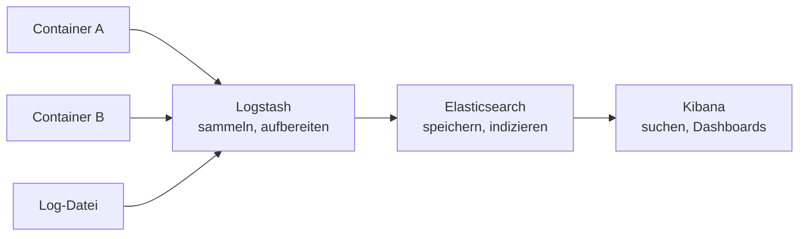
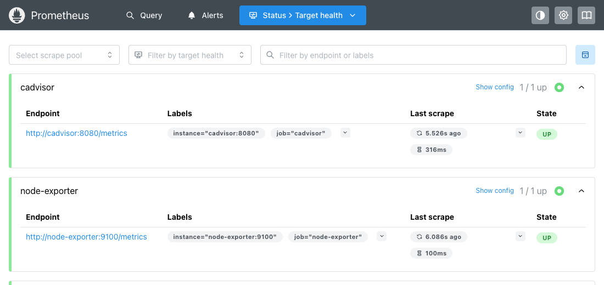
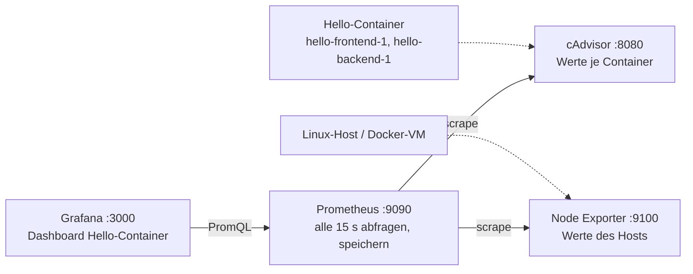
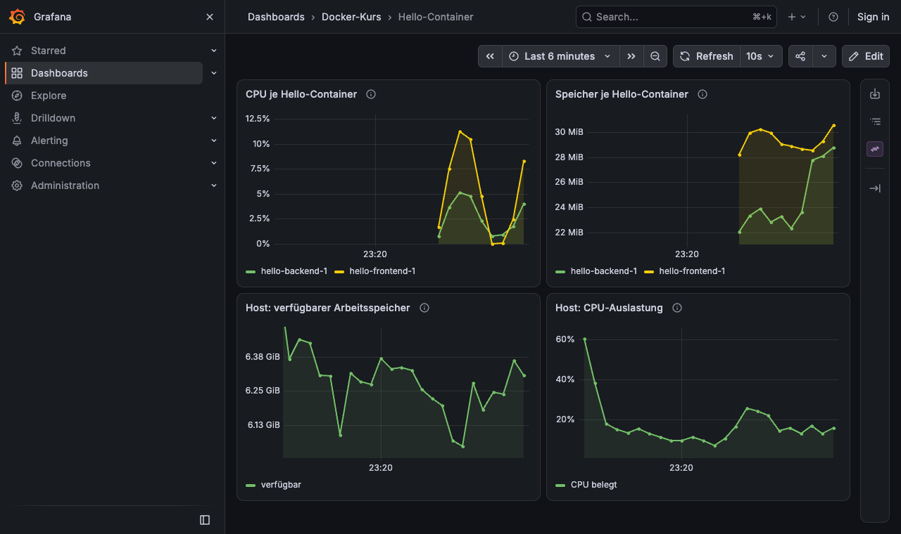

# Lab 7.2: Logging und Monitoring in Docker

**Leitfragen:**

<details>
<summary>Drei Container auf einem Server, einer wird langsam: welcher, und seit wann?</summary>

`docker stats` zeigt nur den Moment. Ein Monitoring-System wie Prometheus speichert CPU und Speicher je Container laufend; im Grafana-Diagramm ist sichtbar, welcher Container ab wann mehr verbraucht.

</details>

<details>
<summary>Zehn Container schreiben Logs: wo soll man suchen, wenn ein Fehler auftritt?</summary>

An einer zentralen Stelle, nicht in zehn einzelnen `docker logs`. Ein Log-System wie ELK oder Loki sammelt alle Zeilen mit Containername und Zeitstempel und macht sie gemeinsam durchsuchbar.

</details>

- Lab 7.1 hat einzelne Fehler mit `docker logs` und `docker stats` gefunden: Momentaufnahmen eines Containers.
- Im Betrieb laufen viele Container über Tage. Gefragt sind dann zwei Dinge: alle **Logs** an einem Ort durchsuchen und **Metriken** (Messwerte wie CPU und Speicher) über die Zeit vergleichen.

## Begriffe

| Begriff | Bedeutung |
| --- | --- |
| Log | Textzeile, die ein Programm über ein Ereignis schreibt, z. B. „Anfrage für /bookOrder erhalten" |
| Metrik | Messwert mit Zeitstempel, z. B. Speicherverbrauch eines Containers in Bytes; wird regelmäßig gemessen |
| Monitoring | laufendes Sammeln, Speichern und Anzeigen von Metriken, oft mit Alarmen bei Grenzwerten |
| Index | sortierte Ablage in Elasticsearch, über die sich Logs schnell durchsuchen lassen |
| Scrape | Abfrage einer Metrik-Adresse (meist `/metrics`) durch Prometheus in festen Abständen |
| Exporter | kleines Programm, das Messwerte eines Systems im Prometheus-Format unter `/metrics` bereitstellt |
| Dashboard | Seite mit mehreren Diagrammen und Kennzahlen, z. B. in Grafana oder Kibana |

## Logs und Metriken zentral sammeln

| | Logs | Metriken |
| --- | --- | --- |
| Inhalt | Text je Ereignis | Zahl je Zeitpunkt |
| Frage | Was ist passiert? | Wie viel, wie schnell, seit wann? |
| Werkzeug in Docker | `docker logs` | `docker stats` |
| zentrale Lösung in diesem Lab | ELK-Stack (Elasticsearch, Logstash, Kibana) | Prometheus mit Grafana, cAdvisor, Node Exporter |

## ELK-Stack für zentrale Logs

Der ELK-Stack besteht aus drei Programmen des Herstellers Elastic, deren Anfangsbuchstaben den Namen bilden:

- **Elasticsearch** speichert und indiziert die Logs, sodass sich Millionen Zeilen in Sekunden durchsuchen lassen.
- **Logstash** verarbeitet die Logs aus verschiedenen Quellen und transportiert sie in Elasticsearch.
- **Kibana** visualisiert und analysiert die Logs in Echtzeit im Browser.



Elastic führt die drei Programme heute als Teil des „Elastic Stack" bzw. der „Elastic Search AI Platform"; ELK bleibt der übliche Name für die Kombination.


_Quelle: Elastic, Elastic fundamentals (https://www.elastic.co/docs/get-started), abgerufen am 23.11.2026._

### Docker-Logs nach ELK bringen

Docker-Logs lassen sich auf zwei Wegen an Elasticsearch senden:

- **über Logstash**: Ein Container schickt seine Ausgaben mit einem Logtreiber an Logstash, z. B. mit dem Treiber `gelf`. Logstash nimmt sie an einem Port entgegen und schreibt sie nach Elasticsearch. `docker logs` zeigt die Ausgaben trotzdem weiter an, weil Docker eine lokale Kopie behält.
- **ohne Logstash, mit einem Log-Sammler**: Docker speichert die Ausgaben aller Container mit dem Standardtreiber `json-file` als Dateien; ein Sammelprogramm von Elastic (Filebeat bzw. Elastic Agent) liest diese Dateien und sendet sie direkt an Elasticsearch. Einen eingebauten Logtreiber für Elasticsearch hat Docker nicht.

```bash
# Logtreiber gelf: Ausgaben dieses Containers gehen an Logstash (Port 12201/udp)
docker run -d --name log-demo \
  --log-driver gelf --log-opt gelf-address=udp://localhost:12201 \
  busybox:1.37 sh -c 'while true; do echo "Hallo ELK $(date)"; sleep 5; done'
```

Die Compose-Datei für einen minimalen Stack aus den drei Diensten:

```yaml
services:
  elasticsearch:
    image: elasticsearch:9.5.5
    environment:
      - discovery.type=single-node
  logstash:
    image: logstash:9.5.5
    volumes:
      - ./logstash.conf:/usr/share/logstash/pipeline/logstash.conf
  kibana:
    image: kibana:9.5.5
    ports:
      - "5601:5601"
```

Die Zeile `version: '3'` am Anfang älterer Beispiele ist veraltet; Docker Compose v2 ignoriert sie (Lab 4.1). Statt der Version 7 aus älteren Anleitungen gilt hier die aktuelle Version 9.5.5 (Docker Hub, Stand 11/2026).

### Logstash-Konfiguration

Logstash arbeitet mit einer **Pipeline** aus drei Abschnitten: `input` (woher kommen die Logs), `filter` (optional: zerlegen, ergänzen) und `output` (wohin gehen sie). Die Datei `logstash.conf` nimmt hier Logzeilen per TCP auf Port 5000 an und schreibt sie nach Elasticsearch:

```text
input {
  tcp {
    port => 5000
  }
}
output {
  elasticsearch {
    hosts => ["elasticsearch:9200"]
  }
}
```

`elasticsearch:9200` ist der Dienstname aus der Compose-Datei mit dem Port der REST-API von Elasticsearch; die Namensauflösung klappt, weil alle drei Dienste im selben Compose-Netzwerk hängen (Lab 5.3).

### Vorteile des ELK-Stacks

- Zentrale Speicherung aller Logs: auch Logs gelöschter Container bleiben erhalten.
- Echtzeit-Analysen und Dashboards in Kibana: Suche über alle Dienste, Filter nach Zeit, Container oder Text.

## ELK in vier Schritten

Die vier Schritte am Beispiel eines Java-Microservices `order-service` (Spring Boot), der Bestellungen annimmt.

### Schritt 1: Logs in Dateien speichern

In `application.properties` des Microservices wird festgelegt, in welche Datei die Logs gehen:

```properties
logging.file.name=logs/order-service.log
```

Im Code schreibt ein Logger jede Anfrage und Antwort mit, z. B. in `OrderController.java`:

```java
Logger log = LoggerFactory.getLogger(OrderController.class);

@PostMapping("/bookOrder")
public TransactionResponse bookOrder(@RequestBody TransactionRequest request) {
    log.info("OrderController bookOrder request {}", request);
    // ...
}
```

Spring Boot schreibt die Zeilen zusätzlich auf die Standardausgabe. Im Container reicht diese Ausgabe meist: Docker sammelt sie, `docker logs` zeigt sie. Die Log-Datei braucht es, wenn Logstash direkt Dateien liest.

### Schritt 2: Compose-Datei für ELK

```yaml
services:
  elasticsearch:
    image: elasticsearch:9.5.5
    ports:
      - "9200:9200"                       # REST-API
    environment:
      - discovery.type=single-node        # ein Knoten, kein Cluster
      - xpack.security.enabled=false      # nur lokal: ohne Anmeldung und ohne TLS
      - ES_JAVA_OPTS=-Xms512m -Xmx512m    # Java-Speicher begrenzen
  logstash:
    image: logstash:9.5.5
    ports:
      - "5000:5000"
    volumes:
      - ./logstash.conf:/usr/share/logstash/pipeline/logstash.conf
    depends_on:
      - elasticsearch
  kibana:
    image: kibana:9.5.5
    ports:
      - "5601:5601"
    environment:
      - ELASTICSEARCH_HOSTS=http://elasticsearch:9200
    depends_on:
      - elasticsearch
```

Ältere Anleitungen nutzen `docker.elastic.co/elasticsearch/elasticsearch:7.17.13` und den Port `9300` für die Verbindung zwischen Cluster-Knoten; mit einem einzigen Knoten ist er nicht nötig. Die offiziellen Images auf Docker Hub (`elasticsearch`, `logstash`, `kibana`) und die Images unter `docker.elastic.co` sind gleichwertig.

Der Stack braucht Arbeitsspeicher: Elasticsearch, Logstash und Kibana zusammen etwa 3 GB. In Docker Desktop sollten unter **Settings > Resources** mindestens 6 GB eingestellt sein. Eine vollständige Fassung mit `logstash.conf` liegt in `project/examples/m07-debugging/l02-logging-monitoring/elk/`.

### Schritt 3: Logstash konfigurieren

Für die Log-Datei aus Schritt 1 liest Logstash die Datei statt eines Ports. Die Datei muss dafür im Logstash-Container liegen, z. B. als Volume eingebunden:

```text
input {
  file {
    path => "/path/to/order-service.log"
    start_position => "beginning"
  }
}

filter {
  # Optional: Filter zur Verarbeitung der Logs hinzufügen
}

output {
  elasticsearch {
    hosts => ["http://elasticsearch:9200"]
  }
}
```

`start_position => "beginning"` liest die Datei beim ersten Start von Anfang an, sonst nur neue Zeilen.

### Schritt 4: Kibana zur Visualisierung nutzen

1. Kibana im Browser öffnen: `http://localhost:5601` (der erste Start dauert 1–2 Minuten).
2. Eine **Data View** anlegen, z. B. `logstash-*`: Die Data View legt fest, welche Indizes durchsucht werden. Ältere Kibana-Versionen nennen sie „Index Pattern". Pfad: **Stack Management > Data Views > Create data view**.
3. Im Bereich **Discover** die Logs durchsuchen und nach Zeit oder Text filtern.
4. Unter **Dashboards** Diagramme für eine übersichtliche Darstellung zusammenstellen.


_Quelle: Wikimedia Commons, Klapi, CC BY-SA 4.0 (https://commons.wikimedia.org/wiki/File:Kibana_demo_screenshot.jpg), abgerufen am 23.11.2026. Ältere Kibana-Oberfläche; der Aufbau aus Zeitdiagramm und Logliste ist geblieben._

## Monitoring von Java-Containern mit Prometheus und Grafana

Für Java-Anwendungen zählen neben CPU und Speicher des Containers vor allem Werte aus der **JVM** (Java Virtual Machine, die Laufzeitumgebung von Java):

- **Heap-Speicher**: Überwachung des Speichermanagements in der JVM; ein voller Heap führt zu `OutOfMemoryError`.
- **Garbage Collection (GC)**: Erkennen von GC-Zyklen, also dem Aufräumen nicht mehr genutzten Speichers, die die Leistung beeinträchtigen.
- **Threads und Latenz**: Auslastung der Threads und Antwortzeiten für Debugging und Performance-Optimierung.

Zwei Werkzeuge teilen sich die Arbeit:

- **Prometheus** sammelt Metriken aus der Anwendung und speichert sie als Zeitreihen.
- **Grafana** visualisiert diese Metriken und erstellt aussagekräftige Dashboards.


_Quelle: Prometheus, Overview (https://prometheus.io/docs/introduction/overview/), abgerufen am 23.11.2026._

Prometheus arbeitet nach dem **Pull-Prinzip**: Es fragt in festen Abständen (`scrape_interval`) die Adresse `/metrics` jedes Ziels ab. Die Anwendung oder ein Exporter muss diese Adresse also bereitstellen.

### Java-Anwendung mit Prometheus verbinden

Ein Java-Agent stellt die JVM-Werte bereit, ohne dass der Code geändert wird. Der offizielle Agent heißt **JMX Exporter** (`jmx_prometheus_javaagent`, Version 1.7.0, Stand 11/2026). Er wird beim Start mit `-javaagent` geladen und öffnet einen eigenen Port für `/metrics`:

```dockerfile
FROM eclipse-temurin:21-jre
WORKDIR /app
COPY target/myapp.jar myapp.jar
COPY jmx_prometheus_javaagent-1.7.0.jar exporter.yaml ./
EXPOSE 8080 9404
# Agent auf Port 9404, Konfiguration exporter.yaml; die Anwendung selbst läuft weiter auf 8080
CMD ["java", "-javaagent:jmx_prometheus_javaagent-1.7.0.jar=9404:exporter.yaml", "-jar", "myapp.jar"]
```

```yaml
# exporter.yaml: alle verfügbaren JVM-Werte ausgeben
rules:
  - pattern: ".*"
```

Das Image `openjdk:17-jdk-slim` aus älteren Beispielen wird nicht mehr gepflegt; `eclipse-temurin` ist ein gepflegtes offizielles Java-Image, die Variante `jre` enthält nur die Laufzeit ohne Compiler. Den Agenten gibt es als JAR-Datei auf der Release-Seite des Projekts. Spring-Boot-Anwendungen können Metriken alternativ selbst bereitstellen (Micrometer, Adresse `/actuator/prometheus`).

_Quelle: JMX Exporter, Quick Start (https://prometheus.github.io/jmx_exporter/getting-started/quick-start), Stand: 11/2026._

### Compose-Konfiguration für Prometheus und Grafana

```yaml
services:
  prometheus:
    image: prom/prometheus:v3.16.0
    volumes:
      - ./prometheus.yml:/etc/prometheus/prometheus.yml
    ports:
      - "9090:9090"
  grafana:
    image: grafana/grafana:13.3.1
    ports:
      - "3000:3000"
```

### Prometheus-Konfiguration

In `prometheus.yml` steht, welche Ziele Prometheus abfragt. Für die Java-Anwendung ist das der Dienstname mit dem Port des Agenten:

```yaml
global:
  scrape_interval: 15s
scrape_configs:
  - job_name: 'java-app'
    static_configs:
      - targets: ['java-app:9404']
```

Ältere Beispiele tragen hier den Port der Anwendung (`java-app:8080`) ein; die Metriken des JMX Exporters liegen aber auf dem Agenten-Port. Prometheus zeigt unter `http://localhost:9090` im Menü **Status > Target health**, ob jedes Ziel erreichbar ist (`UP`).

 Target health: Jobs cadvisor und node-exporter mit Endpoint, Labels, letzter Abfrage und Status UP" width="720">

_Quelle: eigener Screenshot, Monitoring-Stack der Übung, 23.11.2026._

## Ressourcen live mit docker stats

Ein einfacher Befehl, um Container-Ressourcen in Echtzeit zu überwachen (Lab 7.1):

```bash
docker stats
```

```text
CONTAINER ID   NAME               CPU %     MEM USAGE / LIMIT     MEM %     NET I/O          BLOCK I/O    PIDS
5a5c03ed996d   hello-frontend-1   0.03%     27.18MiB / 7.65GiB    0.35%     3.5kB / 2.65kB   0B / 176kB   1
e4a9b57e9a30   hello-backend-1    0.02%     22.39MiB / 7.65GiB    0.29%     1.52kB / 737B    0B / 0B      1
```

`docker stats` speichert nichts: Nach `Strg+C` sind die Werte weg, und es zeigt nur einen Rechner. Für den Verlauf über Stunden und Tage sammeln cAdvisor und Prometheus dieselben Werte.

## cAdvisor für Werte je Container

**cAdvisor** (Container Advisor, von Google) misst in Echtzeit die Ressourcen aller Container eines Rechners: CPU, Speicher, Netzwerk und Datenträger. Er hat eine eigene Weboberfläche und stellt die Werte unter `/metrics` bereit; so lässt er sich in Prometheus einbinden. Wichtige Metriken:

| Metrik | Inhalt |
| --- | --- |
| `container_cpu_usage_seconds_total` | verbrauchte CPU-Zeit in Sekunden; die Änderung pro Sekunde (`rate(...)`) ergibt die Auslastung |
| `container_memory_usage_bytes` | aktueller Speicherverbrauch in Bytes |
| `container_network_receive_bytes_total` | empfangene Bytes |

Jede Metrik trägt den Containernamen als Label `name`, z. B. `container_memory_usage_bytes{name="hello-frontend-1"}`. Das Image liegt seit Version 0.53 unter `ghcr.io/google/cadvisor`, vorher unter `gcr.io/cadvisor/cadvisor`.

## Node Exporter für Werte des Hosts

Der **Node Exporter** überwacht die Werte des Host-Systems: CPU, Speicher, Festplattennutzung, Netzwerk. Er lässt sich ebenfalls in Prometheus einbinden. Unter Docker Desktop ist der Host die Linux-VM, in der Docker läuft, nicht der Mac oder Windows-Rechner selbst.

```yaml
services:
  node-exporter:
    image: prom/node-exporter:v1.13.1
    ports:
      - "9100:9100"
    volumes:
      - /proc:/host/proc:ro
      - /sys:/host/sys:ro
      - /:/rootfs:ro
    command:
      - '--path.procfs=/host/proc'
      - '--path.sysfs=/host/sys'
      - '--path.rootfs=/rootfs'
      - '--collector.filesystem.mount-points-exclude=^/(sys|proc|dev|host|etc)($$|/)'
```

Die Option `--collector.filesystem.ignored-mount-points` aus älteren Beispielen heißt seit Node Exporter 1.3 `--collector.filesystem.mount-points-exclude`. Das doppelte `$$` ist nötig, weil Compose ein einzelnes `$` als Variable liest.

## Monitoring-Stack mit Compose

Die Übung verbindet alle Teile in einer Compose-Datei (`project/starters/m07-l02-monitoring/`):



| Dienst | Image | Port auf dem Rechner | Aufgabe |
| --- | --- | --- | --- |
| `prometheus` | `prom/prometheus:v3.16.0` | 9090 | Metriken abfragen und speichern |
| `cadvisor` | `ghcr.io/google/cadvisor:0.61.1` | 8081 (im Container 8080) | Werte je Container |
| `node-exporter` | `prom/node-exporter:v1.13.1` | 9100 | Werte des Hosts |
| `grafana` | `grafana/grafana:13.3.1` | 3000 | Dashboards |

Zwei Besonderheiten der Kursdateien:

- **Provisioning**: Grafana liest beim Start den Ordner `grafana/provisioning/`. Dort sind die Datenquelle Prometheus (`http://prometheus:9090`) und das Dashboard „Hello-Container" hinterlegt; es ist kein Klickpfad zum Einrichten nötig.
- **Anonymer Zugang**: Grafana öffnet sich ohne Anmeldung (`GF_AUTH_ANONYMOUS_ENABLED`). Das ist nur für die lokale Übung gedacht.

cAdvisor braucht weitreichende Rechte (`privileged: true`, Lesezugriff auf `/` und `/sys`), weil er die Werte aller Container aus dem Kernel liest. Die Containernamen erfährt er über zwei eingebundene Sockets (Dateien, über die Programme miteinander sprechen):

```yaml
    volumes:
      - /var/run/docker.sock:/var/run/docker.sock:ro                       # Docker-API: Namen und Labels
      - /run/containerd/containerd.sock:/run/containerd/containerd.sock:ro # nötig mit containerd Image Store
```

Ältere Anleitungen binden stattdessen den ganzen Ordner `/var/run` ein. Unter Docker Desktop (getestet 23.11.2026, Docker 29.9.3) liegt der Docker-Socket dort nicht, und mit dem containerd Image Store braucht cAdvisor zusätzlich den containerd-Socket. Fehlt einer davon, liefert cAdvisor nur Werte ohne Containernamen (`id="/docker/…"`). Unter Docker Desktop liest er die Werte in der Linux-VM.

In `prometheus.yml` steht als Ziel immer der **Dienstname mit dem Port im Container** (`cadvisor:8080`), nicht der Port auf dem Rechner (`8081`): Prometheus fragt aus seinem Container über das Compose-Netzwerk ab.

Grafana-Dashboards fragen Prometheus mit der Abfragesprache **PromQL** ab, z. B. die CPU-Auslastung je Hello-Container:

```text
sum by (name) (rate(container_cpu_usage_seconds_total{name=~"hello-.*"}[1m]))
```

`rate(...[1m])` berechnet die Änderung pro Sekunde über die letzte Minute, `name=~"hello-.*"` filtert per regulärem Ausdruck alle Container, deren Name mit `hello-` beginnt.


_Quelle: Grafana Labs, Dashboards overview (https://grafana.com/docs/grafana/latest/dashboards/), abgerufen am 23.11.2026._

Das Dashboard „Hello-Container" der Übung zeigt CPU und Speicher je Hello-Container (oben) und die Werte des Hosts (unten); der Ausschlag entsteht durch eine Schleife mit Aufrufen der Hello-App:



_Quelle: eigener Screenshot, Hello-App mit Monitoring-Stack, 23.11.2026._

## Aktuelle Alternativen: Loki und OpenTelemetry

- **Grafana Loki mit Grafana Alloy**: Loki speichert Logs ähnlich wie Prometheus Metriken, indiziert nur Labels (z. B. Containername) statt jedes Wortes und braucht dadurch deutlich weniger Speicher als Elasticsearch. Ein Agent sammelt die Logs der Container und sendet sie an Loki; die Suche läuft in Grafana. Agent ist heute **Grafana Alloy**: Der frühere Agent Promtail ist seit dem 02.03.2026 End-of-Life.
- **OpenTelemetry**: offener Standard der CNCF für Logs, Metriken und Traces (Weg einer Anfrage durch mehrere Dienste). Anwendungen senden ihre Daten einmal im OpenTelemetry-Format; welches Speichersystem dahinter steht (Prometheus, Loki, Elasticsearch, kommerzielle Anbieter), lässt sich danach austauschen.


_Quelle: Grafana Labs, Loki overview (https://grafana.com/docs/loki/latest/get-started/overview/), abgerufen am 23.11.2026. Promtail-EOL: Grafana Labs, Promtail (https://grafana.com/docs/loki/latest/send-data/promtail/), Stand: 11/2026._

## Typische Fehler

| Symptom | Ursache | Lösung |
| --- | --- | --- |
| Prometheus zeigt ein Ziel als `DOWN` mit `connection refused` | Port auf dem Rechner (`8081`) statt Port im Container (`8080`) eingetragen | Ziel `cadvisor:8080` in `prometheus.yml`, danach `docker compose restart prometheus` |
| Änderung an `prometheus.yml` wirkt nicht | Prometheus liest die Datei nur beim Start | `docker compose restart prometheus` |
| Grafana-Diagramm „No data" | Hello-App läuft nicht, oder Containernamen beginnen nicht mit `hello-` | Hello-App im Ordner `hello` starten (`docker compose up -d`); Compose-Projektname prüfen |
| `Bind for 0.0.0.0:8081 failed: port is already allocated` | nginx-Container aus Tag 1 belegt 8081 | `docker ps`, alten Container stoppen oder Port in `compose.yml` ändern |
| Elasticsearch beendet sich mit Exit-Code `137` | zu wenig Speicher für Docker | in Docker Desktop mehr Speicher zuweisen, `ES_JAVA_OPTS` kleiner setzen |

## Fazit

- Logs (Text je Ereignis) und Metriken (Zahl je Zeitpunkt) beantworten verschiedene Fragen; beide gehören an eine zentrale Stelle.
- ELK: Logstash sammelt, Elasticsearch speichert und indiziert, Kibana durchsucht und zeigt; heute oft ersetzt durch Loki mit Alloy oder eingebunden über OpenTelemetry.
- Prometheus holt Metriken per Scrape von Exportern (cAdvisor je Container, Node Exporter je Host, JMX Exporter für Java), Grafana zeigt sie im Verlauf.

In der Übung wird der Monitoring-Stack per Compose gestartet und die Hello-Container werden in Grafana sichtbar.
