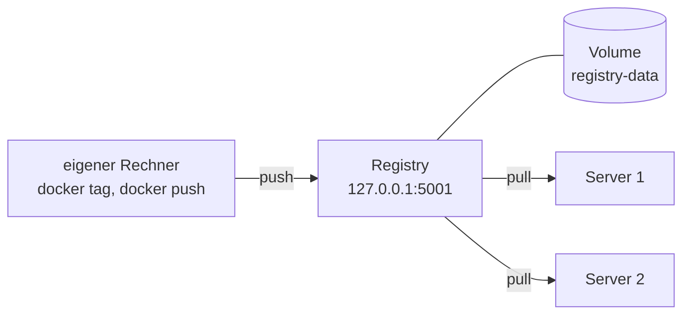
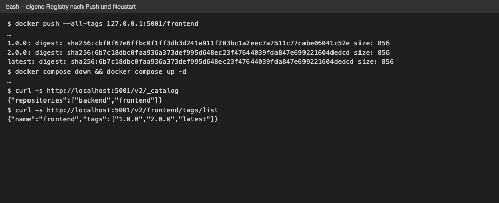

# Lab 8.1: Eigene Docker-Repositories erstellen und verwalten

**Leitfragen:**

<details>
<summary>Ein Server soll in drei Monaten genau dieselbe Version starten wie heute: woran macht man „dieselbe" fest?</summary>

An einer festen Versionsnummer (`frontend:2.0.0`), nie an `latest`. Ganz sicher ist nur der Digest (`sha256:…`): Er ändert sich mit jedem Byte des Images, ein Tag lässt sich dagegen neu vergeben.

</details>

<details>
<summary>Wer darf ein Image veröffentlichen, das danach auf allen Servern läuft?</summary>

Nur wer Schreibrechte auf das Repository hat, am besten eine Build-Pipeline mit eigenem Zugangstoken statt einzelner Personen. Signaturen belegen zusätzlich, dass ein Image wirklich von dieser Stelle stammt.

</details>

- In Lab 3.3 lief eine Registry als einzelner Container ohne Volume: Nach dem Löschen waren alle Images weg.
- Dieses Lab macht daraus eine dauerhafte Registry mit Compose und zeigt die zweite Option für den Alltag: private Repositories auf Docker Hub.

## Begriffe

| Begriff | Bedeutung |
| --- | --- |
| Registry | Server, der Images speichert und ausliefert, z. B. Docker Hub oder `127.0.0.1:5001` (Lab 3.3) |
| Repository | alle Versionen eines Images unter einem Namen in einer Registry, z. B. `<docker-id>/hello-frontend` |
| Tag | Bezeichner für eine Version in einem Repository, z. B. `2.0.0` oder `latest` |
| Digest | Prüfsumme des Images (`sha256:…`); ändert sich mit jeder Änderung und lässt sich nicht neu vergeben |
| Semantische Versionierung | Versionsnummer nach dem Schema `MAJOR.MINOR.PATCH`, z. B. `2.1.3` |
| Zugangstoken (Personal Access Token, PAT) | Ersatz für das Passwort bei `docker login`; mit eigenen Rechten, einzeln widerrufbar |
| Signatur | kryptografischer Nachweis, wer ein Image veröffentlicht hat und dass es unverändert ist |

## Docker-Repository: Speicherort für Image-Versionen

Ein Docker-Repository ist ein Speicherort, an dem Docker-Images gespeichert und verwaltet werden. Repositories können öffentlich oder privat sein und dienen zur Versionierung und Verteilung von Images. Der vollständige Name eines Images zeigt Registry, Repository und Tag:

```text
127.0.0.1:5001/frontend:2.0.0          docker.io/<docker-id>/hello-frontend:2.0.0
└─ Registry ──┘└ Repo ─┘└ Tag ┘        └ Registry ┘└──── Repository ───────┘└ Tag ┘
```

Ohne Registry-Angabe gilt Docker Hub (`docker.io`); `nginx:1.30-alpine` ist also kurz für `docker.io/library/nginx:1.30-alpine` (Lab 3.3).

## Öffentliche und private Repositories

| Art | Wer darf ziehen | Bereitgestellt über | Einsatz |
| --- | --- | --- | --- |
| öffentlich | alle Nutzer, ohne Anmeldung | Plattformen wie Docker Hub | Open-Source-Software, offizielle Images |
| privat | nur Berechtigte nach `docker login` | Docker Hub (privat), eigene Registry, GitHub Container Registry, Cloud-Registries | interne Nutzung und Sicherung von Images, z. B. für proprietäre Software oder Unternehmensanwendungen |

## Option 1: Private Repositories auf Docker Hub

Docker Hub bietet private Repositories an. Vorteil: einfach zu verwenden, Docker betreibt die Infrastruktur.

Schritte:

1. Ein Docker-Konto anlegen (aus dem Setup vorhanden).
2. Repository erstellen: auf [hub.docker.com](https://hub.docker.com) **My Hub > Repositories > Create repository**, Namespace (eigene Docker-ID) und Namen wählen, Sichtbarkeit **Private**, **Create**.
3. Zugangstoken erzeugen und damit anmelden (nächster Abschnitt).
4. Image mit `<docker-id>/<repository>:<tag>` taggen und pushen.

Ein Push auf ein Repository, das noch nicht existiert, legt es automatisch an, und zwar mit der Standard-Sichtbarkeit des Kontos (**My Hub > Settings > Default privacy**).

Grenzen im kostenlosen Plan „Personal" (Stand 11/2026):

| Punkt | Grenze |
| --- | --- |
| private Repositories | 1 |
| Pulls ohne Anmeldung | 100 je 6 Stunden je IP-Adresse |
| Pulls mit kostenlosem Konto | 200 je 6 Stunden |

_Quellen: Docker, Pricing (https://www.docker.com/pricing/) und Docker Hub usage and limits (https://docs.docker.com/docker-hub/usage/pulls/), Stand: 11/2026._

### Zugangstoken für docker login

Für `docker login` im Terminal, auf Servern und in Pipelines empfiehlt Docker einen **Personal Access Token** statt des Passworts. Ein Token hat eigene Rechte, ein Ablaufdatum und lässt sich einzeln widerrufen, ohne das Passwort zu ändern. Bei aktivierter Zwei-Faktor-Anmeldung akzeptiert das Terminal das Passwort gar nicht.

1. Auf [app.docker.com](https://app.docker.com) oben rechts den Avatar wählen, dann **Account settings > Personal access tokens > Generate new token**.
2. Beschreibung (z. B. `docker-kurs`), Ablaufdatum und Rechte festlegen.
3. **Generate** wählen und den Token kopieren: Docker zeigt ihn nur einmal.

| Recht | erlaubt |
| --- | --- |
| Repo Public Read-only (Standard) | öffentliche Repositories ansehen und ziehen |
| Repo Read-only | zusätzlich private Repositories ziehen |
| Repo Read & Write | zusätzlich pushen |
| Repo Read, Write, Delete | zusätzlich Images löschen und Repositories verwalten |

```bash
docker login --username <docker-id>     # bei "Password:" den Token einfügen, nicht das Passwort
```

_Quelle: Docker, Personal access tokens (https://docs.docker.com/security/access-tokens/personal-access-tokens/), Stand: 11/2026._

## Option 2: Eigene Registry mit Docker Registry

Docker Registry ist ein Open-Source-Projekt, mit dem sich ein eigener Registry-Server betreiben lässt. Docker hat es an die CNCF übergeben, dort heißt es heute „Distribution"; das offizielle Image heißt weiter `registry`, aktuelle Hauptversion `registry:3`. Die frühere kommerzielle „Docker Trusted Registry" gibt es unter diesem Namen nicht mehr; größere Alternativen mit Benutzeroberfläche und Rechteverwaltung sind z. B. Harbor oder die Registries von GitHub, GitLab und den Cloud-Anbietern (Lab 3.3).

Mit Compose und einem Volume überlebt die Registry Neustarts und `docker compose down`:

```yaml
services:
  registry:
    image: registry:3
    ports:
      - "5001:5000"                      # auf dem Rechner 5001, im Container 5000
    volumes:
      - registry-data:/var/lib/registry  # Speicherort der Image-Schichten
    restart: unless-stopped

volumes:
  registry-data:
```

Ältere Beispiele nutzen `registry:2`, `version: '3'` und Port `5000:5000`. Port 5001 auf dem Rechner bleibt wie in Lab 3.3, weil macOS Port 5000 für AirPlay belegt. Statt des Named Volumes geht auch ein Ordner (`./data:/var/lib/registry`), dann liegen die Daten sichtbar im Projektordner.



### Registry nutzen

```bash
docker compose up -d                                   # Registry starten (Ordner mit compose.yml)
docker tag frontend:v2 127.0.0.1:5001/frontend:2.0.0   # Image mit Registry-Adresse taggen
docker push 127.0.0.1:5001/frontend:2.0.0              # in die Registry hochladen
curl -s http://localhost:5001/v2/_catalog              # Repositories der Registry
curl -s http://localhost:5001/v2/frontend/tags/list    # Tags eines Repositorys
```

`docker push --all-tags 127.0.0.1:5001/frontend` lädt alle lokalen Tags dieses Repositorys in einem Schritt hoch. Gleiche Digests zeigen, dass `2.0.0` und `latest` dasselbe Image sind; nach einem Neustart der Registry ist der Katalog dank Volume unverändert:



_Quelle: eigener Screenshot, Hello-Images in der eigenen Registry, 23.11.2026._ Die Registry läuft ohne Anmeldung und ohne HTTPS; Docker erlaubt das nur für Adressen auf dem eigenen Rechner (`localhost`, `127.0.0.1`). Auf einem Server gehören TLS und Anmeldung dazu.

## Image-Tags und Versionierung

Ein Tag ist ein Bezeichner für eine bestimmte Version eines Images, z. B. `myapp:1.0` oder `myapp:latest`. Ein Image kann beliebig viele Tags tragen; `docker tag` legt nur einen weiteren Namen an, kopiert aber nichts.

- **Best Practice:** semantische Versionierung (z. B. `1.0.0`, `1.1.0`) für nachvollziehbare Releases.
- `latest` ist kein Sonderwert, sondern ein gewöhnlicher Tag, den Docker ohne Angabe verwendet. Er zeigt auf das, was zuletzt so getaggt wurde, und wandert mit jeder neuen Version mit. Für Server und Compose-Dateien daher immer eine feste Version angeben.

### Semantische Versionierung

Klar definierte Versionen nach `MAJOR.MINOR.PATCH` machen Änderungen und Updates nachvollziehbar. Version `2.1.3` bedeutet:

| Stelle | Wert | erhöhen bei |
| --- | --- | --- |
| MAJOR | 2 | großen Änderungen oder Breaking Changes (alte Nutzung funktioniert nicht mehr) |
| MINOR | 1 | neuen, kompatiblen Funktionen |
| PATCH | 3 | Fehlerkorrekturen und kleineren Änderungen |


_Quelle: Wikimedia Commons, Surjit Bains, CC BY-SA 4.0 (https://commons.wikimedia.org/wiki/File:Semantic-versioning.svg), abgerufen am 23.11.2026._

Häufig bekommt ein Image mehrere Tags gleichzeitig: `2.0.0`, `2.0`, `2` und `latest`. So kann ein Server wählen, ob er genau eine Version (`2.0.0`) oder automatisch alle Fehlerkorrekturen (`2.0`) bekommt. Die Hello-Images aus Lab 3.2 heißen `v1` und `v2`; in der Registry bekommen sie die Versionen `1.0.0` und `2.0.0`, passend zur angezeigten Version „Hello World 1.0.0" bzw. „2.0.0".

## Image-Signatur und Verifizierung

Images werden signiert, um Integrität und Herkunft zu bestätigen: Wer ein signiertes Image zieht, kann prüfen, dass es von der erwarteten Stelle kommt und seit dem Signieren nicht verändert wurde.

Der frühere Weg in Docker, **Docker Content Trust** (DCT, `export DOCKER_CONTENT_TRUST=1`), wird abgelöst: Der dazugehörige Dienst Notary v1 unter `notary.docker.io` wird am 08.12.2026 abgeschaltet. Wer `DOCKER_CONTENT_TRUST` nie gesetzt hat, ist nicht betroffen. Docker verweist auf zwei aktuelle Werkzeuge:

| Werkzeug | Projekt | Kurzbeschreibung |
| --- | --- | --- |
| **cosign** | Sigstore (Open Source Security Foundation) | signiert Images mit Schlüssel oder ohne eigenen Schlüssel über eine Anmeldung (z. B. GitHub-Konto); Signatur liegt als eigenes Objekt in derselben Registry |
| **Notation** | Notary Project (CNCF) | Nachfolger von Notary v1; Signaturen mit Zertifikaten, z. B. aus einer Firmen-PKI |

```bash
# cosign: Image über seinen Digest signieren und prüfen (Schlüsselpaar vorher mit cosign generate-key-pair)
cosign sign --key cosign.key <docker-id>/hello-frontend@sha256:<digest>
cosign verify --key cosign.pub <docker-id>/hello-frontend@sha256:<digest>
```

Signiert wird der Digest, nicht der Tag, weil sich ein Tag neu vergeben lässt. cosign und Notation sind eigene Programme und nicht Teil von Docker Desktop.

_Quelle: Docker, Retired features (https://docs.docker.com/retired/) und Content trust (https://docs.docker.com/engine/security/trust/), Stand: 11/2026._

## Typische Fehler

| Symptom | Ursache | Lösung |
| --- | --- | --- |
| `Bind for 0.0.0.0:5001 failed: port is already allocated` | Registry-Container aus Lab 3.3 läuft noch | `docker rm -f registry` |
| `curl` meldet `{"repositories":[]}` nach dem Neustart | Registry ohne Volume gestartet oder mit `docker compose down -v` gestoppt | Volume in `compose.yml` eintragen, Images erneut pushen |
| `denied: requested access to the resource is denied` beim Push auf Docker Hub | nicht angemeldet, falsche Docker-ID im Namen oder Token nur mit Leserecht | `docker login --username <docker-id>`, Token mit **Read & Write** |
| `unauthorized: incorrect username or password` | Passwort statt Token oder Token abgelaufen | neuen Token erzeugen und einfügen |
| zweites privates Repository lässt sich nicht anlegen | Gratis-Plan erlaubt ein privates Repository | vorhandenes nutzen oder öffentlich anlegen |
| Server startet nach `docker pull` eine andere Version als erwartet | `latest` wurde inzwischen neu vergeben | feste Version oder Digest angeben |

## Fazit

- Ein Repository fasst alle Versionen eines Images zusammen; Tags benennen Versionen, der Digest identifiziert ein Image eindeutig.
- Private Repositories gibt es auf Docker Hub (Gratis-Plan: eines) oder in einer eigenen Registry `registry:3`, die mit Compose und Volume dauerhaft läuft.
- Anmeldung mit Zugangstoken statt Passwort; Docker Content Trust wird abgelöst, Signaturen heute mit cosign oder Notation.

In der Übung wird die Registry per Compose betrieben, die Hello-Images werden mit Versionen gepusht und ein privates Repository auf Docker Hub wird mit Token befüllt.
