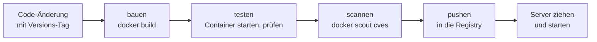

# Lab 8.2: Verteilte und containerisierte Anwendungen mit Docker

**Leitfragen:**

<details>
<summary>Wie kommt eine neue Version vom Laptop auf zehn Server?</summary>

Nicht per Kopie von Hand, sondern über eine Registry: Eine Pipeline baut, testet und pusht das Image mit fester Version; jeder Server zieht genau diese Version und startet sie.

</details>

<details>
<summary>Ein Kollege arbeitet mit einem anderen Prozessor (z. B. Apple Silicon): läuft dasselbe Image?</summary>

Nur, wenn das Image für beide Architekturen gebaut ist (`linux/amd64` und `linux/arm64`). Ein Multi-Plattform-Image enthält beide Varianten unter einem Namen; Docker zieht automatisch die passende.

</details>

- Lab 8.1 hat Images in eine Registry gebracht. Dieses Lab zeigt den Weg von dort auf andere Rechner: automatisch per Pipeline, für verschiedene Prozessoren und per Compose ohne Quellcode.

## Begriffe

| Begriff | Bedeutung |
| --- | --- |
| CI (Continuous Integration) | jede Änderung am Code wird automatisch gebaut und getestet |
| CD (Continuous Delivery / Deployment) | geprüfte Versionen werden automatisch bereitgestellt bzw. auf Server ausgerollt |
| Pipeline | festgelegte Folge von Schritten (Stages), die ein CI/CD-System bei jeder Änderung ausführt, z. B. GitLab CI/CD oder GitHub Actions |
| Architektur / Plattform | Prozessortyp, für den ein Programm übersetzt ist: `linux/amd64` (Intel, AMD) oder `linux/arm64` (Apple Silicon, viele Cloud-Server) |
| Multi-Plattform-Image | ein Image-Name mit Varianten für mehrere Plattformen; Docker wählt beim Pull die passende |
| buildx | Erweiterung von `docker build` (BuildKit) für Multi-Plattform-Builds und weitere Ausgabeformate |

## CI/CD-Pipeline für das Pushen in ein Docker-Repository

Eine Pipeline führt bei jeder neuen Version dieselben Schritte aus, ohne dass jemand Befehle von Hand tippt:



1. **Bauen**: Image aus dem Dockerfile, Tag = Versionsnummer.
2. **Testen**: Container starten und prüfen, z. B. per `curl` oder mit Tests im Container.
3. **Scannen**: Image auf bekannte Schwachstellen prüfen (Docker Scout, Trivy; Lab 6.3).
4. **Pushen**: nur ein Image, das alle Schritte bestanden hat, kommt in die Registry.
5. **Ausrollen**: Server ziehen die neue Version und starten sie neu, z. B. mit `docker compose pull` und `docker compose up -d` oder über einen Orchestrator (Modul 10).


_Quelle: Docker, Continuous integration with Docker (https://docs.docker.com/build/ci/), abgerufen am 23.11.2026._

### Beispiel: GitLab CI/CD

GitLab liest die Pipeline aus der Datei `.gitlab-ci.yml` im Repository. Die Variable `$CI_COMMIT_TAG` enthält den Versions-Tag, mit dem die Version markiert wurde (z. B. `2.0.0`). Grundform mit zwei Stufen:

```yaml
stages:
  - build
  - deploy

build:
  stage: build
  script:
    - docker build -t myapp:$CI_COMMIT_TAG .
    - docker tag myapp:$CI_COMMIT_TAG localhost:5000/myapp:$CI_COMMIT_TAG

deploy:
  stage: deploy
  script:
    - docker push localhost:5000/myapp:$CI_COMMIT_TAG
```

Erweitert um Test und Scan und mit der Registry von GitLab (`$CI_REGISTRY_IMAGE`) statt einer lokalen Adresse:

```yaml
stages: [build, test, scan, push]

variables:
  IMAGE: $CI_REGISTRY_IMAGE/myapp:$CI_COMMIT_TAG     # z. B. registry.gitlab.com/team/projekt/myapp:2.0.0

build:
  stage: build
  script:
    - docker build -t $IMAGE .

test:
  stage: test
  script:
    - docker run -d --name test -p 8080:80 $IMAGE
    - sleep 3 && curl -f http://localhost:8080         # Pipeline bricht ab, wenn die App nicht antwortet

scan:
  stage: scan
  script:
    - docker scout cves --exit-code --only-severity critical,high $IMAGE   # bricht bei kritischen Lücken ab

push:
  stage: push
  rules:
    - if: $CI_COMMIT_TAG                               # nur für markierte Versionen
  script:
    - echo "$CI_REGISTRY_PASSWORD" | docker login -u "$CI_REGISTRY_USER" --password-stdin $CI_REGISTRY
    - docker push $IMAGE
```

Die Anmeldung läuft mit einem Token, das GitLab je Lauf bereitstellt; Passwörter stehen nie in der Datei. Für Docker im Pipeline-Lauf braucht der GitLab-Runner Zugriff auf eine Docker-Engine (z. B. Dienst `docker:dind`); das Einrichten ist Aufgabe des CI-Systems und nicht Teil dieses Kurses. In GitHub Actions heißen die Bausteine anders (`docker/build-push-action`), die Schritte sind dieselben.


_Quelle: Wikimedia Commons, Grégoire Détrez nach Jez Humble, CC BY-SA 4.0 (https://commons.wikimedia.org/wiki/File:Continuous_Delivery_process_diagram.svg), abgerufen am 23.11.2026._

## Images für mehrere Plattformen mit docker buildx

Ein Image enthält Programme, die für einen bestimmten Prozessortyp übersetzt sind. Ein Image für `linux/amd64` läuft auf einem Mac mit Apple Silicon (`arm64`) nur über Emulation: langsam und nicht immer fehlerfrei. Ein **Multi-Plattform-Image** enthält mehrere Varianten unter einem Namen; beim Pull wählt Docker die passende.


_Quelle: Docker, Multi-platform builds (https://docs.docker.com/build/building/multi-platform/), abgerufen am 23.11.2026._

```bash
# Frontend für zwei Plattformen bauen und direkt in die Registry pushen
docker buildx build --platform linux/amd64,linux/arm64 \
  --build-arg APP_VERSION=2.0.0 \
  -t <docker-id>/hello-web:2.0.0 --push frontend

# Plattformen eines Images in der Registry anzeigen
docker buildx imagetools inspect <docker-id>/hello-web:2.0.0

# eigene Plattform anzeigen
docker version --format '{{.Server.Os}}/{{.Server.Arch}}'
```

Was unter Docker Desktop gilt (Stand 11/2026):

- Docker Desktop und Docker Engine ab 29.0 nutzen standardmäßig den **containerd Image Store**. Er speichert Multi-Plattform-Images auch lokal; `--push` ist dann optional. Mit dem älteren klassischen Image Store braucht es einen eigenen Builder (`docker buildx create --driver docker-container --use`) und `--push`.
- Für die fremde Plattform baut Docker Desktop per Emulation (QEMU ist in der Docker-VM enthalten). Das dauert länger als ein normaler Build, z. B. wenn `pip install` Pakete übersetzt.
- Mit `docker run --platform linux/amd64 …` lässt sich gezielt die andere Variante starten.

_Quelle: Docker, Multi-platform builds (https://docs.docker.com/build/building/multi-platform/), Stand: 11/2026._

## Compose mit Images aus der Registry

Auf einem Server liegt kein Quellcode; dort soll Compose fertige Images ziehen. Statt `build:` steht deshalb nur `image:` mit voller Registry-Adresse und fester Version in der Compose-Datei:

| Entwicklung (`compose.yml`, Lab 4.3) | Server (`compose-registry.yml`) |
| --- | --- |
| `image: frontend:v2` + `build: context: frontend` | `image: 127.0.0.1:5001/frontend:2.0.0` |
| baut aus dem Quellcode, wenn das Image fehlt | zieht das Image aus der Registry |
| Quellcode muss auf dem Rechner liegen | nur die Compose-Datei wird gebraucht |

```yaml
services:
  frontend:
    image: 127.0.0.1:5001/frontend:2.0.0   # feste Version aus der Registry, kein build:
    ports:
      - 8080:80
  backend:
    image: 127.0.0.1:5001/backend:1.0.0
```

```bash
docker compose -f compose-registry.yml pull       # alle Images aus der Registry holen
docker compose -f compose-registry.yml up -d      # starten
docker compose -f compose-registry.yml images     # zeigt, welches Image jeder Container nutzt
```

Eine neue Version ausrollen heißt dann: Version in der Datei ändern (z. B. `2.0.1`), `pull`, `up -d`. Compose ersetzt nur die Container, deren Image sich geändert hat. `-f` wählt eine andere Datei als `compose.yml`; der Projektname bleibt der Ordnername, daher ersetzen die Container aus `compose-registry.yml` die gleichnamigen aus `compose.yml`.

Die Adresse `127.0.0.1:5001` funktioniert nur auf dem Rechner, auf dem die Registry läuft. Für einen zweiten Rechner steht dort eine erreichbare Registry, z. B. Docker Hub (`<docker-id>/hello-web:2.0.0`) oder eine Firmen-Registry mit HTTPS.

## Typische Fehler

| Symptom | Ursache | Lösung |
| --- | --- | --- |
| `pull access denied` beim Image der Partnerperson | Repository ist privat oder Name falsch geschrieben | Sichtbarkeit auf Docker Hub prüfen (Public), Docker-ID und Tag vergleichen |
| `no matching manifest for linux/arm64/v8` | Image nur für `amd64` gebaut | mit `--platform linux/amd64,linux/arm64` neu bauen oder `docker run --platform linux/amd64` |
| `Multi-platform build is not supported for the docker driver` | klassischer Image Store ohne containerd | containerd Image Store in Docker Desktop aktivieren oder Builder mit `docker-container`-Treiber |
| `docker compose up` baut statt zu ziehen | `build:` steht noch in der Datei | `build:` entfernen, nur `image:` |
| `Get "http://127.0.0.1:5001/v2/": connection refused` | Registry aus Lab 8.1 läuft nicht | im Ordner `registry` `docker compose up -d` |
| Port 8080 belegt beim Start von `compose-registry.yml` aus anderem Ordner | Hello-App aus `compose.yml` läuft unter anderem Projektnamen | Datei im Ordner `hello` ablegen oder vorher `docker compose down` |

## Fazit

- Eine CI/CD-Pipeline baut, testet, scannt und pusht jede Version gleich; Server ziehen nur geprüfte Images mit fester Version.
- `docker buildx build --platform linux/amd64,linux/arm64` erzeugt ein Image für Intel/AMD und ARM unter einem Namen; Docker wählt beim Pull die passende Variante.
- Auf Servern enthält die Compose-Datei nur `image:` mit Registry-Adresse und Version, kein `build:` und keinen Quellcode.

In der Übung wird die Hello-App für zwei Plattformen gebaut, das Image der Partnerperson gestartet und die eigene Hello-App aus der Registry betrieben.
