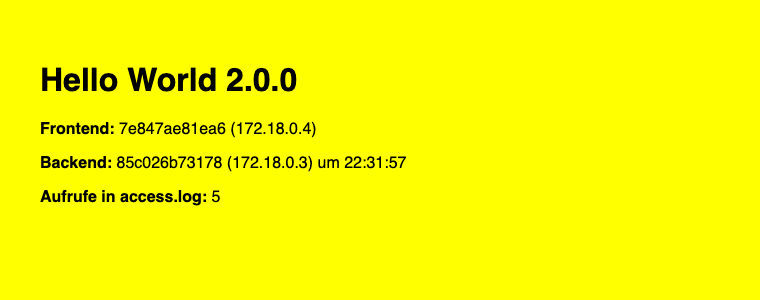
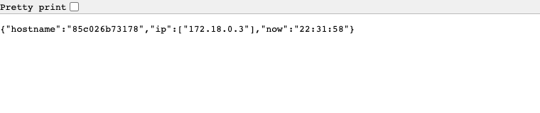

# Lab 9.1 – Lösung: Einführung in Traefik

## Aufgabe 1: Hello stoppen, Starter kopieren

```bash
cd ~/kurs/kodschul-docker-open-3/project/playground/hello   # Pfad an den eigenen Kursordner anpassen
docker compose down
cp ../../starters/m09-l01-compose-traefik.yml compose-traefik.yml
```

```text
[+] Running 3/3
 ✔ Container hello-frontend-1  Removed
 ✔ Container hello-backend-1   Removed
 ✔ Network hello_default       Removed
```

`docker compose down` entfernt Container und Netzwerk, das Volume `hello-data` bleibt. Damit sind Port 8080 und der Name des Projekts frei.

## Aufgabe 2: Traefik konfigurieren

```yaml
  traefik:
    image: traefik:v3.8
    command:
      - --api.insecure=true
      - --providers.docker=true                       # TODO 1
      - --providers.docker.exposedByDefault=false     # TODO 2
      - --entryPoints.web.address=:80                 # TODO 3
    ports:
      - 80:80
      - 8080:8080
    volumes:
      - /var/run/docker.sock:/var/run/docker.sock:ro  # TODO 4
```

## Aufgabe 3: Labels für Frontend und Backend

```yaml
  frontend:
    image: frontend:v2
    depends_on:
      backend:
        condition: service_healthy
    volumes:
      - hello-data:/data
    labels:                                                       # TODO 5
      - traefik.enable=true
      - traefik.http.routers.app.rule=Host(`app.localhost`)
      - traefik.http.routers.app.entrypoints=web

  backend:
    image: backend:v1
    healthcheck:
      test: ["CMD", "curl", "-f", "http://localhost:80"]
      interval: 10s
      timeout: 2s
      retries: 2
      start_period: 3s
    labels:                                                       # TODO 6
      - traefik.enable=true
      - traefik.http.routers.api.rule=Host(`api.app.localhost`)
      - traefik.http.routers.api.entrypoints=web
```

Vollständige Datei: `project/examples/m09-frontend-backend-stack/l01-traefik-intro/hello/compose-traefik.yml`. Kein Port-Label nötig: Beide Images geben nur Port 80 frei (`EXPOSE 80`).

## Aufgabe 4: Starten und Ports prüfen

```bash
docker compose -f compose-traefik.yml up -d
docker compose -f compose-traefik.yml ps
```

```text
NAME               IMAGE          COMMAND                  SERVICE    CREATED          STATUS                    PORTS
hello-backend-1    backend:v1     "python backend.py"      backend    7 seconds ago    Up 6 seconds (healthy)    80/tcp
hello-frontend-1   frontend:v2    "python frontend.py"     frontend   7 seconds ago    Up 3 seconds              80/tcp
hello-traefik-1    traefik:v3.8   "/entrypoint.sh --ap…"   traefik    7 seconds ago    Up 6 seconds              0.0.0.0:80->80/tcp, [::]:80->80/tcp, 0.0.0.0:8080->8080/tcp, [::]:8080->8080/tcp
```

Nur Traefik ist von außen erreichbar. `80/tcp` ohne Pfeil bedeutet: Port im Container offen, aber nicht auf dem Rechner veröffentlicht. Das Frontend startet erst, wenn das Backend `healthy` ist (`depends_on` aus Lab 4.3).

## Aufgabe 5: Im Browser und Dashboard prüfen



_Quelle: eigener Screenshot, Hello-App hinter Traefik, 23.11.2026._

```bash
curl http://api.app.localhost
```

```json
{"hostname":"85c026b73178","ip":["172.18.0.3"],"now":"22:32:15"}
```



_Quelle: eigener Screenshot, Hello-Backend hinter Traefik, 23.11.2026._

Im Dashboard (`http://localhost:8080`, leitet auf `/dashboard/` weiter) unter **HTTP → Routers**:

| Name | Rule | Entrypoint | Service |
| --- | --- | --- | --- |
| `app@docker` | ``Host(`app.localhost`)`` | `web` | `frontend-hello` |
| `api@docker` | ``Host(`api.app.localhost`)`` | `web` | `backend-hello` |
| `api@internal`, `dashboard@internal` | ``PathPrefix(`/api`)``, ``PathPrefix(`/`)`` | `traefik` | eingebaut (Dashboard) |

```bash
curl -i http://localhost
```

```text
HTTP/1.1 404 Not Found
Content-Type: text/plain; charset=utf-8
...
404 page not found
```

Für den Hostnamen `localhost` gibt es keinen Router; Traefik antwortet selbst mit 404. Die Zahl „Aufrufe in access.log" zählt weiter, weil das Volume `hello-data` aus Lab 4.3 wieder eingebunden ist.

## Erweiterung: drei Frontend-Container

```bash
docker compose -f compose-traefik.yml up -d --scale frontend=3
for i in 1 2 3 4 5 6; do curl -s http://app.localhost | grep Frontend; done
```

```text
  <p><b>Frontend:</b> 48ae4d38496d (172.18.0.6)</p>
  <p><b>Frontend:</b> 337c80d7edac (172.18.0.5)</p>
  <p><b>Frontend:</b> 7e847ae81ea6 (172.18.0.4)</p>
  <p><b>Frontend:</b> 337c80d7edac (172.18.0.5)</p>
  <p><b>Frontend:</b> 7e847ae81ea6 (172.18.0.4)</p>
  <p><b>Frontend:</b> 48ae4d38496d (172.18.0.6)</p>
```

Traefik verteilt die Anfragen auf alle drei Container (gewichtetes Round Robin; die Reihenfolge kann springen). Unter **HTTP → Services → frontend-hello** stehen drei Server-Adressen. Ohne `ports:` am Frontend gibt es keinen Portkonflikt beim Skalieren; mit `- 8080:80` würde der zweite Container scheitern (Lab 4.2). Zurück auf einen Container: `docker compose -f compose-traefik.yml up -d --scale frontend=1`.

Die Hello-App bleibt für Lab 9.2 nicht nötig; vor Lab 9.2 mit `docker compose -f compose-traefik.yml down` stoppen, weil die Time-App Port 80 und 8080 selbst braucht.
