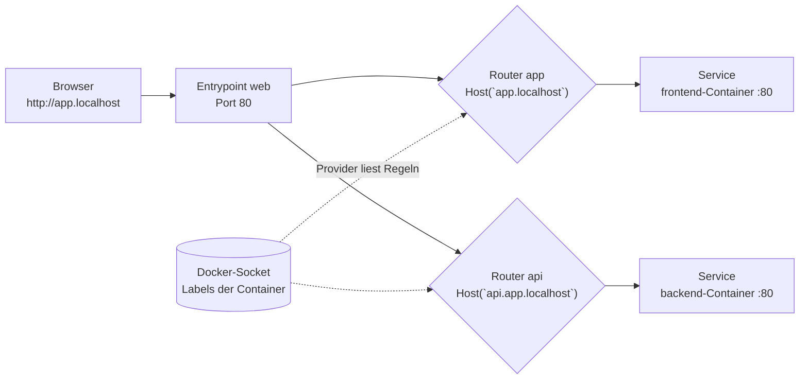
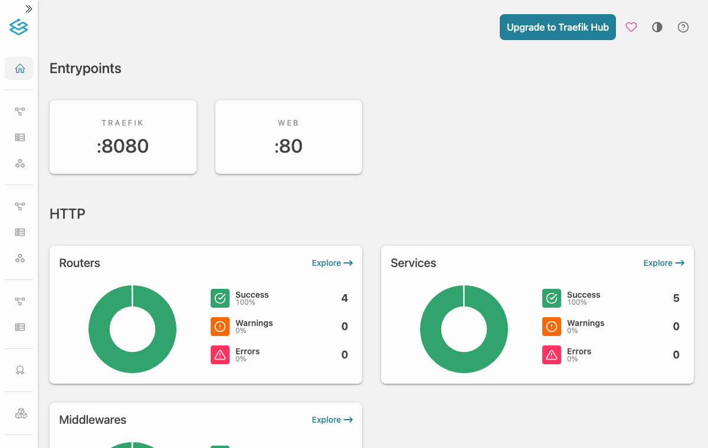

# Lab 9.1: Einführung in Traefik

**Leitfragen:**

<details>
<summary>30 Web-Anwendungen, ein Server, eine Adresse: wie kommt jede Anfrage zur richtigen?</summary>

Ein Programm nimmt alle Anfragen auf Port 80 an und verteilt sie nach dem Hostnamen (z. B. `app.localhost`) oder dem Pfad (z. B. `/api`) an den passenden Container. Dieses Programm heißt Reverse Proxy; Traefik ist einer.

</details>

<details>
<summary>Wer soll Zertifikate verwalten: jede Anwendung selbst oder eine Stelle für alle?</summary>

Eine Stelle für alle: Der Reverse Proxy nimmt HTTPS an, holt und erneuert die Zertifikate (bei Traefik automatisch über Let's Encrypt) und spricht intern mit den Anwendungen.

</details>

- Bisher hatte jeder Dienst einen eigenen Port auf dem Rechner (Hello-Frontend 8080, Registry 5001 …). Mit Traefik gibt es nur noch einen Eingang, Port 80; die Zuordnung zum Container übernimmt Traefik.
- Traefik liest die Regeln direkt aus Labels an den Containern. Ein neuer Container mit passenden Labels ist sofort erreichbar, ohne Traefik neu zu starten.

## Begriffe

| Begriff | Bedeutung |
| --- | --- |
| Reverse Proxy | Programm vor den eigenen Diensten, das Anfragen annimmt und an den richtigen Dienst weiterreicht; wie ein Empfang, der Besucher in das richtige Büro schickt |
| Load Balancer | verteilt Anfragen auf mehrere gleiche Container, damit keiner überlastet wird |
| Entrypoint | Port, auf dem Traefik Anfragen annimmt, z. B. `web` auf Port 80 |
| Router | Regel in Traefik: „Anfragen an Host X (und Pfad Y) gehen an Service Z" |
| Rule | Bedingung eines Routers, z. B. ``Host(`app.localhost`)`` oder ``PathPrefix(`/api`)`` |
| Service (Traefik) | Ziel eines Routers: ein oder mehrere Container mit Adresse und Port |
| Middleware | Zwischenschritt zwischen Router und Service, der die Anfrage verändert, z. B. ein Pfad-Präfix entfernt |
| Provider | Quelle, aus der Traefik seine Regeln liest; hier der Docker-Provider |
| Label | Schlüssel-Wert-Paar an einem Container (`traefik.enable=true`); Docker speichert es, Traefik liest es |
| Docker-Socket | Datei `/var/run/docker.sock`, über die Programme mit der Docker-Engine sprechen; `docker ps` nutzt sie auch |
| Let's Encrypt | kostenlose Zertifizierungsstelle; liefert TLS-Zertifikate für HTTPS automatisch |

## Traefik als Reverse Proxy und Load Balancer

Traefik ist ein Open-Source-Reverse-Proxy und Load Balancer (Lizenz MIT), entwickelt speziell für Microservices und Container. Er arbeitet direkt mit Docker, Docker Swarm und Kubernetes zusammen und liest dort, welche Dienste laufen.


_Quelle: Traefik Labs, „What is Traefik?" (https://doc.traefik.io/traefik/), abgerufen am 23.11.2026._

| Hauptfunktion | Bedeutung |
| --- | --- |
| Automatische Dienstentdeckung | Traefik erkennt neue Container selbst und konfiguriert sich passend |
| Dynamische Konfiguration | Änderungen (Container startet, stoppt, skaliert) wirken in Echtzeit, ohne Neustart |
| Integrierte Let's-Encrypt-Unterstützung | TLS-Zertifikate für HTTPS werden automatisch geholt und erneuert |
| Lastverteilung | mehrere Container hinter einem Router bekommen die Anfragen abwechselnd |

Versionen: v1.0 (07/2016), v2.0 (09/2019), v3.0 (04/2024); aktuell **v3.8.0** vom 23.11.2026 (Quelle: https://github.com/traefik/traefik/releases, abgerufen am 23.11.2026). Der Kurs nutzt das Image `traefik:v3.8`.

## Weg einer Anfrage durch Traefik



Entrypoint → Router (prüft die Rule) → Service (Container). Diese Kette gilt für alle Traefik-Übungen dieses Moduls.

## Traefik mit Docker Compose starten

Traefik läuft selbst als Container. Er hört auf Port 80 für den Webverkehr und auf Port 8080 für das Dashboard. Damit er andere Container erkennt, wird der Docker-Socket eingebunden.

```yaml
services:
  traefik:
    image: traefik:v3.8
    command:
      - --api.insecure=true                           # Dashboard auf Port 8080 ohne Anmeldung
      - --providers.docker=true                       # Docker-Provider: Container und Labels lesen
      - --providers.docker.exposedByDefault=false     # nur Container mit traefik.enable=true
      - --entryPoints.web.address=:80                 # Entrypoint "web" auf Port 80
    ports:
      - 80:80
      - 8080:8080
    volumes:
      - /var/run/docker.sock:/var/run/docker.sock:ro  # :ro = nur lesend
```

- `command:` übergibt Startoptionen an Traefik, je Zeile eine. Die Namen stehen in der Traefik-Doku unter „Install Configuration".
- `exposedByDefault` steht ohne Angabe auf `true`: Dann wäre jeder Container mit freigegebenem Port sofort über Traefik erreichbar. Mit `false` entscheidet jeder Container per Label selbst.
- Wer auf den Docker-Socket zugreift, kann die Docker-Engine steuern. `:ro` verhindert Schreiben in die Datei, ersetzt aber keine Absicherung: `--api.insecure=true` und ein offener Socket gehören nur auf den eigenen Rechner (Quelle: https://doc.traefik.io/traefik/reference/install-configuration/providers/docker/, abgerufen am 23.11.2026).
- Die alten Folien zeigen `traefik:v2.9` und `version: '3.8'`. Die Startoptionen sind in v3 gleich geblieben; `version:` entfällt in Compose v2 (Lab 4.1).

## Dienste über Labels verbinden

Labels sind Schlüssel-Wert-Paare an einem Container. Docker selbst wertet sie nicht aus; Traefik liest sie über den Docker-Socket. Jede Zeile beginnt mit `traefik.`:

```yaml
  frontend:
    image: frontend:v2
    labels:
      - traefik.enable=true                                    # Container veröffentlichen
      - traefik.http.routers.app.rule=Host(`app.localhost`)    # Router "app" mit Regel
      - traefik.http.routers.app.entrypoints=web               # nur über Entrypoint "web"

  backend:
    image: backend:v1
    labels:
      - traefik.enable=true
      - traefik.http.routers.api.rule=Host(`api.app.localhost`)
      - traefik.http.routers.api.entrypoints=web
```

| Label (Traefik v3) | Wirkung |
| --- | --- |
| `traefik.enable=true` | Container für Traefik sichtbar machen (nötig bei `exposedByDefault=false`) |
| ``traefik.http.routers.<router>.rule=Host(`…`)`` | Router anlegen; `<router>` ist ein frei wählbarer Name |
| `traefik.http.routers.<router>.entrypoints=web` | Router nur an diesem Entrypoint |
| `traefik.http.services.<service>.loadbalancer.server.port=5000` | Zielport festlegen; nötig, wenn der Container mehrere Ports freigibt |
| `traefik.docker.network=<netz>` | Netzwerk wählen, über das Traefik den Container erreicht (bei mehreren Netzen) |

_Quelle: Traefik Labs, Docker-Provider, Routing Configuration (https://doc.traefik.io/traefik/reference/routing-configuration/other-providers/docker/), Doku-Stand v3.7, abgerufen am 23.11.2026._

- Ohne Port-Label nimmt Traefik den ersten freigegebenen Port des Containers (`EXPOSE 80` im Hello-Dockerfile aus Lab 3.2).
- Ohne Service-Label legt Traefik den Service selbst an, Name `<Dienst>-<Compose-Projekt>`, z. B. `frontend-hello`.
- Die Dienste brauchen kein `ports:` mehr. Traefik erreicht sie über das gemeinsame Compose-Netzwerk (Lab 5.3); von außen geht alles über Port 80.
- Die Rule steht in Backticks `` ` ``, nicht in einfachen Anführungszeichen.
- Namen auf `.localhost` (z. B. `app.localhost`) zeigen in Browsern immer auf den eigenen Rechner (reservierter Name, RFC 6761); ein Eintrag in der hosts-Datei ist nicht nötig.

## Traefik-Dashboard

Das Dashboard unter `http://localhost:8080` zeigt alle Entrypoints, Router, Services und Middlewares mit ihren Routing-Regeln und ihrem Zustand.



_Quelle: eigener Screenshot, Traefik-Dashboard mit Hello-App, 23.11.2026._


_Quelle: eigener Screenshot, Traefik-Dashboard mit Hello-App, 23.11.2026._

- Router aus Labels enden auf `@docker`, eingebaute Router (Dashboard, API) auf `@internal`.
- Rote oder gelbe Einträge zeigen fehlerhafte Regeln; ein Klick öffnet die Details mit der Fehlermeldung.
- Die Spalte **Priority** entscheidet, welcher Router gewinnt, wenn mehrere passen: standardmäßig die längere Regel.

## Subdomains und Pfade

Traefik unterscheidet Anfragen nach Hostname, Pfad oder beidem. Beispiel: die API unter `app.localhost/api` statt unter einer eigenen Subdomain:

```yaml
    labels:
      - traefik.enable=true
      - traefik.http.routers.apipath.rule=Host(`app.localhost`) && PathPrefix(`/api`)
      - traefik.http.routers.apipath.entrypoints=web
      - traefik.http.routers.apipath.middlewares=api-strip                  # Middleware anhängen
      - traefik.http.middlewares.api-strip.stripprefix.prefixes=/api        # /api vor dem Weiterleiten entfernen
```

| Rule | passt auf |
| --- | --- |
| ``Host(`app.localhost`)`` | alle Pfade unter `app.localhost` |
| ``Host(`api.app.localhost`)`` | eigene Subdomain für die API |
| ``Host(`app.localhost`) && PathPrefix(`/api`)`` | nur Pfade, die mit `/api` beginnen; längere Regel, gewinnt gegen ``Host(`app.localhost`)`` |

- Das Hello-Backend antwortet nur auf `/`. Ohne Middleware käme `/api` beim Backend an und ergäbe `404 Not Found`; `stripprefix` entfernt den Präfix vorher.
- In Traefik v3 nimmt jeder Matcher genau einen Wert; mehrere Bedingungen werden mit `&&` oder `||` verbunden. Reguläre Ausdrücke laufen über eigene Matcher wie `PathRegexp` (Quelle: https://doc.traefik.io/traefik/migrate/v2-to-v3-details/, abgerufen am 23.11.2026).

## Beispiel aus der Traefik-Doku: whoami

Das Image `traefik/whoami` ist ein winziger Webserver, der die empfangene Anfrage zurückgibt. Es eignet sich zum Ausprobieren eines Routers:

```yaml
  whoami:
    image: traefik/whoami
    labels:
      - traefik.enable=true
      - traefik.http.routers.whoami.rule=Host(`whoami.localhost`)
      - traefik.http.routers.whoami.entrypoints=web
```


_Quelle: Traefik Labs, „Getting Started with Docker and Traefik" (https://doc.traefik.io/traefik/getting-started/docker/), abgerufen am 23.11.2026._

## Typische Fehler

| Symptom | Ursache | Lösung |
| --- | --- | --- |
| `Bind for 0.0.0.0:8080 failed: port is already allocated` | Hello aus `compose.yml` belegt Port 8080 noch | `docker compose down`, danach Traefik starten |
| `404 page not found` (Klartext von Traefik) | kein Router passt: Label fehlt, Tippfehler im Hostnamen oder `traefik.enable=true` fehlt | Dashboard → HTTP Routers prüfen; Labels mit `docker inspect <container>` vergleichen |
| Router fehlt im Dashboard, Backend läuft | Container ist laut Healthcheck noch nicht `healthy`; Traefik übernimmt nur gesunde Container | kurz warten, `docker compose -f compose-traefik.yml ps` zeigt `(healthy)` |
| Router rot im Dashboard, Meldung zur Rule | einfache Anführungszeichen statt Backticks in `Host(…)` | Rule mit `` ` `` schreiben |
| `Gateway Timeout` oder `Bad Gateway` | Traefik erreicht den Container nicht (anderes Netzwerk, falscher Port) | Port-Label setzen oder `traefik.docker.network` angeben |
| `curl: (6) Could not resolve host: app.localhost` | ältere curl-Version löst `*.localhost` nicht auf | `curl -H "Host: app.localhost" http://localhost` |
| Seite zeigt alte Hello-Version oder alten Port | Browser nutzt noch `http://localhost:8080` (jetzt das Dashboard) | `http://app.localhost` aufrufen |

## Fazit

- Traefik ist ein Reverse Proxy und Load Balancer: ein Eingang (Port 80), Verteilung nach Hostname und Pfad, Zertifikate an einer Stelle.
- Der Docker-Provider liest Labels über den Docker-Socket; `exposedByDefault=false` plus `traefik.enable=true` veröffentlicht nur gewollte Container.
- Kette: Entrypoint → Router mit Rule → Service; das Dashboard auf Port 8080 zeigt sie live.

In der Übung läuft die Hello-App hinter Traefik: Frontend unter `app.localhost`, Backend unter `api.app.localhost`.
