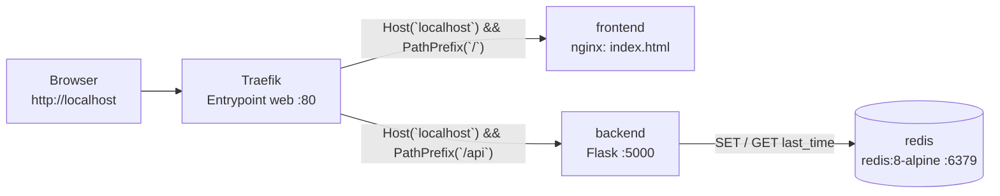

# Lab 9.2: Traefik in der Praxis

**Leitfragen:**

<details>
<summary>Frontend und API sollen unter derselben Adresse erreichbar sein: wonach lassen sich die Anfragen trennen?</summary>

Nach dem Pfad: Alles unter `/api` geht an das Backend, der Rest an das Frontend. In Traefik sind das zwei Router mit ``PathPrefix(`/api`)`` und ``PathPrefix(`/`)``.

</details>

<details>
<summary>Wo soll sich ein Backend etwas merken, wenn es mehrere Kopien davon gibt?</summary>

Nicht im Container selbst, sonst weiß jede Kopie etwas anderes, und beim Neustart ist es weg. Gemeinsame Daten gehören in einen eigenen Dienst, hier den Zwischenspeicher Redis.

</details>

- Ziel der Live-Coding-Session: eine Frontend- und eine Backend-Anwendung mit Docker Compose und Traefik bereitstellen, Redis als Zwischenspeicher für das Backend, Routen mit Traefik verwalten.
- Ergebnis: eine funktionierende Anwendung unter `http://localhost`; die API antwortet unter `http://localhost/api/v1/time` und `http://localhost/api/v1/last_time`.

## Begriffe

| Begriff | Bedeutung |
| --- | --- |
| Time-App | Übungsbeispiel dieses Labs: Webseite mit zwei Knöpfen, die die aktuelle und die zuletzt abgefragte Uhrzeit anzeigt |
| API | Schnittstelle, die ein Programm für andere Programme anbietet; hier Adressen unter `/api/v1/…`, die Text zurückgeben |
| Redis | Datenbank, die Werte im Arbeitsspeicher hält und unter einem Schlüssel ablegt (Key-Value-Speicher); sehr schnell, typisch als Zwischenspeicher |
| Cache (Zwischenspeicher) | Ablage für Daten, die schnell wieder gebraucht werden, hier die letzte abgefragte Uhrzeit |
| Flask | kleines Python-Webframework; bekannt aus der Hello-App (Lab 3.2) |
| CORS | Regel im Browser: Eine Webseite darf eine API unter einer anderen Adresse nur abfragen, wenn die API das erlaubt; `flask-cors` setzt diese Erlaubnis |
| `fetch` | JavaScript-Funktion im Browser, die eine Adresse abruft, ohne die Seite neu zu laden |

## Aufbau der Time-App



| Dienst | Image | Aufgabe | über Traefik erreichbar |
| --- | --- | --- | --- |
| `traefik` | `traefik:v3.8` | nimmt alle Anfragen auf Port 80 an, Dashboard auf 8080 | Port 80, 8080 |
| `frontend` | eigenes Image auf `nginx:1.30-alpine` | liefert die statische Seite `index.html` | ja, alles unter `/` |
| `backend` | eigenes Image auf `python:3.13-alpine` | API: aktuelle Zeit liefern und in Redis merken | ja, alles unter `/api` |
| `redis` | `redis:8-alpine` | speichert den Wert `last_time` | nein, nur im Compose-Netzwerk |

Beide Router passen auf `/api/v1/time`. Traefik vergibt die Priorität standardmäßig nach der Länge der Rule; die Backend-Regel ist länger und gewinnt (Lab 9.1).


_Quelle: Traefik Labs, „API & Dashboard" (https://doc.traefik.io/traefik/reference/install-configuration/api-dashboard/), abgerufen am 23.11.2026._

## Backend: Flask mit Redis

`backend/backend.py` liefert zwei Adressen. Jede Abfrage der aktuellen Zeit schreibt sie zusätzlich unter dem Schlüssel `last_time` in Redis:

```python
from flask import Flask
from datetime import datetime
from flask_cors import CORS
from redis import Redis

app = Flask(__name__)
CORS(app)                                   # Aufrufe von anderen Adressen erlauben
cache = Redis(host="redis", port=6379)      # "redis" = Dienstname in compose.yml

@app.route("/api/v1/time")
def get_current_time():
    current_time = datetime.now().strftime("%Y-%m-%d %H:%M:%S")
    cache.set("last_time", current_time)    # in Redis speichern
    return f"Current time: {current_time}"

@app.route("/api/v1/last_time")
def get_last_time():
    response = cache.get("last_time")       # aus Redis lesen: Bytes oder None
    if response is None:
        return ""
    else:
        return f"Last time: {response.decode('utf-8')}"
```

- Der Hostname `redis` funktioniert, weil Compose alle Dienste in ein gemeinsames Netzwerk mit Namensauflösung legt (Lab 5.3).
- Die Uhrzeit kommt aus dem Container und ist UTC (keine Zeitzone im Alpine-Image gesetzt).
- `requirements.txt` listet die drei Pakete `flask`, `flask-cors`, `redis` (mit Versionsbereich wie in der Hello-App).

## Dockerfile für ein Flask-Backend mit `flask run`

Die Hello-App startet mit `python backend.py`. Das Backend der Time-App nutzt stattdessen den Befehl `flask run`, der seine Einstellungen aus Umgebungsvariablen liest:

| Anweisung | Zweck |
| --- | --- |
| `FROM python:3.13-alpine` | Basisimage wie die Hello-App (alte Folie: `python:3.10-alpine`, ohne Support seit 10/2026) |
| `WORKDIR /code` | Arbeitsordner im Image |
| `ENV FLASK_APP=backend.py` | Datei mit der Flask-App für `flask run` |
| `ENV FLASK_RUN_HOST=0.0.0.0` | auf allen Adressen im Container lauschen; mit dem Standard `127.0.0.1` wäre das Backend für Traefik unerreichbar |
| `COPY requirements.txt …` + `RUN pip install …` | Abhängigkeiten zuerst (Build-Cache, Lab 3.2) |
| `EXPOSE 5000` | Port von `flask run`; Traefik nimmt ihn als Ziel |
| `CMD ["flask", "run", "--debug"]` | Entwicklungsserver mit Debug-Modus: zeigt Fehler ausführlich, nur für Entwicklung und Übung |

## Frontend: statische Seite mit nginx

`frontend/index.html` enthält zwei Knöpfe. Jeder ruft per `fetch` eine API-Adresse ab und schreibt die Antwort in die Seite:

```html
<script>
  function getCurrentTime() {
    fetch("/api/v1/time")                         // gleicher Host wie die Seite, Traefik leitet /api weiter
      .then(response => response.text())
      .then(data => { document.getElementById('currentTime').innerText = data; })
      .catch(error => console.error('Error:', error));
  }
  // getLastTime() genauso mit "/api/v1/last_time"
</script>
<button onclick="getCurrentTime()">Get current time</button>
<div id="currentTime"></div>
```

- Die alte Folie ruft `http://localhost/api/v1/time` mit vollständiger Adresse auf. Die relative Adresse `/api/v1/time` funktioniert auch unter einem anderen Host oder Port.
- Seite und API liegen hier unter derselben Adresse, CORS greift daher nicht. `flask-cors` wird gebraucht, sobald die Seite von einer anderen Adresse kommt, z. B. beim Entwickeln mit einem lokalen Webserver auf Port 5500.
- Das Frontend-Image braucht nur zwei Anweisungen: `FROM nginx:1.30-alpine` und `COPY index.html /usr/share/nginx/html/index.html` (wie die Rezeptseite aus Lab 3.3).

## Compose-Konfiguration mit Traefik

Die Labels folgen dem Muster aus Lab 9.1, statt Subdomains trennen Pfade:

```yaml
services:
  frontend:
    build: ./frontend
    labels:
      - traefik.enable=true
      - traefik.http.routers.frontend.rule=Host(`localhost`) && PathPrefix(`/`)
      - traefik.http.routers.frontend.entrypoints=web
  # backend: build ./backend, depends_on redis, Router "backend" mit PathPrefix(`/api`)
  redis:
    image: redis:8-alpine
  traefik:
    image: traefik:v3.8
    command:
      - --log.level=DEBUG              # ausführliche Logs, hilfreich beim Live-Coding
      # weitere Optionen wie in Lab 9.1
```

- `build:` statt `image:`: Compose baut beide Images aus den Ordnern; `docker compose up -d --build` baut nach jeder Änderung neu.
- `redis` hat kein Label und kein `ports:`; nur das Backend erreicht ihn.
- Änderungen gegenüber der Folie: `traefik:v3.8` statt `v3.0`, `redis:8-alpine` statt `redis:alpine` (fester Tag), kein `version:` und kein `container_name`.

## Typische Fehler

| Symptom | Ursache | Lösung |
| --- | --- | --- |
| `Bind for 0.0.0.0:80 failed: port is already allocated` | Traefik aus Lab 9.1 läuft noch | im Ordner `playground/hello`: `docker compose -f compose-traefik.yml down` |
| `/api/v1/time` zeigt die Startseite des Frontends | Backend-Router fehlt oder Label hat Tippfehler | Dashboard → HTTP Routers prüfen, Labels korrigieren, `docker compose up -d` |
| `502 Bad Gateway` unter `/api/…` | Flask lauscht nur auf `127.0.0.1` | `ENV FLASK_RUN_HOST=0.0.0.0` im Backend-Dockerfile, `docker compose up -d --build` |
| `500 Internal Server Error`, im Log `ConnectionError … redis:6379` | Dienst `redis` fehlt oder heißt anders | Dienstname `redis` in `compose.yml`, passend zu `Redis(host="redis")` |
| Backend startet nicht: `ModuleNotFoundError: No module named 'flask_cors'` | Paket fehlt in `requirements.txt` | `flask-cors` eintragen, neu bauen |
| Änderung an `index.html` nicht sichtbar | Image nicht neu gebaut | `docker compose up -d --build` |

## Fazit

- Ein Host, zwei Router: ``PathPrefix(`/api`)`` an das Backend, der Rest an das Frontend; die längere Regel gewinnt.
- Redis hält Daten außerhalb der Backend-Container; mehrere Kopien des Backends und Neustarts sehen denselben Wert.
- Nur Traefik veröffentlicht Ports; Frontend, Backend und Redis sprechen über das Compose-Netzwerk.

In der Übung entsteht die Time-App aus dem Starter und läuft unter `http://localhost`.
