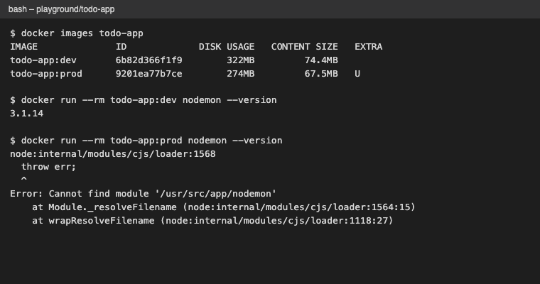
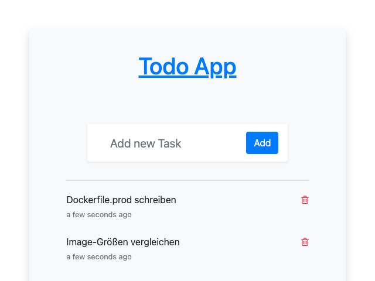

# Lab 9.3 – Lösung: Multistage Dockerfiles

Fertiger Stand: `project/examples/m09-frontend-backend-stack/l03-multistage/todo-app/app/` (`Dockerfile.prod`, `server.js`).

## Aufgabe 1: Todo-App holen

```bash
cd ~/kurs/kodschul-docker-open-3/project/playground      # Pfad an den eigenen Kursordner anpassen
git clone https://github.com/docker/multi-container-app.git todo-app
ls todo-app todo-app/app
```

```text
README.md  app  compose.yaml

Dockerfile  config  models  package-lock.json  package.json  routes  server.js  views
```

Beim ZIP-Weg heißt der entpackte Ordner `multi-container-app-main`; nach dem Umbenennen ist der Inhalt identisch.

## Aufgabe 2: Entwicklungs-Image bauen

```bash
cd todo-app
docker build --build-arg NODE_VERSION=24 -t todo-app:dev app
docker run --rm todo-app:dev nodemon --version
```

```text
3.1.14
```

`--build-arg NODE_VERSION=24` überschreibt das `ARG NODE_VERSION=19.5.0` im originalen Dockerfile. Beide Images nutzen so dasselbe Basisimage `node:24-alpine`, und der Vergleich zeigt nur den Unterschied durch den Multistage-Build.

## Aufgabe 3: Multistage-Dockerfile ergänzen

```bash
cp ../../starters/m09-l03-multistage/Dockerfile.prod ../../starters/m09-l03-multistage/server.js app/
```

Ergänzte Stufe in `app/Dockerfile.prod`:

```dockerfile
# Stufe 3 "production": frisches, schlankes Image
FROM node:24-alpine AS production                                       # TODO 1
ENV NODE_ENV=production                                                 # TODO 2
WORKDIR /usr/src/app
COPY --from=builder /usr/src/app/package*.json /usr/src/app/.npmrc ./  # TODO 3
RUN npm ci --omit=dev && npm cache clean --force                        # TODO 4
COPY --from=builder /usr/src/app/server.js ./                           # TODO 5
COPY --from=builder /usr/src/app/config ./config
COPY --from=builder /usr/src/app/models ./models
COPY --from=builder /usr/src/app/routes ./routes
COPY --from=builder /usr/src/app/views ./views
USER node                                                               # TODO 6
EXPOSE 3000
CMD ["npm", "start"]
```

- `.npmrc` enthält `ignore-scripts=true`: npm führt beim Installieren keine Skripte der Pakete aus. Die Einstellung gilt so auch in der Produktionsstufe.
- `CMD ["npm", "start"]` startet `node server.js` (Skript `start` in `package.json`) statt `nodemon`.

## Aufgabe 4: Bauen und vergleichen

```bash
docker build -f app/Dockerfile.prod -t todo-app:prod app
docker images todo-app
```

```text
IMAGE              ID             DISK USAGE   CONTENT SIZE   EXTRA
todo-app:dev       6b82d366f1f9        322MB         74.4MB
todo-app:prod      9201ea77b7ce        274MB         67.5MB
```

`DISK USAGE` ist die Größe entpackt auf der Festplatte, `CONTENT SIZE` die komprimierte Größe beim Übertragen (Push/Pull). Das Produktions-Image ist 48 MB kleiner (322 → 274 MB, rund 15 %).



_Quelle: eigener Screenshot, Todo-App mit Entwicklungs- und Multistage-Image, 23.11.2026._

```bash
docker run --rm todo-app:prod nodemon --version
```

```text
node:internal/modules/cjs/loader:1568
  throw err;
  ^

Error: Cannot find module '/usr/src/app/nodemon'
```

Das Node-Image startet unbekannte Befehle als Node-Skript (`node nodemon`); weil es weder den Befehl noch das Paket `nodemon` gibt, endet der Versuch mit `Cannot find module`.

Gemessen am 23.11.2026 (Docker 29.9.3, arm64); auf amd64 und mit anderen Paketversionen weichen die Zahlen leicht ab. Das Basisimage `node:24-alpine` macht mit rund 240 MB den größten Teil aus; der Unterschied entsteht aus dem global installierten nodemon (7,7 MB), der doppelten Schicht durch `chown -R` (30,5 MB) und den `devDependencies` (2,5 MB, siehe Erweiterung).

## Aufgabe 5: Produktions-Image mit Datenbank starten

```bash
docker network create todo-net
docker run -d --name todo-database --network todo-net mongo:8
docker run -d --name todo-app --network todo-net -p 3000:3000 todo-app:prod
docker logs todo-app
```

```text
> multi-container-apps@1.0.0 start
> node server.js

Live-Reload aus (Entwicklungspakete nicht installiert)
Server listening on port 3000
Mongodb Connected
```



_Quelle: eigener Screenshot, Todo-App aus dem Multistage-Image, 23.11.2026._

- Der Name `todo-database` muss stimmen: `app/config/keys.js` verbindet sich mit `mongodb://todo-database:27017/todoapp`. Im eigenen Netzwerk `todo-net` löst Docker den Containernamen auf (Lab 5.3).
- Das Repo selbst nutzt `mongo:6` (ohne Support seit 07/2025); `mongo:8` funktioniert mit der App ohne Änderung.

Aufräumen:

```bash
docker rm -f todo-app todo-database
docker network rm todo-net
```

## Erweiterung: Schichten vergleichen

```bash
docker history todo-app:dev
```

```text
IMAGE          CREATED          CREATED BY                                      SIZE      COMMENT
6b82d366f1f9   10 minutes ago   CMD ["/bin/sh" "-c" "npm run dev"]              0B        buildkit.dockerfile.v0
<missing>      10 minutes ago   EXPOSE 3000/tcp                                 0B        buildkit.dockerfile.v0
<missing>      10 minutes ago   USER node                                       0B        buildkit.dockerfile.v0
<missing>      10 minutes ago   RUN /bin/sh -c chown -R node /usr/src/app # …   30.5MB    buildkit.dockerfile.v0
<missing>      10 minutes ago   COPY . . # buildkit                             127kB     buildkit.dockerfile.v0
<missing>      10 minutes ago   RUN /bin/sh -c npm install -g nodemon # buil…   7.68MB    buildkit.dockerfile.v0
<missing>      10 minutes ago   COPY .npmrc . # buildkit                        20.5kB    buildkit.dockerfile.v0
<missing>      10 minutes ago   RUN /bin/sh -c npm ci --include=dev # buildk…   33.1MB    buildkit.dockerfile.v0
...
```

```bash
docker history todo-app:prod
```

```text
IMAGE          CREATED         CREATED BY                                      SIZE      COMMENT
9201ea77b7ce   8 minutes ago   CMD ["npm" "start"]                             0B        buildkit.dockerfile.v0
...
<missing>      8 minutes ago   COPY /usr/src/app/server.js ./ # buildkit       20.5kB    buildkit.dockerfile.v0
<missing>      8 minutes ago   RUN /bin/sh -c npm ci --omit=dev && npm cach…   30.6MB    buildkit.dockerfile.v0
<missing>      8 minutes ago   COPY /usr/src/app/package*.json /usr/src/app…   81.9kB    buildkit.dockerfile.v0
...
```

Im Entwicklungs-Image liegen die Pakete zweimal: 33,1 MB aus `npm ci --include=dev` und fast dieselbe Menge noch einmal in der `chown`-Schicht. Dazu kommt nodemon global mit 7,7 MB. Im Produktions-Image gibt es nur eine Paketschicht mit 30,6 MB; die Schichten der Stufen `base` und `builder` fehlen ganz. Bei dieser App sind die `devDependencies` klein (2,5 MB); bei Apps mit Compiler, Bundler oder Test-Frameworks ist der Unterschied oft ein Vielfaches.
