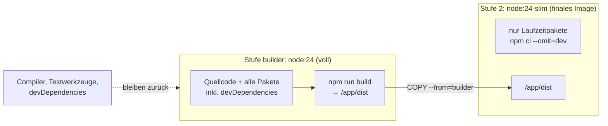
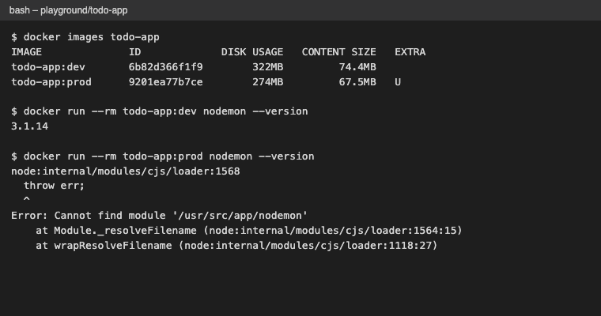

# Lab 9.3: Multistage Dockerfiles

**Leitfragen:**

<details>
<summary>Was braucht man zum Bauen eines Programms, was nur zum Ausführen?</summary>

Zum Bauen: Compiler, Paketmanager, Test- und Entwicklungswerkzeuge, alle Quelldateien. Zum Ausführen: nur die Laufzeit (z. B. Node.js), die Laufzeitpakete und das fertige Programm.

</details>

<details>
<summary>Warum sollte ein Produktivserver keine Entwicklungswerkzeuge enthalten?</summary>

Jedes zusätzliche Programm macht das Image größer, langsamer zu verteilen und bietet mehr Angriffsfläche (Lab 6.3: mehr Pakete, mehr Schwachstellen). Werkzeuge wie `nodemon` haben im Betrieb keine Aufgabe.

</details>

- Ein Multistage-Dockerfile enthält mehrere `FROM`-Zeilen. Jede beginnt eine eigene Build-Stufe; nur die letzte Stufe wird zum Image.
- Aus früheren Stufen kommt nur, was ausdrücklich mit `COPY --from=<stufe>` übernommen wird. Werkzeuge und Entwicklungsabhängigkeiten bleiben zurück.

## Begriffe

| Begriff | Bedeutung |
| --- | --- |
| Build-Stufe (Stage) | Abschnitt eines Dockerfiles ab einer `FROM`-Zeile; wie ein eigener Arbeitstisch, von dem nur das fertige Teil weitergereicht wird |
| `FROM … AS <name>` | gibt einer Stufe einen Namen, z. B. `builder` |
| `COPY --from=<stufe>` | kopiert Dateien aus einer früheren Stufe statt aus dem Build-Kontext |
| Artefakt | Ergebnis eines Build-Schritts, das ins Image soll, z. B. kompilierter Code oder der Ordner `dist` |
| `dependencies` / `devDependencies` | Abschnitte in `package.json`: Pakete für den Betrieb / Pakete nur für Entwicklung und Tests |
| `npm ci` | installiert genau die Versionen aus `package-lock.json`; `--omit=dev` lässt die `devDependencies` weg |
| nodemon | Entwicklungswerkzeug, das eine Node-App bei jeder Dateiänderung neu startet |
| Live-Reload | lädt die Seite im Browser nach einer Änderung automatisch neu; Pakete `livereload` und `connect-livereload` |

## Nutzen von Multistage-Builds

Multistage-Builds ermöglichen:

- mehrere Build-Stufen in einem einzigen Dockerfile zu definieren,
- nur die benötigten Artefakte in das finale Image zu übernehmen,
- Build-Werkzeuge und Entwicklungsabhängigkeiten aus dem Produktions-Image auszuschließen,
- die Image-Größe deutlich zu reduzieren.

Nur die Dateien, die ausdrücklich in die letzte Stufe kopiert werden, landen im endgültigen Image.



## Prinzip am Beispiel einer Node.js-Anwendung

Die erste Stufe nutzt das vollständige Node.js-Image für den Build. Die zweite Stufe beginnt mit einem schlanken Basisimage und übernimmt nur die gebauten Dateien; die Entwicklungsabhängigkeiten bleiben in der Build-Stufe.

```dockerfile
# Build-Stufe
FROM node:24 AS builder
WORKDIR /app
COPY package*.json ./
RUN npm install                       # alle Pakete, auch devDependencies (Compiler, Bundler)
COPY . .
RUN npm run build                     # erzeugt /app/dist

# Produktions-Stufe
FROM node:24-slim
WORKDIR /app
COPY --from=builder /app/dist ./dist  # nur das Ergebnis des Builds
COPY package*.json ./
RUN npm install --omit=dev            # nur Laufzeitpakete
USER node                             # nicht als root
CMD ["npm", "start"]
```

- Aktualisiert gegenüber der alten Folie: `node:24` statt `node:18` (Node 18 ohne Support seit 30.04.2025) und `--omit=dev` statt `--only=production` (veraltete npm-Option; npm warnt und empfiehlt `--omit=dev`).
- Node 24 ist LTS mit Wartung bis 30.04.2028; seit 28.10.2026 ist Node 26 die aktive LTS-Version (Quelle: https://github.com/nodejs/Release, abgerufen am 23.11.2026). Der Wechsel ist eine Änderung am Tag.
- `npm run build` gibt es nur bei Apps mit Build-Schritt (TypeScript, React …). Bei Apps ohne Build-Schritt übernimmt die letzte Stufe die Quelldateien selbst.

## Probleme im bisherigen Setup der Todo-App

Die Todo-App aus Lab 4.2 (`github.com/docker/multi-container-app`, Express + MongoDB) bringt ein Dockerfile für die Entwicklung mit Compose Watch mit:

```bash
git clone https://github.com/docker/multi-container-app    # alternativ als ZIP, siehe Übung
```

```dockerfile
ARG NODE_VERSION=19.5.0
FROM node:${NODE_VERSION}-alpine
ENV NODE_ENV production
WORKDIR /usr/src/app
RUN --mount=type=bind,source=package.json,target=package.json \
    --mount=type=bind,source=package-lock.json,target=package-lock.json \
    --mount=type=cache,target=/root/.npm \
    npm ci --include=dev                  # alle Pakete inklusive devDependencies
COPY .npmrc .
RUN npm install -g nodemon                # Entwicklungswerkzeug global installiert
COPY . .
RUN  chown -R node /usr/src/app
USER node
EXPOSE 3000
CMD npm run dev                           # startet nodemon
```

_Quelle: `app/Dockerfile` im Repository docker/multi-container-app (https://github.com/docker/multi-container-app), Stand 04.06.2026, abgerufen am 23.11.2026._

| Problem | im Dockerfile |
| --- | --- |
| Entwicklungsabhängigkeiten im Produktions-Image | `npm ci --include=dev` installiert `nodemon`, `livereload`, `connect-livereload` |
| unnötige Werkzeuge wie nodemon | zusätzlich `npm install -g nodemon` |
| größeres Image als nötig | alle Pakete plus `chown -R`, das den Inhalt in einer weiteren Schicht noch einmal ablegt |
| Entwicklung und Produktion vermischt | `NODE_ENV production`, aber Start mit `npm run dev`; `server.js` lädt Live-Reload-Pakete bei jedem Start |
| veraltetes Basisimage | `node:19.5.0-alpine`, Node 19 ohne Support seit 01.06.2023 |

`RUN --mount=…` bindet Dateien nur während eines Build-Schritts ein (bind) oder hält den npm-Cache zwischen Builds (cache); beides landet nicht im Image.

## Optimiertes Dockerfile für die Todo-App

Das Multistage-Dockerfile `app/Dockerfile.prod` steht neben dem Entwicklungs-Dockerfile. So bleibt Compose Watch für die Entwicklung erhalten, und das Produktions-Image entsteht getrennt:

```dockerfile
# Stufe 1 "base": gemeinsame Grundlage
FROM node:24-alpine AS base
WORKDIR /usr/src/app
COPY package*.json .npmrc ./

# Stufe 2 "builder": alle Pakete und der Code (Ort für Tests oder einen Build-Schritt)
FROM base AS builder
RUN npm ci
COPY . .

# Stufe 3 "production": finales, schlankes Image
FROM node:24-alpine AS production
ENV NODE_ENV=production
WORKDIR /usr/src/app
COPY --from=builder /usr/src/app/package*.json /usr/src/app/.npmrc ./
RUN npm ci --omit=dev && npm cache clean --force
COPY --from=builder /usr/src/app/server.js ./
COPY --from=builder /usr/src/app/config ./config
COPY --from=builder /usr/src/app/models ./models
COPY --from=builder /usr/src/app/routes ./routes
COPY --from=builder /usr/src/app/views ./views
USER node
EXPOSE 3000
CMD ["npm", "start"]
```

- `FROM base AS builder` baut auf einer eigenen Stufe auf; `base` muss dafür nicht noch einmal ausgeschrieben werden.
- Die Produktionsstufe kopiert gezielt Ordner statt `COPY . .`; Dateien wie `Dockerfile`, `.dockerignore` oder Testdaten kommen so nicht ins Image.
- Ohne `chown -R`: Der Benutzer `node` muss die Dateien nur lesen. Die alte Folie enthält `RUN chown -R node:node .`; das legt alle Dateien ein zweites Mal in einer Schicht ab.
- `npm cache clean --force` löscht den Download-Cache von npm in derselben Schicht.
- Gebaut wird mit `-f`, weil die Datei nicht `Dockerfile` heißt: `docker build -f app/Dockerfile.prod -t todo-app:prod app`.



_Quelle: eigener Screenshot, Todo-App mit Entwicklungs- und Multistage-Image, 23.11.2026._

### Anpassung in `server.js`

`server.js` lädt die Live-Reload-Pakete bei jedem Start. Im Produktions-Image fehlen sie, die App bricht mit `Error: Cannot find module 'livereload'` ab. Der Starter enthält eine angepasste `server.js`, die Live-Reload nur einschaltet, wenn die Pakete installiert sind:

```js
try {
    const livereload = require('livereload');                 // nur im Entwicklungs-Image vorhanden
    const connectLiveReload = require('connect-livereload');
    // ... Live-Reload-Server starten, app.use(connectLiveReload())
} catch (error) {
    console.log('Live-Reload aus (Entwicklungspakete nicht installiert)');
}
```

Das ist der Punkt „Entwicklung und Produktion vermischt" aus der Tabelle: Code, der im Betrieb läuft, darf keine Entwicklungspakete voraussetzen.

## Typische Fehler

| Symptom | Ursache | Lösung |
| --- | --- | --- |
| Container endet sofort, Log `Error: Cannot find module 'livereload'` | originale `server.js` im Produktions-Image | angepasste `server.js` aus dem Starter übernehmen, neu bauen |
| `failed to compute cache key: "/usr/src/app/server.js": not found` | Pfad in `COPY --from` falsch oder Stufenname vertippt | Pfade der Stufe `builder` prüfen (`WORKDIR /usr/src/app`) |
| `invalid from flag value builder` | Stufe heißt anders (`AS build`) oder steht weiter unten | Name in `AS` und `--from` angleichen; Stufe muss vorher definiert sein |
| `npm error … npm ci can only install packages when your package.json and package-lock.json are in sync` | `package-lock.json` nicht mitkopiert | `COPY package*.json` (beide Dateien) |
| Image kaum kleiner | letzte Stufe nutzt `COPY . .` aus `builder` samt `node_modules` | nur die Laufzeitdateien kopieren, Pakete in der letzten Stufe mit `--omit=dev` installieren |
| Seite lädt nicht, Log `MongooseServerSelectionError … todo-database` | Datenbank-Container fehlt oder heißt anders | MongoDB mit dem Namen `todo-database` im selben Netzwerk starten |

## Fazit

- Mehrere `FROM`-Zeilen, eine Stufe je Aufgabe; ins finale Image kommt nur, was `COPY --from` übernimmt.
- Für Node-Apps: alle Pakete zum Bauen und Testen, im finalen Image nur `npm ci --omit=dev`.
- Entwicklungs- und Produktions-Dockerfile dürfen nebeneinander stehen; der Code darf im Betrieb keine Entwicklungspakete brauchen.

In der Übung wird die Todo-App einmal mit dem Entwicklungs-Dockerfile und einmal mit dem Multistage-Dockerfile gebaut und die Größen verglichen.
