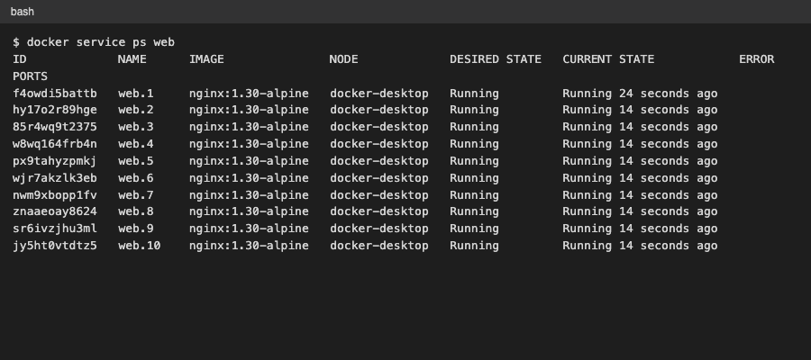

# Lab 10.1 – Lösung: Grundlagen und Einrichtung von Docker Swarm

## Aufgabe 1: Swarm initialisieren

```bash
docker swarm init
```

```text
Swarm initialized: current node (p0c87f626fle6daf5ujmvqeqy) is now a manager.

To add a worker to this swarm, run the following command:

    docker swarm join --token SWMTKN-1-4y30zofd…-awa1co0t… 192.168.65.3:2377

To add a manager to this swarm, run 'docker swarm join-token manager' and follow the instructions.
```

```bash
docker node ls
```

```text
ID                            HOSTNAME         STATUS    AVAILABILITY   MANAGER STATUS   ENGINE VERSION
p0c87f626fle6daf5ujmvqeqy *   docker-desktop   Ready     Active         Leader           29.9.3
```

Der Stern markiert den Node, auf dem der Befehl läuft. Ein einzelner Node ist Manager und Worker zugleich. Die Adresse im `join`-Befehl ist die interne Adresse der Docker-Desktop-VM.

## Aufgabe 2: Service erstellen

```bash
docker service create --name web -p 8001:80 nginx:1.30-alpine
```

```text
qgdjy3sx1uayte4oeizr8m52i
overall progress: 1 out of 1 tasks
1/1: running   [==================================================>]
verify: Waiting 1 seconds to verify that tasks are stable...
verify: Service qgdjy3sx1uayte4oeizr8m52i converged
```

Die erste Zeile ist die Service-ID. `converged` bedeutet: tatsächlicher und gewünschter Zustand stimmen überein.

```bash
docker service ls
docker service ps web
```

```text
ID             NAME      MODE         REPLICAS   IMAGE               PORTS
qgdjy3sx1uay   web       replicated   1/1        nginx:1.30-alpine   *:8001->80/tcp

ID             NAME      IMAGE               NODE             DESIRED STATE   CURRENT STATE            ERROR     PORTS
f4owdi5battb   web.1     nginx:1.30-alpine   docker-desktop   Running         Running 5 seconds ago 
```

`http://localhost:8001` zeigt „Welcome to nginx!". `*:8001` bedeutet: Port 8001 auf jedem Node des Swarms.

## Aufgabe 3: Auf zehn Tasks skalieren

```bash
docker service scale web=10
docker service ls
docker service ps web
docker ps --filter name=web.
```

```text
web scaled to 10
overall progress: 10 out of 10 tasks
1/10: running   [==================================================>]
...
10/10: running   [==================================================>]
verify: Service web converged

ID             NAME      MODE         REPLICAS   IMAGE               PORTS
qgdjy3sx1uay   web       replicated   10/10      nginx:1.30-alpine   *:8001->80/tcp
```



_Quelle: eigener Screenshot, Swarm-Service web mit zehn Tasks, 23.11.2026._

`docker ps` listet zehn Container mit Namen `web.<Nummer>.<Task-ID>`. Auf einem einzelnen Node landen alle Tasks dort; in einem Cluster würde der Manager sie auf die Nodes verteilen.

## Aufgabe 4: Selbstheilung

```bash
docker ps --filter name=web. --format '{{.ID}}  {{.Names}}' | head -3
```

```text
3296b4f75f40  web.9.sr6ivzjhu3mlnqchrogbykzmm
b5b5b57df06d  web.10.jy5ht0vtdtz5qc64350wfzjm7
35195a26d791  web.2.hy17o2r89hge6gn5lxfhxzqzg
```

```bash
docker rm -f 3296b4f75f40
docker service ps web --filter name=web.9
```

```text
ID             NAME        IMAGE               NODE             DESIRED STATE   CURRENT STATE           ERROR                         PORTS
u1usm2y7n4h4   web.9       nginx:1.30-alpine   docker-desktop   Running         Running 2 seconds ago
sr6ivzjhu3ml    \_ web.9   nginx:1.30-alpine   docker-desktop   Shutdown        Failed 7 seconds ago    "task: non-zero exit (137)"
```

Oben der Ersatz-Task, darunter der gelöschte mit `Failed`. `docker service ls` zeigt meist schon beim nächsten Aufruf wieder `10/10`; wer schnell genug ist, sieht kurz `9/10`.

`docker rm -f` beendet den Container hart (Exit-Code 137, Lab 6.2). Der Manager sieht neun statt zehn laufende Tasks und startet einen neuen Task mit derselben Nummer.

## Aufgabe 5: Service entfernen

```bash
docker service rm web
docker ps --filter name=web.
docker info --format '{{.Swarm.LocalNodeState}}'
```

```text
web
CONTAINER ID   IMAGE     COMMAND   CREATED   STATUS    PORTS     NAMES
active
```

Die Container verschwinden nicht sofort: nginx bekommt wie bei `docker stop` Zeit zum Beenden. Ein paar Sekunden nach `service rm` ist die Liste leer.

Ein Service lässt sich nicht stoppen, nur entfernen oder auf `0` skalieren (`docker service scale web=0`).

## Erweiterung: Worker hinzufügen

```bash
docker swarm join-token worker
```

```text
To add a worker to this swarm, run the following command:

    docker swarm join --token SWMTKN-1-4y30zofd…-awa1co0t… 192.168.65.3:2377
```

Die Adresse `192.168.65.3` ist nur innerhalb von Docker Desktop erreichbar; ein zweiter Rechner kann diesem Swarm daher nicht beitreten. Ein echter Mehr-Node-Swarm braucht Rechner, die sich im Netzwerk erreichen, z. B. mehrere Instanzen in Play with Docker:

```bash
# Instanz node1
docker swarm init --advertise-addr 192.168.0.13      # IP der Instanz, steht oben im Fenster
# Instanz node2 und node3: den ausgegebenen join-Befehl einfügen
docker swarm join --token SWMTKN-1-… 192.168.0.13:2377
# zurück auf node1
docker node ls                                        # drei Nodes: Leader und zwei Worker
```

Play with Docker (`labs.play-with-docker.com`) war am 23.11.2026 erreichbar; Anmeldung mit Docker-Konto, Sitzungen sind zeitlich begrenzt.
