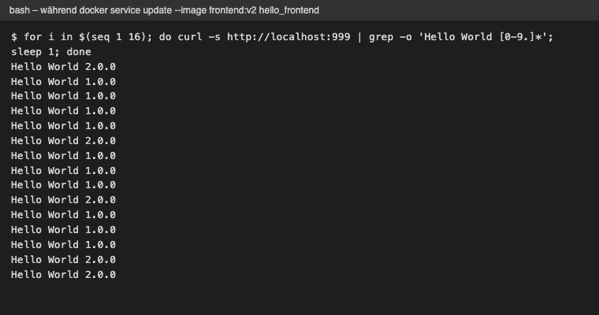

# Lab 10.3 – Lösung: Deployment in die Orchestrierungsplattform

Stack-Datei: `project/examples/m10-orchestration/l03-swarm-deployment/hello/stack.yml` (Inhalt in der Theorie).

## Aufgabe 1: Compose stoppen, Stack starten

```bash
cd ~/kurs/kodschul-docker-open-3/project/playground/hello   # Pfad an den eigenen Kursordner anpassen
docker compose down
docker stack deploy -c stack.yml hello
```

```text
Since --detach=false was not specified, tasks will be created in the background.
In a future release, --detach=false will become the default.
Creating network hello_default
Creating service hello_backend
Creating service hello_frontend
```

`docker compose down` ist nötig, weil das Compose-Netzwerk `hello_default` sonst den Namen belegt und das Frontend aus Lab 4.3 Port 8080 bzw. Traefik Port 80 hält. `stack deploy` wartet nicht, bis die Tasks laufen; direkt danach zeigt `docker stack services hello` noch `0/3` und `0/2`, nach einigen Sekunden die volle Zahl.

```bash
docker stack ls
docker stack services hello
```

```text
NAME      SERVICES
hello     2

ID             NAME             MODE         REPLICAS   IMAGE         PORTS
03arvz33lkqd   hello_backend    replicated   2/2        backend:v1
i36yayttc3vx   hello_frontend   replicated   3/3        frontend:v1   *:999->80/tcp
```

## Aufgabe 2: Healthcheck-Status

```bash
docker ps --format 'table {{.Names}}\t{{.Image}}\t{{.Status}}'
```

```text
NAMES                                          IMAGE         STATUS
hello_frontend.3.jog34nhyav9ww8d2mwcigoufh     frontend:v1   Up 19 seconds
hello_frontend.2.s2a91wb47xwjnen0qiwsjgkb5     frontend:v1   Up 19 seconds
hello_frontend.1.w3ro2e5jgvfzxp2s4ud0jaq6t     frontend:v1   Up 19 seconds
hello_backend.1.pips16vi3jnmbsu9rvoh86eg4      backend:v1    Up 20 seconds (healthy)
hello_backend.2.dddg35fhv98d1a390biq1tubu      backend:v1    Up 20 seconds (healthy)
```

Nur das Backend hat einen Healthcheck. Swarm wertet ihn aus: Ein Task gilt erst nach `(healthy)` als gestartet, ein `(unhealthy)` gewordener Task wird ersetzt. `http://localhost:999` zeigt „Hello World 1.0.0" mit Frontend- und Backend-Angaben. Die Zeile „Aufrufe in access.log" zählt je Frontend-Task getrennt, weil `stack.yml` kein Volume einbindet.

## Aufgabe 3: Skalieren und Lastverteilung

```bash
docker service scale hello_frontend=5
for i in 1 2 3 4 5 6; do curl -s http://localhost:999 | grep Frontend; done
```

```text
hello_frontend scaled to 5
overall progress: 5 out of 5 tasks
verify: Service hello_frontend converged

  <p><b>Frontend:</b> 2ef1017fe1e0 (10.0.1.9)</p>
  <p><b>Frontend:</b> a02ed13a7475 (10.0.1.8)</p>
  <p><b>Frontend:</b> b81614e1bd08 (10.0.1.10)</p>
  <p><b>Frontend:</b> 4851429977f4 (10.0.1.11)</p>
  <p><b>Frontend:</b> e8e5fdd2932d (10.0.1.7)</p>
  <p><b>Frontend:</b> 2ef1017fe1e0 (10.0.1.9)</p>
```

Die Container-ID und die IP im Stack-Netzwerk `hello_default` (`10.0.1.x`) wechseln reihum über alle fünf Tasks, auch im Browser beim Neuladen. Die Backend-Zeile wechselt ebenfalls zwischen den zwei Backend-Tasks (`10.0.1.3` und `10.0.1.4`): Der Dienstname `backend` zeigt auf die virtuelle IP des Services, Swarm verteilt dahinter.

## Aufgabe 4: Rolling Update auf v2

```bash
docker service update --image frontend:v2 hello_frontend
```

```text
hello_frontend
overall progress: 0 out of 5 tasks
...
overall progress: 5 out of 5 tasks
verify: Waiting 5 seconds to verify that tasks are stable...
verify: Service hello_frontend converged
```

Das Update dauert etwa eine Minute: Je Task wartet Swarm bis zu 10 s, bis der alte Container beendet ist, startet den neuen, prüft ihn 5 s und macht 5 s Pause (`delay`). In dieser Zeit liefern die Aufrufe gemischt beide Versionen:



_Quelle: eigener Screenshot, Hello-App als Swarm-Stack während des Rolling Updates, 23.11.2026._

 

_Quelle: eigene Screenshots, Hello-App v1 und v2 im Swarm, 23.11.2026._

```bash
docker service ps hello_frontend
```

```text
ID             NAME                   IMAGE         NODE             DESIRED STATE   CURRENT STATE                 ERROR     PORTS
a3ka4j88vuu5   hello_frontend.1       frontend:v2   docker-desktop   Running         Running 15 seconds ago
w3ro2e5jgvfz    \_ hello_frontend.1   frontend:v1   docker-desktop   Shutdown        Shutdown 15 seconds ago
rr7yeo2vx4oc   hello_frontend.2       frontend:v2   docker-desktop   Running         Running 27 seconds ago
s2a91wb47xwj    \_ hello_frontend.2   frontend:v1   docker-desktop   Shutdown        Shutdown 27 seconds ago
sbgaqv582e81   hello_frontend.3       frontend:v2   docker-desktop   Running         Running 51 seconds ago
jog34nhyav9w    \_ hello_frontend.3   frontend:v1   docker-desktop   Shutdown        Shutdown 51 seconds ago
zuk1zcnhye42   hello_frontend.4       frontend:v2   docker-desktop   Running         Running about a minute ago
2mdl96lh1k46    \_ hello_frontend.4   frontend:v1   docker-desktop   Shutdown        Shutdown about a minute ago
r0ddmxccvl4f   hello_frontend.5       frontend:v2   docker-desktop   Running         Running 39 seconds ago
kpp5cirrnoem    \_ hello_frontend.5   frontend:v1   docker-desktop   Shutdown        Shutdown 39 seconds ago
```

Fünf Tasks laufen mit `frontend:v2`; darunter je der ersetzte v1-Task im Zustand `Shutdown`. Die Seite zeigt „Hello World 2.0.0".

## Aufgabe 5: Rollback und Aufräumen

```bash
docker service rollback hello_frontend
```

```text
hello_frontend
rollback: manually requested rollback
overall progress: rolling back update: 0 out of 5 tasks
...
overall progress: rolling back update: 5 out of 5 tasks
verify: Service hello_frontend converged
```

Der Rollback dauert etwa 40 Sekunden; `rollback_config` hat keine Pause (`delay`) eingestellt.

`http://localhost:999` zeigt wieder „Hello World 1.0.0". Der Rollback stellt die komplette vorherige Service-Definition her, hier das Image `frontend:v1`; die Anzahl von fünf Tasks bleibt, weil das Skalieren schon vor dem Update lag.

```bash
docker stack rm hello
docker swarm leave --force
docker info --format '{{.Swarm.LocalNodeState}}'
```

```text
Removing service hello_backend
Removing service hello_frontend
Removing network hello_default
Node left the swarm.
inactive
```

Danach läuft die Hello-App bei Bedarf wieder per Compose: `docker compose up -d`.

## Erweiterung: Update-Regeln lesen und ändern

Vor `docker stack rm hello` ausführen.

```bash
docker service inspect --pretty hello_frontend
```

```text
ID:             i36yayttc3vxogj0in3luvyu2
Name:           hello_frontend
Labels:
 com.docker.stack.image=frontend:v1
 com.docker.stack.namespace=hello
Service Mode:   Replicated
 Replicas:      5
UpdateStatus:
 State:         rollback_completed
 ...
UpdateConfig:
 Parallelism:   1
 Delay:         5s
 On failure:    pause
 Monitoring Period: 5s
 Max failure ratio: 0
 Update order:      stop-first
RollbackConfig:
 Parallelism:   1
 On failure:    pause
 Monitoring Period: 5s
 Max failure ratio: 0
 Rollback order:    stop-first
ContainerSpec:
 Image:         frontend:v1
...
Ports:
 PublishedPort = 999
  Protocol = tcp
  TargetPort = 80
  PublishMode = ingress
```

`Parallelism` und `Delay` stammen aus `stack.yml`; die übrigen Werte sind Standards. `stop-first` bedeutet: alter Task stoppt, bevor der neue startet; bei fünf Tasks fällt so immer nur einer aus.

```bash
docker service update --update-parallelism 2 --update-delay 2s --image frontend:v2 hello_frontend
```

Das Update ersetzt jetzt zwei Tasks gleichzeitig und ist nach etwa 30 Sekunden fertig statt nach etwa einer Minute. `docker service inspect --pretty hello_frontend` zeigt danach `Parallelism: 2` und `Delay: 2s`.
