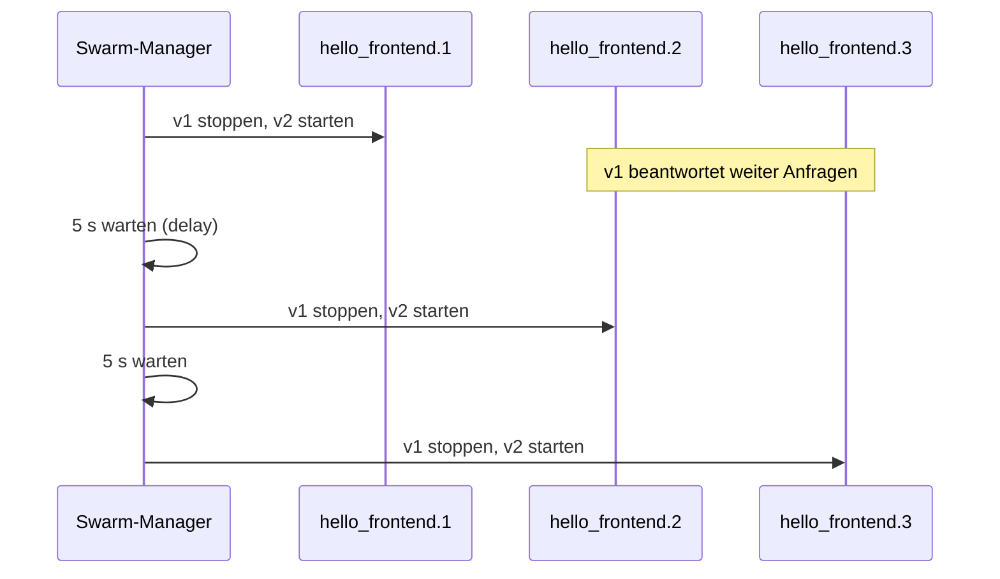

# Lab 10.3: Deployment in die Orchestrierungsplattform

**Leitfragen:**

<details>
<summary>Wie tauscht man die Reifen eines fahrenden Busses?</summary>

Einen nach dem anderen, während die übrigen weiter tragen. Ein Rolling Update ersetzt Container schrittweise; die übrigen beantworten in der Zeit die Anfragen.

</details>

<details>
<summary>Eine neue Version ist kaputt: was ist schneller, reparieren oder zurück?</summary>

Zurück: Die alte Version ist bekannt und als Image vorhanden. Ein Rollback (`docker service rollback`) stellt sie in Sekunden wieder her; repariert wird danach in Ruhe.

</details>

- Deployment in der Container-Orchestrierung heißt: Container in einer orchestrierten Umgebung bereitstellen und verwalten, mit automatischer Skalierung, Selbstheilung sowie Updates und Rollbacks ohne Ausfallzeit.
- Ein Stack ist eine Compose-Datei, die Swarm als Gruppe von Services startet. Die Hello-App läuft so mit drei Frontend- und zwei Backend-Tasks.

## Begriffe

| Begriff | Bedeutung |
| --- | --- |
| Stack | Gruppe von Services aus einer Compose-Datei, gestartet mit `docker stack deploy`; Namen der Services: `<stack>_<dienst>`, z. B. `hello_frontend` |
| Replicated Mode | Service mit fester Anzahl Tasks, verteilt auf die Nodes (Standard) |
| Global Mode | genau ein Task auf jedem Node, z. B. für Monitoring-Agenten wie Node Exporter (Lab 7.2) |
| Routing Mesh | Swarm veröffentlicht einen Port auf jedem Node und leitet Anfragen an einen beliebigen Task weiter, auch auf einem anderen Node |
| Rolling Update | Tasks werden nacheinander durch Tasks mit neuer Version ersetzt |
| Rollback | Rückkehr zur vorherigen Konfiguration eines Services (Image, Optionen) |
| `deploy:` | Abschnitt in der Compose-Datei mit Swarm-Einstellungen: Replikas, Update- und Rollback-Regeln |

## Deployment-Konzepte in Docker Swarm

| Konzept | Bedeutung |
| --- | --- |
| Service | definiert, wie Container ausgeführt werden: Image, Replikas, Ports, Netzwerke |
| Task | einzelne Instanz eines Services, genau ein Container |
| Replicated Mode | mehrere Instanzen eines Containers, über mehrere Nodes verteilt |
| Global Mode | jeder Node erhält eine Instanz des Containers |

Ein Service ist eine Abstraktion, die eine oder mehrere Instanzen eines Containers im Swarm-Cluster ausführt (Bild in Lab 10.1).


_Quelle: Docker Inc., „How services work" (https://docs.docker.com/engine/swarm/how-swarm-mode-works/services/), abgerufen am 23.11.2026._

## Services erstellen und verwalten

| Befehl | Wirkung |
| --- | --- |
| `docker service create --name web -p 80:80 nginx:1.30-alpine` | Service erstellen |
| `docker service ls` | laufende Services anzeigen |
| `docker service ps web` | Tasks eines Services mit Node und Zustand |
| `docker service inspect --pretty web` | Details eines Services: Image, Replikas, Update-Regeln, Ports |
| `docker service update --image nginx:1.31-alpine web` | Service aktualisieren (Rolling Update) |
| `docker service scale web=5` | Service manuell skalieren |
| `docker service ps web` | Skalierung prüfen; Swarm verteilt die Instanzen auf verfügbare Nodes |
| `docker service rollback web` | auf die vorherige Version zurück (alte Schreibweise: `docker service update --rollback web`) |

Skalieren verteilt die Instanzen automatisch auf die verfügbaren Nodes und sorgt so für hohe Verfügbarkeit und Lastverteilung. Die alten Folien nutzen `nginx:latest` und `nginx:1.21`; feste, aktuelle Tags machen die Versionen nachvollziehbar.

## Lastverteilung im Swarm

| Art | Funktion |
| --- | --- |
| interner Load Balancer | Swarm verwendet standardmäßig einen internen Load Balancer: Jeder Service hat eine virtuelle IP, Anfragen an den Dienstnamen (z. B. `backend`) verteilt Swarm auf die Tasks |
| Routing Mesh (Ingress) | alle Nodes im Swarm nehmen Anfragen auf dem veröffentlichten Port an und leiten sie zu einem Task weiter |
| externer Load Balancer (z. B. HAProxy, Traefik) | zusätzlich vor dem Swarm, um den Verkehr gezielt auf die Nodes zu verteilen, TLS oder Hostnamen zu behandeln (Lab 9.1) |


_Quelle: Docker Inc., „Use Swarm mode routing mesh" (https://docs.docker.com/engine/swarm/ingress/), abgerufen am 23.11.2026._

Überprüfung durch mehrere Anfragen: Jede Antwort kann von einem anderen Task kommen. Die Hello-App zeigt die IP des Frontends und macht das sichtbar:

```bash
for i in 1 2 3 4 5 6; do curl -s http://localhost:999 | grep Frontend; done
```

## Stack-Datei der Hello-App

`project/examples/m10-orchestration/l03-swarm-deployment/hello/stack.yml`:

```yaml
services:
  frontend:
    image: frontend:v1
    ports:
      - 999:80                              # Routing Mesh: Port 999 auf jedem Node
    deploy:
      replicas: 3
      update_config:
        parallelism: 1                      # Rolling Update: ein Task nach dem anderen
        delay: 5s                           # 5 s Pause zwischen zwei Tasks
      rollback_config:
        parallelism: 1

  backend:
    image: backend:v1
    deploy:
      replicas: 2
    healthcheck:                            # wie in Lab 4.2
      test: ["CMD", "curl", "-f", "http://localhost:80"]
      interval: 10s
      timeout: 2s
      retries: 2
      start_period: 3s
```

| Unterschied zu `docker compose` | Bedeutung |
| --- | --- |
| kein `build:` | Swarm baut keine Images; `frontend:v1`, `frontend:v2` und `backend:v1` müssen vorhanden sein (Lab 3.2) oder aus einer Registry kommen (Modul 8) |
| `deploy:` wirkt | Replikas, `update_config`, `rollback_config`; `docker compose` nutzt davon nur einen Teil |
| kein `depends_on` | Swarm startet Services ohne Reihenfolge; das Frontend zeigt „Backend nicht erreichbar", bis ein Backend-Task gesund ist |
| Healthcheck steuert Updates | ein Task gilt erst als laufend, wenn er `healthy` ist; ungesunde Tasks ersetzt Swarm |
| Netzwerk | `docker stack deploy` legt das Overlay-Netzwerk `hello_default` an (Lab 5.1) |

```bash
docker stack deploy -c stack.yml hello      # Stack "hello" starten oder aktualisieren
docker stack ls                             # Stacks mit Zahl der Services
docker stack services hello                 # Services des Stacks mit Replikas
docker stack ps hello                       # alle Tasks des Stacks
docker stack rm hello                       # Stack mit allen Services entfernen
```

## Rolling Updates und Rollbacks

Swarm aktualisiert Container schrittweise, um Ausfallzeiten zu vermeiden. Standardmäßig wird ein Container nach dem anderen ersetzt.



```bash
docker service update --image frontend:v2 hello_frontend   # Rolling Update v1 → v2
docker service rollback hello_frontend                     # zurück zu v1
```

- Während des Updates antworten v1- und v2-Tasks gemischt; die Seite zeigt abwechselnd „Hello World 1.0.0" und „2.0.0".
- `update_config` bestimmt Tempo und Verhalten: `parallelism` (Tasks gleichzeitig), `delay` (Pause), `failure_action` (Standard `pause`: Update anhalten, wenn neue Tasks scheitern).
- `rollback` stellt die vorherige Service-Definition wieder her, nach den Regeln aus `rollback_config`.
- Ein späteres `docker stack deploy` mit unveränderter `stack.yml` setzt das Image wieder auf den Stand der Datei; dauerhafte Änderungen gehören deshalb in `stack.yml`.

## Swarm mit mehreren Nodes

Auf einem einzelnen Rechner liegen alle Tasks auf einem Node. Die Verteilung auf mehrere Nodes zeigt ein Cluster aus einem Manager und mindestens einem Worker (Befehle aus Lab 10.1):

1. Auf dem Manager `docker swarm init --advertise-addr <Manager-IP>`.
2. Auf jedem Worker den ausgegebenen `docker swarm join --token <token> <Manager-IP>:2377`.
3. Auf dem Manager `docker service create --name web --replicas 3 -p 8001:80 nginx:1.29-alpine`, danach `docker service ps web`: Die Tasks verteilen sich auf die Nodes.
4. `docker service scale web=5` und erneut `docker service ps web`: Die neuen Tasks landen auf den Nodes mit den wenigsten Tasks.
5. `docker service scale web=2`: Einige Replikas verschwinden, `curl http://<Node-IP>:8001` antwortet auf jedem Node weiter (Routing Mesh).
6. `docker service update --image nginx:1.30-alpine web` (ältere Version 1.29 → 1.30), mit `docker service ps web` prüfen; ein fehlerhaftes Update simulieren (`--image nginx:0.0-alpine`, ein Tag, den es nicht gibt): Neue Tasks scheitern, Swarm hält das Update an; `docker service rollback web` stellt den letzten Stand wieder her.

Ohne zweiten Rechner eignet sich [Play with Docker](https://labs.play-with-docker.com/) (kostenloses Docker-Konto, mehrere Instanzen je Sitzung, Sitzung zeitlich begrenzt; erreichbar geprüft am 23.11.2026).

## Typische Fehler

| Symptom | Ursache | Lösung |
| --- | --- | --- |
| `this node is not a swarm manager` | Swarm aus Lab 10.1 nicht aktiv | `docker swarm init` |
| `Bind for 0.0.0.0:999 failed` oder Task `Pending` mit Portfehler | Compose-Stand der Hello-App läuft noch oder Port belegt | `docker compose down` bzw. `docker compose -f compose-traefik.yml down` im Ordner `playground/hello` |
| `Ignoring unsupported options: build` | `build:` in der Stack-Datei | Hinweis ohne Folgen; Images vorher bauen (`bash build-images.sh`) |
| `image frontend:v2 could not be accessed on a registry to record its digest` | lokales Image ohne Registry | Hinweis ohne Folgen auf einem Node; im Cluster Images aus einer Registry nutzen (Modul 8) |
| Task `Rejected`, `No such image: frontend:v1` | Image fehlt auf dem Node | `bash build-images.sh` im Ordner `project/` |
| Frontend zeigt „Backend nicht erreichbar" | Backend-Tasks noch nicht `healthy` | 10–20 s warten, `docker ps` zeigt `(healthy)` |
| IP wechselt im Browser nicht | Browser hält die Verbindung offen | mehrmals mit `Strg+F5` neu laden oder `curl` in einer Schleife |

## Fazit

- `docker stack deploy -c stack.yml hello` startet eine Compose-Datei als Gruppe von Swarm-Services; `deploy:` legt Replikas und Update-Regeln fest.
- Das Routing Mesh veröffentlicht Port 999 auf jedem Node und verteilt Anfragen auf alle Frontend-Tasks; intern verteilt Swarm über den Dienstnamen.
- Rolling Update ersetzt Tasks einzeln ohne Ausfall; `docker service rollback` führt in Sekunden zurück.

In der Übung läuft die Hello-App als Stack, skaliert auf fünf Frontend-Tasks, bekommt ein Rolling Update auf v2 und ein Rollback auf v1.
